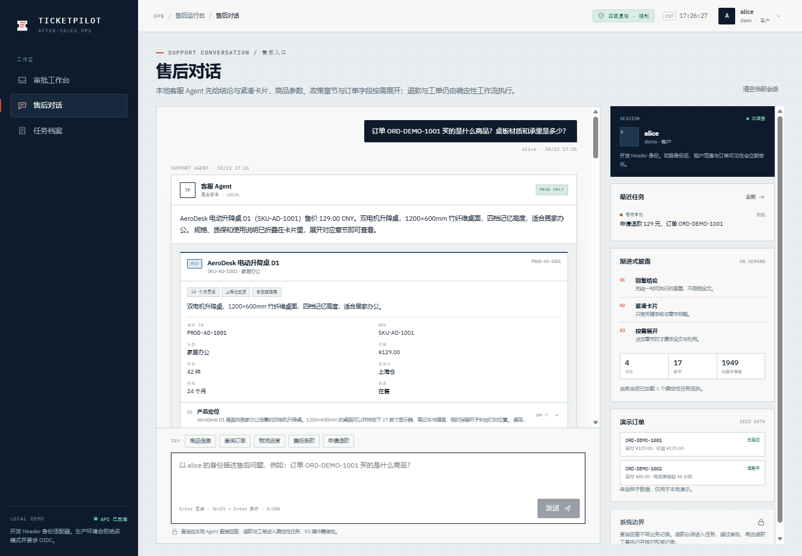

# TicketPilot

**售后退款场景的 AI Agent：模型只负责读懂，授权与资金由服务端确定性代码决定。**

[](https://www.python.org/)
[](https://fastapi.tiangolo.com/)
[](https://react.dev/)
[](https://www.postgresql.org/)
[](LICENSE)

TicketPilot 是一个可运行的售后客服 Agent。只读问题（商品、政策、订单、物流、自助统计）由本地 Agent 回答；写操作（退款、工单）交给确定性工作流，依次经过资格校验、按金额分层的人工审批、幂等执行与对账。语言模型只做意图识别和槽位抽取，不产出任何动作。默认 `AGENT_MODE=rules`，不需要任何云 API 就能在本机跑通。



## 功能

- **只读问答**：商品咨询、政策问答、订单与物流查询、受控 Text-to-SQL 自助统计，不产生副作用。
- **确定性写路径**：退款与工单经过资格 → 审批 → 台账 → 对账，模型只能提交意图，不能授权。
- **四眼审批**：按订单金额分层，`action_digest` 绑定审批内容，订单级唯一索引挡住重复申请。
- **受控问数**：自然语言 → 结构化计划 → AST → SELECT 子集校验 → 只读连接执行，全程不调用模型。
- **转人工**：无依据、缺槽位或超权限时主动移交，并带上客户已经看到的候选。
- **多渠道**：Web、邮件、微信、企业微信统一进站，验签、身份映射与消息幂等集中在网关。
- **可评测**：Golden Set、只读支持集、分层检索集与意图语料，全部通过产品接口驱动。

## 快速开始

需要 Python 3.12+。

```bash
python -m venv .venv
source .venv/Scripts/activate        # Windows；macOS/Linux 用 source .venv/bin/activate
pip install -e ".[dev]"

python scripts/seed.py               # 建表 + 演示数据
uvicorn app.asgi:app --port 8000
```

- API 文档：<http://127.0.0.1:8000/docs>
- 健康检查：`/health/live`、`/health/ready`
- 控制台：<http://127.0.0.1:8000/console/>（先 `cd web && npm ci && npm run build`）

再开一个终端跑退款全链路：

```bash
python scripts/refund_flow.py
```

完整安装、环境变量、Docker Compose 与常见问题见 [快速开始](docs/guide/快速开始.md)。

## 架构

```text
ChannelGateway（验签 / 身份映射 / 消息幂等）
        │
        ▼
POST /api/v1/support/messages
        ├─ 只读 ──► SupportAgent ──► ContextCard / 受控问数
        ├─ 转人工 ─► HandoffBundle ─► 坐席队列
        └─ 写操作 ─► TaskRuntime ──► 资格 → 审批 → 执行 → 对账
```

`app/agent` 与 `app/services` 不按渠道分支，新增渠道只加适配器。分层与控制流见 [架构说明](docs/guide/架构说明.md)。

## 配置

从 `.env.example` 复制一份 `.env`：

```bash
cp .env.example .env
```

| 变量 | 默认 | 说明 |
|---|---|---|
| `AGENT_MODE` | `rules` | `rules` 纯规则；`pydantic_ai` 启用受限模型 |
| `DATABASE_URL` | `sqlite+pysqlite:///./ticketpilot.db` | 生产使用 PostgreSQL |
| `ENVIRONMENT` | `dev` | `prod` 触发 fail-closed 校验 |

更多变量见 [快速开始](docs/guide/快速开始.md#关键环境变量)，完整清单在 `app/core/config.py`。

## 文档

| 文档 | 内容 |
|---|---|
| [快速开始](docs/guide/快速开始.md) | 安装、环境变量、Docker |
| [架构说明](docs/guide/架构说明.md) | 分层、控制流、状态机 |
| [接口说明](docs/guide/接口说明.md) | API 契约与错误码 |
| [范围与边界](docs/guide/范围与边界.md) | 明确不做的事 |
| [安全说明](docs/guide/安全说明.md) | 信任边界与 fail-closed |

## 项目结构

```text
app/
  agent/         意图目录、规则路由、受限模型、上下文卡片
  api/           FastAPI 路由与依赖注入
  channels/      渠道适配器、验签、入站幂等、出站传输
  core/          配置、策略引擎、身份、错误信封、护栏
  db/            会话与引擎装配
  models/        SQLAlchemy 模型
  observability/ 链路追踪与脱敏
  repositories/  数据访问
  resources/     随包分发的演示政策与商品目录
  retrieval/     BM25 / 稠密 / RRF / 重排 / 查询改写
  schemas/       请求与响应模型
  services/      任务运行时、退款、审批、对账、转人工、记忆、主动服务
  sql/           受控 Text-to-SQL
  tools/         工具注册、Gateway、执行器
alembic/         数据库迁移
evals/           Golden Set、支持集、检索与意图评测
scripts/         种子数据、演示与评测脚本
web/             React 控制台
docs/            指南、契约、ADR
```

## 开发

```bash
make install     # 安装依赖
make run         # 启动服务
make lint        # ruff
make mypy        # 类型检查
make eval        # Golden Set
```

没有 `make` 时直接运行对应命令，见 [CONTRIBUTING.md](CONTRIBUTING.md)。

## 贡献

见 [CONTRIBUTING.md](CONTRIBUTING.md)。

## 安全

部署前读 [安全说明](docs/guide/安全说明.md)。项目默认拒绝以 `prod` 模式启动：Header 身份、mock 退款与公开文档在 `prod` 下都不被接受；未实现的 OIDC 与 HTTP 适配器会让应用直接起不来。

## 许可

[MIT](LICENSE) © 2026 TicketPilot contributors
