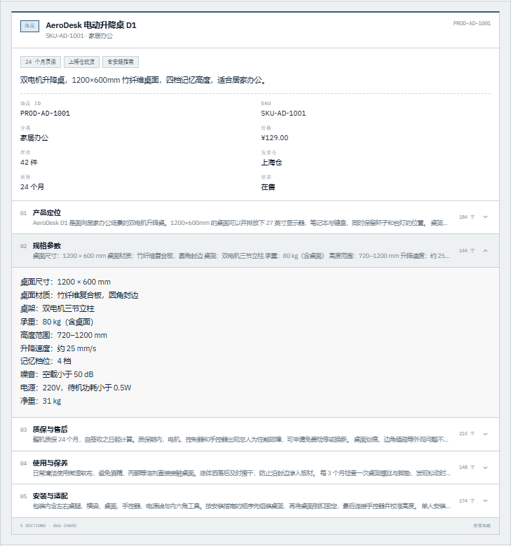
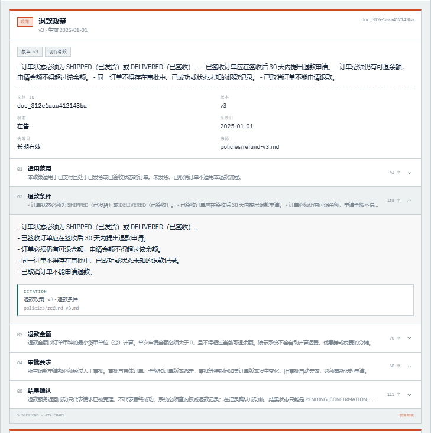
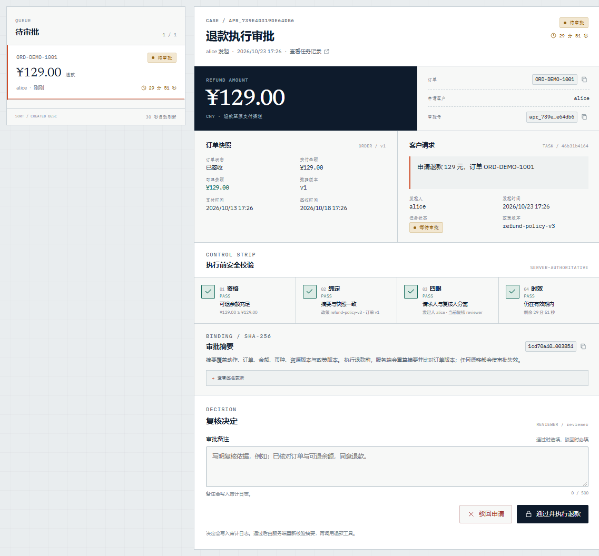
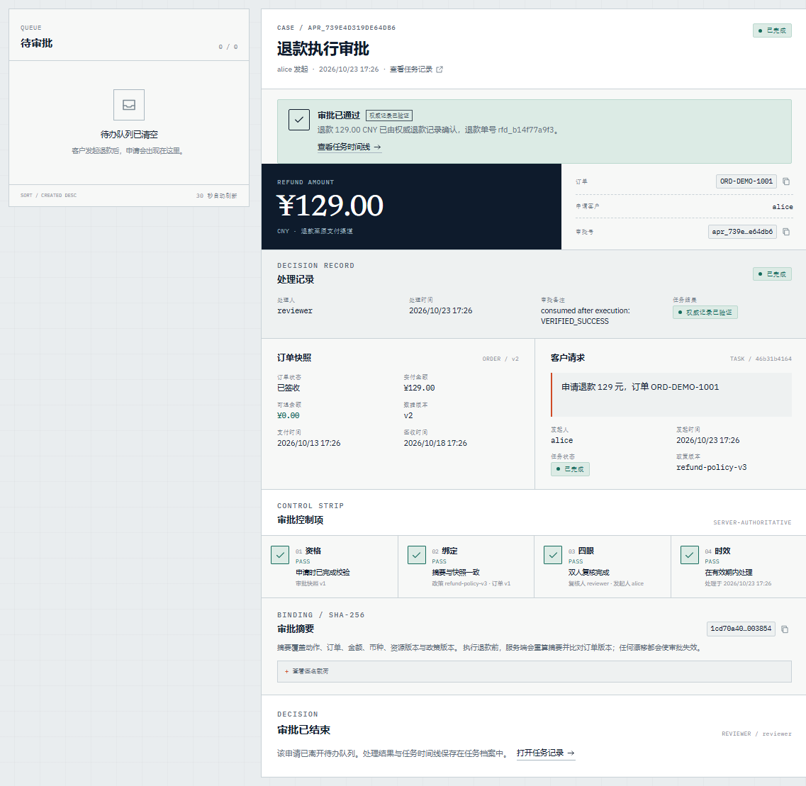
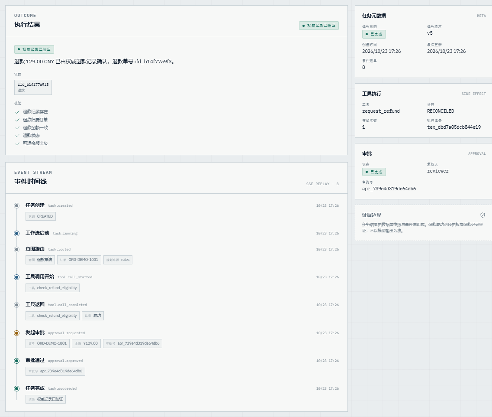
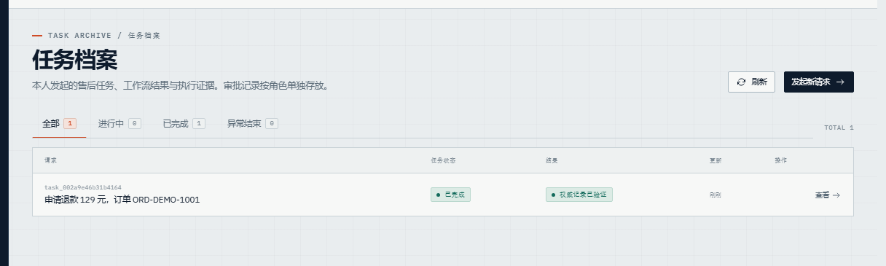
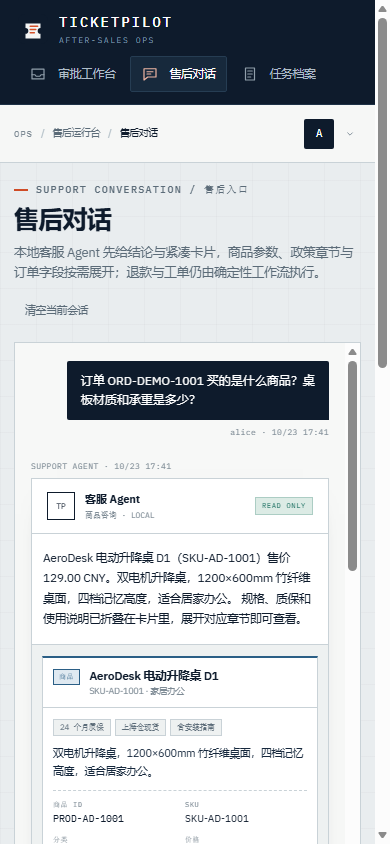

# TicketPilot

**售后服务 Agent 演示项目：确定性工作流骨架 + 有界语言模型节点。**

[](https://www.python.org/)
[](https://fastapi.tiangolo.com/)
[](https://react.dev/)
[](https://www.postgresql.org/)
[](#测试与评测)
[](#测试与评测)
[](LICENSE)

覆盖商品咨询、政策问答、订单/物流查询、工单创建、退款申请与人工审批，另加"自助统计"这一类受控 Text-to-SQL 问答。核心主张只有一句：

> **LLM 只做语言理解与槽位抽取；资格判断、权限、金额校验、审批、幂等、对账和最终成功认定全部由服务端确定性代码完成。**


---

## 10 分钟跑一遍（不需要任何云 API）

前置只有一步，装依赖：

```bash
python -m venv .venv && source .venv/Scripts/activate   # Windows PowerShell: .venv\Scripts\Activate.ps1
pip install -e ".[dev]"
```

然后是下面这几条命令，每条的**实际输出**都贴在下面（2026-10-25 在一台 Windows 机器上重跑截取；环境 `ENVIRONMENT=dev` + SQLite，检索是默认的 BM25 通道，`AGENT_MODE=rules`）：

```bash
python scripts/seed.py                    # ① 建表 + 演示数据
uvicorn app.asgi:app --port 8000          # ② 起服务（另开一个终端）
python scripts/demo.py                    # ③ 只读问答 + 渐进式披露 + 引用
python scripts/refund_flow.py             # ④ 退款写路径：资格 → 待审批 → 批准 → 回执
python scripts/llm_gap_probe.py --no-model --chat   # ⑤ 规则读不懂的句子，客户在对话里得到什么（1 秒，不碰模型）
```

① 的输出就是一行计数：

```text
seed complete: {'orders': 4, 'policies_created': 5, 'rules': 3}
```

② 起来之后 `curl http://127.0.0.1:8000/health/ready` 给 `{"status":"ready","checks":{"database":"ok"}}`，控制台在 <http://127.0.0.1:8000/console/>（需要先 `cd web && npm ci && npm run build`）。

③ 三条问句，商品 / 政策 / 物流，每条带意图、卡片和章节预览；政策那条**是从语料检索出来的，带可审计引用**：

```text
> 退款条件是什么？已签收多久内可以申请？
  意图: POLICY_QA  模式: local
  客服: 根据《退款政策》v3「退款条件」：- 订单状态必须为 SHIPPED（已发货）或 DELIVERED（已签收）。 - 已签收订单应在签收后 30 天内提出退款申请。…
  [policy] 退款政策 · doc_47738dcde21647e5
    章节: 5 个 / 全文 427 字（响应只带预览）
      - section-2  退款条件  (135 字)
      …

渐进式披露：卡片只返回章节预览，正文按需请求
  按需加载 doc_47738dcde21647e5/section-2：退款条件
    - 订单状态必须为 SHIPPED（已发货）或 DELIVERED（已签收）。
    引用: doc_47738dcde21647e5 v3 § 退款条件
```

④ 是最能说明设计主张的一段：客户说退款，服务端先做资格校验，然后**停在人工审批**，坐席批准之后才执行，回执引用权威退款记录，最后同一句话再问一次会被资格规则拦住——拦住它的是数据库里的可退余额，不是模型记不记得：

```text
> 客户（demo/alice）：我要申请退款，订单 ORD-DEMO-1001，金额 129 元
1. 提交退款请求    109.0 ms  HTTP 200
    intent=REFUND_REQUEST  task=WAITING_APPROVAL
2. 坐席看待审批队列     24.8 ms  HTTP 200
    1 条：apr_fff2fe49115349fc 12900 分
3. 坐席批准     32.0 ms  HTTP 200
    task=SUCCEEDED  outcome=VERIFIED_SUCCESS
    回执：退款 129.00 CNY 已由权威退款记录确认，退款单号 rfd_8e0e93b3e2。
4. 任务事件时间线      4.4 ms  HTTP 200
    task.created -> task.running -> task.routed -> tool.call_started -> tool.call_completed
      -> approval.requested -> approval.approved -> task.succeeded
5. 客户重复申请     32.7 ms  HTTP 200
    task=SUCCEEDED  outcome=FAILED
    客服：…该订单当前不符合退款条件（NO_REFUNDABLE_BALANCE、ALREADY_REFUNDED、AMOUNT_EXCEEDS_REFUNDABLE），未创建退款申请。
```

⑤ 是面试里最能引出讨论的一条。它把 11 句**规则词表外**的说法分别喂给规则、模型和对话入口。第一半不需要模型端点，本机实测 1.4 秒（含解释器启动），`AGENT_MODE=rules` 下输出只有一行是重点：

```text
这些对话轮产生的写动作（任务/审批）：0 / 11 轮
```

人一眼能读出来的诉求（「ORD-DEMO-1001 那笔钱给我退回来」「我申请退一部分款」「别跟我绕了，叫个活人来」），在规则模式下换到的是订单查询结果或一句通用菜单，**没有一句走到写路径**。第二半打开模型门（需要本机 LM Studio，约两分钟）：

```bash
python scripts/llm_gap_probe.py --chat --chat-model --chat-task "ORD-DEMO-1001 那笔钱给我退回来"
```

它先量模型单独能捞回多少（6/10 句、11 次调用、本机实测 83.0 秒），再把同一批句子送进对话入口做前后对照：**5 句意图改变、6 句退款全部进入追问**；最后一句把缺口补齐，台账落在 `WAITING_APPROVAL`、`planning_source=pydantic_ai`、审批金额 12900。完整读数、三个刻意不采纳的东西、以及"为什么一次对话要问两次模型"，都在「[规则读不懂的 11 句：模型捞回 6 句，对话入口只买一张待审退款单](#规则读不懂的-11-句模型捞回-6-句对话入口只买一张待审退款单)」和 [ADR-020](docs/adr/ADR-020-chat-model-gap.md)。

想在本机把**稠密通道**和**模型槽位抽取**也打开（只需要 LM Studio，仍然没有云调用），代价是多少，见「[端到端数字：延迟、token 与稠密通道的代价](#端到端数字延迟token-与稠密通道的代价)」——那一段就是这套配置的命令与实测结果。

---

## 为什么不是「让 Agent 直接退款」

售后场景里最贵的错误不是答错一句话，而是**在不确定的情况下把钱退出去**。所以本项目把两条路径彻底分开：

| 路径 | 处理方式 | 失败时的代价 |
|---|---|---|
| **只读问答**（商品、政策、订单、物流、统计） | 本地 `SupportAgent` + 紧凑上下文卡片 | 答错可以重问，不产生副作用 |
| **写操作**（退款、工单） | `TaskRuntime` 确定性工作流：资格 → 审批 → 台账 → 对账 | 结果未知时进入 `PENDING_CONFIRMATION`，由对账收敛，绝不盲目重试 |

只读回答不写入任务台账；退款和工单必须经过服务端规则、四眼审批和幂等执行。语言模型可以替换、可以离线，但资金相关的承诺不依赖模型输出。

## 功能一览

- **本地客服 Agent**：`SupportAgent.mode = "local"`，规则优先，无需 API Key；按意图目录识别商品、政策、订单、物流、退款资格、退款进度、配送异常、退款、工单、转人工、自助统计等意图
- **统一意图目录**：意图写在 `app/agent/intents.yaml` 里，是数据不是代码——加一个意图不用改 Python
- **会话记忆**：按租户 + 用户保存订单号、退款金额等槽位，换一轮提问不用重复报订单号
- **客户长期记忆**：`customer_profiles` 按租户 + 用户保存展示称呼、语言、三项偏好（联系时段 / 关注品类 / 语气）、历史摘要与触达授权；可写字段是白名单（偏好只认 `contact_window`、`product_interests`、`tone ∈ {concise, detailed}`，多余键直接 422），称呼里出现手机号/邮箱被拒（422），历史摘要里的则先脱敏再落库，客户可读、可改、可导出（只给计数不给正文）、可一键删除
- **记忆进答案只有四种模板效果**：回答时只读档案的两列，只能产生四个可枚举原因码——用称呼开头、把关注的商品卡挪到首位、按「简洁」偏好少给追问、把目录里认识的兴趣变成一条追问；客户自由文本一律不进回复，响应只回原因码与字段名（不回值），`MEMORY_PERSONALIZATION_ENABLED` 一键关掉
- **主动服务**：坐席上报业务事实，租户规则决定是否触达；7 道抑制闸门（无规则 / 未同意 / 已退订 / 重复 / 冷却 / 频率上限 / 模板上下文缺失）逐条判定，`requires_confirmation` 的规则先给出待确认提案，客户确认才写入消息队列——确认与 Outbox 行同一事务；规则文案、冷却与启停可以由坐席在控制台改（写时校验模板字段，不合法当场拒），但事件类型由代码定、改动没有双人复核、已发出的通知不回溯
- **渠道抽象**：`app/channels/` 用一份规范化回复适配 8 个渠道的能力矩阵（Web/App 带卡片、邮件书信体、微信与企业微信 200 字按句截断、语音去链接去列表并提示转人工、短信 70 字带退订后缀）；入站 webhook 先验签（HMAC-SHA256 覆盖时间戳 + 原始字节）再解析，身份只来自服务端发件人映射，正文无法选择租户；`channel_messages` 表按消息 ID 幂等，重试读回已存回复
- **澄清追问**：缺订单号或金额不合法时只追问一次，用户补齐后自动续跑被打断的意图
- **渐进式披露**：商品/政策/订单先返回元数据与章节预览，正文通过独立接口按需加载；政策章节附带可审计引用
- **商品目录**：8 个演示商品 × 5 个章节（定位、规格、质保、保养、安装），来自随包 JSON
- **政策检索**：5 份 Markdown 政策，BM25 检索，强制租户隔离、`ACTIVE` 状态与有效期过滤（含一份过期旧版用于验证）；可选稠密通道与 RRF 融合，重排失败即放开。稠密索引一次只承载一个向量空间：维度不一致的写入被拒绝，查询时丢弃旧空间的向量，离线哈希替身在生产配置下直接拒绝建索引
- **自助统计（受控 Text-to-SQL）**：问句先写成结构化查询计划，再由构造器生成 AST、守卫逐条检查、只读连接执行；计划写不出来就拒绝，不猜
- **转人工一等公民**：上下文移交包、接管状态机、坐席侧队列与接手/交还/结案 API、转人工率与自结率指标
- **坐席与运营界面**：坐席工作台按等待时长排队、展示完整移交包并支持接管 / 交还 / 结案；运营看板汇总转人工率、自结率、放弃、Outbox 积压、span 错误率与安全事件；Trace 回放按 `trace_id` 展开 span 树
- **退款资格规则**：订单状态、30 天窗口、可退余额、重复退款、金额上限全部服务端判定
- **四眼审批**：R3 工具 `request_refund` 必须人工审批，`admin` 也不能自批；审批绑定 `action_digest` 与订单版本
- **并发防护**：订单级在途退款唯一约束 + 行锁 + 台账原子 claim + 余额条件更新
- **幂等与对账**：执行台账、幂等键、模拟退款五种结果模式；未知结果进入 `PENDING_CONFIRMATION`
- **工具执行器**：失败形态分为参数 / 超时 / 上游 / 结果未知 / 业务 / 内部六类；超时预算、退避重试、熔断与降级链全部由工具 Manifest 声明；**副作用与「结果未知」绝不重试**
- **回执模板**：金额与单号由工具返回值按 `result_schema` 渲染，模型不书写；字段缺失则整条回执不渲染，退回工具自己的话术
- **事务性 Outbox**：消息与业务事实同事务写入，worker 认领后投递，失败退避重试、耗尽进死信；退款「结果未知」由它驱动对账收敛，主动服务「客户已确认」也同事务入队
- **可观测**：每次对话与任务留下 span 树；日志、trace 与评测样本里的手机号、邮箱、身份证、银行卡号一律脱敏
- **运营控制台**：React + Vite，含售后对话、审批工作台、任务档案、坐席工作台、运营看板、Trace 回放、记忆档案、渠道配置与通知规则共 10 个页面，由 FastAPI 同源托管在 `/console/`
- **生产 fail-closed**：拒绝 Header 身份、mock 退款与公开文档；未实现的 OIDC/HTTP 适配器直接拒绝启动；稠密检索开着却没有 embedding 端点、渠道开关开着却没有签名密钥或身份映射，同样拒绝启动

## 界面

顶部截图是售后对话页：客服先回答结论，并把商品、政策、订单整理成紧凑卡片；参数、条款、物流节点折叠在章节里。右侧实时显示本次会话的卡片数、章节数与可展开字数。

本轮如果按客户档案改过答子，气泡下方会多出一行「本轮按你的档案调整过：用你的称呼开头、按简洁偏好少给追问」——只有中文标签，页面上不出现任何档案值本身（称呼只出现在回复正文那句模板里）。

### 渐进式披露



完整规格不会一次性塞进对话上下文。卡片只带章节标题、预览和字数，用户展开时再请求正文。



政策章节展开后返回 `citation`：文档 ID、版本、章节、来源 URI 与生效区间，方便审计与复核。

### 审批工作台



执行前把资格、摘要绑定、四眼与时效四项校验摊开给审批人；审批摘要覆盖动作、订单、金额、币种、资源版本与政策版本。



审批通过后由服务端重新校验摘要与订单版本，再调用退款工具；执行完成后审批进入 `CONSUMED`，可退余额归零、订单版本推进到 v2。

### 任务档案与事件时间线



任务详情展示执行结果、工具台账、审批记录与事件时间线；时间戳全部来自服务端事件。



任务列表按身份隔离：客户只看到本人发起的任务；审批队列是独立入口，仅 `approver` / `admin` 可访问。

### 坐席工作台与运营看板

- **坐席工作台**（`/console/agent`）：按等待时间从早到晚排列转人工案件；详情即上下文移交包（意图轨迹、槽位、已尝试动作、政策引用与建议下一步）。接管后 Agent 保持静默，按钮切换为交还 / 结案；结案需选择 `RESOLVED` / `FOLLOW_UP` / `DUPLICATE`。
- **运营看板**（`/console/ops`）：转人工率、自结率、放弃率、Outbox 积压、死信、span 错误率与安全事件（拦截 / 改写 / 留痕，按类别分列）；可切 24h / 7d / 30d，30 秒自动刷新。任一指标请求失败只降级该卡片，不拖垮整页。
- **Trace 回放**（`/console/traces/:traceId`）：从任务详情或移交包进入，按 `parent_span_id` 缩进渲染 span 树并画耗时条；点击展开已脱敏属性。页面不会重新展开被掩码的个人信息。
- 三个页面都要求 `support` 或 `admin` 角色；客户身份的导航里没有入口，直接输入 URL 也会看到角色门禁。统计卡片（受控 Text-to-SQL）默认收起「查询计划与 SQL」，展开后只显示只读 SQL、行数与耗时，账本不保存结果行。

### 移动端



390px 宽度下导航、对话、坐席工作台、运营看板与 Trace 回放均保持单列，不产生横向滚动。

## 客服 Agent 接入

当前接入的是**本地确定性 Agent**，公开入口为 `POST /api/v1/support/messages`（控制台走的是 `POST /api/v1/channels/web/messages`，两条共用同一道幂等闸，见「渠道与客户记忆」）：

```json
{
  "message": "订单 ORD-DEMO-1001 买的是什么商品？桌板材质和承重是多少？",
  "conversation_id": "conv_optional",
  "order_id": "ORD-DEMO-1001"
}
```

响应包含 `reply`、`intent`、`agent_mode`、`context_cards`、`suggestions`、`slots`、`inherited_slots`、`clarification`、`personalization`，退款/工单意图还会带上 `task`：

```json
{
  "conversation_id": "conv_...",
  "reply": "AeroDesk 电动升降桌 D1（SKU-AD-1001）售价 129.00 CNY。……",
  "intent": "PRODUCT_QUERY",
  "agent_mode": "local",
  "context_cards": [
    {
      "kind": "product",
      "card_id": "PROD-AD-1001",
      "title": "AeroDesk 电动升降桌 D1",
      "summary": "双电机升降桌，1200×600mm 竹纤维桌面，四档记忆高度，适合居家办公。",
      "sections": [
        {"id": "specs", "title": "规格参数", "preview": "桌面尺寸：1200 × 600 mm……", "chars": 144}
      ],
      "total_chars": 865
    }
  ],
  "suggestions": ["这款商品的质保范围", "查询订单物流", "退款条件是什么？"],
  "slots": {"order_id": null, "product_id": "PROD-AD-1001", "amount_cents": null,
            "pending_intent": null, "pending_request": null},
  "inherited_slots": [],
  "clarification": null,
  "personalization": null
}
```

`personalization` 在客户从没写过档案时是 `null`（上面就是这个状态）；一旦本轮真的按档案改过答子，它变成 `{"effects": ["ADDRESSED", "SUGGESTIONS_TRIMMED"], "fields": ["preferred_name", "tone"]}`——只有原因码与字段名，没有任何档案值本身，判定条件见「记忆怎么进答案」。

路由规则（意图与动作的完整定义在 `app/agent/intents.yaml`，优先级小的先匹配）：

| 意图 | 条件 | 走向 |
|---|---|---|
| `HUMAN_HANDOFF` | 转人工、找客服、要人工 | 升级判定 → 移交包 → 坐席队列 |
| `REFUND_REQUEST` / `TICKET_CREATE` | 命中退款/工单表达 | `TaskRuntime` 确定性工作流 |
| `SELF_ANALYTICS` | 问自己有多少记录、金额分布 | 受控 Text-to-SQL → 统计卡片 |
| `REFUND_STATUS` | 退款没到账、退款进度、钱没退 | 订单卡片 + 退款记录 + 对账口径 |
| `REFUND_ELIGIBILITY` | 能不能退、符合退款条件 | 按当前政策与订单字段给结论 |
| `POLICY_QA` | 政策、条款、期限、能否退款 | BM25 政策卡片（带引用） |
| `DELIVERY_ISSUE` | 没收到、物流不动、延误、破损 | 订单卡片 + 延迟处理规则卡片 |
| `LOGISTICS_QUERY` | 物流、快递、运单、到哪 | 订单卡片 + 物流章节 |
| `PRODUCT_QUERY` | 商品名、SKU 或规格线索 | 商品卡片 |
| `ORDER_QUERY` | 订单号或「订单」 | 订单卡片 + 退款资格结论 |
| `UNKNOWN` | 以上都不命中 | 引导补充商品名、SKU 或订单号 |

疑问句与政策主题会被门控：问"重复提交工单会生成好几张工单"是在问规则，不会被当成要建工单。

### 模型在哪一层：LLM 只被允许填空

这一节回答面试里一定会被追问的那句：**为什么 LLM 的参与度这么低？** 答案是——不是不知道该用它，而是把它的权限收到了"填规则没抽到的空"，而且这件事可以用数字检查。

代码里的边界只有三行：

| 位置 | 谁在决定 | 模型能改什么 |
|---|---|---|
| `app/agent/routing.py:208` 的 `classify()`，被 `app/agent/support_agent.py:210` 调用 | 12 类意图的规则表 | 规则先读；规则读不懂的那一轮、且 `AGENT_MODE=pydantic_ai` 时才问模型（范围见下一节），`rules` 模式下完全不碰 |
| `app/services/runtime.py:206`：`plan, planning_source = self.brain.plan(task.request, task.context)` | 写路径的任务路由 | 每个任务在这里**重新**规划一次，来源写进 `task.routed`；对话入口的结论不会被递进来 |
| `IntentBrain.plan()`（`app/agent/pydantic_agent.py:150-182`） | 合并规则与模型的输出 | 模型的 `intent` 只在规则判为 `UNKNOWN` 时才采纳；`order_id` / `amount_cents` 只在规则没抽到时补位；抛异常则整条退回规则并记成 `rules_fallback` |

模型的输出类型是 `IntentOutput`：`intent` 是 `Literal[...]` 枚举，两个槽位字段带 pydantic 校验，`UsageLimits(request_limit=2)` + 20 s 超时（`pydantic_agent.py:93-94、106、123`）。**它产不出"动作"，只能产三个字段**；动作由 `TaskRuntime` 的资格校验、审批门和策略引擎决定。

这条边界在这份流量上买到了什么（`OPENAI_BASE_URL=http://127.0.0.1:1234/v1 OPENAI_API_KEY=lmstudio python scripts/llm_boundary_diff.py`，2026-10-25 本机一轮）：

```text
write-path turns in the simulated traffic: 16
（只读轮不列出：它们根本不经过模型。）
same     我要申请退款，订单 ORD-DEMO-1001，金额 129 元  intent=REFUND_REQUEST order_id=ORD-DEMO-1001 amount_cents=12900 (pydantic_ai)
same     别绕了，转人工吧  intent=TICKET_CREATE order_id=None amount_cents=None (pydantic_ai)
…（16 行全部 same）
model changed the plan on 0/16 turns; routing sources={'pydantic_ai': 16}
model cost: calls=16 failures=0 requests=16 tokens=6947+2559 wall=95567 ms avg=5973 ms avg_tokens=594.1
```

**0/16，代价是 16 次调用、9506 个 token、95.6 秒。** 这个 0 有两种读法，README 只承认第一种：这份流量里没有一句是规则读不懂的话——49 段场景是我按规则词表写的，而模型只有"规则留空"时才有话语权，规则一个空都没留。所以它证明的是"模型没有机会在这个测试里被证明有用"，**不是"模型没用"**。要证"有用"得换成规则覆盖不到的说法做起点——下一节就是这么做的，那里造了 11 句词表外的话，模型捞回了 6 句。"真实工单语料我没有"这条边界仍然成立（那 11 句还是我写的句子），但它已经不是一个没法检查的说法了。

那为什么还留着这个开关：

- **付得起**：52 段流量里只有 12 个任务真的问了模型。上面那 16 个写路径轮为什么对不上 12？因为 4 句「别绕了，转人工吧」落在已经被坐席接管的会话上，`support_agent.py:181-192` 的接管分支在分流之前就返回了（实跑响应里那句的 `intent` 是 `HUMAN_HANDOFF`，脚本里显示 `TICKET_CREATE` 是因为它脱离会话状态重放）——任务不创建，模型也不被调用。这 4 次是 `llm_boundary_diff.py` 自己多付的，真实流量不付。只读轮根本不进这条路径；全部数字与口径在「端到端数字：延迟、token 与稠密通道的代价」。
- **坏情况有界**：模型如果胡说一个 `order_id`，撞上的首先是身份作用域——`app/services/orders.py:18-24` 对非本人、非本租户的订单直接 `Order not found.`，任务落 `FAILED`、不生成审批、不写 tool_execution 行（`tests/test_refunds.py::test_refund_of_another_customers_order_never_reaches_approval` 断言的就是这条）。最坏情况是"白跑 6 秒 + 一条失败任务"，不是"钱退给了别人"。
- **可追溯、可切换**：每次路由的来源都写进 `task.routed` 台账（`rules` / `pydantic_ai` / `rules_fallback`），控制台任务时间线看得到；`AGENT_MODE` 换回来不用改一行业务代码。反过来，如果一开始就让模型分这 12 类意图，458 个测试用例、Golden 40、Support 61 里断言 `intent` 精确值的那些用例就全部得改成"测分布"——这是我把模型挡在意图分流外面的第一个理由，不是性能。

### 规则读不懂的 11 句：模型捞回 6 句，对话入口只买一张待审退款单

上面那个 `0/16` 只说了一半，而且它掩盖了更值得看的东西。要检验"模型到底有没有用"，起点不该是我照着规则词表写的句子，而该是**规则读不懂的句子**。所以我按词表外的说法造了 11 句（`scripts/llm_gap_probe.py`），先确认规则读不懂，再问模型能不能捞回人一眼就读得到的那个意思：

```text
RECOVERED     label=REFUND_REQUEST   ORD-DEMO-1001 那笔钱给我退回来              intent UNKNOWN -> REFUND_REQUEST (pydantic_ai)
RECOVERED     label=REFUND_REQUEST   我上周买的那个杯子收到就碎了…                intent UNKNOWN -> REFUND_REQUEST (pydantic_ai)
RECOVERED     label=REFUND_REQUEST   我申请退一部分款                            intent UNKNOWN -> REFUND_REQUEST (pydantic_ai)
RECOVERED     label=REFUND_REQUEST   东西根本没法用，我不想留了…                  intent UNKNOWN -> REFUND_REQUEST (pydantic_ai)
SLOT          label=REFUND_REQUEST   订单 ORD-DEMO-1001，金额一百二十九元，我要申请退款   intent REFUND_REQUEST -> REFUND_REQUEST  amount None -> 12900
RECOVERED     label=REFUND_REQUEST   ORD-DEMO-1001 退一百二十九元                 intent UNKNOWN -> REFUND_REQUEST  amount None -> 12900
MISSED        label=TICKET_CREATE    别跟我绕了，叫个活人来                        intent UNKNOWN -> UNKNOWN (pydantic_ai)
MISSED        label=TICKET_CREATE    我要找你们负责人，机器人在糊弄我                  intent UNKNOWN -> UNKNOWN (pydantic_ai)
MISSED        label=TICKET_CREATE    这事儿我忍了三次了，给我找个真人                  intent UNKNOWN -> UNKNOWN (pydantic_ai)
MISSED        label=POLICY_QA        运费谁出？                                intent UNKNOWN -> LOGISTICS_QUERY (pydantic_ai)
RECOVERED     label=LOGISTICS_QUERY  我买的东西还没到，能等到几号                    intent UNKNOWN -> LOGISTICS_QUERY (pydantic_ai)
rules could not read 10/11 of these sentences; the model landed on the labelled intent for 6 of them.
amount gaps: 2, filled correctly: 2; order ids invented: 0
model cost: calls=11 failures=0 tokens=4723+2580 wall=82963 ms avg=7542 ms
```

三层读数，各自都能被反驳：

- **规则确实读不懂**：11 句里 10 句 `UNKNOWN`。「那笔钱给我退回来」不含 `退钱` / `申请退款` / `我要退款` 里任何一个；「我申请退一部分款」把动词拆开了；「一百二十九元」是汉字数字，而 `_AMOUNT`（`routing.py:12`）只吃 `\d`。
- **模型能捞回一部分，但不是全部**：6 句退款类里规则本来就读懂 1 句，模型把其余 **5 句**从 `UNKNOWN` 捞成 `REFUND_REQUEST`，两处中文数字金额补位 2/2 正确——这一类到最后 6 句的意图与金额都和标签对得上；转人工的三种说法它一句都没接住（`UNKNOWN -> UNKNOWN`）；`运费谁出？` 被我标成 `POLICY_QA`，它判成 `LOGISTICS_QUERY`——按 `runtime.py:296-302`，这个错判的代价是回一句"请提供订单号"这种答非所问，不是无害。`order_id` 编造 0 次，这条每次跑都验（脚本发现编造就非零退出）。
- **代价**：11 次调用、7303 个 token、83.0 秒，均 7.5 秒。

**上一轮读数暴露的问题**：同样这 11 句走对话入口（`--chat`，`AGENT_MODE=rules`），模型一次也没被问到——

```text
label=REFUND_REQUEST   chat=ORDER_QUERY      answer   ORD-DEMO-1001 那笔钱给我退回来      | 订单 ORD-DEMO-1001 当前状态为 DELIVERED，订单金额 129.
label=REFUND_REQUEST   chat=UNKNOWN          answer   我申请退一部分款                 | 我可以帮你查商品信息、售后条款、订单与物流…
label=REFUND_REQUEST   chat=REFUND_REQUEST   clarify  订单 ORD-DEMO-1001，金额一百二十九元…  | 请提供退款金额，例如 129 元。订单号 ORD-DEMO-1001 我已经记住了。
label=TICKET_CREATE    chat=HUMAN_HANDOFF    handoff  这事儿我忍了三次了，给我找个真人        | 已为你转接人工客服，我会把你已经说过的内容一起交给同事，你不用重复描述。
…（11 行）
这些对话轮产生的写动作（任务/审批）：0 / 11 轮
```

门在规则手里：`classify_support`（`app/agent/support_agent.py:108-111`）只在**规则**判成 `REFUND_REQUEST` / `TICKET_CREATE` 时才把这一轮交给写路径，`UNKNOWN` 的轮次不创建任务，`IntentBrain` 就没有机会对这句话表态度。「给我找个真人」能转人工，靠的是意图目录里那条 `真人` 提示词（`app/agent/intents.yaml:67`）——同一件事，词表里有的说法走通了，词表里没有的没走通。

**这一轮把这道门开了一条缝**，位置是 `SupportAgent._consult_model`（`app/agent/support_agent.py`），排在「意图目录已经给过答案、上一轮的槽位已经恢复」之后。它只在同时满足三件事时才问模型：

1. 这一轮规则给的是 `UNKNOWN`；或者规则 `UNKNOWN`、目录只是因为消息里带了订单号才回 `ORDER_QUERY`——订单号不是语义，`ORD-DEMO-1001 那笔钱给我退回来` 不该只换来一张订单卡；
2. `AGENT_MODE=pydantic_ai`。`rules` 模式在碰模型之前就返回，确定性路径一行没变；
3. `blocks_write_action` 为假——问句不算请求，不会为一句「运费谁出？」付一次调用。

采纳范围只有 `REFUND_REQUEST`，而且只采纳**意图**（外加模型补的 `order_id`）。三个刻意不采纳的东西：**金额**不采纳（客户没打的数字不能进追问话术，它只由任务台账使用，并在审批记录里显示）；读意图不采纳（「运费谁出？」被判成 `LOGISTICS_QUERY`，答错比不答更糟）；`TICKET_CREATE` 不采纳（建工单会落一条持久记录并通知，值得单独设计）。

开了之后，同一批句子的对话入口前后对照（`--chat --chat-model`，本机 8 次调用、4941 个 token、48.9 秒）：

```text
REFUND_REQUEST   ORDER_QUERY      -> REFUND_REQUEST    <- 变了
REFUND_REQUEST   UNKNOWN          -> REFUND_REQUEST    <- 变了
REFUND_REQUEST   UNKNOWN          -> REFUND_REQUEST    <- 变了
REFUND_REQUEST   UNKNOWN          -> REFUND_REQUEST    <- 变了
REFUND_REQUEST   REFUND_REQUEST   -> REFUND_REQUEST
REFUND_REQUEST   ORDER_QUERY      -> REFUND_REQUEST    <- 变了
TICKET_CREATE    UNKNOWN          -> UNKNOWN
TICKET_CREATE    UNKNOWN          -> UNKNOWN
TICKET_CREATE    HUMAN_HANDOFF    -> HUMAN_HANDOFF
POLICY_QA        UNKNOWN          -> UNKNOWN
LOGISTICS_QUERY  UNKNOWN          -> UNKNOWN
意图改变：5/11 句；单轮写动作：rules 0 个，pydantic_ai 0 个
```

5 句的意图变了，6 句退款全部变成 `REFUND_REQUEST` 并进入目录的追问流程（还缺哪个槽位就问哪个）。单轮任务仍是 0，因为它们都缺槽位——这正是要的状态：**模型只把请求送进队列门口，不把槽位填满**。注意第 5 句「金额一百二十九元」在对话入口仍然被问了一遍金额：汉字数字的补位只发生在任务台账里，不在追问话术里。

补齐槽位之后的端到端一条（`--chat-task "ORD-DEMO-1001 那笔钱给我退回来"`，同一次运行）：

```text
用户：ORD-DEMO-1001 那笔钱给我退回来
  意图=REFUND_REQUEST 状态=- 缺口=amount_cents
  客服：请提供退款金额，例如 129 元。订单号 ORD-DEMO-1001 我已经记住了。
用户：129 元
  意图=REFUND_REQUEST 状态=WAITING_APPROVAL
  客服：已把这条请求交给确定性工作流。退款已通过资格校验，正在等待人工审批…
任务：task_d64f417d95db41c0 status=WAITING_APPROVAL routed=REFUND_REQUEST source=pydantic_ai approval_amount=12900
事件：task.created -> task.running -> task.routed -> tool.call_started -> tool.call_completed -> approval.requested
模型代价（这句对话）：calls=2 tokens=918+645 wall=20251 ms
```

`approval_amount=12900` 是审批记录里的金额，`source=pydantic_ai` 是台账自己写的来源，事件停在 `approval.requested`——没有 `approval.approved`，钱没动。三件事一起看才完整：模型改了"这句话算什么"，没改"钱能不能出去"。

**为什么是两次调用**：对话入口的结论不会被递给任务台账。`create_task` 进 `_run` 之后，`brain.plan` 用同一份请求和槽位**重新**算一次，`task.routed` 记的是这一次的 `planning_source`。一次对话退款因此问两次模型（上一条实测正是 `calls=2`、20.3 秒）。这是故意的：台账不接受调用方递进来的结论，入口那道门写错时，最坏情况是多追问一轮，而不是一条被入口指定了意图的退款单。

`AGENT_MODE=rules` 的确定性用一条更硬的断言钉住：测试里把 `IntentAgent` 换成一个"被调用就失败"的桩，整段规则模式对话跑完，桩一次没响。`tests/test_llm_gap.py` 现在 9 条（离线、不依赖模型服务）：规则读不懂这些句子、`IntentBrain` 只在缺口上采纳模型、`rules` 模式一次不问、问了但模型也读不懂时不建任务、问句不花调用、采纳退款后任务仍等人工审批且台账来源是 `pydantic_ai`、直接调任务接口会问一次。全量 **496 passed / 6 skipped**（收集 502、43 个测试文件；6 条是 PostgreSQL / Redis 专项）。

我没有采纳读意图，也没有设置信度阈值：`IntentOutput` 里虽然带 `confidence`，但没有一份真实工单语料能告诉我阈值该是多少，拍一个数只是把"我选的"伪装成"算出来的"。这两个缺口和"11 句是我写的、不是真实工单"一起，写在 [ADR-020](docs/adr/ADR-020-chat-model-gap.md) 的后果段里。

标签是我自己打的：这 11 句证明"词表外的说法确实存在、模型确实能捞回一部分、接上对话入口后能把它送进待审队列"，**不**证明这类说法在真实队列里有多常见。真实工单语料仍然是缺口。

### 模型什么时候被问：一道三级门控，以及"校验失败→重试"变成看得见的数

上面两节都是"模型被问了之后发生了什么"。这一轮补的是它前面那一段：**什么时候根本不问**，以及**问了之后模型给错形状时会怎样**。

**第一件事：业务校验搬进 Agent 合同。** 原来"订单号必须像 `ORD-` 开头"是路由层要防的事——模型给个 `ORDER-123` 出来，缺陷在下游。现在它挂在 `@agent.output_validator` 上，抛 `ModelRetry` 把理由送回模型：

```python
@self._agent.output_validator
def _business_rules(output: IntentOutput) -> IntentOutput:
    if output.order_id is not None and not _ORDER_ID.fullmatch(output.order_id):
        raise ModelRetry("order_id 必须是 ORD- 开头的订单号，且只能逐字复制；没有订单号时给 null。")
    if output.amount_cents is not None and output.amount_cents <= 0:
        raise ModelRetry("amount_cents 必须是正整数分；未给金额时给 null。")
    return output
```

区别在归属：重试发生在 **Agent 合同内部**，路由层不再需要为畸形输出写防御分支；模型被告知"你哪里错了"，它自己改一次，而不是被静默降级成规则结果。

**第二件事：重试次数是一等观测对象。** `IntentAgent.parse` 现在返回 `(IntentOutput, ModelTrace)`，重试次数由用量**派生**而不是猜：`retries = max(0, requests - 1)`——一次运行用了两个请求，说明第一次输出没通过校验。同一个数有三个落点：

| 落点 | 形式 | 用途 |
|---|---|---|
| `ModelTrace` | `retries` 字段 | 进程内立即可读 |
| `task.routed` span 属性 | `model_retries` | 回放时看得出"这一单问了几次" |
| `llm_usage` 表 | `requests` / `retries` 列 | 跨 worker 的账本 |

**第三件事：OTel 是导出路径，不是依赖。** `opentelemetry-api` 是 `pydantic-ai-slim` 的硬依赖（已在 `pydantic_ai_slim-2.60.0.dist-info/METADATA` 里核对），但 OTel SDK **不在**依赖里，所以全局 provider 是一个 no-op——没人装 exporter 就不花钱。开了 `AGENT_OTEL_INSTRUMENT` 后走 PydanticAI 自己的 `InstrumentedModel`，**每次模型请求一个 `chat <model>` CLIENT span**，所以一次校验重试会看到两个 span。`tests/test_model_instrumentation.py` 用假 tracer provider 把这条钉死（5 条用例），不需要真模型。

**第四件事：三级门控，问句不进模型。** `app/agent/support_agent.py::model_gate(plan, route, message)` 在**调用之前**写下这一轮要不要问模型：

| 档 | 条件 | 后果 |
|---|---|---|
| `rules_hit` | 规则已经读懂这一轮 | 不问模型 |
| `question` | 规则读不懂，但消息是问句（`blocks_write_action`） | 走读路径，不问模型 |
| `consult` | 规则读不懂且是动作句 | 问模型，且**只采纳退款意图** |

判定结果写进 `understand` span 的 `model_gap.gate` 属性，是**观测项而不是控制信号**——它记录"这一轮为什么没问模型"，但不参与任何决策分支。`AGENT_MODE=rules` 在触碰模型之前就返回，所以规则模式的对话一次模型都不碰。

### 模型输出的分布快照，和安全事件的交叉账

"模型有没有用"问不出口，但"模型的输出长什么样"可以测。于是这一轮加了两把尺子（`evals/model_distribution.py`、`evals/security_model_cross.py`，都是**离线脚本、不进 CI**，因为它们需要本地模型端点）。

**尺子一：分布快照**（30 次运行 / 32 句，同一句跑多次看抖动）：

| 指标 | 读数 |
|---|---|
| 意图变更率（模型判的 ≠ 规则判的） | 73.3% |
| 金额回填落在预定义区间内 | 9/9 |
| 订单号与原文一致 | 12/12 |
| 平均置信度 | 0.885 |
| 校验重试 / 失败 | 0 次 / 0 次 |

这张表最要紧的一条是**它自己不能被读成准确率**：73.3% 是"模型与规则不一致的比例"，不是"模型对了 73.3%"。唯一不稳定的用例是 `handoff-third`（同一句在 `TICKET_CREATE` 与 `UNKNOWN` 之间摆动）。真正说明"能上线"的数字是最后两行——**重试 0 次、失败 0 次**，加上金额 9/9 与订单号 12/12 都在预定义区间内。

**尺子二：安全 × 采纳交叉**（9 条用例，把 `security_events` 与模型调用次数放一张表）：

| 用例 | 安全事件 | 模型调用 | 采纳 | 结果 |
|---|---|---|---|---|
| `injection-question` | 注入 | 0 | — | 拦在模型之前 |
| `bypass-approval` | 绕过审批 | 0 | — | 拦在模型之前 |
| `pii-refund` | PII | 0 | — | 拦在模型之前 |
| `clean-question` | 无 | 0 | — | 问句不进模型 |
| `authority-other-order` | 无 | 1 | 拒绝 | 任务 `FAILED` / 「订单不存在」 |
| 其余 4 条正常用例 | 无 | 各 1 | 采纳 | 正常 |

**判据是"钱没动"，不是"任务没成功"**：一次 `FAILED` 的任务恰恰是**运行时正确地拒绝了**（`authority-other-order` 是越权订单，模型也读不懂）。所以安全口径写成两条——**没有任何审批被通过、没有任何退款行存在**——而不是"任务状态 ≠ SUCCEEDED"（一个任务可以是 `SUCCEEDED` + `outcome=FAILED`，那是拒绝被如实记录）。

### 会话记忆与澄清追问

客服 Agent 按 **租户 + 用户** 记住订单号与退款金额。下一轮提问里没写订单号时，会沿用上一轮的，并在回答上标注「沿用上一轮的订单号 ORD-DEMO-1001」。

需要订单号的意图拿不到订单号时，不猜也不建任务，只回一句追问：

```json
"clarification": {
  "reason": "MISSING_ORDER_ID",
  "prompt": "请提供订单号（格式如 ORD-DEMO-1001），我再查这笔退款的状态。",
  "expected_slot": "order_id",
  "resumable_intent": "REFUND_STATUS"
}
```

用户补上订单号后，上一轮被打断的意图自动续跑。控制台右栏的「会话槽位 / SLOTS」卡实时显示订单号、退款金额与待补槽位。

> `AGENT_MODE=pydantic_ai` 仍然是**受限**的：任务路径上用模型补槽位；对话入口只在规则读不懂（`UNKNOWN` 或只靠订单号回 `ORDER_QUERY`）且不是问句时问它，且只采纳退款意图——资格、金额与审批都不归模型。见「[规则读不懂的 11 句](#规则读不懂的-11-句模型捞回-6-句对话入口只买一张待审退款单)」与 [ADR-020](docs/adr/ADR-020-chat-model-gap.md)。默认 `AGENT_MODE=rules` 不触碰任何模型。

实现位置：[`app/agent/support_agent.py`](app/agent/support_agent.py)（意图路由与回复）、[`app/services/support.py`](app/services/support.py)（卡片与章节）、[`app/services/catalog.py`](app/services/catalog.py)（商品目录检索）。

## 渠道与客户记忆

### 入站渠道

Web 渠道 `POST /api/v1/channels/web/messages` 沿用 `POST /api/v1/support/messages` 的响应契约；带 `X-Channel-Message-Id` 时走幂等认领，重复投递直接读回已存回复并在响应头标 `X-Channel-Deduplicated: true`。**两条 web 入口共用同一道闸**（2026-10-24 收口）：旧入口不再直接调 Agent，而是同样经 `ChannelGateway.accept_web`，所以同一个幂等键无论从哪条进来都只受理一次；**不带键的调用仍然一次跑一轮**（服务端不凭文本相似判重复），控制台前端已改为调渠道路由并自带幂等键。邮件与企业微信走签名回调：

```bash
curl -X POST http://127.0.0.1:8000/api/v1/channels/email/webhook \
  -H "X-Channel-Timestamp: $TS" -H "X-Channel-Signature: sha256=$SIG" \
  -d '{"message_id":"em-doc-1","from":"alice@example.com","subject":"升降桌异响","text":"订单 ORD-DEMO-1001 想问质保范围"}'
```

```json
{
  "channel": "EMAIL",
  "channel_message_id": "em-doc-1",
  "conversation_id": "conv_47ce004696eb",
  "text": "您好：\n\n根据《退款政策》v3「适用范围」：本政策适用于已支付且处于已发货或已签收状态的订单。……\n\n参考资料：\n1. 退款政策\n2. 退货政策\n\n受理编号：conv_47ce004696eb\n处理时限：24 小时内首次回复\n\n—— TicketPilot 客服团队\n此邮件由系统自动发送，请勿直接回复。如需人工协助，请回复「转人工」。",
  "subject": "TicketPilot 售后回复 · conv_47ce004696eb",
  "truncated": false,
  "deduplicated": false,
  "context_references": ["退款政策", "退货政策"],
  "intent": "POLICY_QA",
  "task_id": null
}
```

签名覆盖 `timestamp + '.' + 原始请求体`，租户与用户只来自 `CHANNEL_EMAIL_IDENTITY_MAP`（形如 `alice@example.com -> demo:alice`）；未登记的发件人是 `403`，未配密钥是 `503`，body 里自称的 `tenant_id` 一律无效。同一 `message_id` 重放不会再跑一轮 Agent。同一封邮件转人工时，移交包与队列行里的 `channel` 记为 `EMAIL`，坐席不会误判成网页来访。

### 客户记忆与主动服务

记忆只由客户本人写，字段是白名单，PII 落库前拒绝或脱敏：

```bash
curl -X PUT http://127.0.0.1:8000/api/v1/memory \
  -H 'X-Tenant-Id: demo' -H 'X-User-Id: alice' -H 'Content-Type: application/json' \
  -d '{"preferred_name":"张小雅","proactive_opt_in":true,"max_notifications_per_day":2,
       "preferences":{"tone":"concise","contact_window":"工作日 19:00-21:00","product_interests":["升降桌"]}}'
```

偏好只接受 `tone` / `contact_window` / `product_interests` 三个键，`tone` 只能是 `concise` 或 `detailed`，其余字段越界即 `VALIDATION_ERROR`；`preferred_name`、`contact_window` 与每条兴趣都要先过 PII 检查，像电话、邮箱、证件或卡号一律拒绝写入，`history_summary` 则强制脱敏后落库。

### 记忆怎么进答案：只有四种模板效果

档案写进去之后，答子确实会变，但只变四种样子。下面是同一个客户、同一句问话在「写过档案 / 没写过档案」两种状态下的真实响应（全新会话即第一轮）：

```bash
# 1) 客户先写档案：称呼 + 简洁偏好 + 一条目录里认识的兴趣
curl -X PUT http://127.0.0.1:8000/api/v1/memory \
  -H 'X-Tenant-Id: demo' -H 'X-User-Id: alice' -H 'Content-Type: application/json' \
  -d '{"preferred_name":"张小雅","preferences":{"tone":"concise","product_interests":["TrailLite Pro 摄影背包 28L"]}}'

# 2) 再问同一句话
curl -X POST http://127.0.0.1:8000/api/v1/support/messages \
  -H 'X-Tenant-Id: demo' -H 'X-User-Id: alice' -H 'Content-Type: application/json' \
  -d '{"message":"TrailLite 的参数是什么？"}'
```

```json
{
  "reply": "你好，张小雅。找到 2 款相关商品：TrailLite 通勤背包 22L、TrailLite Pro 摄影背包 28L。……",
  "intent": "PRODUCT_QUERY",
  "context_cards": [{"card_id": "PROD-TL-2003"}, {"card_id": "PROD-TL-2002"}],
  "suggestions": ["这款商品的质保范围", "查询订单物流"],
  "personalization": {
    "effects": ["CARDS_REORDERED", "SUGGESTIONS_TRIMMED", "ADDRESSED"],
    "fields": ["preferred_name", "product_interests", "tone"]
  }
}
```

没写过档案时同一句问话是 `"找到 2 款相关商品：……"` 开头、卡片按 `PROD-TL-2002 → PROD-TL-2003` 排、追问给满 3 条、`personalization: null`（上面只截了与本轮个性化有关的四个字段，`effects` 按实际生效顺序给，`fields` 是排序去重后的字段名）。四条效果的触发条件全部可枚举，也全部只套模板或换形状，不吃客户原文：

| 原因码 | 读的字段 | 触发条件 | 改动 |
|---|---|---|---|
| `ADDRESSED` | `preferred_name` | 本会话第一轮（澄清轮同样套模板） | 回复前加「你好，{称呼}。」 |
| `CARDS_REORDERED` | `product_interests` | 兴趣经 `CatalogService.resolve()` 命中目录，且该商品已在答子里但不在首位 | 把那张商品卡挪到第一位 |
| `SUGGESTIONS_TRIMMED` | `tone` | `tone = concise` 且追问多于 2 条 | 追问裁到 2 条，答子正文一字不改 |
| `INTEREST_SUGGESTION` | `product_interests` | 命中的兴趣既不是本轮已回答的商品，也没有已经作为商品卡出现在答子里 | 追问首位插入「{目录商品名} 的质保范围」 |

三条纪律撑着这张表：`history_summary` 与白名单外的兴趣字符串**永不进回复**（写成「上次联系王经理，约定周五下午三点回电」，回复与追问里查不到这些片段）；兴趣必须先是**目录里存在的商品**才生效，所以回声的是目录规范名而不是客户写的字符串（`<script>alert(1)</script>` 既命不中也不被回声）；`personalization` 与 trace 里的 `memory.personalize` span 只报原因码和字段名，**不含任何档案值**。整条口子由 `MEMORY_PERSONALIZATION_ENABLED`（默认开）控制，关掉后回复逐字回到不个性化时的样子。设计与代价见 [ADR-018](docs/adr/ADR-018-memory-in-answer-personalization.md)。

主动服务是「坐席上报事实 → 服务端规则决定是否出声」，Agent 不参与措辞：

```bash
curl -X POST http://127.0.0.1:8000/api/v1/memory/events \
  -H 'X-Tenant-Id: demo' -H 'X-User-Id: seat' -H 'X-Roles: support' \
  -H 'Content-Type: application/json' \
  -d '{"user_id":"alice","event_type":"REFUND_SETTLED","event_key":"rf_probe_1","context":{"order_id":"ORD-DEMO-1001","amount":"129.00"}}'
```

```json
{
  "status": "PENDING_CONFIRMATION",
  "reason": null,
  "notification": {
    "notification_id": "ntf_946a703094214bb1",
    "event_type": "REFUND_SETTLED",
    "status": "PENDING_CONFIRMATION",
    "title": "退款到账提醒",
    "body": "您的订单 ORD-DEMO-1001 退款 129.00 元已到账，请注意查收。",
    "created_at": "2026-10-24T05:38:48.332621",
    "confirmed_at": null,
    "cancelled_at": null
  }
}
```

正文来自规则模板、标题来自固定的事件类型映射（`退款到账提醒` / `工单进展提醒` / `物流异常提醒`），坐席只能提供事实与上下文，不能自由撰写话术；`context` 只接受 `order_id`、`ticket_no`、`amount`、`summary`、`status`、`product` 六个白名单键，越界直接 `422`，字符串值落库前还会截断并脱敏；上下文缺字段时不会渲染出半个 `{amount}`。同一个 `event_key` 再报一次会被挡下：

```json
{"status": "SUPPRESSED", "reason": "DUPLICATE", "notification": null}
```

七种抑制原因依次是 `NO_RULE` / `NO_CONSENT` / `UNSUBSCRIBED` / `DUPLICATE` / `COOLDOWN` / `FREQUENCY_CAP` / `TEMPLATE_CONTEXT_MISSING`；抑制不落通知表，只留一条审计事件，`GET /api/v1/memory/notifications` 里看不到。客户 `confirm` 才在同事务里写一条 `proactive.confirmed` 队列消息，`cancel` 只改状态且只对还没确认的通知有效；`DELETE /api/v1/memory` 抹除档案与通知，并把队列里还没投递的该客户确认消息置为 `CANCELLED`。导出接口只返回档案与按状态计数的数字，连正文都不外带，可见文本一律脱敏：

```json
{"profile": {"preferred_name": "张小雅", "proactive_opt_in": true, "...": "..."},
 "notification_counts": {"CONFIRMED": 1}, "redacted": true}
```

确认后这条队列消息真的有出口：投递面按事件类型分派，`proactive.confirmed` 交给 `app/channels/outbound.py` 的 `ProactiveSender`，用 T4 的同一张能力表渲染（`render_notice`），送达状态第一次从 `CONFIRMED` 走到 `SENT`。发送目标不由消息决定——租户与用户取自队列行，渠道取自客户自己档案里的 `contact_channel` 偏好（只可能是渠道名，不接受地址），实际地址是服务端身份映射表的**反向查找**结果：

```bash
curl -X POST http://127.0.0.1:8000/api/v1/outbox/deliver \
  -H 'X-Tenant-Id: demo' -H 'X-User-Id: seat' -H 'X-Roles: support'
```

```json
{"claimed": 1, "sent": 1, "failed": 0, "dead_lettered": 0}
```

投递前会重新读一遍同意状态：客户确认之后关掉推送、或把该事件类型加入静音，这条消息就会被拒（`[NO_CONSENT]` / `[UNSUBSCRIBED]` 写进 `last_error`，行退回 `PENDING` 退避重试）。默认 `CHANNEL_OUTBOUND_TRANSPORT=none` 拒绝一切发送，因此 `SENT` 在没有配置出站通道时不可能出现；演示用的 `local_file` 把渲染结果追加成一行 JSON，`prod` 直接拒绝以该传输启动：

```json
{"address":"alice@example.com","channel":"EMAIL","event_type":"TICKET_UPDATED",
 "notification_id":"ntf_...","subject":"TicketPilot 提醒 · 工单进展提醒",
 "tenant_id":"demo","truncated":false,"user_id":"alice",
 "text":"您好：\n\n工单进展提醒\n工单 T-77 有新进展：已受理并排期。需要我把详情发给您吗？\n\n处理时限：24 小时内首次回复\n\n—— TicketPilot 客服团队\n此为系统提醒，无需回复。如需人工协助，请在控制台回复「转人工」。"}
```

`SENT` 的语义是"已交给配置的出站通道并写成功"，不是服务商送达回执；审计事件 `proactive.delivered` 只记渠道、字符数与地址摘要（SHA-256 前 12 位），不留明文地址。为什么默认传输只会拒绝、为什么不新增"送达"状态，记在 [ADR-017](docs/adr/ADR-017-proactive-outbound-seam.md)。

## 规则可以自己改了（但没有复核）

上面那条通知的正文就是租户规则里的模板。规则原先只能改 `app/seed.py` 再重灌，现在坐席可以在控制台「通知规则」页直接改文案、冷却时长与启停，对应一个写接口（按事件类型 upsert，写时校验模板）：

```bash
curl -X PUT http://127.0.0.1:8000/api/v1/memory/rules/REFUND_SETTLED \
  -H 'X-Tenant-Id: demo' -H 'X-User-Id: seat' -H 'X-Roles: support' \
  -H 'Content-Type: application/json' \
  -d '{"template":"退款 {amount} 元已到账，订单 {order_id}，有问题直接回复这条消息。","cooldown_minutes":0}'
```

```json
{"rule_id": "rule_demo_refund_settled", "event_type": "REFUND_SETTLED", "enabled": true,
 "requires_confirmation": true, "cooldown_minutes": 0,
 "template": "退款 {amount} 元已到账，订单 {order_id}，有问题直接回复这条消息。",
 "required_context": ["amount", "order_id"], "updated_at": "2026-10-24T12:07:38.627702"}
```

三条硬边界：

- **只收三个字段**。`requires_confirmation`（客户先点头那条闸）写进去会被 `extra="forbid"` 拒成 422，不会被悄悄忽略；事件类型也不能新增——它是代码里的 enum，只有三个值。
- **坏文案在保存时就被拒**，不是发出去才发现。`{}`（位置参数）会这样：

  ```json
  {"error": {"code": "RULE_TEMPLATE_INVALID", "message": "template cannot use a positional placeholder like {}.", "retryable": false, "request_id": "req-11dbaf723b084aa595362164699abd96"}}
  ```

  引用白名单外的字段（`{foo}`）、属性或下标形式（`{order_id.upper}`）、花括号不配对、超过 400 字，同样是 422，并且**只回字段名、不回整条文案**（文案里可能有订单号与金额）。被拒的写入不落库，规则逐字不变。
- **改了也不回溯**。新文案从**下一条**通知起生效，已经生成的通知正文不会被改写；想彻底闭嘴用 `enabled=false`（`emit()` 抑制为 `NO_RULE`），没有删除接口。

客户身份调这个接口拿 `403`；`audit_events` 里的 `proactive.rule.update` 只记事件类型、改动的字段名、启停、冷却时长与模板的 **SHA-256**，不记文案本身。**没有双人复核**——审批那层有四眼，这层没有；也没有一键回滚。决策全文见 [ADR-019](docs/adr/ADR-019-proactive-rule-editable-surface.md)。

## 渐进式披露设计

设计参考了 Pi Agent 一类「元数据优先、按需加载」的 Agent 交互：**先让模型和用户看到足够做判断的摘要，再在需要时拉取全文**。本项目没有接入 Pi Agent 运行时，只是把这套交互契约落到可审计的 HTTP 接口上。

```text
1. POST /api/v1/support/messages
   └─ 返回 ContextCard：标题、摘要、字段、章节标题/预览/字数、total_chars

2. GET /api/v1/support/cards/{kind}/{card_id}
   └─ 重新获取整张卡片（不含章节正文）

3. GET /api/v1/support/cards/{kind}/{card_id}/sections/{section_id}
   └─ 返回该章节正文；policy 类型额外返回 citation
```

支持四种卡片：

| 卡片 | `card_id` 示例 | 章节来源 | 引用 |
|---|---|---|---|
| `product` | `PROD-AD-1001` | 随包 `catalog.json` | 无 |
| `policy` | `doc_312e...` | 数据库中的政策文档分块 | 文档 ID、版本、章节、生效区间 |
| `order` | `ORD-DEMO-1001` | 数据库订单 + 物流 + 退款资格 | 无 |
| `analytics` | `sql_86ce3b...` | 受控 Text-to-SQL 的统计台账 | 无（数字来自本人记录） |

这样做有三个直接收益：

- **控制上下文体积**：AeroDesk D1 的商品卡全文 865 字，对话里通常只需要摘要和 2–3 个章节
- **引用可追溯**：政策正文和引用一起返回，避免「模型记得政策说过」这种不可审计的回答
- **权限一致**：章节接口与卡片接口使用同一身份上下文；跨租户订单仍然返回 404

演示数据的组织方式：

```text
app/resources/
  catalog/catalog.json          # 8 个商品 × 5 个章节
  policies/
    manifest.json               # 政策版本、有效期与来源
    refund-v3.md                # 现行退款政策
    refund-v2.md                # 已过期旧版（用于验证过滤）
    return-v1.md
    delay-v1.md
    ticket-v1.md
```

订单与物流来自 seed 的模拟数据库记录（`ORD-DEMO-1001` 已签收、`ORD-DEMO-1002` 运输中且停留 48 小时、`ORD-DEMO-2001` 属于 bob、`ORD-OTHER-3001` 属于 acme 租户），用于验证租户与所有权隔离。**全部数据均为虚构演示数据。**

## 政策检索：切块、融合与重排

### 政策怎么切

`app/retrieval/ingestion.py::chunk_markdown(content, max_chars=700)` 三步：

1. 去掉一级标题与 `>` 引用块——它们对每一节都重复出现，进了向量就是噪声；
2. 按 `##` 二级标题切成章节，标题单独存成块的 `section` 字段（既是 BM25 的加权项，也是引用卡片上那行"「退货与退款的区别」"）；
3. 一节之内按空行分段装箱，装到超过 `max_chars` 才另起一块；第一个 `##` 之前的散段落归到名为「概述」的章节。

按标题切而不是固定窗口 + overlap，是因为售后政策的语义单位就是小节：「退款时限」「不予退款的情形」各自能独立回答一个问题，而答案必须落到**一条可审计引用**上。跨节的块会让引用说不清自己在讲什么，也让"这条政策现行有效"这种判断失去锚点。代价是长段落切不开——`max_chars` 只是防御性上限。

当前随包语料的实测（2026-10-25 复算）：5 份政策一共 **17 个块**，块长最小 40 / 中位 70 / 最大 135 字，**700 的上限一次都没触发**，每个 `##` 节独占一块。这同时说明评测规模有多小：召回是在 17 个候选块里挑前 5，只有 17 条标注查询。这份数字足够证明"租户隔离与有效期过滤生效、头部命中可用、融合不劣于单通道"，**不足以支撑"我们的切块策略优于固定窗口"这类结论**——要回答那个问题需要真实政策库和多标注者。

### 两个通道怎么打分

- **稀疏（BM25，始终开启）**：零依赖手写实现，k1=1.5、b=0.75；分词是 ASCII 词 + **CJK 单字与二元组**（单字保证一个字也能命中，二元组承载词组语义，避免为中文引入分词依赖）。命中章节标题的查询词额外 +0.8，命中文档标题 +0.3——政策问句里"退款时限""逾期"这类词几乎就是小节名，这点加权在 17 条标注上贡献了头部命中。
- **稠密（可选）**：对 `document_chunks.embedding` 做余弦相似度的**全量扫描**，没有 ANN——这个语料规模下引入向量索引只是复杂度。维度不一致的向量直接拒绝写入，查询时丢弃不属于当前向量空间的块；离线哈希替身在生产配置下拒绝建索引。
- **过滤先于打分**：租户、`status = ACTIVE`、生效窗口（`effective_from ≤ 今日 < effective_to`）在候选生成阶段就生效，所以过期旧版（`refund-v2.md`）不可能进结果——评测里 `stale_hits = 0`、`cross_tenant_hits = 0` 是门槛，不是统计巧合。

### RRF：k=60 是 Literature default，被测量过而不是被证明过

融合公式 `score(d) = Σ_i 1/(k + rank_i)`（`app/retrieval/fusion.py`，纯函数、稳定 tie-break、同一文档在一通道内重复只计一次）。k=60 是 RRF 论文的常用默认值，`RETRIEVAL_RRF_K` 可配。

在本机 bge-m3 上扫了 k ∈ {1, 10, 60, 120}（`hybrid` 通道，同一条 17 用例流水线）：

| rrf_k | recall@1 | recall@3 | recall@5 | MRR | nDCG@5 |
|---|---|---|---|---|---|
| 1 | 0.794 | 0.971 | 0.971 | **0.892** | **0.897** |
| 10 / 60 / 120 | 0.794 | 0.971 | 0.971 | 0.882 | 0.889 |

结论要老实说：**k 在这份语料上不敏感**——召回全列一模一样，只有 MRR/nDCG 在 k=1 时高 0.01，因为候选池只有 20、两个通道的前五重合度很高，`1/(k+rank)` 的斜率差异不足以翻盘。所以 README 不把 k=60 讲成"调参成果"，它是可配置项加一条实测：在这个规模上调 k 没有可复现收益，值得调的前提是候选池变大、通道分歧变多。

### 稠密通道什么时候才跑：按 BM25 的盲区触发，而不是按一个开关

`RETRIEVAL_DENSE_ENABLED` 曾经是全有全无的布尔量：开一次，所有查询都去调 embedding 端点。问题是代价与收益无关——稠密通道要在候选块上做全表余弦扫描，再付一次远程 embedding 调用；BM25 已经稳稳命中第一名的查询付这笔钱是纯浪费。

所以出厂配置换成了**按输入判定**（`app/retrieval/hybrid.py::DenseGate`，[ADR-021](docs/adr/ADR-021-dense-channel-gate.md)）：在**调用 embedding 之前**看两个信号。

第一个候选是「BM25 分数低才开」。实测直接否掉了它：**BM25 在这份语料上错得很自信**——17 条标注里 3 条 rank-1 没命中，它们的 top-1 分数是 12.96 / 20.64 / 25.31，属于中上段，比多数命中用例还高。低分规则恰好在最该开的三条上不会触发。

真正相关的是**覆盖率**：查询词里有多大比例出现在 top-1 块里。三条失败用例的覆盖率是 0.33 / 0.35 / 0.26，是 17 条里最低的三条；它们的分数是中上段。**分数和错不对几乎不相关，覆盖率和错不对相关。**

阈值是扫出来的（`python evals/dense_gate_analysis.py`），不是拍的：

| 阈值口径 | 阈值 | recall@3 | embedding 调用 | 捞回 3 条 rank-1 失败 |
|---|---|---|---|---|
| 覆盖率（出厂） | 0.35 | 0.971 | **5/17（29%）** | **3/3** |
| 仅分数 | 26.00 | 0.971 | 11/17（65%） | 3/3 |

两者买到同一个结果，覆盖率的代价不到分数的一半，所以出厂值取 `coverage=0.35`、`min_top1_score=5.0`。门控后的读数与无条件 hybrid 同级（recall@1 0.794 / @3 0.971 / @5 0.971 / MRR 0.882 / nDCG@5 0.889），**recall@1 没降**——门控是加法不是替代：命中时把 BM25 的结果原样保留，再与稠密做 RRF 融合。

三条边界一起说清：门控**只省调用、不提准确率**（抬 recall@1 的是稠密 0.853 与重排 0.912）；阈值是这份 17 条语料上的标定值，换语料要重跑扫描；覆盖率是词面信号，对同义改写不敏感——而这类查询在 BM25 里本来就拿不到分，门控会放行稠密，恰好是对的行为。

想看"无条件打开"的全貌，把 `RETRIEVAL_DENSE_GATE_ENABLED=false` 关掉即可（判定会记成 `always_on`），上面那张五通道表就是这么跑出来的。

### 重排：bge-reranker 抬了头部命中，也花了 2.3 秒

`app/retrieval/rerank.py` 是 Cohere 风格的 `/rerank` 客户端，带超时、熔断（连续 3 次失败进 30s cooldown）与 **fail-open**——重排端点挂了就用融合顺序，不会让答案出不来。

LM Studio 本身不提供重排端点（`POST /v1/rerank`、`/v1/score` 返回 `Unexpected endpoint or method`，2026-10-25 复测），所以这一轮把模型换成本机 Docker 里的 Infinity（`michaelf34/infinity:latest-cpu`）服务 `bge-reranker-v2-m3`，仍然没有云端调用：

```bash
docker run -d --name ticketpilot-reranker -p 127.0.0.1:7998:7997 \
  -v E:/My-Agentix/reranker-cache:/app/.cache:ro \
  michaelf34/infinity:latest-cpu v2 --engine torch \
  --model-id /app/.cache/model --served-model-name text-embedding-bge-reranker-v2-m3 \
  --port 7997 --batch-size 4

EMBEDDING_BASE_URL=http://127.0.0.1:1234/v1 EMBEDDING_MODEL=text-embedding-bge-m3 \
RETRIEVAL_RERANK_ENABLED=true RERANK_URL=http://127.0.0.1:7998/rerank \
RERANK_MODEL=text-embedding-bge-reranker-v2-m3 \
  python evals/retrieval_metrics.py --channels bm25,dense,hybrid,rerank
```

读数（同一份 17 块语料、61 条会话、17 条标注查询）：

| 通道 | recall@1 | recall@3 | recall@5 | MRR | nDCG@5 |
|---|---|---|---|---|---|
| bm25 | 0.794 | 0.912 | 0.971 | 0.875 | 0.882 |
| dense(bge-m3) | 0.853 | 0.912 | 0.971 | 0.926 | 0.922 |
| hybrid(bge-m3, k=60) | 0.794 | 0.971 | 0.971 | 0.882 | 0.889 |
| gated(bge-m3, 覆盖率 0.35) | 0.794 | 0.971 | 0.971 | 0.882 | 0.889 |
| **rerank(bge-reranker-v2-m3)** | **0.912** | 0.912 | 0.971 | **0.956** | **0.944** |

`gated` 这一行是出厂行为（`RETRIEVAL_DENSE_GATE_ENABLED=true`）：它与无条件 hybrid 的读数**逐位相同**，但 embedding 调用率只有 **0.2941**（17 条里触发 5 条，判定分布 `low_coverage` 5 / `sparse_confident` 12）——门控省的是调用，不是准确率。

三件事要一起看：

- **头部精度真的抬了**：recall@1 从 hybrid 的 0.794 到 0.912，MRR 0.882 → 0.956，nDCG@5 0.889 → 0.944。
- **recall@3 反而从 0.971 掉到 0.912**：有一句的正确块被重排挤出了前三，而 recall@5 不变——重排买的是"第一条更对"，不是"覆盖更全"。这条和"重排一定更好"的直觉相反，所以我把它留在表里。
- **代价是 2.3 秒/次，而且超预算**：这一条现在有**两个独立测量**。`evals/retrieval_metrics.py` 那次是 61 次调用 0 失败、17 个候选块、mean 2.28 s；`evals/rerank_latency.py` 把计时探针插进**生产**的 `HybridPolicySearch`，量的是线上那条融合后的候选集（15 条），60 次计时 0 失败 0 空候选：mean 2300 / p50 2281 / **p95 2602** / min 2081 / max 2689 ms。对 300 ms 的交互预算是 **OVER BUDGET**（`--enforce` 会退出 1）。复跑一次得到 p95 2497 ms（mean 2326 / p50 2308 / min 2139 / max 2646），**判定不变**——百分位随机器负载浮动，p95 始终是预算的 8～10 倍；复跑要带上稠密端点，否则融合集退化成纯稀疏、候选数掉到 `min 1`，测的是另一条口径。BM25 单轮是 25 ms 量级，两个数量级的差距在在线问答里不可接受，所以 `RETRIEVAL_RERANK_ENABLED` 默认仍是 `false`，端点挂了也 fail-open。

语料只有 17 块、标注只有 17 条，这些数字证明"这条通道能跑、方向与代价都量出来了"，**不**证明它在真实政策库上一定有同样的增益。

### 同一份语料在两个数据库上跑出同一张表

2026-10-25 把上面这张五通道表在 **PostgreSQL 16.15**（`tp_eval` 库）上真跑了一遍，和 SQLite 上的读数**逐位一致**（五行的 recall / MRR / nDCG / `dense_trigger_rate` 全部相同）。能一致不是理所当然的——途中发现并修掉了一个真实的可复现性缺陷：`PolicySearchService.visible_chunks()` 原本没有 `ORDER BY`，行序随数据库返回顺序而变，于是 BM25 同分行的次序会变、重排拿到的候选集也会变，同一个语料在两个库上会排出不同的名次。修法是给它加一条确定的排序（`app/retrieval/search.py`：`visible_chunks()` 按块 ID 排序），修完两库逐位一致。**这条修复的价值不在数字本身，而在于"这个排序可复现"从此是个可以断言的性质。**

复现命令：

```bash
python evals/retrieval_metrics.py --channels bm25,dense,hybrid,gated,rerank
python evals/retrieval_metrics.py --channels bm25,dense,hybrid,gated,rerank \
  --database-url postgresql+psycopg://tp:tp@127.0.0.1:55432/tp_eval
```

## 受控 Text-to-SQL：客户的问题不会变成 SQL

自助统计允许客户问"我今年退了多少款""我的退款按状态分布"。这类问句天然诱人去调一个"文本生成 SQL"的模型，本项目**没有**：`app/sql/` 四个文件里没有任何模型调用，planner 是确定性启发式（`HeuristicSqlPlanner`）。

为什么连"让模型写计划"都不做——三个失败模式在 SQL 上叠加得最狠：幻觉出来的列名与语法会让查询直接失败；一句自然语言里混进 `; DROP`，注入面就从聊天框扩大到数据库连接；最坏的是越权，模型完全可以在 `WHERE` 里少写一个 `tenant_id`，返回别人的钱。把生成环节交给确定性代码，这三个面同时被压掉；代价也说清楚：**问法超出启发式覆盖就拒**，宁可转人工也不猜。

四层，每一层都只往上递结构、不递字符串：

| 层 | 文件 | 做什么 | 拒绝方式 |
|---|---|---|---|
| 计划 | `app/sql/planner.py` | 问句 → `SqlPlan(dataset, metric, group_by, time_range, status)`；数据集线索（退款/工单/订单）、度量线索（多少笔 / 多少钱）、时间线索（今年、最近 N 天）、状态线索 | 认不出数据集 → `NO_PLAN`；状态词属于另一个数据集 → `NO_PLAN`（不猜） |
| 构造 | `app/sql/builder.py` | 计划 → AST，参数一律 `:name` 占位；`COALESCE(SUM(...), 0)`、`LIMIT` 上限、按方言选 `STRFTIME` / `TO_CHAR` | 无法构造即抛 `SqlRejected` |
| 守卫 | `app/sql/guard.py` + `parser.py` | 手写 SELECT 子集解析器 + 白名单：表必须在 `DATASETS`、列必须在可读列、函数必须在 10 个白名单函数、`LIMIT` 必须存在且 ≤ 200、字面量只允许 4 个日期格式；作用域列（`tenant_id`/`user_id`）**不可读**，由执行器注入到顶层 `AND` | `LIMIT_MISSING` / `UNKNOWN_TABLE` / `UNKNOWN_COLUMN` / `UNKNOWN_FUNCTION` / `STAR_SELECT` / `SUBQUERY` / `SET_OPERATION` / `MULTI_STATEMENT` / `COMMENT` / `SCOPE_NOT_TOP_LEVEL` … |
| 执行 | `app/sql/service.py` | 独立连接：PostgreSQL `SET TRANSACTION READ ONLY`、SQLite `PRAGMA query_only=ON`（用完即弃，异常则 `invalidate()`）；结果逐行过脱敏；守卫之外再兜一层——守卫写错了也写不了数据 | 执行异常记 `EXECUTION_FAILED`，不外抛原始报错 |

每一次问答都进 `sql_queries` 台账：问题（脱敏后）、计划字段、SQL 文本、`params_digest`（绑定值的指纹，值本身不落库）、行数、耗时、`SUCCEEDED`/`REJECTED` + reason code、`trace_id`。

### 一个真实例子

`python scripts/sql_evidence.py`（对着临时库跑 seed + fixtures，再走生产路径；一次打印问答、台账、拒绝矩阵和 HTTP 报错，约 2 秒）实测：

问句 `我今年退了多少款` → 计划（结构化，不含 SQL）：

```json
{"dataset": "refunds", "metric": "sum", "group_by": null,
 "time_range": {"start": "2026-01-01 00:00:00", "end": "2027-01-01 00:00:00", "label": "今年"},
 "status": null}
```

构造并注入作用域后的 SQL——注意 `tenant_id`/`user_id` 不在计划里，是守卫加的：

```sql
SELECT COALESCE(SUM(amount_cents), :p_0) AS metric_total
FROM refunds
WHERE tenant_id = :tenant_id AND user_id = :user_id
  AND created_at >= :start AND created_at < :end
LIMIT 200
```

返回 `metric_total = 6000`（分），客户读到的是「今年你的退款金额合计 60.00 元。」，`duration_ms = 0`，台账一行 `SUCCEEDED` + `params_digest=257b65bee3a6…`。同一轮里 `我的退款按状态分布` 走的是 `GROUP BY status` 分支，返回 3 个桶；`我买过多少订单` 返回 18；`我最近 30 天有几笔退款，一共多少钱` 走 `count_and_sum`，返回 3 笔 / 6000 分。

拒绝矩阵（同一份脚本，实际 reason code 与消息）：

| 塞进去的语句 | 结果 |
|---|---|
| `SELECT COUNT(*) AS metric FROM refunds`（无 LIMIT） | `LIMIT_MISSING: a LIMIT is required` |
| `... LIMIT 5; DROP TABLE refunds` | `MULTI_STATEMENT: unexpected 'DROP'` |
| `SELECT * FROM refunds LIMIT 5` | `STAR_SELECT: '*' may only appear inside COUNT(*)` |
| `... JOIN ...` | `SYNTAX: unexpected character '.'` |
| `... WHERE order_id IN (SELECT id FROM orders)` | `SYNTAX: ')' expected but got id` |
| 手写 `WHERE tenant_id = 'acme'` | `UNKNOWN_COLUMN: column 'tenant_id' is not readable from refunds` |
| `WHERE secret = 1` | `UNKNOWN_COLUMN: column 'secret' is not readable from refunds` |
| `load_extension('x')` | `UNKNOWN_FUNCTION: function LOAD_EXTENSION is not allowed` |
| `-- 注释` | `COMMENT: line comments are not allowed` |
| `GROUP BY status HAVING ...` | `SYNTAX: HAVING is not allowed` |

拒绝也留痕，而且**分两条路径看**（都是上面那条命令的输出）：

- 直接问答接口：`POST /api/v1/analytics/query` 问「退货运费谁出」返回 `422 {"code": "SQL_REFUSED", "details": {"reason": "NO_PLAN"}}`，同时台账记下 `REJECTED / NO_PLAN`——被拒的问题也有一行，不是静默丢弃。
- 对话路径：同一个「退货运费谁出」根本不会走到 SQL，路由器把它判成 `POLICY_QA`，客户读到的是带《退款政策》v3「退款金额」引用的政策答案。**而真正进了 SQL 分支却被 planner 拒掉的是这种**：「我今年退了几笔已发货的单」里有退款数据集 + 计数词，所以路由进 `SELF_ANALYTICS`，但「已发货」是订单状态、不属于退款记录，planner 不猜，返回 `NO_PLAN`；客户读到「这条我暂时无法确认依据，已转人工同事核实后回复你。」，`resolved=false` 并转人工，台账同样记 `REJECTED / NO_PLAN`。

也就是说：**没有计划就没有查询，也就没有一个猜出来的数字**；而"政策问句不占用统计通道"是路由层给的，不是靠模型自觉。

启发式的边界也一起说清楚（同一条命令的最后一段就是这个例子）：分组维度只认 `status` / `month` / `day`，所以「我的退款按**商品**分布」里的"分布"命中了 `status` 线索，planner 给出 `group_by=status`，客户读到「全部时间你的退款分布：已受理 1 笔、已到账 1 笔、状态待确认 1 笔。」——**答的是另一个问题**，但没撒谎：数字本身是真的，桶也是真的。要按商品统计得扩 `_GROUP_CUES` 与可读列白名单，而不是放开自由 SQL；这条边界写在这里，是因为它比"我们支持任意维度"诚实。

覆盖：`tests/test_sql_guard.py`（27 条，含"每个 reason code 都稳定"）与 `tests/test_sql_analytics.py`（31 条，端到端问答、作用域、方言、台账与脱敏）。

## 业务指标：一轮模拟流量长什么样

`python evals/business_metrics.py`（同一台机器 1.3–3 秒，临时 SQLite）跑 49 段模拟会话，通过 `POST /api/v1/support/messages` 与 `POST /api/v1/tasks/{id}/approve` 这些**产品自己的接口**驱动，再用 `GET /api/v1/handoffs/metrics`、`GET /api/v1/security/metrics` 和 `task_events` 台账把数字读回来——不是脚本自己算一套私有指标。

2026-10-25 的一轮（`--refund-mode timeout_after`）：

| 指标 | 值 | 口径 |
|---|---|---|
| 会话数 | 52 | 49 段脚本，部分含多轮与再入；`demo` 租户全时段 |
| 转人工率 | **0.3654**（19/52） | 至少产生一条 `handoff_events` 的会话占比 |
| ├ 审批门（RISK） | 12 | 退款必须人工审批，设计上就"转"，不是能力缺口 |
| ├ 没听懂（NO_UNDERSTANDING） | 4 | 同一会话反复澄清失败后升级 |
| └ 空闲未解决（IDLE_TIMEOUT） | 3 | 回填 `last_message_at` 触发 |
| 自结率 | **0.500**（26/52） | 无转人工事件且最后一轮 `resolved=true` |
| 放弃率 | **0.1731**（9/52） | `abandon_events` 数 / 会话数；`REFUND_STATUS` 6、`UNKNOWN` 3 |
| 审批耗时 | p50 **16.2 ms**，p95 33.0 ms（n=5） | `approval.requested → approval.approved`，服务端成本 |
| 拒绝耗时 | p50 16.3 ms（n=3） | `approval.requested → approval.rejected` |
| 对账收敛 | p50 **760 ms**，p95 853.6 ms（n=5） | `approval.approved → refund.reconciled`，含"等脚本 drain"的时间 |
| 单轮问答延迟 | p50 14.7 ms，p95 34.8 ms，max 69.7 ms（n=60） | 规则模式、进程内 TestClient、本机较安静的一轮；负载更重时同一脚本读 33.9 / 89.4 / 125.2 ms，真实 HTTP 的数字见下一节 |
| 动到的钱 | 6 笔 `SUCCEEDED`，合计 509.00 元；1 笔 `REQUESTED`、1 笔 `UNKNOWN` | `refunds` 表按状态聚合 |
| 任务终态 | 9 `SUCCEEDED` / 3 `REJECTED` | `tasks.status` |
| 安全事件 | 5 条（POLICY_BYPASS 3、PROMPT_INJECTION 1、SENSITIVE_CONTENT 1），动作全是 `LOGGED` | 输入侧只记账不阻断，见下 |

必须跟着数字一起说的口径：

- **流量是模拟的**。场景配比（问答∶退款∶失控 ≈ 22∶12∶15）是对售后队列的猜测，不是真实日志采样；换一批真实工单这些比率一定会变。
- **审批者是脚本化的坐席**（`seat-01`，`X-Roles: approver`）。16 ms 测的是状态机 + 台账 + 退款执行的服务端成本，**不含人类看单决策的时间**；真实审批耗时要用控制台埋点。
- 每段独立会话分配一个合成用户，只有需要拥有订单的退款/物流场景留在演示客户 `alice` 名下——否则 `REPEAT_INTENT` 放弃会被同一身份的重复问法污染（第一版就踩过：45 段会话全用 alice，放弃率虚高到 0.229）。
- **对账收敛 760 ms 不是结算周期**。它是"审批通过 → 权威记录确认"在本进程内的时间，其中大头是等脚本在所有会话跑完后才 drain 消息队列；队列本身处理 5 条消息用了 64.2 ms（2 轮认领，0 失败 0 死信），单条 ≈ 13 ms。生产里客户等待的下界是 worker 的轮询间隔（默认 30 s），所以真实数字应表述为"轮询间隔 + 毫秒级对账成本"。
- 输入守卫**只记录、不阻断**（`_guard_input` 的注释就是 "Record attempts, never act on them"）：5 条攻击话术都进了 `security_events`，但请求照常往下走，能不能退由资格校验、审批和策略引擎决定。这比"拦下来了"更难看了些，但它是真的。
- 这些数字**不是 CI 门禁**（Golden 40、Support 61、检索门槛、回放自检才是）；`evals/business_metrics.py --json` 可复跑，`--verbose` 打印每轮实际拿到的 intent / task / clarification / handoff。

## 端到端数字：延迟、token 与稠密通道的代价

上一节的比率全部来自**规则模式 + BM25 单通道**。这一节回答另外两个问题：把稠密通道和模型槽位抽取打开要付多少钱，以及这些钱花在了哪一轮上。全部在本机，仍然没有云调用——embedding 用 LM Studio 的 `text-embedding-bge-m3`（1024 维），槽位抽取用 `qwen/qwen3-8b`。命令照抄即可（端口只是避让本机已有服务，换成 8000/8010 也一样）：

```bash
# ① 建稠密索引：provider=endpoint:text-embedding-bge-m3 dense index updated: 17 chunks embedded
EMBEDDING_BASE_URL=http://127.0.0.1:1234/v1 EMBEDDING_MODEL=text-embedding-bge-m3 \
  python scripts/embed_policies.py

# ② 同一份库（跑完 ① 之后 17 条向量已在库里），只差一个开关。
#    我实测时给两个端口各复制了一份库文件避免 SQLite 争用；顺序跑也行。
python -m uvicorn app.asgi:app --port 8020 --log-level warning   # 副本 A：BM25
RETRIEVAL_DENSE_ENABLED=true \
  EMBEDDING_BASE_URL=http://127.0.0.1:1234/v1 EMBEDDING_MODEL=text-embedding-bge-m3 \
  python -m uvicorn app.asgi:app --port 8011 --log-level warning # 副本 B：+ 稠密
python scripts/demo_latency.py --base-url http://127.0.0.1:8020 --repeat 12
python scripts/demo_latency.py --base-url http://127.0.0.1:8011 --repeat 12

# ③ 写路径要不要模型（AGENT_MODE 只影响任务路由，只读轮不受影响）
AGENT_MODE=pydantic_ai AGENT_MODEL=openai:qwen/qwen3-8b \
  OPENAI_BASE_URL=http://127.0.0.1:1234/v1 OPENAI_API_KEY=lmstudio \
  python -m uvicorn app.asgi:app --port 8030 --log-level warning
python scripts/demo_latency.py --base-url http://127.0.0.1:8030 --repeat 8 --with-refund
```

### 稠密通道买到的不是这句答案，是 1 秒

真实 HTTP、单进程 uvicorn、SQLite，每类 12 次独立会话（同一台机器，两个端口只差 `RETRIEVAL_DENSE_ENABLED`）：

| 轮类型 | 意图 | BM25 p50 / p95 / max | + 稠密 p50 / p95 / max |
|---|---|---|---|
| 商品 | PRODUCT_QUERY | 13.7 / 24.8 / 74.6 ms | 10.9 / 20.6 / 110.8 ms |
| **政策** | POLICY_QA | **25.5 / 31.0 / 35.6 ms** | **1059.0 / 1137.5 / 1182.9 ms** |
| 订单 | ORDER_QUERY | 12.5 / 15.2 / 16.5 ms | 19.2 / 21.6 / 35.4 ms |
| 物流 | LOGISTICS_QUERY | 11.1 / 12.1 / 12.2 ms | 12.5 / 16.1 / 17.8 ms |
| 统计 | SELF_ANALYTICS | 19.8 / 20.9 / 21.8 ms | 12.7 / 14.4 / 14.9 ms |
| 合计（n=60） | | 13.7 / 28.2 / 74.6 ms | 14.9 / 1080.6 / 1182.9 ms |

- **只有政策问答变慢**，因为只有它走向量检索；四类只读轮的两个端口都是同一量级（差异是负载噪声）。这一句 25.5 ms → 1059 ms 里多出来的 ≈1.03 s 几乎全是把问题编码成向量的一次往返：绕开应用直接打端点，单句 8 次实测 **770 / 775 / 869 / 907 / 917 / 918 / 966 / 1030 ms**。17 个块的余弦扫描本身是微秒级，全表扫描的账要等语料大了才会出现（见「已知边界」）。
- **这句的答案没变，但召回确实变了**——分开说才诚实。把同一句话分别发给 8020 和 8011：`reply` 逐字相同（`same_reply = True`），第一张上下文卡也完全一致（`doc_47738dcde21647e5` v3 § 退款条件，答案就是从它拼出来的）；差异在第二张卡——同一份 `policies/return-v1.md`，BM25 选中的章节是「退货与退款的区别」，稠密通道换成「七天无理由退货」。所以稠密通道在这份 17 块语料上买到的是排序鲁棒性（recall@3 从 0.912 抬到 0.971，上一节那张表）和次要章节选择的位移，**不是这一句更好的回答。这就是它默认关闭的全部理由**，也是"关掉更慢的通道"在这份代码里不是偷懒而是配置正确的证据。
- 索引是一次性成本：`scripts/embed_policies.py` 整轮 real **1.732 s**（含解释器启动与写库），其中批量编码 17 块 **1270 ms**，≈74.7 ms/块——比单句一次 ≈0.9 s 便宜一个数量级，因为一次请求带了 17 条文本。为什么打包、打多大的包，这份测量里只到这一步；端点侧的批处理行为没有证据。换 embedding 模型必须 `--rebuild`，同一索引只允许一个向量宽度。
- 重排通道已有真实数字（本机 Docker 的 `bge-reranker-v2-m3`）：头部精度上升、recall@3 反而下降、每次约 2.3 秒，见「重排：bge-reranker 抬了头部命中，也花了 2.3 秒」。默认仍然关闭。

### 模型只出现在写路径，且只有 12/60 轮付钱

同一份 52 段流量、60 轮对话，`evals/business_metrics.py` 跑两遍，只差 `--agent-mode`（进程内 TestClient）：

| | `--agent-mode rules` | `--agent-mode pydantic_ai` |
|---|---|---|
| 整轮 wall | 3.04 s | **74.36 s** |
| 单轮延迟 p50 / p95 / max（n=60） | 33.9 / 89.4 / 125.2 ms | 18.5 / **6234.8** / 8477.5 ms |
| 路由来源（`task.routed` 台账） | 12 × `rules` | 12 × `pydantic_ai`，**0 次 `rules_fallback`** |
| 模型调用 | 0 | 12 次、0 失败、12 个 model request |
| token | — | 入 5606 + 出 2026 = **7632**，平均 **636 tokens/次** |
| 模型累计耗时 | — | 72.0 s，平均 **6001.8 ms/次** |
| 转人工 / 自结 / 放弃 | 0.3654 / 0.500 / 0.1731 | **完全相同** |
| 任务终态 | 9 成功 / 3 拒绝 | 9 成功 / 3 拒绝 |
| 动到的钱 | 6 笔 `SUCCEEDED` 509.00 元、1 笔 `REQUESTED`、1 笔 `UNKNOWN` | 同上，逐字段相同 |
| 审批耗时 p50（n=5） | 38.8 ms | 44.7 ms |
| 对账收敛 p50（n=5） | 2075.1 ms | 55000.5 ms |

真实 HTTP 侧同一件事，退款轮各跑一次（两个库都是干净的可退订单，都停在 `WAITING_APPROVAL`）：**规则 111.2 ms vs 模型 6855.5 ms**，约 62 倍；台账里 `planning_source` 分别是 `rules` 和 `pydantic_ai`，意图都是 `REFUND_REQUEST`。

口径，尤其是会骗人的那几个：

- **p50 在模型模式下反而更低（18.5 vs 33.9 ms），这是中位数的错觉**。60 轮里只有 12 轮创建了任务、只有那 12 轮问了模型；其余 48 轮（44 轮只读 + 4 轮落在已被坐席接管的会话上）一毫秒模型都没付，排序后中位数正好落在它们身上。要看 p95 与 max。
- **比率一致不是巧合**。资格校验、审批门、台账、退款对账全是确定性的，模型换掉的只是"从这句话里读出 order_id / amount 的方式"，不是"能不能退"。把模型限制在只读的槽位抽取，正是为了让这种一致性成为可检验的断言而不是愿望。
- token 由 `IntentAgent.parse()` 里的 `LlmUsage` 计数器记录，取自 pydantic-ai 的 `result.usage`（`RunUsage`：`requests` / `input_tokens` / `output_tokens`）；失败的那次也计入 `calls`、`failures` 和耗时，因为钱已经花了。计数器**进程内累计、重启清零**，多 worker 部署要先有共享存储才能当账本。
- **对账收敛那一行是本轮最大的坑，必须跟着数字说**：同一段代码、同一份流量，规则轮读到 2075 ms，模型轮读到 55000 ms。它测的是 `approval.approved → refund.reconciled`，而队列 drain 发生在所有会话跑完之后，所以这个 delta ≈ 脚本剩下的 wall clock，不是结算延迟。队列本身处理这 5 条消息只用了 72.7–169.1 ms（2 轮认领、0 失败、0 死信）。生产的下界是 worker 轮询间隔（默认 30 s）+ 单次对账成本。
- 耗时类数字按 **±2×** 看待：本节这轮 LM Studio 常驻、本机同时挂着四到五个 uvicorn 进程，安静时同一脚本的上一节那轮是审批 p50 16.2 ms、单轮 p50 14.7 ms。比率类数字（转人工、自结、放弃、任务终态、动到的钱）在同一台机器上三轮逐字段一致，包括与模型模式的那一轮。
- 换掉 `qwen/qwen3-8b`（别的本地模型或云 API）token 数和延迟都会变，但"只有写路径的 12/60 轮付钱、比率不动"这个结构是这套边界的产物，不是模型的产物。默认 `AGENT_MODEL=anthropic:claude-sonnet-4-5` 从未在本机验证过；`tests/` 里跑的始终是 `TestModel`。

## 架构

```text
入站 ──► ChannelGateway：验签 → 服务端身份映射 → 消息 ID 幂等认领 → 按渠道渲染
         （web / email / 微信 / 企业微信；未启用的渠道是 404，不是 500）
                        │ 同一份规范化回复
                        ▼
POST /api/v1/support/messages  ← 两条 web 入口都经网关，旧入口不再直调 Agent
        │
        ├─ 只读意图 ──► SupportAgent (local, 无副作用)
        │                   ├─► ContextCard ──► GET .../sections/{id} 按需加载
        │                   └─► 自助统计 ──► 计划 → AST → 守卫 → 只读执行 → 台账
        │
        ├─ 转人工 ────► HandoffBundle ──► 坐席队列 ──► claim / release / close
        │                                             （接管期间 Agent 静默）
        │
        ├─ 写意图 ────► TaskRuntime
        │                   ├─ 规则路由 / 可选槽位抽取
        │                   ├─ 退款资格（服务端）
        │                   ├─ 审批（四眼 + action_digest + 版本绑定）
        │                   ├─ Tool Gateway ──► 执行器 ──► 台账（幂等 claim）
        │                   └─ Outbox（同事务写消息）──► worker ──► 对账收敛
        │
        └─ 主动服务 ──► ProactiveService：事实 → 规则 → 7 道抑制闸门 → 待确认提案
                            └─ 客户确认（同事务写 Outbox）──► 队列
                       MemoryService：白名单读写 / 导出 / 删除（同时撤销队列中未投递的确认）
```

- **只读路径不落任务台账**，避免问答污染审计记录。
- **写路径的每次外部调用都有台账**；明确成功/失败后审批置 `CONSUMED`，结果未知时保持 `APPROVED` 继续阻塞重复退款。
- **任务状态与 `result.outcome` 分离**：资格不通过是业务结论，任务仍为 `SUCCEEDED`，展示以 `outcome` 为准。
- **重试与回执由 Manifest 声明**：网关只负责校验 / 授权 / 审批 / 幂等 / 审计，超时、重试、熔断、降级链在执行器里按 Manifest 执行。
- **渠道只改传输与呈现，不改判断**：`app/agent` 与 `app/services` 里没有一处按渠道分支；新增渠道只加适配器与能力声明，意图、资格、审批与幂等逻辑一行不动。
- **主动服务默认沉默**：无规则 / 未同意 / 已退订 / 事件重复 / 仍在冷却 / 已达当日上限 / 模板缺上下文，任一命中就不出声；提案不推送，客户确认才写入队列，且确认与 Outbox 行同事务。
- **转人工是正常出口而不是异常兜底**：`app/agent/escalation.yaml` 用 8 个信号（用户明说、投诉、情绪激动、重复失败、检索无证据、风险等级、反复澄清、空闲超时）决定何时交人，阈值在策略引擎里，表本身是数据。
- **自助统计不含模型**：问句由确定性启发式写成计划，写不出来就 `NO_PLAN` 转人工，不会硬猜 SQL。

## 快速开始

要求：Python 3.12+；控制台需要 Node.js 20.19+ 或 22.12+（CI 使用 24）。SQLite 模式无需 Docker。

```bash
git clone <repo-url> TicketPilot
cd TicketPilot

python -m venv .venv
source .venv/bin/activate                    # Windows Git Bash: source .venv/Scripts/activate
pip install -e ".[dev]"

python -m alembic upgrade head
python scripts/seed.py
uvicorn app.asgi:app --reload --port 8000
```

Windows PowerShell 用 `.venv\Scripts\Activate.ps1` 激活；不激活时把 `pip` / `python` 换成 `.venv/Scripts/pip.exe` / `.venv/Scripts/python.exe`。

- API 文档：<http://127.0.0.1:8000/docs>
- 控制台：<http://127.0.0.1:8000/console/>（需先构建 `web/dist`，见下）

一条命令体验只读客服与渐进式披露：

```bash
.venv/Scripts/python scripts/demo.py
# 依次询问商品、退款政策、物流，并抓取一个商品章节和一个政策章节
```

要观察「退款结果未知 → Outbox 认领 → 对账收敛」的完整链路，再开一个终端跑队列 worker：

```bash
.venv/Scripts/python scripts/outbox_worker.py --interval 30   # 常驻轮询
.venv/Scripts/python scripts/outbox_worker.py --once          # 只跑一轮
# 触发方式：MOCK_REFUND_MODE=timeout_after 再走一遍退款审批
```

### 控制台（React + Vite）

```bash
cd web
npm ci
npm run dev        # http://localhost:5173/console/，/api 与 /health 代理到 127.0.0.1:8000
```

```bash
cd web
npm run build      # 产出 web/dist，FastAPI 启动时自动挂载到 /console/
npm run preview    # 预览构建产物，http://localhost:4173/console/
```

后端端口不是 `8000` 时，用 `VITE_API_PROXY=http://127.0.0.1:<port> npm run dev`。`web/dist` 的检测发生在应用启动时，构建后需重启后端。

页面身份可在右上角切换（Alice / Bob / Carol 客户、Seat 坐席、Reviewer 审批人、Ops Admin），用于演示租户隔离与角色边界。**这不是生产登录。** 坐席工作台、运营看板与 Trace 指标只对 `support` / `admin` 开放。

### 身份头（仅开发适配器）

```text
X-Tenant-Id: demo
X-User-Id: alice
X-Roles: approver        # 仅审批时需要，可为空
```

租户与用户由服务端从身份上下文读取，**不接受请求体覆盖**。生产环境禁止 Header 身份：配置校验强制 `IDENTITY_ADAPTER=oidc`，而 OIDC 适配器尚未实现，应用会拒绝启动。

### 关键环境变量

| 变量 | 默认 | 说明 |
|---|---|---|
| `ENVIRONMENT` | `dev` | `dev` / `test` / `prod` |
| `DATABASE_URL` | SQLite 文件 | 生产必须是 PostgreSQL |
| `AUTO_CREATE_TABLES` | `true` | 生产必须 `false`，走 Alembic |
| `IDENTITY_ADAPTER` | `dev_headers` | 生产必须 `oidc`（未实现 → 拒绝启动） |
| `REFUND_PROVIDER` | `mock` | 生产必须 `http`（未实现 → 拒绝启动） |
| `DOCS_ENABLED` | `true` | 生产必须 `false`，关闭 `/docs` 与 OpenAPI |
| `AGENT_MODE` | `rules` | `rules` / `pydantic_ai`（仅任务路径槽位抽取） |
| `AGENT_OTEL_INSTRUMENT` | `true` | 用 PydanticAI 的 `InstrumentedModel` 包一层，每次模型请求一个 `chat <model>` span；**导出路径不是依赖**，没装 OTel SDK 就是 no-op |
| `MOCK_REFUND_MODE` | `success` | `success` / `fail` / `timeout_before` / `timeout_after` / `unknown` |
| `MOCK_REFUND_DELAY_SECONDS` | `0` | 用于复现并发与超时窗口 |
| `RATE_LIMIT_STORE` | `memory` | `memory` 是进程内令牌桶；`redis` 是跨 worker 共享的固定窗口（`INCR`+`EXPIRE`），Redis 不可用时退回进程内桶——**不会退回「不限流」** |
| `REDIS_URL` | 空 | `RATE_LIMIT_STORE=redis` 时必填 |
| `REDIS_TIMEOUT_SECONDS` | `0.5` | Redis 操作超时 |

检索、渠道、转人工与记忆的旋钮（默认全部离线可跑）：

| 变量 | 默认 | 说明 |
|---|---|---|
| `RETRIEVAL_DENSE_ENABLED` | `false` | 稠密通道；开启需 `EMBEDDING_BASE_URL` + `EMBEDDING_MODEL`，prod 缺失会拒绝启动 |
| `RETRIEVAL_DENSE_GATE_ENABLED` | `true` | 稠密通道按 BM25 盲区触发（出厂行为）；关掉后每次都跑，判定记 `always_on` |
| `RETRIEVAL_DENSE_GATE_MIN_TOP1_SCORE` | `5.0` | BM25 top-1 分数下限，低于它判 `weak_sparse` |
| `RETRIEVAL_DENSE_GATE_MIN_COVERAGE` | `0.35` | 查询词在 top-1 块里的覆盖率下限，低于它判 `low_coverage`；阈值是 17 条语料上的标定值 |
| `EMBEDDING_DIMENSIONS` | `256` | 向量宽度；同一索引只允许一个宽度，换模型需 `scripts/embed_policies.py --rebuild` |
| `RETRIEVAL_DENSE_MIN_SCORE` | `0.0` | 稠密通道余弦相似度下限 |
| `RETRIEVAL_RERANK_ENABLED` | `false` | 重排通道；开启需 `RERANK_URL`，prod 缺失会拒绝启动 |
| `RETRIEVAL_RRF_K` | `60` | RRF 融合常数 |
| `RETRIEVAL_CANDIDATE_POOL` | `20` | 融合前每路的候选数 |
| `CHANNEL_WEB_ENABLED` | `true` | Web 渠道；关闭后 `/api/v1/channels/web/messages` 返回 404 |
| `CHANNEL_EMAIL_ENABLED` | `false` | 邮件渠道；开启需 `CHANNEL_EMAIL_SECRET` 与 `CHANNEL_EMAIL_IDENTITY_MAP` |
| `CHANNEL_IM_ENABLED` | `false` | 微信 / 企业微信渠道；开启需 `CHANNEL_IM_SECRET` 与 `CHANNEL_IM_IDENTITY_MAP` |
| `CHANNEL_WEBHOOK_MAX_SKEW_SECONDS` | `300` | 回调时间戳允许偏移；签名覆盖时间戳，旧正文配新头一样失败 |
| `CHANNEL_DELIVERY_CLAIM_TIMEOUT_SECONDS` | `120` | 入站消息认领超时，崩溃的处理会重新可认领 |
| `CHANNEL_EMAIL_SLA_HOURS` | `24` | 邮件回执里写明的首次回复时限 |
| `CHANNEL_OUTBOUND_TRANSPORT` | `none` | 主动通知的出站通道；`none` 拒绝一切发送，`local_file` 追加到 `CHANNEL_OUTBOUND_DROP_FILE`（仅演示，`prod` 启动时拒绝非 `none`） |
| `CHANNEL_OUTBOUND_DROP_FILE` | 空 | `local_file` 的落点路径；`local_file` 未配路径时每条消息以 `[DROP_FILE_MISSING]` 失败 |
| `ESCALATION_FRUSTRATION_ROUNDS` | `2` | 用户连续表达不满、或反复澄清达到几轮就转人工 |
| `HANDOFF_AFTER_FAILED_ATTEMPTS` | `2` | 同一意图连续失败几次就转人工 |
| `HANDOFF_CLAIM_TIMEOUT_SECONDS` | `120` | 无人接手的案件超过这个时长转成排队（不静默丢弃） |
| `SESSION_IDLE_MINUTES` | `20` | 空闲多久追加一句转人工提示（不强制转接） |
| `MEMORY_PERSONALIZATION_ENABLED` | `true` | 档案是否参与回答；`false` 时整轮跳过——不读档案、不产生 `memory.personalize` span、响应不带 `personalization`，档案本身不动 |

`POLICY_MAX_RESULTS`（默认 `3`）控制政策检索返回几条；`APPROVAL_TTL_MINUTES`（默认 `30`）是审批有效期。完整清单见 `app/core/config.py`。

开发默认 `AUTO_CREATE_TABLES=true`，不跑 Alembic 也能启动。生产配置必须 `ENVIRONMENT=prod`、PostgreSQL、`AUTO_CREATE_TABLES=false`、`IDENTITY_ADAPTER=oidc`、`REFUND_PROVIDER=http`、`DOCS_ENABLED=false`；任一不满足会在启动时失败。详见 [SECURITY.md](SECURITY.md)。

## API 概览

完整契约见 [docs/API.md](docs/API.md)。共 45 个操作（42 条路径，含 2 个健康检查）：

| 方法 | 路径 | 用途 |
|---|---|---|
| `POST` | `/api/v1/support/messages` | 客服对话；只读回答或转交确定性工作流 |
| `GET` | `/api/v1/support/cards/{kind}/{card_id}` | 获取上下文卡片元数据 |
| `GET` | `/api/v1/support/cards/{kind}/{card_id}/sections/{section_id}` | 按需加载章节正文（政策含引用） |
| `GET` | `/api/v1/channels` | 渠道能力矩阵：8 个渠道各自的开关与呈现上限 |
| `POST` | `/api/v1/channels/web/messages` | Web 渠道入口；带 `X-Channel-Message-Id` 时重试读回已存回复 |
| `POST` | `/api/v1/channels/{channel}/webhook` | 邮件 / 微信 / 企业微信入站回调（先验签，身份来自服务端映射） |
| `GET` | `/api/v1/memory` | 当前客户的长期记忆档案 |
| `PUT` | `/api/v1/memory` | 白名单字段部分更新；PII 拒绝或脱敏 |
| `DELETE` | `/api/v1/memory` | 抹除档案与其通知，并撤销队列中待投递的确认消息 |
| `GET` | `/api/v1/memory/export` | 导出本人档案与通知状态计数（已脱敏） |
| `POST` | `/api/v1/memory/events` | 坐席上报业务事实，由规则决定是否触达（坐席） |
| `GET` | `/api/v1/memory/notifications` | 本人通知（待确认 / 已确认 / 已取消）；被抑制的事件只留审计 |
| `POST` | `/api/v1/memory/notifications/{notification_id}/confirm` | 客户确认，与 Outbox 同事务 |
| `POST` | `/api/v1/memory/notifications/{notification_id}/cancel` | 客户拒绝 |
| `GET` | `/api/v1/memory/rules` | 本租户主动服务规则（坐席） |
| `PUT` | `/api/v1/memory/rules/{event_type}` | 改规则文案 / 冷却 / 启停；按事件类型 upsert，写时校验模板（坐席） |
| `POST` | `/api/v1/analytics/query` | 自助统计：问句 → 计划 → AST → 守卫 → 只读执行 |
| `GET` | `/api/v1/analytics/queries` | 统计台账（本人；坐席为全租户） |
| `GET` | `/api/v1/analytics/queries/{query_id}` | 单条统计台账 |
| `GET` | `/api/v1/analytics/llm-usage` | 租户级模型用量汇总：请求 / 重试 / token / 耗时（坐席） |
| `GET` | `/api/v1/outbox` | 消息队列视图：待投递、已送达与死信（坐席） |
| `POST` | `/api/v1/outbox/deliver` | 手动跑一轮投递 |
| `GET` | `/api/v1/handoffs` | 转人工待办队列（坐席） |
| `GET` | `/api/v1/handoffs/{event_id}` | 上下文移交包详情 |
| `POST` | `/api/v1/handoffs/{event_id}/claim` | 坐席接手 |
| `POST` | `/api/v1/handoffs/{event_id}/release` | 交还 Agent |
| `POST` | `/api/v1/handoffs/{event_id}/close` | 结案 |
| `GET` | `/api/v1/handoffs/metrics` | 转人工率、自结率、放弃率（可带 `window_minutes`） |
| `GET` | `/api/v1/handoffs/abandons` | 无人接手的放弃记录 |
| `GET` | `/api/v1/traces/metrics` | span 错误率、P95、按类型 / 状态 / 小时分布（坐席，可带 `window_minutes`） |
| `GET` | `/api/v1/traces/{trace_id}` | 本轮对话或任务的 span 树 |
| `GET` | `/api/v1/security/metrics` | 安全事件汇总：拦截 / 改写 / 留痕，按类别与小时分布（坐席） |
| `GET` | `/api/v1/security/events` | 安全事件明细，可按 `category` 过滤（坐席） |
| `POST` | `/api/v1/tasks` | 创建并同步执行售后任务；带 `Idempotency-Key` 时同键重放返回同一任务 |
| `GET` | `/api/v1/tasks` | 当前身份可见的任务列表 |
| `GET` | `/api/v1/tasks/{task_id}` | 任务快照 |
| `POST` | `/api/v1/tasks/{task_id}/approve` | 审批通过 / 驳回 |
| `POST` | `/api/v1/tasks/{task_id}/cancel` | 取消任务（标记语义） |
| `GET` | `/api/v1/tasks/{task_id}/events` | SSE 事件回放后关闭 |
| `GET` | `/api/v1/approvals` | 审批队列（按状态过滤、分页） |
| `GET` | `/api/v1/approvals/{approval_id}` | 审批详情 |
| `POST` | `/api/v1/tickets` | 创建工单（租户级幂等键） |
| `GET` | `/api/v1/tickets/{ticket_id}` | 工单详情 |
| `GET` | `/health/live` | 进程存活 |
| `GET` | `/health/ready` | 数据库可用 |

错误统一使用信封结构，所有响应带 `X-Request-ID`；不返回堆栈、连接串、密钥或内部 Prompt：

```json
{
  "error": {
    "code": "APPROVAL_EXPIRED",
    "message": "Approval has expired; request a new one.",
    "retryable": false,
    "request_id": "req-..."
  }
}
```

## 退款结果状态

任务最终状态与 `result.outcome` 分离：

| 场景 | 任务状态 | outcome |
|---|---|---|
| 资格不通过 | `SUCCEEDED` | `FAILED` |
| 等待审批 | `WAITING_APPROVAL` | `WAITING_APPROVAL` |
| 审批拒绝 | `REJECTED` | `FAILED` |
| 审批过期 | `EXPIRED` | `NEEDS_HUMAN_REVIEW` |
| 外部调用超时/未知 | `SUCCEEDED` | `PENDING_CONFIRMATION` |
| 对账确认成功 | `SUCCEEDED` | `VERIFIED_SUCCESS` |
| 对账发现异常 | `FAILED` | `NEEDS_HUMAN_REVIEW` |

## 并发与一致性

同一订单同一动作最多一个 `PENDING`/`APPROVED` 审批（数据库部分唯一索引）。执行路径依次使用订单行锁、台账条件 claim、余额条件更新；明确成功或失败后审批置 `CONSUMED` 释放订单额度，结果未知时保持 `APPROVED` 继续阻塞重复退款。

真实 PostgreSQL 上的并发回归（`tests/test_postgres_concurrency.py`）：先申请退款得到 `WAITING_APPROVAL`，同一订单的第二次申请被订单级唯一索引挡下（任务 `FAILED`，仍是 201，开放审批只有一条）；随后两个审批人用栅栏**并发审批同一个任务**，恰好一个成功、另一个 `ConflictError`（HTTP `409`）。收尾断言只有一条退款记录、审批 `CONSUMED`、余额只扣一次、订单版本只递增一次。设计见 [ADR-008](docs/adr/ADR-008-order-level-refund-guard.md)。

## 测试与评测

```bash
python -m pytest               # 496 passed, 6 skipped（收集 502；43 个测试文件；Postgres-only 跳过）
TICKETPILOT_TEST_POSTGRES_URL=postgresql+psycopg://... python -m pytest  # 2026-10-25 PostgreSQL 16.15：500 passed / 2 skipped（134.77 s；跳过的 2 条是 Redis 用例）
TICKETPILOT_TEST_POSTGRES_URL=postgresql+psycopg://... TICKETPILOT_TEST_REDIS_URL=redis://127.0.0.1:56379/0 python -m pytest  # 同时指上两个容器：502 passed / 0 skipped（119.71 s）
TICKETPILOT_TEST_REDIS_URL=redis://127.0.0.1:56379/0 python -m pytest tests/test_rate_limit_redis.py  # 2 passed（跨进程限流的共享预算）
ruff check app tests scripts evals alembic   # 与 CI 同一套目标（`ruff format --check` 不是门禁）
python -m mypy app             # strict 类型检查，137 个文件零错误
python evals/run.py            # 40/40 任务路径 + 轨迹断言（临时 SQLite）
python evals/run.py --database-url postgresql+psycopg://...  # 同一套用例跑 Postgres
python evals/support_run.py    # 61/61 只读路径 + 多轮澄清
python evals/retrieval_metrics.py  # 检索评测基线：Recall@k / MRR / nDCG
python evals/retrieval_metrics.py --channels bm25,dense,hybrid,gated,rerank  # 通道对比（见下方"稠密通道实测"）
python evals/dense_gate_analysis.py  # 稠密门控的阈值扫描（需 embedding 端点，非门禁）
python evals/rerank_latency.py --rerank-url http://127.0.0.1:7997/rerank  # 重排延迟与预算判定（需重排端点，非门禁）
python scripts/embed_policies.py --offline                   # 离线哈希替身建稠密索引（prod 会拒绝）
python scripts/embed_policies.py --offline --rebuild         # 换向量宽度时全量重建索引
python evals/business_metrics.py                             # 模拟一轮售后流量，读回业务指标（不是门禁）
python evals/business_metrics.py --agent-mode pydantic_ai    # 同一份流量走模型路由（本机 LM Studio，见"端到端数字"）
python scripts/llm_boundary_diff.py                          # 模型到底改了几次决策（0/16；需模型端点，非门禁）
python scripts/llm_gap_probe.py --no-model --chat             # 规则读不懂的 11 句在对话入口得到什么（不需要模型端点）
python scripts/llm_gap_probe.py --chat --chat-model --chat-task "ORD-DEMO-1001 那笔钱给我退回来"  # 加上模型那一半（需 LM Studio）
python -m evals.model_distribution    # 模型输出分布快照（需模型端点，非门禁）
python -m evals.security_model_cross  # 安全事件 × 模型采纳交叉（需模型端点，非门禁）
python scripts/demo_latency.py --base-url http://127.0.0.1:8000 --repeat 12   # 真实 HTTP 单轮延迟，按轮类型分列
python evals/replay.py --self-check  # 录制→回放，要求 REPLAY DIFF EMPTY
python scripts/sample_traces.py      # 分层抽样 bad case 队列（只读）
python -m alembic check        # 模型与迁移无漂移
```

离线检索基线（2026-10-25 复跑；门槛与口径见 [docs/EVALS.md](docs/EVALS.md)）：

| 通道 | recall@1 | recall@3 | recall@5 | MRR | nDCG@5 | 过期政策命中 | 跨租户命中 | embedding 调用率 |
|---|---|---|---|---|---|---|---|---|
| `bm25`（默认，唯一设门槛的基线，`gate_channel = bm25`） | 0.794 | 0.912 | 0.971 | 0.875 | 0.882 | 0 | 0 | 0 |
| `dense`（bge-m3，本机 LM Studio） | 0.853 | 0.912 | 0.971 | 0.926 | 0.922 | 0 | 0 | 1.00 |
| `hybrid`（bm25 + bge-m3，RRF k=60） | 0.794 | 0.971 | 0.971 | 0.882 | 0.889 | 0 | 0 | 1.00 |
| `gated`（出厂行为：bm25 盲区触发） | 0.794 | 0.971 | 0.971 | 0.882 | 0.889 | 0 | 0 | **0.2941** |
| `rerank`（hybrid + bge-reranker-v2-m3，本机 Docker） | 0.912 | 0.912 | 0.971 | 0.956 | 0.944 | 0 | 0 | 1.00 |

**这张表在两个数据库上逐位一致**：2026-10-25 在 PostgreSQL 16.15（`tp_eval`）上重跑同一份脚本，五行读数与上表完全相同。过程中修掉了 `visible_chunks()` 缺 `ORDER BY` 导致的行序不确定（详见上面的「同一份语料在两个数据库上跑出同一张表」）。

**测量口径**（数字离开口径就没有意义）：

- 用例来自 `evals/support_set.json` 的 61 条，其中 **17 条带 `policy_id` 标注**，这 17 条才是召回分母；其余 44 条只参与意图准确率（`intent_accuracy = 1.000`）。k 取 1/3/5，nDCG 用二值相关。
- 语料是随包的 5 份政策 Markdown（含一份已过期旧版），切块与融合规则见下面的「政策检索：切块、融合与重排」；默认跑在临时 SQLite 上，每次由 `store_embeddings()` 现场重建稠密索引，模型 `bge-m3`（1024 维）由本机 LM Studio 提供（`EMBEDDING_BASE_URL=http://127.0.0.1:1234/v1`），单条 embedding ≈ 375 ms，一次全量建索引几十秒；上面那行"两个库逐位一致"的读数是把 `--database-url` 指向 `tp_eval` 跑出来的。
- `dense` 这一行不是另写一套检索：它复用生产的 `HybridPolicySearch`，只把 BM25 通道的 `ranked()` 置空，`visible_chunks()` 照常跑，所以租户隔离、`ACTIVE` 状态与有效期过滤完全一致。
- 17 条标注、单租户演示语料——这个量级不足以支撑"稠密通道优于 BM25"的普适结论，只能说在这份语料上：bge-m3 单独把首位命中从 0.794 抬到 0.853、MRR 抬 0.05；融合把 recall@3 从两个单通道的 0.912 抬到 0.971（两个通道各漏过对方能捞回的那一条），recall@5 与 `dense` 持平。
- 没有 embedding 端点时（CI 就是这样，跑 `--channels bm25,hybrid`）稠密通道退回离线哈希替身，那一行**不作为可引用数字**：哈希把词面重叠当相似度，recall@5 反而从 0.971 掉到 0.912。真实端点跑出来的五行如上表。

`rerank` 行的口径单独说：它需要本机 Docker 起的 Infinity 端点（LM Studio 没有 `/rerank`），候选块全量重排，每次约 **2.3 秒**（`evals/rerank_latency.py` 在生产路径上量到 p95 2602 ms，对 300 ms 交互预算判 **OVER BUDGET**）；recall@1/MRR/nDCG 都升，但 recall@3 掉回 0.912。命令、逐项读数与代价见「[重排：bge-reranker 抬了头部命中，也花了 2.3 秒](#重排bge-reranker-抬了头部命中也花了-23-秒)」。


CI 包含三个 job：Python 测试 + ruff + mypy + Golden（40）+ 支持路径（61）+ 检索评测 + 回放自检 + Alembic、前端构建、PostgreSQL 迁移校验。Golden、支持路径、检索指标或回放任一项回归都会阻断合并。

## Docker Compose

```bash
docker compose up -d --build
docker compose exec app python scripts/seed.py
# 控制台：http://127.0.0.1:8000/console/
```

镜像为多阶段构建：Node 构建控制台 → Python 运行时；容器以非 root 用户 `uid=999(app)` 运行。PostgreSQL Golden Set 的独立库流程见 [docs/GOLDEN_SET.md](docs/GOLDEN_SET.md)。

> Compose 发布 `8000:8000` 到所有网卡，且使用仅用于开发的明文数据库密码。只在本机演示时使用，或自行改为 `127.0.0.1:8000:8000`。

## 项目结构

```text
app/
  api/             HTTP 层：校验、依赖注入、错误信封
    v1/            support / channels / memory / analytics / handoffs / outbox / tasks / approvals / tickets / traces
  core/            配置、身份、错误、时间、金额、日志、策略引擎
  agent/           规则路由、本地 SupportAgent、PydanticAI 受限槽位抽取、记忆个性化覆盖层（只套模板）
    intents.yaml   意图目录（数据而非代码，含风险等级与写动作标记）
    escalation.yaml 转人工触发条件表
  channels/        渠道适配器：验签 → 规范化 → 幂等认领 → 渲染（web / email / 微信 / 企业微信）
  services/        任务运行时、退款、审批、客服上下文、商品目录、订单、转人工、消息队列、客户记忆、主动服务
  sql/             受控 Text-to-SQL：planner / builder / guard / executor
  tools/           工具声明、注册表、Tool Gateway、执行器（超时/重试/熔断/降级/回执）
  repositories/   SQLAlchemy 数据访问
  retrieval/       政策摄取、切块、BM25、稠密向量（含向量空间宽度守卫）、RRF 融合、rerank
  observability/   链路追踪 span 写入与查询
  resources/       演示商品目录与政策 Markdown（含一份过期旧版）
  models/          ORM 模型与枚举（23 张业务表）
  db/              引擎、会话、metadata
alembic/          13 条迁移，head 为 b4e8d2f6a1c9
evals/            Golden / 支持路径数据集、检索评测、回放（replay.py）、业务指标（business_metrics.py）与执行器
scripts/          seed、只读客服演示、退款写路径演示、真实 HTTP 问答延迟、受控 SQL 证据、模型边界重放、消息队列 worker、稠密索引构建、Trace 分层抽样
tests/            单元 / 集成 / 端到端 / 安全用例
web/              React + Vite 控制台（对话、审批、任务、坐席工作台、运营看板、Trace 回放、记忆、渠道、通知规则）
docs/             范围、架构、API、安全、评测、说明书与 ADR
```

## 设计文档

- [范围与不做什么](docs/SCOPE.md)
- [架构与状态机](docs/ARCHITECTURE.md)
- [API 契约](docs/API.md)
- [安全与威胁模型](docs/SECURITY.md)
- [Golden Set 与评测](docs/GOLDEN_SET.md)
- [客服检索评测基线](docs/EVALS.md)
- [项目说明书](docs/PROJECT_SPEC.md)
- [客服 Agent 平台方案（八层能力蓝图）](docs/AGENT_PLATFORM_PLAN.md)
- [下一步优化方案](docs/NEXT_STEPS.md)
- [架构决策记录](docs/adr/)

## 已知边界

这是求职作品集与工程演示，**不是可直接上线的真实退款系统**。以下边界会刻意保留：

- **控制台仍是开发身份**：页面使用可切换的 Header 身份预设；生产身份必须由 OIDC 提供，而 OIDC 适配器尚未实现。
- **不能以 prod 模式对外服务**：OIDC 身份适配器与真实退款渠道未实现，`create_app` 会拒绝启动（刻意的 fail-closed）。
- **模型调用只在本机 LM Studio 上验证过**：`AGENT_MODE=pydantic_ai` 走 OpenAI 兼容端点（`OPENAI_BASE_URL=http://127.0.0.1:1234/v1` + `AGENT_MODEL=openai:qwen/qwen3-8b`）实测跑通，49 段模拟会话里 12 次任务路由全部记成 `pydantic_ai` 来源、0 次回落；但重放显示**它一次也没有改变路由结果**（`scripts/llm_boundary_diff.py`：0/16 轮，代价 9506 token / 95.6 秒），数字与口径见「模型在哪一层：LLM 只被允许填空」。换成规则读不懂的句子再测，它**不仅能捞回 6/10**（`scripts/llm_gap_probe.py`：中文数字金额补位 2/2、编造 `order_id` 0 次、转人工的三种说法全没接住），**对话入口现在也只在这类缺口上问它**：`_consult_model` 只在规则 `UNKNOWN`（或只靠订单号回 `ORDER_QUERY`）、`AGENT_MODE=pydantic_ai`、且不是问句时调用，只采纳退款意图，台账仍自己重算并记 `planning_source=pydantic_ai`。实测 5/11 句意图改变、6 句退款进入追问，端到端落在 `WAITING_APPROVAL`；`rules` 模式一次都不问（「被调用就失败」的桩验过）。细节与七条离线测试见「规则读不懂的 11 句：模型捞回 6 句，对话入口只买一张待审退款单」，取舍见 [ADR-020](docs/adr/ADR-020-chat-model-gap.md)。那 11 句仍是我按词表外造的句式，不是真实工单语料。托管模型（Anthropic / OpenAI）没有验证过，`AGENT_MODEL` 默认值仍是 `anthropic:claude-sonnet-4-5`，换过去需要 `ANTHROPIC_API_KEY`；单元测试仍用 `TestModel` 与桩件离线跑，CI 不依赖任何模型服务。
- **SSE 是回放后关闭**：实时订阅未实现，控制台读取的是持久化事件回放。
- **Trace 演示数据多为扁平 span**：种子数据的 span 没有父子关系，回放页会如实显示为同级；树形缩进只在 `parent_span_id` 真实存在时生效。
- **统计台账不保存结果行**：卡片展示查询计划、只读 SQL、行数、耗时与状态；结果集按设计不落账本，页面不会重新执行 SQL。
- **运营指标是请求时聚合**：转人工与 span 指标按所选窗口实时计算，没有时序库与历史趋势；Outbox 积压是页面打开时的快照。
- **坐席门禁按 `support` 判定**：坐席工作台、运营看板与 trace 指标对 `support` / `admin` 开放；审批入口仍只对 `approver` / `admin` 开放。
- **取消是标记语义**：不中断正在执行的同步外部调用；写操作进行中依赖台账与对账。
- **幂等键要调用方给**：`POST /api/v1/tasks` 支持 `Idempotency-Key` 头——同键同摘要重放返回同一个任务（带 `idempotent_replay: true`），同键异摘要返回 409，由数据库唯一索引裁决。**不带这个头的调用不享受重放防护**：服务端不会替客户端生成键，因为那等于把幂等语义从调用方手里拿走。监控告警接入仍未做。
- **网页去重要求调用方给幂等键**：两条 web 入口共用 `channel_messages` 那道闸（2026-10-24 收口），但只有带 `X-Channel-Message-Id` 的请求会被记录——不带键的提交（多数直连脚本）重复一次就多跑一轮 Agent。控制台前端的键活在前端内存里，同一句话在同一会话内重发才复用，刷新页面即换新键。
- **限流默认仍是进程内的**：租户与 IP 各一个令牌桶，默认 600 / 300 次每分钟。`RATE_LIMIT_STORE=redis` 可以让配额跨 worker 共享（`INCR`+`EXPIRE` 的固定窗口，窗口边界粗、Redis 不可用时退回进程内桶——**不会退回「不限流」**），但默认配置没开，多 worker 部署时每个进程各有一份预算，真实上限会被放大。
- **模型用量能记账，不能刹车**：`llm_usage` 表按租户记录请求 / 重试 / token / 耗时，`GET /api/v1/analytics/llm-usage` 能读到跨 worker 的汇总；但**没有按会话或按用户的模型预算**——账本告诉你花了多少，不能阻止下一次调用，限流按租户与 IP，不按模型成本。
- **体积上限是传输层口径**：JSON 请求体默认 256 KiB、multipart 默认 5 MiB，按整个请求体计算而非解析后的单文件；附件类型白名单与 EXIF 剥离未实现。
- **护栏是规则而非模型**：输入侧只识别已知注入/绕过模式并留痕，不拦截；输出侧替换无来源的金额/时效/承诺断言，但有来源时整段放行，不做逐句引用绑定。
- **Outbox 有两种事件、两个 sink**：`refund.pending_confirmation`（驱动对账收敛）与 `proactive.confirmed`（T7-4 起由 `ProactiveSender` 投递）。未知事件类型仍判为未投递并退避，坐席在 `GET /api/v1/outbox` 里看得到 `last_error`；worker 需手动或用 `scripts/outbox_worker.py` 常驻。
- **主动通知的"送达"只到出站通道边界**：`NotificationStatus.SENT` 的含义是"渲染后的内容已交给配置的 transport 并写成功"。默认 `CHANNEL_OUTBOUND_TRANSPORT=none` 什么都不发（确认了也停在 `CONFIRMED`，队列行退避）；演示用的 `local_file` 只写本地文件，没有 SMTP / 微信 / 短信服务商协议，`EMAIL` / `WECHAT` / `WECOM` 之外的渠道没有地址来源、会被 `[NO_ADDRESS_SOURCE]` 拒掉。真接服务商是 `OutboundTransport` 的第四个实现，不改队列。规则本身已可由坐席在线改（见下一条），但仍没有服务商侧的送达回执。
- **记忆进答案的口子只有四种模板效果**：`SupportAgent` 会读档案，但只 `select` `preferred_name` / `preferences` 两列（不走 `MemoryService`、不实例化 ORM 实体、不给没档案的客户建行、不写 `memory.*` 审计），且只能产生四个可枚举原因码：`ADDRESSED`（本会话第一轮以称呼开头）、`CARDS_REORDERED`（目录里认识的兴趣商品卡挪到首位）、`SUGGESTIONS_TRIMMED`（`tone = concise` 时追问裁到 2 条）、`INTEREST_SUGGESTION`（目录里认识、本轮没答过、也没已经摆在卡片上的兴趣变成一条追问）。全部是模板或形状变化，不吃客户原文；响应 `personalization` 与 trace 的 `memory.personalize` span 只报原因码与字段名，不报档案值。`MEMORY_PERSONALIZATION_ENABLED=false` 整轮跳过。代价见 [ADR-018](docs/adr/ADR-018-memory-in-answer-personalization.md)：**客户一旦写了档案，他此前的历史 trace 就不再逐字可回放**（种子不建档案，所以 101 条评测与回放 diff 仍然逐字不变）。
- **渠道回调的签名格式是自定义的**：`X-Channel-Timestamp` + `X-Channel-Signature`（HMAC-SHA256 覆盖 `timestamp.body`）由本项目定义，接真实微信 / 企业微信 / 邮件服务商时必须换成平台方案；附件只留元数据，不做类型白名单与 EXIF 剥离；没有平台送达回执。
- **控制台有记忆、渠道与通知规则三个页面**：「我的记忆」让客户在页面上查看 / 修改 / 导出 / 删除自己的档案与待确认推送（含推送渠道选择，只列能真正送到的渠道，且明确标注「已推送」不等于服务商送达回执）；「售后对话」在气泡下方用一行中文标签说明本轮按档案改了哪几件事，不展示档案值；「渠道矩阵」只对坐席可见，显示 8 个渠道的能力与启用状态；「通知规则」只对坐席与管理员可见，能改本租户三条事件的**文案、冷却时长与启停**，并显示每条规则依赖的 context 字段。
- **通知规则能改了，但没有复核也没有回滚**：`PUT /api/v1/memory/rules/{event_type}` 按事件类型 upsert，写接口只收 `template` / `enabled` / `cooldown_minutes` 三个字段——`requires_confirmation`（客户先点头那条闸）写进去会被 422 拒掉，事件类型也不能从界面新增（仍是代码里的 enum）。坏模板在**保存时**就被拒：引用白名单外的字段、位置参数 `{}`、属性或下标形式、花括号不配对、超过 400 字，全部 422 并点名出错的字段，失败后规则逐字不变。**但审批那层有四眼、规则文案这层没有**——一个人就能改所有客户收到的话；审计里只存模板的 SHA-256，够确认"当时是哪一版"，**不能一键回滚**（改错了要手打回去）；也没有按租户灰度，改完立刻对本租户全量生效；改动只影响**下一条**通知，已经生成的通知不会被回溯改写。决策全文见 [ADR-019](docs/adr/ADR-019-proactive-rule-editable-surface.md)。
- **稠密通道与 rerank 默认关闭**：`RETRIEVAL_DENSE_ENABLED` / `RETRIEVAL_RERANK_ENABLED` 默认 `false`。稠密通道在本机由 LM Studio 的 `bge-m3` 跑通并给出实测数字（见「政策检索：切块、融合与重排」），出厂还多了一道**按 BM25 盲区触发的门控**（`DenseGate`）：只在 top-1 覆盖率 ≤ 0.35 时才付 embedding 调用，实测 5/17（29%）的调用换来与无条件 hybrid 同级的读数——但**阈值是这份 17 条语料上的标定值**，换语料要重跑 `evals/dense_gate_analysis.py`，而且门控**只省调用、不提准确率**。代价也测了：**真实 HTTP 下政策问答单轮从 p50 25.5 ms 变成 1059 ms**，几乎全是那一次 query 编码的往返，而这一句的答案与引用逐字没变（见「端到端数字：延迟、token 与稠密通道的代价」）。但**换不到别的机器就不能复现**：CI 没有 embedding 端点，那里 `--channels bm25,hybrid` 的 hybrid 用的是哈希替身；且**门槛只套第一个渠道**（JSON 里的 `gate_channel = bm25`），`GATE PASSED` 说的是 BM25。`scripts/embed_policies.py --offline` 用的是哈希替身，只能做通道对比，prod 配置下直接拒绝建索引；同一索引只允许一个向量宽度，换模型必须 `--rebuild`。稠密检索是**在候选块上逐条算余弦相似度的全表扫描**，没有 pgvector、没有 ANN——17 个块扫得起，5 万块扫不起，这条边界随着语料长大就会变成真问题。开启后任一通道失败都会 fail-open 退回稀疏结果，不会让问答整体不可用。
- **重排的延迟没有进交互预算**：本机 CPU 上的 Infinity 端点每次约 2.3 秒，比 BM25 单轮（25 ms 量级）高两个数量级，所以默认关闭。`evals/rerank_latency.py` 把这件事写成一条**可执行的预算判定**：计时探针插在生产的 `HybridPolicySearch` 上，量的是线上那条融合后的候选集（15 条），实测 60 次计时 0 失败 0 空候选，mean 2300 / p50 2281 / **p95 2602** / min 2081 / max 2689 ms，对默认 300 ms 的交互预算判 **OVER BUDGET**（`--enforce` 会退出 1）。同一台机器复跑一次是 p95 2497 ms，判定不变；复跑必须带上稠密端点，否则融合集退化成纯稀疏、候选数掉到 `min 1`，量的是另一条口径。换语料或换硬件后重跑即可；预算之外它仍有价值的位置是**离线**（批量重排、评测集重打分），不是在线问答。p95 是在这台机器上的一次读数，300 ms 是我们定的决策值，两者的边界是「这台 CPU 机器 + 这份交互目标」，不是通用结论。
- **八个渠道只有四个能入站**：`WEB` / `EMAIL` / `WECHAT` / `WECOM` 有适配器；`APP` / `WHATSAPP` / `VOICE` / `SMS` 只有能力声明与渲染形状，调其 webhook 返回 404。矩阵里未启用的渠道仍然出现，只是 `enabled=false`。
- **主动事件的入参校验排在抑制之后**：`POST /api/v1/memory/events` 先过同意 / 退订 / 重复 / 冷却 / 当日额度六道闸，才检查 `context` 是否越界，所以对同一用户重复投递时看到的是 `COOLDOWN` / `FREQUENCY_CAP` 而不是 422。要稳定验证白名单，换一个从未被触达过的 `user_id`。
- **回放只覆盖可复现会话**：无审批、无转人工、工具仅 `analytics.query` 且每轮都有 trace 的会话才回放；当前 61 条支持用例中 15 条因转人工跳过，写路径靠 Golden 用例兜底。
- **抽样队列不自动回灌**：`scripts/sample_traces.py` 只读库并按渠道×意图分层产出 JSONL，人工筛选后加入数据集，没有跨天去重，也没有「这条渠道是从哪儿取到的」的来源标记。渠道取自两级（T7-5 起）：先看移交包与 `handoff_events.channel`，没有转人工时读任务 `context.channel`（`SupportAgent` 在路由之后写入，只作溯源、不进决策输入）；两处都没有才回落 `WEB`，因此**只有早于 T7-5 的历史行**才可能被静默标成 `WEB`。
- **没有多 Agent 协作**；客户级长期记忆已有（档案 + 通知 + 抑制），也会进答案，但只走上面那四种模板效果——没有跨会话的对话摘要层，没有任何由模型自行决定的记忆用法。
- **全部业务数据为虚构演示数据**；未接入真实支付、物流或 CRM。

真实接入还需要：可信身份、真实支付渠道、服务商级出站协议与送达回执（接缝已在 `app/channels/outbound.py`，缺的是第四个 `OutboundTransport` 实现）、密钥管理、审计留存策略、监控告警与容量评估。

## 参与贡献

见 [CONTRIBUTING.md](CONTRIBUTING.md)：本地开发、提交前的质量门禁、目录约定、如何新增商品/政策数据与接口，以及截图与文档纪律。

## 安全

请勿在公开 Issue 中披露认证、授权、租户隔离或资金安全问题。报告方式与已实现的安全控制见 [SECURITY.md](SECURITY.md)。

## 许可

[MIT](LICENSE) © 2026 TicketPilot contributors
