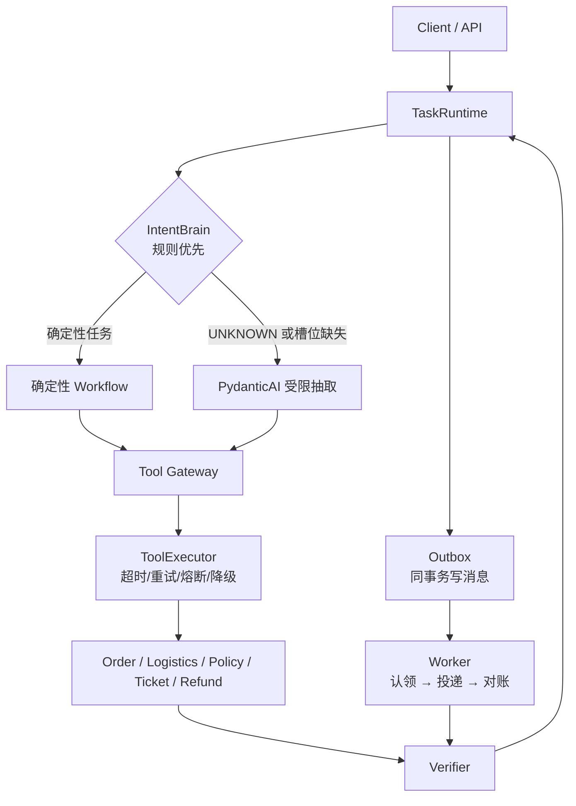
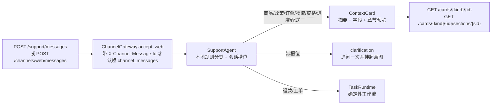
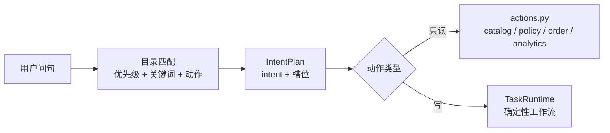
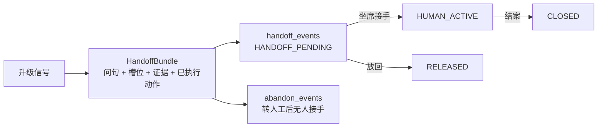
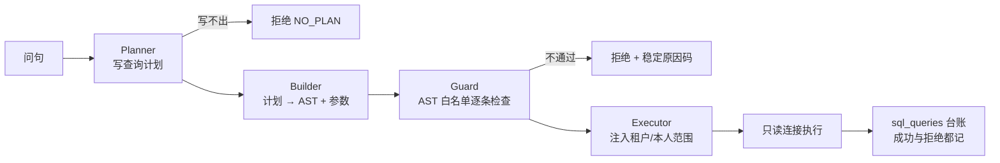
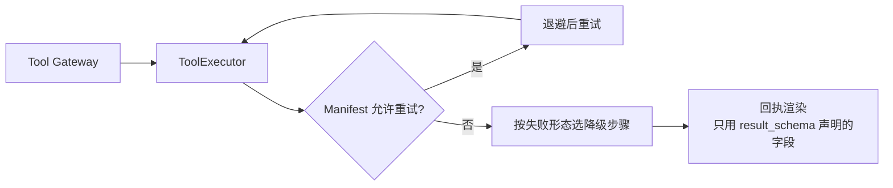
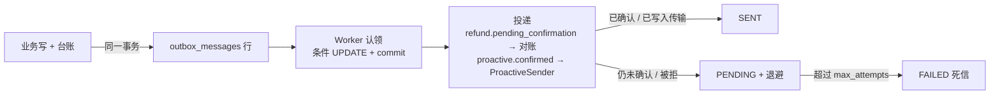
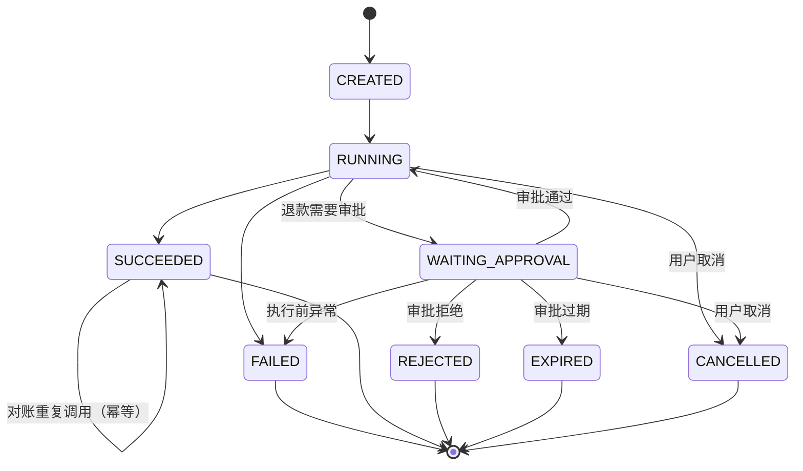
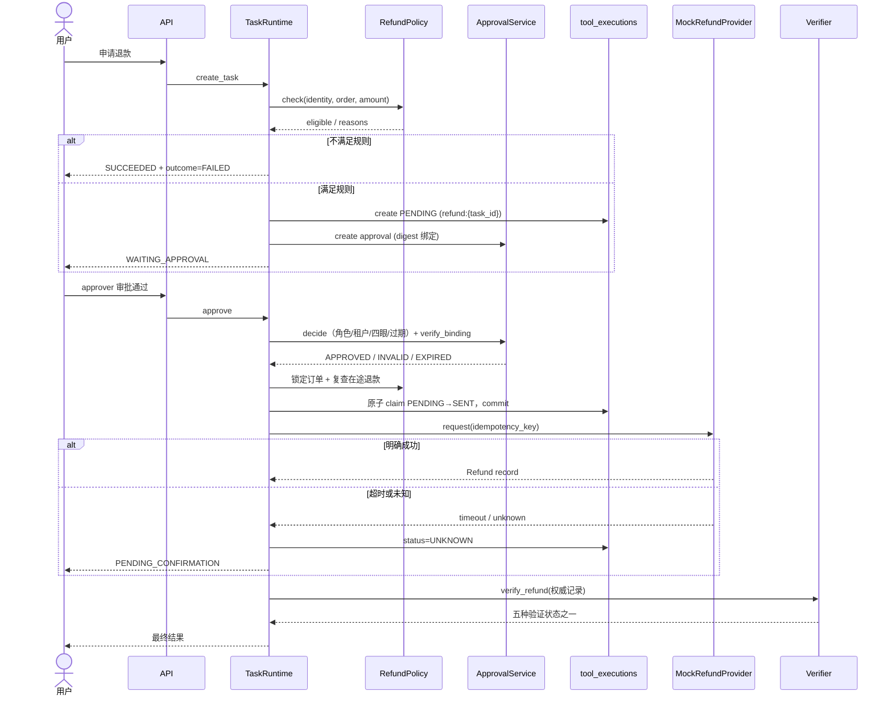
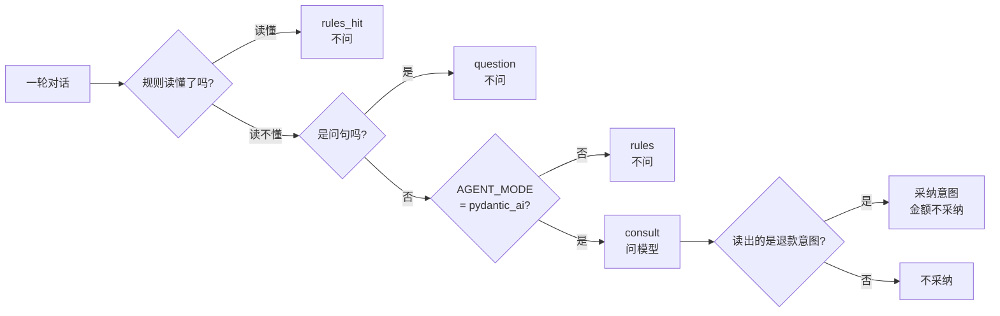

# 架构

## 分层



职责边界：

- `web/`：React + Vite 控制台；构建产物由 `app/main.py` 挂载到 `/console/`，API 同源
- `api/`：HTTP、身份头、错误信封、SSE 编码
- `services/runtime.py`：唯一任务控制流
- `agent/intents.yaml`：统一意图目录（数据，不是代码）；`agent/intent_catalog.py` 读它并路由
- `agent/routing.py`：确定性规则
- `agent/escalation.yaml` + `agent/escalation.py`：升级触发表与判定
- `agent/pydantic_agent.py`：只做结构化抽取；失败自动回退规则。业务校验（`order_id` 形状、金额为正）在 `@agent.output_validator` 里，不合格就 `ModelRetry` 让模型重问；`ModelTrace` 带请求 / 重试 / token / 耗时计数
- `agent/support_agent.py`：只读客服 Agent；本地规则分类 + 会话槽位，**在规则读不懂且不是问句时**才问模型（见「模型调用的三级门控」）
- `agent/actions.py`：意图到动作的注册表，写动作与只读动作在这里分开
- `services/support.py` + `services/catalog.py`：上下文卡片与商品目录，渐进式披露的正文来源
- `services/handoff.py` + `agent/handoff.py`：上下文移交包与接管状态机
- `sql/`：受控 Text-to-SQL（规划器 → 构造器 → 守卫 → 执行器 → 台账）
- `tools/`：工具声明、风险等级、审批与审计入口；`tools/executor.py` 是失败模型与回执渲染的实现处
- `services/refunds.py`：台账、模拟外部服务、对账、结果收敛
- `services/outbox.py` + `repositories/outbox.py`：事务性消息队列与投递循环
- `channels/`：渠道抽象（`base` / `registry` / `gateway` / `store` / `render` + 四个适配器）。入站只有一条路——`ChannelGateway` 是把传输请求变成 agent turn 的唯一地方，加渠道不在 `app/agent/`、`app/services/` 加分支；`outbound.py` 是主动通知的出站面（`ProactiveSender` + `OutboundTransport` 协议）
- `services/memory.py` + `services/proactive.py`：客户自持档案（查看 / 部分合并 / 导出 / 删除）、主动服务的七道抑制闸，以及租户规则的读写与写时模板校验
- `agent/personalization.py`：档案进答案的覆盖层，纯函数、只套模板或换形状、四种可枚举原因码；读档案不复用 `MemoryService`（见 [ADR-018](adr/ADR-018-memory-in-answer-personalization.md)）
- `retrieval/`：政策摄取、切块、BM25、稠密通道、RRF 融合、重排
- `observability/`：trace span 记录与 PII 脱敏
- `core/policy.py`：策略引擎（阈值与放行判定）

> **分层是被守着的，不是写在纸上就算**：`docs/architecture-guard.yaml` 把层号、例外与禁止边写成数据，
> `tests/test_architecture_guard.py` 每次跑 `pytest` 都按它检查 `app/` 的 import 图——新增一层目录、
> 让下层反过来依赖上层、引入模块级 import 环、或者把已登记的例外留着却不再使用，都会红。
> 已知并登记的反向依赖只有四条（`agent → services`、`tools → services`、`channels → agent`、
> `core → observability`），外加一条已知偏离 `api → sql`；每条都写了 why，改动要走 ADR（[ADR-025](adr/ADR-025-architecture-and-docs-guards.md)）。

## 只读客服路径

问答与写操作是两条互不重叠的路径：只读路径**不创建任务、不落台账、不写审计**，写路径必须走 `TaskRuntime`。



- 卡片只带元数据与章节预览（标题、预览、字数），正文按需单独请求，避免把整份商品规格或政策塞进上下文。
- 章节 `id` 是公开契约：商品章节用 `catalog.json` 里的稳定字符串，政策与订单章节用位置式 `section-{n}`。
- 政策章节响应带 `citation`（文档 ID、版本、章节、来源 URI、生效区间），回答可追溯。
- 卡片与章节接口共用同一身份上下文；跨租户的订单与政策返回 404。
- 会话槽位按「租户 + 用户」存在 `conversations` 表：订单号、金额可跨轮继承，缺槽位时只追问一次并把意图挂起，用户补齐后自动续跑。
- `SupportAgent.handle` 内部固定三段：**决策塑形 → 记忆个性化 → 输出护栏**。塑形（`_shape`）定稿后调用一次 `app/agent/personalization.py`，它只读档案的 `preferred_name` / `preferences` 两列、只产生四种模板效果；随后过 `app/core/output_guard.py`，所以个性化插进去的文本同样要过护栏——护栏永远是最后一道。人工接管静默轮不读档案。这条读路径不写 `audit_events`、不新增 `customer_profiles` 行，因此上面那句「只读路径不写审计」在客户已有档案时依然成立；代价是回复开始取决于档案，该客户的历史 trace 不再逐字可回放（[ADR-018](adr/ADR-018-memory-in-answer-personalization.md)）。

## 意图目录（数据而非代码）

`app/agent/intents.yaml` 是意图的唯一声明处：每一行写明意图标签、匹配的关键词、优先级、要执行的动作、能力来源与是否可升级。`agent/intent_catalog.py` 读目录并按优先级匹配，`SupportIntent` 枚举通过 `_missing_` 接受目录里新增但本版本未知的标签——**加一个意图不用改 Python 代码**。



升级判定走另一张表 `app/agent/escalation.yaml`：触发信号、阈值、目标队列与优先级。目录管"这是什么问题"，触发表管"这问题该不该交给人"，两者互不混用。

## 转人工与接管

转人工不是一句话，是一个有状态、有上下文、有度量的一等公民。



- 移交包带上坐席接手所需的全部上下文，坐席不必回头翻对话。
- 接管状态机（`AGENT_ACTIVE` / `HANDOFF_PENDING` / `HUMAN_ACTIVE` / `QUEUED` / `RELEASED` / `CLOSED` / `NOTED`）显式表达"谁在管这段会话"。
- Agent 进入接管状态后对同一会话静默：不与坐席抢答。
- `GET /api/v1/handoffs/metrics` 按租户给出会话量、转人工率、自结率与放弃率。

## 受控 Text-to-SQL

问句**不**变成 SQL 文本再交给模型改写。链路固定，每一步都只认结构化输入：



四条不可绕过的规则：

1. **计划是结构化的**：数据集、度量、分组、时间窗、状态各有取值域；写不出计划就没有查询。
2. **守卫检查 AST 而不是字符串**：只放行单条受限 SELECT；子查询、集合运算、`SELECT *`、多语句、内联字面量全部拒绝。
3. **范围由执行器注入**：语句体里必须出现租户与本人两个范围条件，且必须在最外层；构造器与规划器都无法放宽它。
4. **一切取值都是绑定参数**：方言差异只影响分桶函数（SQLite `STRFTIME` / PostgreSQL `TO_CHAR`），值不进 SQL 文本。

第二道防线在数据库侧：执行连接是只读的（SQLite `PRAGMA query_only=ON`，PostgreSQL 只读事务），即使守卫被绕过也写不进去。

拒绝也有台账：拒答记录 `status = "REJECTED"` 与 `rejected_reason`，所以"哪些问题答不了"是可统计的，而不是消失在对话里。

## 工具执行器与失败模型

网关负责"能不能调用"（校验 → 授权 → 审批 → 幂等 → 审计），执行器负责"这次调用会怎么失败"。两件事分开，是因为 Manifest 已经声明了后者，把它留在注释里就等于没有。



六类失败形态，各自对应不同的下一步：

| 形态 | 触发 | 是否重试 | 用户看到 |
|---|---|---|---|
| `validation` | 参数不合法 | 否 | 回引导（订单号格式等） |
| `timeout` | 超时 | 按 Manifest | 首次静默，超阈值后告知 |
| `upstream` | 上游 5xx / 熔断打开 | 按 Manifest | 「系统繁忙，已记录，稍后自动重试」 |
| `unknown` | 读后超时，结果未知 | **绝不** | 「处理中」+ 主动通知 |
| `business` | 超期 / 余额不足 / 冲突 | 否 | 原因 + 替代路径 |
| `internal` | 未预期异常 | 否 | 转人工并带完整上下文 |

两条安全规则写在执行器里，新工具无法靠疏忽绕过：

1. **有副作用的工具，除非 Manifest 声明 `idempotency = "required"`，否则不重试。**
2. **结果未知绝不重试。** 调用可能已经生效，重来一次等于要两次同样的副作用；只有对着权威记录对账才能知道实际发生了什么。

回执契约：金额与单号只能来自工具自己的返回值，且只能用 `result_schema` 声明过的字段。字段缺失或未声明则**整条回执不渲染**，退回工具自己的话术——半句话比工具原话更糟。

超时预算是"我们愿意接受的上限"，不是"掐断开关"：已经开跑的 handler 不会被中断，中途杀死一次写入比等它更糟。

## 事务性 Outbox

外部调用拿不到结论时，光有台账不够——还得有一条"还没送达的消息"，而且它必须和业务事实**同一个事务**落地。



- `dedupe_key` 唯一约束保证同一事实只排一条消息。
- worker 先**提交认领**再推送，所以投递是 at-least-once；重复由下游幂等吸收。
- 认领用 `UPDATE ... WHERE status='PENDING' RETURNING id`，两个 worker 抢同一行时只有一个赢家（SQLite 与 PostgreSQL 上都有真实并发测试）。
- **"还没确认"不等于"已投递"**：退款仍是 `PENDING_CONFIRMATION` 时消息回到 `PENDING` 等待下一轮，而不是被标成已送达。
- **两种事件、两个消费者**（`app/services/runtime.py::_outbox_sink` 按 `event_type` 分派）：`refund.pending_confirmation` 走对账；`proactive.confirmed` 走 `app/channels/outbound.py` 的 `ProactiveSender`——渠道取客户档案里的 `contact_channel`，地址由服务端身份映射**反查**，`payload` 里的任何指向都改不了去向。默认 `CHANNEL_OUTBOUND_TRANSPORT=none` 拒绝一切发送，被拒的行退回 `PENDING` 并把 `[NO_TRANSPORT]` 之类的拒绝码写进 `last_error`。
- 这里的 `SENT` 只说明"渲染结果已交给配置的传输并写成功"，**不是服务商送达回执**；接真实协议是 `OutboundTransport` 的第四个实现，不改队列。
- 坐席可以从 `GET /api/v1/outbox` 看到队列全貌，`POST /api/v1/outbox/deliver` 手动跑一轮。

## 任务状态机



说明：

- `SUCCEEDED` 表示**任务完成**，不代表业务动作成功。业务结果看 `result.outcome`。
- 退款超时后任务为 `SUCCEEDED` + `PENDING_CONFIRMATION`，对账可以继续更新结果。
- 终态任务不能再取消；重复审批返回 409。

## 退款时序



## 数据模型

| 表 | 作用 |
|---|---|
| `tasks` | 任务与当前状态（乐观锁 `version`） |
| `task_events` | 任务生命周期事件，供回放 |
| `tool_executions` | 副作用执行台账与幂等键 |
| `approvals` | 人工审批与摘要绑定 |
| `tickets` | 客服工单，租户级幂等 |
| `documents` / `document_chunks` | 政策文档、版本、有效期、切块 |
| `audit_events` | 追加式安全审计 |
| `orders` / `logistics` / `refunds` | 演示业务数据与权威退款记录 |
| `conversations` / `conversation_messages` | 会话槽位与消息历史 |
| `handoff_events` | 转人工事件与接管状态 |
| `abandon_events` | 转人工后无人接手的放弃记录 |
| `trace_spans` | 一次对话或任务的 span 树 |
| `sql_queries` | 自助统计台账（成功与拒绝都记） |
| `outbox_messages` | 待投递的状态同步消息（与业务事实同事务写入） |
| `llm_usage` | 模型用量账本：每次模型运行一行（请求 / 重试 / token / 耗时 / 状态 / 来源） |

关键约束：

- `tool_executions(task_id, idempotency_key)` 唯一
- `refunds.idempotency_key` 唯一
- `tickets(tenant_id, idempotency_key)` 唯一
- `tasks(tenant_id, user_id, idempotency_key)` 唯一（`uq_tasks_idempotency`，任务创建幂等键）
- `outbox_messages(dedupe_key)` 唯一（同一事实只排一条消息）
- 同一任务最多一个 `PENDING` 审批（部分唯一索引，SQLite/PostgreSQL 均支持）
- 同一订单同一动作最多一个 `PENDING`/`APPROVED` 审批（`uq_approvals_open_per_resource`）
- `approvals.action_digest` 覆盖动作、订单、金额、币种、资源版本、政策版本
- 订单余额扣减使用 `WHERE refundable_cents >= amount` 的条件更新并递增 `version`

## 审批绑定

```text
digest = sha256(canonical_json({
  action, order_id, amount_cents, currency,
  resource_version, policy_version
}))
```

执行前重新计算当前订单版本对应的摘要；不一致则审批置 `INVALID`，台账置 `CANCELLED`，不调用外部服务。

审批状态：

```text
PENDING → APPROVED → CONSUMED
        ↘ REJECTED / EXPIRED / INVALID / CANCELLED
```

`APPROVED` 与 `PENDING` 都占用订单级唯一额度；明确成功/失败后 `CONSUMED` 释放，结果未知时保持 `APPROVED` 直到对账收敛。自批对 `admin` 同样禁止。

## 外部结果与对账

模拟提供方支持：`success`、`fail`、`timeout_before`、`timeout_after`、`unknown`。

- `timeout_after`：外部已创建退款记录，但响应超时 → 台账 `UNKNOWN`、任务 `SUCCEEDED`、业务结论 `PENDING_CONFIRMATION`（三级状态各有枚举，不要混读）
- `reconcile` 按幂等键查询权威记录，找到则应用余额并验证；找不到则继续 `PENDING_CONFIRMATION`
- `response_payload.balance_applied` 保证余额只扣一次
- 禁止超时后自动重试同一退款

对账由 Outbox 驱动：退款进入未知结果时，同一事务写入一条 `refund.pending_confirmation` 消息；worker 认领后调用对账，确认成功 / 失败 / 需人工则消息置 `SENT`，仍未确认则消息回到 `PENDING` 等下一轮，退避耗尽进死信。也可以用 `TaskRuntime.reconcile(task_id)` 直接对账（供运维工具与测试使用）。

## 渠道入站与主动出站

渠道层只在传输侧做事，认知层不知道渠道的存在（ADR-016；出站那一半见 ADR-017）。

**入站**（T4）：`Channel` 有 8 个值，`ChannelCapabilities` 有 8 个字段（是否线程、正文上限、是否要主题与署名、能否降级…），`render()` 按能力矩阵把同一份答案裁成不同形状——邮件带主题与署名、IM 裁到 200 字、语音追加转人工话术。四个适配器可用（`WEB` / `EMAIL` / `WECHAT` / `WECOM`），其余四个只有能力声明，入站一律 `404`。三道闸按顺序是：验签（本仓库自定的 `sha256=HMAC(timestamp + '.' + raw_body)`，缺头 / 错签名 / 时间戳漂移 → `401`）→ 身份映射（`tenant:user` 串在配置里，payload 自选不了租户，未登记发件人 `403`）→ 数据库级幂等（`channel_messages` 上 `X-Channel-Message-Id` 唯一；同 id 重放读回同一条回复并带 `X-Channel-Deduplicated`，同 id 换内容 `409`）。幂等闸**只有一道**（T8，2026-10-24）：`/api/v1/support/messages` 也已委托 `ChannelGateway.accept_web`，控制台前端改调渠道路由并自带幂等键，所以同一个 `X-Channel-Message-Id` 跨两条 web 路由只受理一次；不带键的调用仍逐次执行、不在 `channel_messages` 留行。

**出站**（T7-4）：`ProactiveSender` 消费 `proactive.confirmed`，复用同一张能力表渲染（`render_notice`）。去向由三段决定，任何一段都不听消息里的指向——队列行的租户+用户 → 档案里的 `contact_channel` 偏好 → 服务端身份映射**反查**出的地址。`OutboundTransport` 只有两个实现：默认 `none` 拒绝一切发送，演示用 `local_file` 追加一行 JSON（`prod` 启动校验直接拒绝非 `none`）。被拒时通知停在 `CONFIRMED`、队列行退回 `PENDING` 退避，`last_error` 里是 `[NO_TRANSPORT]` / `[NO_CHANNEL]` / `[NO_ADDRESS_SOURCE]` / `[NO_CONSENT]` / `[UNSUBSCRIBED]` 之类的拒绝码；只有传输写成功才落 `SENT`，而 `SENT` 不等于服务商送达回执。审计事件 `proactive.delivered` 只记渠道、字符数与地址摘要（SHA-256 前 12 位）。

## 主动规则的可编辑面

事件类型是**代码所有**的（`app/models/enums.py` 的 `ProactiveEventType`，三个值），`emit()` 的第一道闸就是它——所以「什么事实可以触发一条消息」不在配置面里。能配的是这条规则**怎么说**：文案、冷却、启停。

写路径只有一条：`PUT /api/v1/memory/rules/{event_type}` → `ProactiveService.update_rule()` → `proactive_rules` 行（`(tenant_id, event_type)` 唯一，所以这条 `PUT` 天然是 upsert，**不需要新表也不需要迁移**）。规则是租户级的，不是客户级的——它决定「本租户遇到这类事实时说什么」，不碰任何一份客户档案。

校验发生在**写入时**，而不是发送时。原因是坏模板有两种后果，都很难排查：引用白名单外的字段（`{foo}` / `{order_id.upper}`）会让整条规则从此被 `TEMPLATE_CONTEXT_MISSING` 静默抑制；位置参数（`{}`）会让 `emit()` 在渲染时抛 `ValueError` 变成一条 500。两者都是写规则的人的错，所以都在写的时候拒，并带上是哪个字段（[ADR-019](adr/ADR-019-proactive-rule-editable-surface.md)）。

只读视图带两个字段：`required_context`（这条模板用到的 context 键）与 `updated_at`。前者把「这条规则要 emit 带什么」摆在界面上，而不是等人去撞抑制码。

边界如实写：**没有双人复核**（审批那一层有四眼，规则文案这一层没有）、**没有版本表也没有一键回滚**（审计里只有 `template_sha256`）、**没有按租户灰度**、**不能删除规则**（「不再发」由 `enabled = false` 表达，删掉会让 `notification.rule_id` 指向不存在的行）、**改动不回溯**（已生成的通知逐字不变）。

## 检索

- 切块：按 H2 分节，去掉 H1 与免责声明引用块
- 过滤：租户、`ACTIVE`、`effective_from <= today <= effective_to`
- 稀疏通道：BM25 + 标题/小节命中加权
- 稠密通道（可选）：`HashingEmbedder` 离线可用；配置真实嵌入服务时走 `OpenAICompatibleEmbedder`
- **稠密门控**：稠密不是「开关一开就每次都问 embedding」。`DenseGate` 在调用 embedding **之前**判一次——BM25 top-1 分数低于 5.0（`weak_sparse`），或 top-1 块的**词覆盖率** ≤ 0.35（`low_coverage`），才放行稠密；否则跳过（`sparse_confident`）。理由是实测出来的：17 条标注里 3 条 rank-1 没命中，它们的 BM25 分数是 12.96 / 20.64 / 25.31——**BM25 错得很自信**，所以分数门槛在这三条上永远不会响，而它们的覆盖率恰好是最低的三条。门控后的指标与无条件稠密同级，embedding 调用从 17 次降到 5 次（标定过程见 [ADR-021](adr/ADR-021-dense-channel-gate.md)）
- 融合：两路结果用 RRF（reciprocal rank fusion）合并，只有单路命中的片段也有机会进前列
- 重排（可选）：对融合后的候选重排，**失败即放开**——重排服务不可达时检索链路照常工作
- 回答：抽取式引用，明确标注文档标题、版本、小节
- 默认部署只开稀疏通道：没有稠密服务与已存向量时自动降级，不影响功能

> 稠密、重排与融合实现在 `app/retrieval/dense.py`、`fusion.py`、`rerank.py`、`hybrid.py`，统一保持「可选、失败可退化」的性质，没有把外部服务变成硬依赖。

## 模型调用的三级门控

对话入口（`_consult_model`）是**唯一**能碰模型的地方，它前面有一道写下来的判定（`app/agent/support_agent.py::model_gate`）：



三档的含义：

| 档 | 条件 | 动作 |
|---|---|---|
| `rules_hit` | 意图目录读懂了这一轮（`UNKNOWN` 除外；只因带订单号命中 `ORDER_QUERY` 也算读不懂） | 不问 |
| `question` | 规则读不懂，但这句是问句（`blocks_write_action`） | 不问——问句没有能采纳的写意图，问了也白花钱 |
| `consult` | 规则读不懂 + 不是问句 | 问；**只采纳 `REFUND_REQUEST`**，金额不采纳 |

判定结果写进 `understand` span 的 `model_gap.gate`，**只用于观测**，没有任何分支读它来决定下一步。`AGENT_MODE=rules` 在碰模型前就返回，确定性路径一行未改。

理由与实测见 [ADR-024](adr/ADR-024-three-level-model-gate.md)。

## 模型用量的落库

每次模型运行写一行 `llm_usage`（`app/services/llm_usage.py`）：请求数、重试数、输入 / 输出 token、墙钟耗时、状态、来源（`task` / `chat`）、规划来源、模型名，以及归属的 `task_id` / `conversation_id`。

- **任务路径**与 `task.routed` 事件在**同一个事务**里写入——要么都有，要么都没有；
- **对话路径**写在**这一轮自己的 session** 上（另开连接会在 SQLite 上等这一轮的写锁），失败时放过：记账不该变成可用性依赖；
- 读取接口 `GET /api/v1/analytics/llm-usage` 给租户级汇总（总量、按来源拆分、最近若干行）。

进程内的 `IntentAgent.usage` 计数仍然存在，但**它不是账本**——进程一重启就归零。跨 worker 的口径以 `llm_usage` 表为准（见 [ADR-023](adr/ADR-023-cross-process-seams.md)）。

## 限流与幂等的两条接缝

- **限流**：`RateLimitStore` 有两个实现。默认 `TokenBucket` 是进程内的，N 个 worker 就是 N 倍预算；`RATE_LIMIT_STORE=redis` + `REDIS_URL` 换成 `RedisFixedWindow`（`INCR` + `EXPIRE`，一分钟一个窗口），配额变成**跨进程的一个事实**。窗口粗，租户可以在分钟边界前后花掉两个窗口；Redis 挂掉时**退回本地桶**，不放行全部流量。
- **任务幂等**：`POST /api/v1/tasks` 接受 `Idempotency-Key` 头。同键 + 同请求摘要 → 回放已有任务（返回体带 `idempotent_replay: true`），同键 + 不同摘要 → 409。仲裁者是唯一索引 `uq_tasks_idempotency`（`(tenant_id, user_id, idempotency_key)`），**不是应用层的时序**；应用层先查后建只是省掉常见的顺序重试。

## 身份

开发适配器从 `X-Tenant-Id` / `X-User-Id` / `X-Roles` 读取身份。生产配置强制 `IDENTITY_ADAPTER=oidc` 且关闭文档；OIDC 适配器尚未实现，`create_app` 会拒绝启动，避免 Header 身份进入生产。跨租户访问一律表现为 404，避免枚举。
