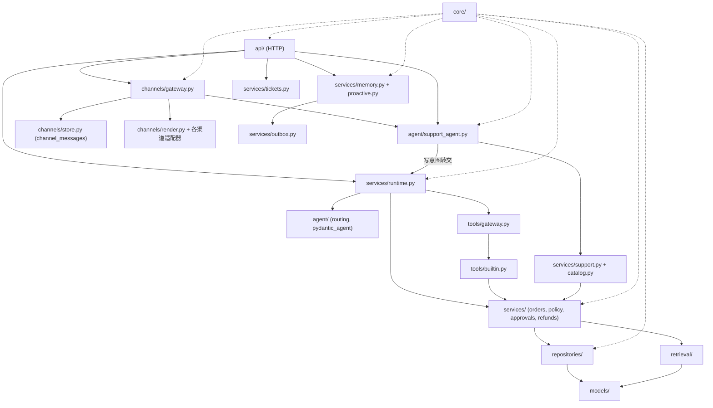

# TicketPilot 项目说明书

> 本文档是 TicketPilot 的**实现级说明书**：写给要读代码、改代码、做架构评审的人。
> 阅读顺序按「一次请求怎么走 → 分层怎么落地 → 高风险动作怎么被约束 → 前端怎么呈现」展开。
>
> **定位方式：只写模块、类、函数、开关名，不写行号。** 行号会随提交漂移；需要精确定位时，
> 在编辑器里按符号跳转即可。文中路径均相对仓库根目录。
>
> **事实基准：2026-10-27 收尾轮复跑（T4 渠道抽象、T4b 渠道溯源、T5 客户记忆与主动服务、T6 稠密检索护栏、T7 控制台与主动消息出口、T8 网页入口幂等收口、T9 记忆进答案、T10 主动规则可编辑面、对话入口模型缺口收口、稠密通道门控、三级模型门控、跨进程接缝与模型评测、查询侧改写与分层检索评测、意图语料评测、预取式统计与事实性守卫、P2 决策复用、P3-a 维度拒绝、P4 规则治理、P5 意图缺口闭环、P6 SSE 跟随、P11 澄清候选降级、P8 意图候选化、B-1 退款原因与退款类型、B-3 审批金额分层完成后）。**
> 本机结果：默认 pytest 套件 **1074 passed / 6 skipped / 0 failed**（收集 1080 个用例，74 个测试文件；2026-10-28 复跑，当前读数见 §19.1；上一轮 P8（2026-10-26）是 879 / 收集 885 / 65 个文件；更早 P11 是 812 / 收集 818 / 59 个文件），
> 用例构成：`tests/test_refunds.py` 里 1 条退款作用域用例、`tests/test_llm_gap.py` 9 条模型边界用例、
> 模型那一轮新增的 7 个测试文件 32 条（模型埋点 5、分布快照 3、安全交叉 6、幂等键 5、限流存储 7、限流 Redis 2、用量账本 4）、
> 并入 `tests/test_retrieval_channels.py` 的 6 条稠密门控用例，
> 两个守卫轮的 2 个测试文件 17 条（架构依赖守卫 8、文档一致性守卫 9），
> 查询侧改写 68 条（`test_query_rewrite.py`）与分层检索集 13 条（`test_retrieval_set.py`），
> 意图语料评测 25 条（`test_intent_eval.py`）与意图缺口闭环 31 条（`test_intent_gaps.py`），
> 以及预取式统计 102 条（`test_analytics_prefetch.py` 18、`test_analytics_router.py` 11、`test_analytics_narrative.py` 15、`test_analytics_faithfulness.py` 49、`test_analytics_followup.py` 9），
> 澄清候选降级 28 条（那一轮收集 790 → 818；新文件 `test_support_candidates.py` 12、`test_clarification_evidence.py` 11，其余补在既有文件的候选与阈值断言里），
> 意图候选化 48 条（P8 轮收集 818 → 885 中的 48 条；新文件 `test_intent_candidates.py` 15、`test_intent_candidate_model.py` 9、`test_intent_candidate_trace.py` 3、`test_intent_candidate_eval.py` 20，另有 1 条补进既有文件 `test_decision_reuse.py`，其余增量来自同工作区的渠道可用性轮），
> Ruff 通过，`mypy app`（strict）零错误（148 个文件），任务路径 Golden Set **40/40**，只读路径支持集 **62/62**，
> 回放自检 **REPLAY DIFF EMPTY**，离线检索评测门槛全过（`bm25` / `dense` / `hybrid` / `gated` / `rerank` 五通道真实端点读数见 §11.5，
> 门槛仍只套 `bm25`），`alembic check` 无漂移（head `ea6c2b48d701`，16 条迁移、26 张表），
> 控制台 `npm run build` 通过，本地 uvicorn + SQLite 下 `scripts/demo.py` 走完只读客服与渐进式披露，`/health/ready` 返回 `ready`。
> **PostgreSQL 16.15（一次性容器）最近一次全量复跑（519 条时代）：同时指上 PostgreSQL 与 Redis 两个容器后 519 passed / 0 skipped（137.23 s）**，
> 默认跳过的 4 条 PostgreSQL 专项用例（并发与 Outbox）与 2 条 Redis 共享配额专项全部执行；
> **查询改写 68 + 分层检索集 13 + 意图语料评测 25 + P2/P3/P6 19 + 预取式统计 102 + P4 规则治理 13 + P5 意图缺口闭环 31 + P11 澄清候选降级 28 + P8 意图候选化 48（合计 347），加渠道可用性轮 19 条，再加 B-1/B-3 与后续各轮（收尾返工轮、R1/R3 端到端能力、R4 指标基线、R5 答案层、R7 采纳面收口）新增 194 条（未逐轮拆分归因），共 560 条新增用例目前只有 SQLite 证据，尚未在 PG 上复跑**；
> 同一容器上的 Golden Set **40/40**、支持集 **61/61**（该轮支持集还是 61 条；P11 后是 62 条，未在 PG 复跑），
> 同一容器上 `alembic upgrade head` 走完**当时**的 **13** 条迁移（head `b4e8d2f6a1c9`）、`alembic check` 无漂移；
> 第 14 条 `a1c7e9d4b820`（P4 规则版本与通知 `rule_version`）是 2026-10-26 才加的，**没有在那次手工全量里跑过**；
> 它在 PG 方言上有两条证据：P4 那一轮在运行中的 PostgreSQL 16 容器上新建空库走 `upgrade head`（`b4e8d2f6a1c9` → `a1c7e9d4b820`）+ `alembic check` 无漂移
> （见 [证据索引.md](../guide/证据索引.md) 的 P4 一节），以及 CI 的 `postgres-migration` 作业（`postgres:16-alpine`，不跑 pytest）。
> **五通道检索指标脚本本身已在 PG 上跑过**
> （`evals/retrieval_metrics.py --channels bm25,dense,hybrid,gated,rerank --database-url …`，五行读数与 SQLite 逐项相同，见 §11.5）。
> `docker compose up -d --build` 镜像构建通过，栈内 `/health/ready` 返回 `ready`、`/console/` 可访问，
> 容器内 `scripts/seed.py` 与 `scripts/demo.py` 均跑通；
> 真实模型调用已在本机 LM Studio（`qwen3-8b`）上验证，托管模型（Anthropic / OpenAI）仍未验证；OIDC 登录仍未实现；任务事件流默认实时跟随（数据库轮询），见 §12.4。
>
> **数字口径**：测试总数只在 `README.md` 维护；Golden Set 的规模与执行方式只在
> `docs/guide/黄金集说明.md` 维护。本文档只解释机制，不复述会随代码变化的计数。
>
> **写作原则**：不把「设计意图」写成「已经实现」。实现与文档措辞不一致时，以代码事实为准，
> 并在 §19 的「文档漂移与已知缺口」中单独列出，避免读者被漂亮话误导。

---

## 本文章节

- 0. 阅读指南
- 1. 项目概览
- 2. 仓库结构与分层
- 3. 配置与启动装配
- 4. 领域模型与数据库
- 5. TaskRuntime 控制流
- 6. 意图识别与有界 Agent
- 7. Tool Gateway 与风险分级
- 8. 退款资格与执行
- 9. 审批系统与并发防护
- 10. 验证、台账与对账
- 11. 政策摄取、BM25 检索与引用
- 12. HTTP API 与 SSE 实时事件流
- 13. React 控制台
- 14. 测试、Golden Set 与质量门禁
- 15. 安全与威胁模型
- 16. 部署与运维
- 17. 十二条端到端场景走查
- 18. 技术选型与被拒方案
- 19. 当前边界、文档漂移与演进路线
- 20. 源码阅读路线与练习
- 21. 转人工一等公民与接管静默
- 22. 受控 Text-to-SQL 与预取式统计（受控统计问答）
- 23. 工具执行器：失败分类、重试熔断与回执
- 24. 事务性 Outbox 与投递
- 25. 两个守卫：架构依赖与文档一致性
- 附录 A：状态与错误码速查
- 附录 B：文件索引
- 附录 C：验证清单
- 附录 D：文档同步面

## 0. 阅读指南

### 0.1 先读这三条

1. **控制流不在 LLM 里。**
   任务由 `app/services/runtime.py` 的 `TaskRuntime` 驱动：创建任务 → 路由意图 →
   调用固定工具 → 进入审批或直接收敛。PydanticAI 只是一个可选的**槽位抽取器**，
   它不持有工具、不决定退款资格、不能批准退款。规则模式（`AGENT_MODE=rules`）下，
   一次任务可以做到 **0 次模型调用**。

2. **高风险动作有三道彼此独立的闸门。**
   - **业务规则闸门**：`RefundPolicy.check` 判断订单状态、30 天窗口、可退余额、重复退款。
   - **审批闸门**：金额**超过**审批阈值 `refund_approval_threshold_cents` 时，退款必须经
     `ToolGateway` 校验 `APPROVED` 审批；审批与动作、订单、金额、币种、订单版本、政策版本、
     退款原因、退款类型、审批档位快照这九项做 SHA-256 摘要绑定；发起人不能审批自己的申请
     （管理员也不行）。金额**不超过**阈值时按规则自动执行：不起审批行，但仍走同一个权威执行体
     与同一套校验（§8.3、§8.4）。
   - **权威记录闸门**：外部退款返回成功只算「请求已受理」。`VerificationService` 必须
     查回权威退款记录，核对订单、金额、状态与余额不变量，才给出 `VERIFIED_SUCCESS`。

3. **任务状态 ≠ 业务结果。**
   `TaskStatus` 描述流程走到哪里；`result.outcome` 描述业务结论。
   例如「不符合退款条件」是任务成功完成（`SUCCEEDED`）、业务结论失败（`FAILED`）；
   「退款超时结果未知」也是任务成功完成（`SUCCEEDED`），业务结论是
   `PENDING_CONFIRMATION`。读代码时先确认自己在看哪一层状态。

### 0.2 按目标选阅读路线

| 你的目标 | 建议路线 | 说明 |
| --- | --- | --- |
| **第一天：跑起来，看懂一次退款** | README 快速开始 → §1 → §17 场景 D/E → §5 → §8 | 先看状态怎么变，再回头补代码 |
| **第一周：看懂主控制流** | §2 → §3 → §4 → §5 → §6 → §7 | 建立「API → Runtime → 服务 → 仓库」的骨架 |
| **改退款/审批代码前** | §8 → §9 → §10 → §14 | 先理解三条不变量和对应测试，再动代码 |
| **做前端/演示** | §12 → §13 → §17 | 先看 API 返回什么，再看控制台如何消费 |
| **架构评审/面试** | §0.1 → §1 → §8.4 → §9.5 → §18 → §19 | 重点讲「为什么不让 Agent 执行」与「并发怎么防」 |
| **想看 Agent 平台化怎么做** | §6.2 → §21 → §22 → ADR-009/010/011 | 意图目录、转人工、受控 SQL 三条主线 |
| **排查线上问题** | §10.7 → §16.7 → §19 | 按任务状态、台账状态、审批状态三张表定位 |
| **只想查配置** | §3.2 → §3.9 | 注意有些配置只影响展示/规则返回值，不改变主流程 |

### 0.3 章节地图

| 组 | 章 | 主题 | 关键源码位置 |
| --- | --- | --- | --- |
| **全景** | 1 | 项目概览与最终状态 | `README.md`、`pyproject.toml` |
| | 2 | 仓库结构、分层与依赖方向 | `app/`、`web/src/` |
| | 3 | 配置、启动装配、生产 fail-closed | `app/core/config.py`、`app/main.py` |
| **内核** | 4 | 领域模型、枚举、约束、迁移 | `app/models/`、`alembic/` |
| | 5 | `TaskRuntime` 控制流、状态机、事件 | `app/services/runtime.py` |
| | 6 | 规则路由、本地客服 Agent、PydanticAI 受限抽取 | `app/agent/` |
| | 7 | 工具注册、风险分级、Tool Gateway | `app/tools/` |
| **高风险链路** | 8 | 退款资格、执行、对账、结果映射 | `app/services/refund_policy.py`、`refunds.py` |
| | 9 | 审批生命周期、摘要绑定、订单级并发防护 | `app/services/approvals.py`、`app/repositories/approvals.py` |
| | 10 | 执行台账、幂等、Verifier、人工复核 | `app/services/executions.py`、`verification.py` |
| **支撑面** | 11 | 政策摄取、BM25/稠密混合检索、引用 | `app/retrieval/` |
| | 12 | HTTP API、错误信封、SSE 实时事件流、上下文卡片与渐进式披露、渠道层、客户记忆与主动服务（§12.8–§12.9） | `app/api/`、`app/schemas/`、`app/services/`、`app/channels/` |
| | 13 | React 控制台、设计系统、交互状态 | `web/src/` |
| | 14 | 测试、Golden Set、CI 门禁 | `tests/`、`evals/`、`.github/workflows/ci.yml` |
| | 15 | 安全与威胁模型 | `docs/guide/安全说明.md`、`app/core/security.py` |
| | 16 | 部署、迁移、健康检查、运维 | `Dockerfile`、`docker-compose.yml`、`Makefile` |
| **元问题** | 17 | 十条端到端场景走查 | 全链路 |
| | 18 | 技术选型与被拒方案 | `docs/adr/` |
| | 19 | 当前边界、文档漂移、演进路线 | 实测与源码 |
| | 20 | 源码阅读路线与练习 | 全仓库 |
| **守卫** | 25 | 架构依赖守卫与文档一致性守卫（规则在 YAML，事实从代码现算；§25.4 是守卫的反向验证） | `docs/architecture-guard.yaml`、`docs/fact-baseline.yaml`、`scripts/guard_negative_check.py` |

### 0.4 术语表

| 术语 | 含义 |
| --- | --- |
| **TaskRuntime** | 唯一任务控制流；负责状态迁移、路由、工具调用、审批入口与快照 |
| **IntentBrain** | 意图规划器；规则优先，可选 PydanticAI 补齐 |
| **RoutePlan** | 路由结果：`intent`、`order_id`、`amount_cents`、`amount_invalid`、`refund_reason`、`refund_type` |
| **Tool Gateway** | 工具的唯一执行入口：审批校验、审计、handler 分发 |
| **R0–R3** | 工具**风险等级**；R3 为高风险写操作，当前只有 `request_refund`。它回答「这个动作多危险」，**不是**审批档位，与金额无关；档位值不得写进 `risk_level` 字段 |
| **Eligibility** | 服务端退款资格结论，含 `eligible`、`reasons`、金额上限、政策版本与 `requires_approval`。其中 `requires_approval` 是「**要不要**人批」的布尔量，**不是**档位，且**不进摘要**（进摘要的是档位快照 `approval_tier`） |
| **审批档位（tier）** | 一笔退款按金额落入的审批规格档，`tier_id` / `max_cents` / `roles` / `required_approvals` 四个字段。它回答「按什么规格审」，**不回答**「要不要审」；表在 `app/core/approval_tiers.yaml`，由 `app/core/approval_tiers.py::tier_for` 按「首个 `max_cents >= amount_cents` 命中」解析，未命中落到**最高档**并记 `refund.tier_fallback` |
| **审批阈值** | `refund_approval_threshold_cents`（env `REFUND_APPROVAL_THRESHOLD_CENTS`，默认 `0`）：金额**大于**它才要人批。它是**一个标量**，与**一张表**（档位表）分工不同，两者不得互相顶替（§8.1） |
| **档位快照** | 解析出档位后冻结下来的四元组，作为载荷键 `approval_tier` 进摘要；`roles` 在装载期按字典序规范化，因此同一组角色换个书写顺序不会让摘要假漂移 |
| **执行路径标记** | `approval_path`，取值封闭为 `AUTO` / `APPROVAL`，落任务 `result` 顶层与任务事件负载，用来区分「自动执行」与「人工审批后执行」 |
| **自动执行** | 金额不超过审批阈值时的路径：**不起审批行**、不进 `WAITING_APPROVAL`，直接执行退款；但仍走同一套台账、资格复核、绑定校验、渠道调用、验证与对账，并留下 `refund.auto_executed` 事件与审计 |
| **退款原因** | `RefundReason` / 载荷键 `reason`：客户或坐席发起退款时对**退款缘由**的分类选择，取值 `QUALITY` / `DAMAGED` / `WRONG_ITEM` / `NOT_AS_DESCRIBED` / `NO_LONGER_NEEDED` / `OTHER`。链路各处用带上下文的 `refund_reason`，只在载荷与落库边界映射为裸名 `reason` |
| **退款类型** | `RefundType` / `refund_type`：本次退款在**业务动作维度**上的分类，取值 `FULL` / `PARTIAL` / `SHIPPING` / `PRICE_PROTECTION`。后两个只作分类标签，不代表任何独立金额项、拆分、分摊或「应退/实退」多口径。与「审批档位」是两件事：`PARTIAL` 不等于「低档位」 |
| **原因补充说明** | `reason_note`：`reason=OTHER` 时坐席可填的一段自由文本；不进载荷、不进摘要、不进公开回执，只在审批详情侧显示 |
| **未提供** | 显示标签，**不是枚举成员**：历史退款或存量审批载荷的 `reason` / `refund_type` 为 NULL 时在审批详情与回执上显示的中文标签；不得写入数据库，也不参与摘要 |
| **action_digest** | 审批摘要：对动作、订单、金额、币种、资源版本、政策版本、退款原因、退款类型、审批档位快照这九项做规范化 SHA-256 |
| **四眼原则** | 发起人与审批人必须是不同的人；`admin` 也没有自批例外 |
| **APPROVED / CONSUMED** | `APPROVED` 表示决定已作出但仍占用订单额度；`CONSUMED` 表示执行已有明确结果并释放额度 |
| **Ledger（台账）** | `tool_executions` 表；记录副作用请求、幂等键、尝试次数、外部请求号与响应摘要 |
| **UNKNOWN** | 外部调用结果未知；不得自动重试，必须按幂等键对账 |
| **Verifier** | 以权威退款记录验证业务结果，输出五种验证状态 |
| **outcome** | 业务结论；与任务状态分离 |
| **SSE follow** | 先回放 `task_events` 中客户端漏掉的部分，再按轮询间隔持续推送新事件；终态后排空最后一批并关闭。`follow=false` 回到一次性回放 |
| **Fail-closed** | 配置不安全或依赖未实现时拒绝启动，而不是带着不安全默认值上线 |
| **Dev Header 身份** | 本地演示用 `X-Tenant-Id` / `X-User-Id` / `X-Roles`；生产必须替换为 OIDC |
| **SupportAgent** | 只读本地客服节点（`mode = "local"`）：回答商品/政策/订单/物流，写意图转交 `TaskRuntime` |
| **ContextCard** | 客服回答携带的紧凑上下文卡：`kind`、`card_id`、摘要、字段、章节预览与 `total_chars` |
| **渐进式披露** | 卡片只给元数据与预览，章节正文按需请求；政策章节同时返回 `citation` |

### 0.5 读代码前先记住的六条硬约定

1. **金额一律整数分。** 解析、存储、计算都用 `int`；展示时才用 `format_cents`。
   不用浮点数做金额。
2. **时间统一 naive UTC。** `app/core/time.py` 的 `utcnow()` 去掉时区后再入库，
   保证 SQLite 与 PostgreSQL 往返一致；前端 `parseUtc` 对没有时区的字符串补 `Z`。
3. **身份只从 `Identity` 来。** 租户和用户不信任请求体；跨租户访问统一返回 404，
   避免通过错误差异枚举资源。
4. **所有有副作用的工具都过 `ToolGateway`。** 审批校验、审计与 handler 分发在同一个入口；
   新工具不能绕过网关直接调用服务。
5. **状态迁移必须显式声明 `allowed_from`。** `TaskRepository.transition` 拒绝非法迁移，
   并递增 `version`；这是流程层的乐观并发标记。
6. **「成功」必须有权威证据。** 退款成功只能来自 `Refund` 表与 Verifier，
   不能来自模型输出、工具返回值或 HTTP 200。

### 0.6 文档维护约定

- 本文档写**跨模块的实现事实**：状态机、默认值、事务边界、幂等作用域、失败语义。
- 不重复写：README 的产品介绍与快速开始、`docs/guide/接口说明.md` 的接口字段全表、
  `docs/guide/安全说明.md` 的威胁模型全文、`docs/guide/黄金集说明.md` 的用例明细。
- 改行为时的同步面：`README.md`、`docs/guide/架构说明.md`、`docs/guide/接口说明.md`、
  `docs/guide/安全说明.md`、相关 ADR、本文档、测试。
- **本文档不带行号**；结构计数只在稳定且必要处出现，其余交给源码。
- 发现实现与文档冲突时：先确认代码事实，再在 §19 记录漂移，最后回改受影响的文档。

### 0.7 相关文档地图

| 想了解 | 文档 |
| --- | --- |
| 产品定位、快速开始、命令、当前边界 | [`文档地图.md`](../文档地图.md) |
| 范围与不做什么、验收口径 | [`docs/guide/范围与边界.md`](../guide/范围与边界.md) |
| 架构图、状态机、数据模型摘要 | [`docs/guide/架构说明.md`](../guide/架构说明.md) |
| API 字段、错误码、SSE 示例 | [`docs/guide/接口说明.md`](../guide/接口说明.md) |
| 威胁模型、审批权限、生产 fail-closed | [`docs/guide/安全说明.md`](../guide/安全说明.md) |
| Golden Set、指标、扩展到 50 条的计划 | [`docs/guide/黄金集说明.md`](../guide/黄金集说明.md) |
| 检索评测基线（Recall@k / MRR / nDCG）与路由缺口 | [`docs/guide/评测说明.md`](../guide/评测说明.md) |
| 架构决策记录 | [`docs/adr/`](../adr/) |
| 双项目学习路线 | [`D:\Code\LEARNING_GUIDE.md`](../../../LEARNING_GUIDE.md) |

---

## 1. 项目概览

### 1.1 一句话定位

TicketPilot 是一个**售后服务 Agent 演示项目**，用一句话概括它的主张：

> **让语言模型负责理解，让确定性代码负责决定，让权威记录负责宣布成功。**

它不是通用 Agent 平台，也不是可直接上线的退款系统。它刻意把范围收窄到四类售后任务，
用一条可运行、可测试、可审计的链路证明：在真实业务里，Agent 的语言能力可以被安全地
嵌入确定性工作流，而不是反过来让工作流服从模型。

### 1.2 四类任务

| 任务 | 输入示例 | 是否需要副作用 | 主要路径 |
| --- | --- | --- | --- |
| 政策问答 | 「退款条件是什么？」 | 否 | BM25 检索 → 抽取式回答 + 引用 |
| 订单/物流查询 | 「帮我查订单 ORD-DEMO-1001」 | 否 | R1 只读工具 |
| 工单创建 | 「我要投诉物流延迟」 | 是，低至中风险 | R2 写工具 + 幂等键 + 审计 |
| 退款申请 | 「订单 1001 退 129 元」 | 是，高风险 | 资格规则 → 审批 → 执行台账 → Verifier → 对账 |

这四类是**任务链路**。此外还有一条**只读问答链路**（§6.7）：商品咨询、政策问答、
订单与物流查询由本地 `SupportAgent` 直接回答并返回上下文卡片（§12.7），不创建任务、
不写台账；只有退款与工单会落到上面的任务模型里。

再往外还有三条横切能力，它们不属于任何单一任务，但决定了系统的边界：

| 能力 | 解决什么 | 章节 |
| --- | --- | --- |
| **自助统计** | 「我上个月退了几笔款」这类聚合问题，固定工作流答不了 | §22 |
| **转人工一等公民** | 客户要的是人，不是一张没人看的工单 | §21 |
| **意图目录（Data）** | 新增一种能力 = 加一行目录 + 一个动作，不改路由代码 | §6.2 |

### 1.3 技术栈（以仓库声明为准）

| 层 | 选型 | 版本口径 |
| --- | --- | --- |
| 语言 | Python | `requires-python >=3.12`；CI/Docker 用 3.12；本机 venv 为 3.13.9 |
| Web 框架 | FastAPI + Starlette | `fastapi>=0.115,<1`；本机实测 0.161.1 |
| 数据建模 | Pydantic 2 / pydantic-settings | `pydantic>=2.8,<3`；本机 2.14.1 |
| ORM/迁移 | SQLAlchemy 2 + Alembic | `sqlalchemy>=2.0.30,<2.1`、`alembic>=1.13,<2` |
| 数据库 | SQLite（开发/测试）、PostgreSQL 16（目标） | `psycopg[binary]>=3.2,<4` |
| 受限模型节点 | PydanticAI（`pydantic-ai-slim[anthropic]`） | `>=2.60,<3`；本机 2.60.0 |
| 前端 | React 19 + React Router 7 + Vite 8 + TypeScript 5.9 | 见 `web/package.json`；构建由 `tsc --noEmit` 前置 |
| 测试/质量 | pytest、Ruff、Alembic check、离线 Golden Set | `pyproject.toml`、`.github/workflows/ci.yml` |
| 部署 | Docker 多阶段构建、Docker Compose | Node 构建控制台 → Python 运行时，非 root 用户 |

> 版本区间是依赖约束，不是锁定版本。真正的事实源是 `pyproject.toml` 与
> `web/package-lock.json`；本文档不承诺未来安装到的具体补丁版本。

### 1.4 运行形态

```text
浏览器
  └── /console/  React SPA（Vite 构建产物，FastAPI 同源托管）
        └── /api/v1/*、/health/*  FastAPI
              ├── SQLite（本地零依赖）
              └── PostgreSQL 16（Docker Compose / 生产目标）
```

- **本地开发**：`AUTO_CREATE_TABLES=true` 可以直接建表；推荐仍跑 Alembic。
- **容器**：Dockerfile 先构建 `web/dist`，再复制进 Python 镜像；容器启动时先
  `alembic upgrade head`，再启动 Uvicorn。
- **前端开发**：Vite dev server 监听 5173，代理 `/api` 与 `/health` 到 8000；
  `base` 固定为 `/console/`。
- **生产目标**：PostgreSQL + Alembic + OIDC + 真实退款渠道；后两者尚未实现，
  因此 `ENVIRONMENT=prod` 目前只能验证「拒绝启动」的 fail-closed 行为。

### 1.5 主要入口

| 入口 | 作用 |
| --- | --- |
| `app/asgi.py` | Uvicorn 入口，调用 `create_app()` |
| `app/main.py` 的 `create_app` | 配置校验、引擎/会话、运行时、路由、静态控制台装配 |
| `app/services/runtime.py` 的 `TaskRuntime` | 所有任务控制流的唯一入口 |
| `app/agent/support_agent.py` 的 `SupportAgent` | 只读客服问答的唯一入口 |
| `app/services/support.py` 的 `SupportContextService` | 上下文卡片与按需章节的组装点 |
| `app/services/catalog.py` 的 `CatalogService` | 商品目录加载、名称/SKU 匹配 |
| `app/api/v1/support.py` | 问答、卡片、章节三个端点 |
| `app/api/v1/tasks.py` | 创建、查询、审批、取消、事件回放 |
| `app/api/v1/approvals.py` | 审批队列与详情 |
| `app/api/v1/tickets.py` | 工单创建/查询（独立于任务流） |
| `web/src/App.tsx` | 控制台路由、导航与角色门禁 |
| `web/src/pages/ApprovalWorkbench.tsx` | 四眼复核工作台 |
| `web/src/pages/AgentWorkbench.tsx` | 坐席工作台：转人工队列、移交包、接管/交还/结案 |
| `web/src/pages/OpsDashboard.tsx` | 运营看板：转人工、放弃、Outbox 与 span 指标 |
| `web/src/pages/TraceViewer.tsx` | Trace 回放：span 树与脱敏属性 |
| `web/src/pages/MemoryPage.tsx` | 客户自持档案：查看/修改/导出/删除、待确认推送的同意与拒绝、推送渠道选择 |
| `web/src/pages/ChannelMatrix.tsx` | 坐席侧渠道矩阵：8 个渠道的能力、启用状态与幂等计数（客户身份被门禁拒绝） |

### 1.6 设计主张：三层分离

```text
┌──────────────────────────────────────────────────────────────┐
│ 语言层：PydanticAI / 规则路由                                 │
│ 只回答「用户想做什么」和「槽位是什么」                          │
├──────────────────────────────────────────────────────────────┤
│ 决策层：TaskRuntime + RefundPolicy + ApprovalService          │
│ 回答「能不能做」「谁批准」「参数有没有被偷换」                   │
├──────────────────────────────────────────────────────────────┤
│ 证据层：tool_executions + Refund + VerificationService        │
│ 回答「到底做成了没有」「余额是否只扣一次」                       │
└──────────────────────────────────────────────────────────────┘
```

这三层不是抽象口号，而是代码中的硬边界：

- 模型没有工具权限，`IntentAgent` 的 `output_type` 只有 `IntentOutput`；
- 写操作只能经 `ToolGateway`，R3 工具没有 `APPROVED` 审批就无法执行；
- 退款最终状态由 `verify_refund` 产生，不采信 `MockRefundProvider` 的返回值作为最终事实。

### 1.7 已验证与未验证

**已验证（2026-10-24 复跑，SQLite + 本地 uvicorn/TestClient）：**

- 四类任务的路由与执行，规则模式可完全离线运行；
- 本地 `SupportAgent` 的意图路由、只读回答与写意图转交（`scripts/demo.py` 实跑）；
- 会话槽位承接、澄清追问后自动续跑、个性化资格结论、跨用户不继承；
- 上下文卡片与按需章节加载、政策引用、跨租户订单/政策 404；
- 退款资格规则、审批、驳回、过期、摘要失效、订单级并发防重；
- 工具执行器的超时/重试/熔断/降级链、回执模板渲染、事务性 Outbox 的认领与死信；
- 输入护栏（注入/越权/敏感内容）、输出护栏（无来源金额与承诺）、租户与 IP 令牌桶限流、
  请求体与附件体积上限，以及安全事件的落库与看板；
- 转人工移交包、接管状态机、坐席 API 与指标；渠道抽象与 webhook 幂等
  （邮件/企微/微信三条入站链路实跑，含签名校验与身份映射）；
- 客户长期记忆的白名单写入、PII 拒绝与掩码、导出与彻底抹除；
  主动服务的七道抑制闸与"确认才入队"；
- 主动规则的可编辑面（T10）与治理面（P4）：坐席提交文案 / 冷却 / 启停，写时校验模板（未知 context 键、位置参数 `{}`、
  不配对花括号、超长都在落库前被拒，且失败后规则行逐字不变）；提案必须由**另一位审批人**批准才生效，
  每次生效写入不可变版本快照，回滚是把旧版本作为新提案再走一次审批；通知记录生成时的 `rule_version`；
  审计只存模板与理由的 SHA-256，不存正文；
- 受控 Text-to-SQL 的计划—构造—守卫—执行—台账；
- SQLite 上的完整测试、Golden Set、支持集、检索评测、回放自检；
  PostgreSQL 16 上的迁移与并发双审批回归；
- Docker 镜像构建、非 root 运行、迁移、seed、`/console/` 深链接与静态资源；
- 控制台审批通过/驳回、对话发起退款、槽位面板与澄清块、任务详情时间线、
  坐席接管/交还/结案、运营看板与时段切换、Trace 展开与脱敏属性、
  1440px 与 390px 布局；客户身份访问坐席/运营页被角色门禁拒绝。

**未验证 / 未实现（不要夸大）：**

- 真实模型调用：本机 LM Studio（OpenAI 兼容端点，`AGENT_MODEL=openai:qwen/qwen3-8b`）实测跑通
  任务槽位抽取与对话入口的缺口兜底；托管模型（Anthropic / OpenAI）仍未验证，
  `AGENT_MODEL` 默认值 `anthropic:claude-sonnet-4-5` 那条路需要 `ANTHROPIC_API_KEY`。
- 生产身份：OIDC 适配器未实现，`create_app` 在 `IDENTITY_ADAPTER=oidc` 时拒绝启动。
- 候选化对**模型答对率**的作用：服务端候选集的形状已被离线测量（§19.1 的 P8 读数），
  但「收窄之后模型是否答得更准」**未验证**——12 句本机样本里 gold 已在候选内的 3 句模型仍全部
  答 `UNKNOWN`，而无信号集有 3 句从 `UNKNOWN` 改成了具体但错的意图。端点不具确定性，样本分母是
  12 而不是 346；服务端桶**没有阈值**，因为校准数据不存在（[ADR-034](../adr/ADR-034-意图候选收窄.md)）。
- 真实退款：HTTP 渠道未实现，`REFUND_PROVIDER=http` 时拒绝启动。
- 实时 SSE：默认 `follow=true`，连接保持并轮询 `task_events`；`follow=false` 保留一次性回放。
  跨 worker 成立依赖所有进程读同一张表，没有进程内 pub/sub；推送延迟上界是轮询间隔（§12.4）。
- 生产稠密 / 重排端点：本机用 LM Studio 的 `bge-m3` 与 Docker Infinity 的 `bge-reranker-v2-m3`
  跑出过真实检索数字（四行读数见 §11.5），但生产 embedding / rerank 服务仍未接入；CI 里没有端点时
  `scripts/embed_policies.py` 用离线哈希替身把编排跑通——那一行**不是生产召回结论**
  （哈希把词面重叠当相似度，`recall@5` 反而从 0.971 掉到 0.912）。生产
  `RETRIEVAL_DENSE_ENABLED=true` 会直接拒绝启动，除非显式声明已灌入真向量；重排只在 CPU 上测过，
  每次约 2.3 秒，没有生产延迟预算。
- 主动服务的出站投递：`proactive.confirmed` 由 `app/channels/outbound.py` 的 `ProactiveSender` 消费，
  通知能走到 `SENT`；但只有 `none`（默认，拒绝一切发送）与 `local_file`（写本地文件，仅演示）两种传输，
  **没有 SMTP / 微信 / 短信服务商协议**，所以 `SENT` 只等于"已交给配置的出站通道"，不等于服务商送达回执。
  主动服务规则**现在能提交、复核与回滚了**（T10 开写面，P4 补治理：`PUT /api/v1/memory/rules/{event_type}`
  只生成待审提案，另一位审批人批准后才生效；版本不可变，回滚走同一条审批路径），
  但仍然没有的是：事件类型固定三个且归代码所有、**不能删除规则**（仍用 `enabled=false`）、
  **没有按租户灰度、没有定时生效**、改动不回溯已生成的通知。
- 渠道侧只有三条入站适配器（WEB/EMAIL/IM），`APP`、`WHATSAPP`、`VOICE`、`SMS`
  只有能力矩阵；webhook 签名格式是本项目自定义的，不是微信/企业微信官方 AES 协议。
  出站方向同理：只有 `EMAIL` / `WECHAT` / `WECOM` 能从服务端身份映射表反查地址，
  其余渠道的通知以 `[NO_ADDRESS_SOURCE]` 被拒，不会猜测目的地。
- 长期记忆进答案只有四种可枚举的模板效果（称呼开头 / 商品卡重排 / 按 `tone` 裁追问 / 把目录认识的商品变成一条追问），由 `app/agent/personalization.py` 的只读覆盖层实现：只读 `preferred_name` 与 `preferences` 两列、不写审计、不建档案行，客户写的自由文本与 `history_summary` 不进回复。没有"档案拼进提示词""按历史自动预填参数"这类路径，见 §6.7 与 [ADR-018](../adr/ADR-018-记忆进答案.md)。
- 任务创建幂等、后台对账与过期调度器、部分退款、多实例压测、CORS/TLS/TrustedHost 未实现。

---

## 2. 仓库结构与分层

### 2.1 顶层目录地图

```text
TicketPilot/
├── app/                     后端应用
│   ├── api/                 HTTP 路由与依赖注入
│   │   └── v1/              support / channels / memory / analytics / handoffs / outbox / tasks / approvals / tickets / traces / security
│   ├── agent/               规则路由 + 本地 SupportAgent + PydanticAI 受限抽取
│   │   ├── intents.yaml     意图目录（Data）
│   │   └── escalation.yaml  升级触发表（Data）
│   ├── channels/            渠道抽象：base（能力矩阵契约）/ registry（装配）/ gateway（入站编排）/ web + email + im（适配器）/ render（出站渲染）/ outbound（主动通知的出站投递）/ store（幂等认领）
│   ├── core/                配置、身份、错误、时间、金额、日志、策略引擎、输入输出护栏
│   ├── db/                  引擎、会话、Base
│   ├── models/              SQLAlchemy ORM 与枚举
│   ├── observability/       链路追踪 span 与 PII 脱敏
│   ├── repositories/        数据访问
│   ├── resources/           随包分发的演示政策与商品目录
│   │   ├── catalog/         catalog.json（8 商品 × 5 章节）
│   │   └── policies/        政策 Markdown + manifest.json
│   ├── retrieval/           政策摄取、切块、BM25、可选稠密通道、RRF 融合、重排
│   ├── schemas/             请求/响应模型
│   ├── services/            运行时、退款、审批、验证、工单、订单、客服上下文、转人工、Outbox、客户记忆、主动服务
│   ├── sql/                 受控 Text-to-SQL：planner / builder / guard / parser / executor
│   └── tools/               工具声明、注册表、执行器、Gateway、内置工具
├── alembic/                 十一条迁移：初始 schema → 订单级审批 → 会话状态 → trace → 任务关联 trace → 转人工 → SQL 台账 → Outbox → 安全事件 → 渠道消息 → 客户记忆
├── evals/                   离线 Golden Set、支持集、检索评测基线与执行器、回放自检
├── tests/                   路由 / API / 退款 / 审批队列 / 客服 / 会话 / 检索评测 / 治理 / PostgreSQL 并发 / 受控 SQL / 转人工 / 执行器 / Outbox / 安全护栏 / 渠道 / 记忆与主动服务
├── web/                     React + Vite 控制台
├── docs/                    范围、架构、API、安全、Golden Set、检索评测、ADR、本文
├── scripts/                 seed.py 种子数据、demo.py 只读客服演示、outbox_worker.py 投递 worker、embed_policies.py 政策向量化、sample_traces.py 线上抽样
├── Dockerfile               多阶段构建（Node → Python）
├── docker-compose.yml       app + PostgreSQL 16
├── Makefile                 常用命令
└── pyproject.toml           依赖、pytest、Ruff、mypy 配置
```

### 2.2 `app/` 子包职责

| 子包 | 职责 | 不应该做的事 |
| --- | --- | --- |
| `api/` | 参数校验、身份依赖、错误信封、SSE 编码 | 不写业务规则，不直接拼 SQL |
| `channels/` | 渠道能力矩阵、入站适配器（签名校验、身份映射、字段归一）、Outbound 渲染、投递认领与幂等 | 不判断意图，不改写 Agent 的结论，不在正文里塞链接或卡片 |
| `agent/` | 意图分类、槽位抽取、只读客服回答、记忆个性化覆盖层（四种模板效果）、规则回退 | 不判断退款资格，不调用写工具，**不写客户档案、不产生 `memory.*` 审计** |
| `core/` | 配置、身份模型、错误类型、UTC、金额、请求 ID | 不依赖上层服务 |
| `db/` | 引擎、会话工厂、建表、SQLite 外键 | 不写业务查询 |
| `models/` | 表结构、枚举、约束 | 不写跨表业务流程 |
| `repositories/` | 查询、行锁、条件更新、幂等查询 | 不返回 API 字段，不决定状态机 |
| `services/` | 业务规则、运行时、审批、执行、验证、客户记忆与主动服务 | 不处理 HTTP，不信任模型输出 |
| `tools/` | 工具规格、注册、网关、handler | 不绕过 Gateway 直接暴露给模型 |
| `retrieval/` | 摄取、切块、过滤、BM25、稠密通道、RRF 融合、重排、引用 | 不生成自由发挥的答案 |
| `sql/` | 受控 Text-to-SQL：计划、构造 AST、白名单守卫、只读执行 | 不接受自然语言 SQL，不生成写语句 |
| `observability/` | 链路 span 写入与读取、PII 脱敏 | 不记录明文敏感字段 |
| `resources/` | 演示政策 Markdown/manifest、商品目录 `catalog.json` | 不放真实企业数据 |

### 2.3 依赖方向



依赖规则（按代码实际走向）：

1. `api` 只依赖依赖注入进来的 `TaskRuntime`、`SupportAgent`、`ChannelGateway`、
   `MemoryService` / `ProactiveService`、`Session` 与核心类型；
2. `services` 可以依赖 `repositories`、`models`、`core`、`retrieval`；
3. `repositories` 只依赖 `models`、`core`；
4. `tools` 依赖 `services`、`retrieval`、`core`、`models`；
5. `agent/routing.py` 与 `agent/pydantic_agent.py` 只依赖 `core`、`models` 与 PydanticAI，
   不依赖 `services`；
6. `agent/support_agent.py` 是**只读组合层**：可以调用 `services/support.py`、
   `services/catalog.py`，并在写意图时把原话转交 `TaskRuntime`；它自己不判断资格、
   不碰金额、不创建审批。
7. `channels/` 是**进出两端的翻译层**：`gateway.py` 依赖 `agent/support_agent.py`
   （唯一一个渠道层调用 Agent 的地方），适配器与 `render.py` 只依赖 `core`、`models` 和
   自己的 `base.py`，Agent 的回答以「响应字典」的形式进来、以渠道文本出去，
   渲染层不参与任何判断。

TicketPilot **没有单独的 domain 层**，也没有自动化的分层 AST 守卫。
它的「领域」由 `models` + `services` + `repositories` 共同承担；这是规模取舍，
不是遗漏。代价是：新增模块时要靠代码评审维持依赖方向，不能指望测试替你守。

一处已知的不一致：`channels/store.py` 直接用 `Session` 读写 `channel_messages`，
没有经过 `repositories/`。理由是这张表只服务渠道幂等、字段与领域模型无关，
但按上面的分层规则它本该落在 `repositories/channel_messages.py`；
后续再加渠道查询维度时应当搬过去，而不是继续扩大例外。

### 2.4 一次任务请求的调用栈

以 `POST /api/v1/tasks` 为例：

```text
tasks.create_task
  → TaskRuntime.create_task
      → session 1：TaskRepository.create
                    TaskRepository.append_event("task.created")
                    AuditRepository.record("task.create")
                    commit
      → TaskRuntime._run
          → session 2：transition(CREATED → RUNNING)
                        append_event("task.running")
                        commit
          → IntentBrain.plan
          → append_event("task.routed")
          → commit
          → _dispatch
              → _call_tool
                  → ToolGateway.call
                      → handler（OrderService / PolicySearchService / ...）
                  → append_event("tool.call_started/completed")
              → _finish / _clarify / _handle_refund
          → commit 或 rollback + _mark_failed
      → TaskRuntime.get_task
          → 新 session：读取任务、pending/latest approval、latest execution
          → 返回快照
```

关键点：

- **创建与执行不在同一个事务里。** 任务先落库并提交，再进入执行；这样执行失败时任务仍可被查询、
  被标记失败、被重试或人工处理。
- **工具调用与状态迁移共享执行 session。** 工具返回后、任务状态提交前如果抛异常，
  会回滚该 session 再重新读取任务并标记失败。
- **返回的是快照，不是 ORM 对象。** `_snapshot` 把任务、pending approval、latest approval、
  latest execution 拼成纯字典，避免会话关闭后 lazy load。

### 2.5 前后端同源

- 生产/Docker：FastAPI 把 `web/dist` 挂到 `/console`，API 与页面同源，不需要 CORS。
- 本地 Vite：`vite.config.ts` 把 `/api` 和 `/health` 代理到 `VITE_API_PROXY`（默认 8000）。
- 路由使用 `BrowserRouter`，`basename` 来自 `import.meta.env.BASE_URL`，所以
  `/console/approvals`、`/console/tasks/<id>` 都能直接打开。
- `ConsoleStaticFiles` 对无扩展名的未命中路径回退 `index.html`；带点的静态资源未命中仍返回 404，
  避免把缺失的 JS/CSS 伪装成 HTML。

### 2.6 结构上的取舍

**优点：**

- 目录直白，按「接口 → 运行时 → 服务 → 仓库 → 模型」就能找到位置；
- 高风险链路的服务边界清楚：退款、审批、验证各自独立，便于单测；
- 前端不引入状态管理库，页面状态 + `useEffect` 足够支撑当前规模。

**代价：**

- `TaskRuntime` 同时承担编排、快照、审批入口和可见性校验，文件较大；
- 没有 domain 层与依赖守卫，规模扩大后容易出现服务间互相引用；
- `TaskRuntime._services` 每次请求重新组装一整套服务，逻辑清楚但有一定样板代码。

---

## 3. 配置与启动装配

### 3.1 `Settings` 机制

`app/core/config.py` 使用 `pydantic-settings`：

- 从环境变量与 `.env` 读取，大小写不敏感，未知键忽略；
- `get_settings()` 带 `lru_cache`，进程内只构造一次；
- `Settings.validate_production_safety` 是 `model_validator(mode="after")`，
  在 `environment == "prod"` 时做硬校验；
- 配置对象通过 `create_app` 注入 `app.state.settings`，服务层不直接读环境变量。

### 3.2 环境变量与真实生效范围

环境变量对账（口径：两侧名字大写归一，`.env.example` 的注释行不计入有效赋值）：`Settings` **89** 个字段、`.env.example` **79** 条有效赋值；反向违规（赋值找不到字段）**0** 条，本轮起是硬断言；正向缺口（字段无赋值）**10** 条是既有状态读数，不做门禁。四个数由 `tests/test_docs_consistency.py` 现算绑定，不再手抄。

| 变量 | 默认值 | 实际作用 | 注意 |
| --- | --- | --- | --- |
| `ENVIRONMENT` | `dev` | 选择运行环境；`prod` 触发硬校验 | `test` 常用于测试 |
| `DATABASE_URL` | `sqlite+pysqlite:///./ticketpilot.db` | 引擎连接串 | 生产必须是 PostgreSQL |
| `AUTO_CREATE_TABLES` | `true` | 启动时 `Base.metadata.create_all` | 生产必须 `false`，走 Alembic |
| `DOCS_ENABLED` | `true` | 是否暴露 `/docs`、`/redoc`、`/openapi.json` | 生产必须 `false` |
| `IDENTITY_ADAPTER` | `dev_headers` | 选择身份适配器 | 当前只实现 `dev_headers`；`oidc` 会拒绝启动 |
| `REFUND_PROVIDER` | `mock` | 选择退款渠道 | 当前只实现 `mock`；`http` 会拒绝启动 |
| `APPROVAL_TTL_MINUTES` | `30` | 审批有效期 | 过期在操作时惰性判断，无后台任务 |
| `REFUND_APPROVAL_THRESHOLD_CENTS` | `0` | 传入 `RefundPolicy`，影响 `requires_approval` 返回值 | 写路径按它分流：金额**大于**它建审批行进人审，**不超过**则自动执行（§8.2）。默认 `0` 时每笔退款都要人批 |
| `POLICY_MAX_RESULTS` | `3` | 政策检索返回上限 | 由 `PolicySearchService` 使用 |
| `POLICY_MIN_SCORE` | `0.01` | BM25 最低分 | 过低会引入弱相关片段 |
| `AGENT_MODE` | `rules` | `rules` 或 `pydantic_ai` | 规则模式零模型调用 |
| `AGENT_MODEL` | `anthropic:claude-sonnet-4-5` | PydanticAI 模型标识 | 需要对应 provider 凭据 |
| `AGENT_REQUEST_LIMIT` | `2` | PydanticAI `UsageLimits.request_limit` | 限制模型请求次数 |
| `AGENT_TIMEOUT_SECONDS` | `20` | 单次抽取超时 | 超时回退规则 |
| `AGENT_OTEL_INSTRUMENT` | `true` | 用 PydanticAI 的 `InstrumentedModel` 包一层 | **导出路径不是依赖**：SDK 不在依赖里，全局 provider 是 no-op；每次模型请求一个 `chat <model>` CLIENT span（§6.5） |
| `INTENT_CANDIDATES_ENABLED` | `true` | 问模型之前是否先算服务端候选集（P8，§6.5） | 关掉后不注入候选、不记 `model_reason`；唯一已登记差异是「字面量之外的答案」从 `rules_fallback` 变成「答了但不采纳」，路由结果不变（ADR-034） |
| `INTENT_CANDIDATES_MAX` | `6` | **带内容证据**的候选上限 | 超出按桶（高 > 中 > 低）再按目录 `priority` 截断；`HUMAN_HANDOFF` / `UNKNOWN` 不占上限也不被截断 |
| `RETRIEVAL_DENSE_ENABLED` | `false` | 稠密通道总开关 | 打开还需要 embedding 端点；出厂改为**按 BM25 盲区触发**（下一行） |
| `RETRIEVAL_DENSE_GATE_ENABLED` | `true` | 是否按输入判定要不要调 embedding | 关掉后稠密每次都跑（判定记 `always_on`），保留「离线看全貌」的用法 |
| `RETRIEVAL_DENSE_GATE_MIN_TOP1_SCORE` | `5.0` | BM25 top-1 分数下限 | 低于它判 `weak_sparse` |
| `RETRIEVAL_DENSE_GATE_MIN_COVERAGE` | `0.35` | 查询词在 top-1 块里的覆盖率下限 | 低于它判 `low_coverage`；阈值是 17 条语料上的标定值（§11.5） |
| `RETRIEVAL_QUERY_REWRITE_ENABLED` | `true` | 查询改写总开关 | 关掉后检索结果逐位回到改写前；`build_policy_search()` 返回未包装的旧对象（§11.6） |
| `RETRIEVAL_QUERY_REWRITE_NUMBERS` | `true` | 中文数字 / 时段追加阿拉伯形式 | 只追加、不替换原形；订单号不碰 |
| `RETRIEVAL_QUERY_REWRITE_SYNONYMS` | `true` | 同义词追加政策侧措辞 | 只追加，且政策词已在查询里时不重复追加 |
| `RETRIEVAL_QUERY_REWRITE_SECTIONS` | `true` | 按领域与 5W1H 追加 ACTIVE 章节标题 | 查询里已出现任一 ACTIVE 标题时不追加 |
| `RETRIEVAL_QUERY_REWRITE_MAX_SECTION_HINTS` | `1` | 每次查询的章节提示上限 | 口径上限 2 |
| `RETRIEVAL_QUERY_REWRITE_MAX_EXPANSIONS` | `8` | 每次查询的追加词上限 | 不含原话；数字优先、章节次之、同义词最后 |
| `MOCK_REFUND_MODE` | `success` | 模拟渠道行为 | `success` / `fail` / `timeout_before` / `timeout_after` / `unknown` |
| `MOCK_REFUND_DELAY_SECONDS` | `0` | 模拟外部延迟 | 用于复现并发/超时窗口 |
| `SECURITY_EVENTS_ENABLED` | `true` | 是否写 `security_events` | 关闭后护栏仍工作，但不留痕 |
| `RATE_LIMIT_ENABLED` | `true` | 是否启用租户 / IP 令牌桶 | 关闭用于压测或排障 |
| `RATE_LIMIT_TENANT_PER_MINUTE` | `600` | 租户桶容量与每分钟补充 | 进程内计数，多 worker 各自一份 |
| `RATE_LIMIT_IP_PER_MINUTE` | `300` | IP 桶容量与每分钟补充 | 同上 |
| `RATE_LIMIT_STORE` | `memory` | 限流计数存哪 | `memory` 是进程内令牌桶；`redis` 是跨 worker 共享的固定窗口（`INCR`+`EXPIRE`，窗口边界是粗的） |
| `REDIS_URL` | 空 | Redis 连接串 | `RATE_LIMIT_STORE=redis` 时必填 |
| `REDIS_TIMEOUT_SECONDS` | `0.5` | Redis 操作超时 | Redis 不可用时**退回进程内桶**，绝不退回「不限流」 |
| `REQUEST_MAX_BYTES` | `262144` | 非 multipart 请求体上限 | 超限 413 |
| `ATTACHMENT_MAX_BYTES` | `5242880` | multipart 请求体上限 | 按整个请求体计，不是单文件 |
| `MEMORY_PERSONALIZATION_ENABLED` | `true` | 是否让本人档案参与只读问答的四种模板效果（§6.7.4） | **进程级**，不是按租户或按客户；关掉后回复与 T9 之前逐字一致、`personalization` 恒为 `null`。（本表只列到 T2 的护栏变量；渠道 / 记忆 / 出站变量以 `README.md` 环境变量表与 §12.8 / §12.9 为准） |

### 3.3 生产 fail-closed 矩阵

`Settings.validate_production_safety` 在启动前拒绝以下组合：

| 配置 | 生产要求 | 违反时 |
| --- | --- | --- |
| `DATABASE_URL` | 非 SQLite | `ValueError`，应用不启动 |
| `AUTO_CREATE_TABLES` | `false` | `ValueError` |
| `IDENTITY_ADAPTER` | `oidc` | `ValueError` |
| `REFUND_PROVIDER` | `http` | `ValueError` |
| `DOCS_ENABLED` | `false` | `ValueError` |

即使五项都满足，`create_app` 还会在以下情况直接抛 `RuntimeError`：

```python
if settings.identity_adapter != "dev_headers":
    raise RuntimeError("... OIDC adapter is not implemented ...")
if settings.refund_provider != "mock":
    raise RuntimeError("... real refund provider is not implemented ...")
```

这意味着当前生产模式**只能验证拒绝启动**，不能对外服务。这是刻意的：
宁可启动失败，也不让 Header 身份、Mock 退款和公开文档悄悄进入生产。

### 3.4 启动装配顺序

`create_app` 的顺序（按代码）：

1. 读取或接收 `Settings`；
2. 校验未实现的适配器，不满足直接 `RuntimeError`；
3. `configure_logging()`；
4. `build_engine(settings.database_url)`，SQLite 时挂外键 PRAGMA；
5. `build_session_factory(engine)`；
6. 若 `AUTO_CREATE_TABLES`，`create_all(engine)`；
7. 构造 `FastAPI`，按 `DOCS_ENABLED` 决定文档路由；
8. 写入 `app.state.settings / engine / session_factory / runtime`；
9. 安装请求 ID 中间件与错误处理器；
10. 挂载 health、tasks、approvals、tickets 路由；
11. 若找到 `web/dist/index.html`，挂载 `/console`；
12. 注册根路径 `/`，按配置返回 docs/console 提示；
13. 返回 app。

`find_console_dir()` 会检查仓库根目录与当前工作目录下的 `web/dist`。**构建发生在应用启动前**；
如果在后端已启动后才 `npm run build`，需要重启后端才能看到静态控制台。

### 3.5 运行时服务组装

`TaskRuntime._services(session)` 每次调用都会构造一套绑定当前 session 的服务：

```text
OrderService
RefundPolicy(approval_threshold_cents)
PolicySearchService(max_results, min_score)
TicketService
RefundExecutionService(mock mode, delay, approval ttl)
build_registry(...) → ToolRegistry
ApprovalService(ttl)
ToolGateway(session, registry)
TaskRepository / ApprovalRepository / ExecutionService
```

这样做的优点：

- 不需要全局单例或 DI 容器；
- 每个请求/事务拿到独立 session，避免跨请求共享 ORM 状态；
- 测试可以通过 `app_factory` 覆盖配置并得到隔离数据库。

代价：

- 服务构造分散在运行时内部，新增服务要同步改 `RuntimeServices` 与 `_services`；
- `RefundExecutionService` 内部又构造一个 `ApprovalService`，与 `RuntimeServices.approval_service`
  并存；目前只用于 `verify_binding/invalidate`，而 TTL 只在创建审批时真正生效。

### 3.6 本地启动

```bash
python -m venv .venv
.venv/Scripts/pip install -e ".[dev]"      # Windows
# source .venv/bin/activate && pip install -e ".[dev]"  # macOS/Linux

python -m alembic upgrade head
python scripts/seed.py
uvicorn app.asgi:app --reload --port 8000
```

- `/docs`：API 文档（`DOCS_ENABLED=true` 时）。
- `/console/`：需要先构建 `web/dist`。
- `.env` 可选；不建 `.env` 也能用默认 SQLite 启动。

### 3.7 Docker 启动

```bash
docker compose up -d --build
docker compose exec app python scripts/seed.py
# http://127.0.0.1:8000/console/
```

Dockerfile 的两个阶段：

```text
node:24-slim
  npm ci
  npm run build          → /web/dist

python:3.12-slim
  pip install .
  COPY --from=web /web/dist ./web/dist
  创建 app 用户（非 root）
  CMD: alembic upgrade head && uvicorn ...
```

Compose 里 `AUTO_CREATE_TABLES=false`，因此容器启动必须先跑迁移；数据库健康检查通过后 app 才启动。
容器内的 PostgreSQL 密码是本地演示值，不能用于任何真实环境。

### 3.8 配置层的三个实现细节

1. **阈值现在是分流闸，但只是「要不要人批」这一半。** `RefundPolicy` 返回
   `requires_approval = amount > approval_threshold_cents`，`TaskRuntime._handle_refund` 读取
   该字段并据此二选一：为真建审批行进 `WAITING_APPROVAL`，为假不起审批行、直接执行（§8.2）。
   默认阈值 0 与「所有退款都要审批」一致，因此默认读数与引入分层前逐字相同；把阈值调到 10000
   后，金额不超过 10000 分的退款不再等人批。**改阈值不需要改代码**，重启进程即生效。
   阈值**不决定**按什么规格批：审批规格来自档位表 `app/core/approval_tiers.yaml`（§8.1），
   两者不得互相顶替。**已登记的联动**：`app/agent/escalation.py::_needs_review` 读的是同一个
   `PolicyEngine.requires_approval`，因此阈值真正生效后，`risk` 转人工信号在阈值以下的金额上
   不再触发，对话里追加的那句「这类高风险操作会进入人工审批环节……」也随之不再出现
   （§21.2）。这个联动是被接受的：阈值以下确实不进人审，留着那句话才是撒谎。
2. **`AGENT_MODE=pydantic_ai` 不代表「只对 UNKNOWN 调用模型」。** 当前 `IntentBrain.plan`
   在该模式下每次都会调用 `IntentAgent.parse`，然后用规则结果做保守合并；模型输出只在
   规则为 `UNKNOWN` 或槽位缺失时被采用。若目标是「只在需要时调用」，需要在该方法里提前短路。
   自 P8 起，这次调用**之前**还有一步确定性计算：`app/agent/candidates.py` 算出
   `CandidateSet`，`INTENT_CANDIDATES_ENABLED=false` 时跳过这一步。候选化不改变调用次数，
   只改变「模型能说什么」——越界与 `NONE` 都回退规则读数，且**不多问一次**（§6.5）。
3. **审批过期是惰性的。** 没有定时任务扫描 `expires_at`；只有调用 `approve` 时才会发现过期，
   并把审批置 `EXPIRED`、任务置 `EXPIRED`。列表里的过期状态不会自动刷新。

### 3.9 三类在线信号的阈值数据

1. **阈值是 YAML 数据，不是环境变量。** 三类在线信号的告警阈值存在 `app/core/online_signals.yaml`，
   由 `app/core/online_signals.py` 首次使用时读取并缓存（进程内一份，`@lru_cache(maxsize=1)`）、加载期做封闭键
   校验、未知键即报错。它**没有**环境变量、**没有** `Settings` 字段，也不进 `.env.example`。
2. **改 YAML 后重启进程生效**，不承诺热加载——与意图目录、转人工条件、审批档位三张表在**重启与缓存语义**上同一形状
   （封闭键校验的形态另见 ADR-040 决策 2）。
3. **当前三条读数**：

   | `signal_id` | 阈值 | `calibrated` | `realert_minutes` |
   |---|---|---|---|
   | `no_evidence_rate` | `0.20` | `false`（未经基线校准的占位初值） | `15` |
   | `handoff_rate` | `0.55` | `true`（基线读数 `0.3654`，阈值是向上取的判断值） | `15` |
   | `tool_failure_rate` | `0.10` | `false`（未经基线校准的占位初值） | `15` |

4. **为什么放在 3.9 而不是 3.2 或 16.7**：3.2 讲的是环境变量与真实生效范围，本节这三条阈值恰恰
   不在环境变量面；16.7 讲的是运维动作。阈值是配置数据本身，属本节（配置层）的范畴。

---

## 4. 领域模型与数据库

### 4.1 二十六张表的分工

数据库不是「把对象存下来」那么简单，它承担了九类互不替代的职责：

1. **流程真源**：`tasks` + `task_events` 记录任务走到哪里、发生过什么。
2. **业务真源**：`orders` / `logistics` / `refunds` / `tickets` 记录外部世界的状态。
3. **治理真源**：`approvals` / `tool_executions` / `audit_events` 记录谁批准了什么、
   系统向外部发过什么请求、最终凭什么认定成功。
4. **会话真源**：`conversations` + `conversation_messages` 记住客服会话的槽位与往来消息。
5. **协同与观测真源**：`handoff_events` / `abandon_events` 记录转人工的接管与放弃，
   `trace_spans` 记录一次请求的链路，`sql_queries` 记录受控统计查询的执行台账。
6. **投递与安全真源**：`outbox_messages` 记录尚未送达的外部消息（欠账），
   `security_events` 记录输入/输出护栏与传输层拒绝的命中，供运营看板与审计追溯。
7. **渠道真源**：`channel_messages` 记录每个渠道回调的幂等认领与渲染结果，
   让"重放同一条 webhook"落到已存回复而不是再跑一轮 Agent。
8. **客户记忆与触达真源**：`customer_profiles` 存客户自己写的偏好与授权，
   `proactive_rules` 存"事件 → 措辞"的规则，`notifications` 存待客户确认的触达提案。
9. **模型用量真源**：`llm_usage` 记录每次模型运行的请求 / 重试 / token / 耗时，
   让"模型花了多少"是**跨 worker 的事实**而不是某个进程里的计数器。

| 表 | 一句话职责 | 关键约束 |
| --- | --- | --- |
| `tasks` | 一次售后请求的流程实例 | 主键 `id`；`version` 乐观并发标记；`(tenant_id, user_id, idempotency_key)` 唯一 |
| `task_events` | 任务事件流，供时间线、SSE 跟随与断点续传 | `(task_id, created_at)` 复合索引 |
| `approvals` | 高风险动作的审批单与绑定摘要 | 两个部分唯一索引（见 §4.3） |
| `orders` | 订单快照与可退余额 | `version` 每次余额变动递增 |
| `logistics` | 订单一对一物流记录 | `order_id` 唯一 |
| `refunds` | 权威退款记录（mock provider 落库） | `idempotency_key` 全局唯一；`reason` / `refund_type` / `reason_note` 三列**可空**（历史行没有这两个字段） |
| `tool_executions` | 副作用请求台账 | `(task_id, idempotency_key)` 唯一 |
| `tickets` | 售后工单 | `(tenant_id, idempotency_key)` 唯一 |
| `documents` | 政策文档版本 | `(source_uri, version)` 唯一 |
| `document_chunks` | 文档切块与引用单元 | `(document_id, chunk_index)` 唯一 |
| `audit_events` | 追加式审计流水 | 只插入，不更新 |
| `conversations` | 客服会话与槽位 | `(tenant_id, user_id)` 唯一 |
| `conversation_messages` | 会话消息流水 | `(conversation_id, created_at)` 复合索引 |
| `handoff_events` | 转人工事件与移交包快照 | `(tenant_id, status)` 复合索引 |
| `abandon_events` | 客户放弃等待事件 | 按租户与时间统计 |
| `trace_spans` | 链路 span（8 类 kind） | `(trace_id, started_at)` 复合索引 |
| `sql_queries` | 受控统计查询台账 | 含 `rejected_reason` 与 `trace_id` |
| `outbox_messages` | 事务性 Outbox 消息与投递状态 | `(status, next_attempt_at)` 复合索引 |
| `security_events` | 安全事件留痕（输入/输出/传输层） | `(tenant_id, created_at)` 与 `(tenant_id, category)` 复合索引 |
| `channel_messages` | 一次渠道入站投递的认领与已存回复 | `(channel, channel_message_id)` 唯一；`(tenant_id, created_at)` 索引 |
| `customer_profiles` | 客户自己写的长期记忆与触达授权 | `(tenant_id, user_id)` 唯一 |
| `proactive_rules` | 「事件类型 → 措辞与限额」的租户规则 | `(tenant_id, event_type)` 唯一 |
| `notifications` | 等客户确认的主动触达提案 | `(tenant_id, user_id, event_type, event_key)` 唯一 |
| `llm_usage` | 模型用量账本（每次模型运行一行） | `(tenant_id, created_at)` 与 `(tenant_id, user_id)` 索引 |

### 4.2 实体关系

```text
                         ┌──────────────┐
                         │    tasks     │
                         │ status       │
                         │ version      │
                         └──┬────┬───┬──┘
             1:N            │    │   │            1:N
        ┌───────────────────┘    │   └────────────────────┐
        ▼                        ▼ 1:N                    ▼
┌──────────────┐        ┌─────────────────┐      ┌──────────────────┐
│ task_events  │        │   approvals     │      │ tool_executions  │
│ event_type   │        │ resource_type   │      │ idempotency_key  │
│ payload      │        │ resource_id     │      │ status / attempt │
└──────────────┘        │ action_digest   │      └──────────────────┘
                        │ resource_version│
                        └────────┬────────┘
                                 │ 逻辑关联（无外键）
                                 ▼
┌──────────────┐  1:1   ┌─────────────────┐  1:N   ┌──────────────┐
│  logistics   │◄───────│     orders      │───────►│   refunds    │
│ tracking_no  │        │ refundable_cents│        │ idempotency  │
└──────────────┘        │ version         │        └──────────────┘
                        └─────────────────┘
                                 ▲
                                 │ resource_id 指向订单
                        （approvals 通过多态字段关联，不建 FK）

┌──────────────┐  1:N   ┌──────────────────┐
│  documents   │───────►│ document_chunks  │
│ version      │        │ section / content│
└──────────────┘        └──────────────────┘

┌──────────────┐        ┌──────────────────┐
│   tickets    │        │  audit_events    │  ← 逻辑引用任意资源
└──────────────┘        └──────────────────┘
```

两个刻意的「不建外键」：

- `approvals.resource_id` 指向订单，但表结构不知道「订单」是什么。审批被设计成
  可复用的动作容器（`action_type` + `resource_type`），代价是数据库无法保证引用完整性。
  当前只有 `REFUND` / `order` 一种组合，读取时通过 `outerjoin` 补订单快照。
- `audit_events` 不挂业务外键。审计要能在业务记录被删除后仍然成立，因此只存
  `resource_type` / `resource_id` 字符串。代价是无法用 JOIN 保证审计对象仍存在。

### 4.3 六个关键约束

**（1）每任务最多一个待审批：**

```python
Index(
    "uq_approvals_one_pending_per_task",
    "task_id",
    unique=True,
    sqlite_where=text("status = 'PENDING'"),
    postgresql_where=text("status = 'PENDING'"),
)
```

同一任务不能并行挂两个 `PENDING` 审批。SQLite 与 PostgreSQL 都支持部分索引，
迁移里同时声明两种方言谓词，保证两边行为一致。

**（2）每订单最多一个未结审批：**

```python
Index(
    "uq_approvals_open_per_resource",
    "resource_type",
    "resource_id",
    "action_type",
    unique=True,
    sqlite_where=text("status IN ('PENDING', 'APPROVED')"),
    postgresql_where=text("status IN ('PENDING', 'APPROVED')"),
)
```

这是订单级并发防护的数据库底座。注意谓词包含 `APPROVED`：审批通过后、执行完成前，
审批仍占用唯一槽位，防止「前一笔已批准但还没执行，后一笔又申请」的窗口。

**（3）退款幂等键全局唯一。** `refunds.idempotency_key` 是普通唯一约束，不是
`(tenant_id, key)`。运行时生成的键是 `refund:{task_id}`，task_id 全局唯一，
因此全局唯一与按任务唯一等价，且更强。

**（4）台账幂等按任务隔离。** `tool_executions` 唯一键是 `(task_id, idempotency_key)`，
允许未来同一任务对多个工具各持一个幂等键。

**（5）工单幂等按租户隔离。** `tickets` 唯一键是 `(tenant_id, idempotency_key)`；
不同租户可以使用相同的调用方键，互不冲突。

**（6）余额扣减是条件更新，不是读后写。** `CommerceRepository.apply_refund_balance`
使用一条 `UPDATE ... WHERE refundable_cents >= amount ... RETURNING id`，只有 `RETURNING` 命中一行才算成功。
这比「先 `SELECT` 再 `UPDATE`」少一个竞态窗口。真正加锁发生在更外层的
`get_order_for_update`。

### 4.4 枚举与状态字段

所有状态列都是 `SAEnum(..., native_enum=False)`，落库为 `VARCHAR(32)`。
这意味着：

- 读取时的合法性由 ORM 的 `validate_strings=True` 保证；
- 数据库本身默认不建 `CHECK` 约束，手工 SQL 仍可能写入非法值；
- 跨数据库迁移不需要维护 PostgreSQL ENUM 类型，代价是失去数据库级枚举保护。

状态类一共九个：`TaskStatus`、`VerificationStatus`、`ApprovalStatus`、
`ToolExecutionStatus`、`TicketStatus`、`OrderStatus`、`LogisticsStatus`、
`RefundStatus`、`RiskLevel`，另有 `Intent`。它们分属不同层次，不能混用：

| 状态族 | 回答的问题 | 谁写 |
| --- | --- | --- |
| `TaskStatus` | 流程走到哪一步 | `TaskRepository.transition` |
| `VerificationStatus` | 业务结论是什么 | `VerificationService` / `RefundOutcome` |
| `ApprovalStatus` | 审批单处于什么阶段 | `ApprovalService` / `ApprovalRepository` |
| `ToolExecutionStatus` | 外部副作用请求处于什么阶段 | `RefundExecutionService` |
| `RefundStatus` | 权威退款记录本身是什么状态 | mock provider 落库 |
| `OrderStatus` | 订单本身的履约状态 | 种子数据（本演示不提供订单写接口） |

最常见的误读是把 `TaskStatus.SUCCEEDED` 当成「退款成功」。它不是。任务状态只说明
运行时把这次请求处理完了；退款是否成功看 `task.result.outcome`，而后者必须来自
`refunds` 表与 Verifier。

### 4.5 迁移策略

仓库有十一条 Alembic 迁移，当前 head 为 `c3b8e5a71d29`：

| revision | 内容 |
| --- | --- |
| `322b3f652b72` | 初始 schema：十一张表、索引、唯一约束 |
| `7d3a9c1e5b42` | `uq_approvals_open_per_resource` 订单级部分唯一索引 |
| `b41d7c9e2f30` | 会话状态：`conversations` 与 `conversation_messages` 两张表 |
| `c8e2f5a91d47` | 链路追踪：`trace_spans` 表与 `(trace_id, started_at)` 索引 |
| `d5a91b73e204` | 任务关联 trace：`tasks.trace_id` 与索引 |
| `e2f6a4d81c57` | 转人工：`handoff_events` 与 `abandon_events` 两张表 |
| `b7c4e19a2f60` | 受控统计：`sql_queries` 台账表 |
| `c4f1b8d2e306` | 事务性 Outbox：`outbox_messages` 表 |
| `f3a7c9d21b84` | 安全事件：`security_events` 表与两个租户复合索引 |
| `a9d4c2f7b135` | 渠道入站：`channel_messages` 表与 `(channel, channel_message_id)` 唯一约束 |
| `c3b8e5a71d29` | 客户记忆与主动服务：`customer_profiles`、`proactive_rules`、`notifications` 三张表 |

`alembic/env.py` 支持用 `-x db_url=...` 覆盖连接串，因此同一套迁移可以在 SQLite 与
PostgreSQL 上执行；`render_as_batch=True` 让 SQLite 的 ALTER 走批处理重建表。
CI 会在两种数据库上分别执行 `upgrade head` + `check`，后者验证「模型定义与迁移无漂移」。

开发默认 `AUTO_CREATE_TABLES=true`，应用启动时直接 `Base.metadata.create_all`，
方便零迁移起步；Compose 里则显式设为 `false`，容器启动命令先跑
`alembic upgrade head`。生产配置进一步强制 `AUTO_CREATE_TABLES=false`，
避免「代码先于迁移上线」的隐式建表。

### 4.6 种子数据

`app/seed.py` 写入四个订单和五份政策：

| 订单 | 租户/用户 | 状态 | 可退余额 | 用途 |
| --- | --- | --- | --- | --- |
| `ORD-DEMO-1001` | demo / alice | DELIVERED | 129.00 | 标准退款成功链路 |
| `ORD-DEMO-1002` | demo / alice | SHIPPED | 80.00 | 未签收但可退；演示物流 |
| `ORD-DEMO-2001` | demo / bob | DELIVERED | 50.00 | 演示自审批被拒 |
| `ORD-OTHER-3001` | acme / carol | DELIVERED | 30.00 | 演示跨租户不可见 |

政策目录在 `app/resources/policies/`，由 `manifest.json` 驱动。关键设计是同时放入
`refund-v3`（2025-01-01 起生效）和 `refund-v2`（2024 年有效、已过期）。
Golden Set 的 `policy-active-v3-only` 用例要求回答包含「30 天」、不包含「15 天」，
且证据里不能出现 v2——它验证的不只是检索能命中，而是**有效期过滤真的生效**。
`acme` 租户没有任何政策文档，因此政策问答返回「未检索到适用的有效政策」，
这是租户隔离的正向用例。

`seed_proactive_rules` 为 `demo` 租户写三条主动服务规则（`rule_demo_refund_settled` /
`rule_demo_ticket_updated` / `rule_demo_delivery_exception`），冷却分别是 60 / 30 / 120 分钟，
**三条都是 `requires_confirmation=true`**，所以演示链路一律停在「等客户点头」。
种子不会替客户建档案：`customer_profiles` 是空的，第一条主动触达必然被 `NO_CONSENT` 挡下，
必须先由 alice 自己 `PUT /api/v1/memory` 打开 `proactive_opt_in`。
这个"默认沉默"是设计，不是缺数据。

### 4.7 时间与金额约定

- **金额**：所有金额列都是整数分（`*_cents`）。展示用 `format_cents`，
  解析用 `parse_yuan_to_cents`（拒绝非正数、超过两位小数、无法整除的分）。
  代码里没有浮点金额运算。
- **时间**：`utcnow()` 返回去掉 tzinfo 的 UTC 时间，SQLite 与 PostgreSQL 都按
  naive datetime 往返。API 输出的 ISO 字符串不带时区，前端 `parseUtc` 检测到无时区
  就补 `Z`。这是前后端之间唯一的隐式契约，改动时必须同时改两侧。
- **ID**：业务 ID 用前缀 + 随机串，例如 `task_`、`apr_`、`tex_`、`rfd_`、`tkt_`、
  `doc_`、`chk_`、`evt_`、`aud_`、`chm_`（渠道投递）、`mem_`（客户档案）、`ntf_`（触达提案）。
  主动服务规则是唯一例外：`rule_demo_refund_settled` 这类可读 ID 由种子写死，
  因为「一条规则对应一类事件」需要能在日志里一眼认出。没有数据库自增，便于跨环境复现与日志检索。

---

## 5. TaskRuntime 控制流

### 5.1 一次创建请求的完整时序

```text
POST /api/v1/tasks
  │
  ├─ get_identity：读 X-Tenant-Id / X-User-Id / X-Roles
  ├─ TaskRuntime.create_task
  │    ├─ 生成 task_id
  │    ├─ 新建 Session
  │    ├─ TaskRepository.create(status=CREATED, version=1)
  │    ├─ append_event("task.created")
  │    ├─ AuditRepository.record("task.create")
  │    ├─ commit
  │    ├─ _run(task_id)            ← 同步执行，不投队列
  │    └─ get_task(identity, id)   ← 重新开 Session 读快照
  │
  └─ 返回 TaskResponse（201）
```

关键事实：**任务在 HTTP 请求线程内同步执行完毕**。没有 Celery、没有后台 worker、
没有消息队列。`_run` 结束后才返回响应，因此：

- 查询类任务在响应里已经是 `SUCCEEDED` 或 `FAILED`；
- 退款任务在响应里是 `WAITING_APPROVAL`（金额超过审批阈值时），或者已经是执行结果
  对应的终态（金额不超过阈值时的自动执行路径，§8.2）；默认阈值 `0`，因此默认读数
  仍是前者；
- 审批通过后的执行也发生在 `POST /approve` 请求内，响应返回时退款已经调用并验证。
  自动执行路径没有这一步，执行发生在创建请求内。

这换来的是演示与测试的确定性，代价是长任务会占用 HTTP 连接，且没有崩溃恢复的
执行者。真实系统应把 `_run` 与审批后的执行移到队列，但必须保留台账与幂等语义。

### 5.2 `_run` 的失败边界

```python
task.status CREATED → RUNNING           # 只允许从 CREATED 进入
plan, planning_source = brain.plan(...) # 规则或规则+PydanticAI
append_event("task.routed")
try:
    _dispatch(...)
except AppError as exc:                 # 领域可预期错误
    rollback
    _mark_failed(summary=exc.message, error_code=exc.code)
except Exception:                       # 未预期错误
    rollback
    _mark_failed(summary="任务执行失败…", error_code="INTERNAL_ERROR")
```

三个细节：

1. **`_run` 本身不在 `try` 里。** 路由阶段的异常不会被转成任务失败，而是向上冒泡。
   当前路由只做纯文本处理，风险低；若未来路由引入外部调用，需要扩大异常边界。
2. **回滚后重新加载任务。** `rollback` 会让 ORM 对象过期，所以 `_mark_failed` 之前
   必须 `tasks.require(task_id)` 重新取。
3. **`_mark_failed` 会清理挂起资源。** 它把该任务 `PENDING` 审批置 `CANCELLED`，
   把 `PENDING` / `UNKNOWN` 台账置 `CANCELLED`，然后写 `FAILED`。这保证异常退出后
   不会留下永久占用订单额度的孤儿审批。

### 5.3 意图分发

`_dispatch` 是一个显式的 `if` 链，不是策略表：

| 意图 | 行为 | 终态 |
| --- | --- | --- |
| `ORDER_QUERY` | 缺订单号则澄清；否则 `get_order` | `SUCCEEDED` |
| `LOGISTICS_QUERY` | 缺订单号则澄清；否则 `get_logistics` | `SUCCEEDED` |
| `POLICY_QA` | `search_policy`；无命中则人工复核 | `SUCCEEDED` |
| `TICKET_CREATE` | `create_ticket`，键为 `task:{task_id}` | `SUCCEEDED` |
| `REFUND_REQUEST` | 缺退款原因则澄清；否则 资格校验 → 台账 → 按阈值分流：超阈值建审批进 `WAITING_APPROVAL`，不超阈值自动执行（§8.2） | `WAITING_APPROVAL`（默认阈值 `0`）或退款结果终态 |
| `UNKNOWN` | 固定澄清文案 | `SUCCEEDED` + `NEEDS_HUMAN_REVIEW` |

「缺槽位」与「不识别」都走 `_clarify`：任务状态是 `SUCCEEDED`，业务结论是
`NEEDS_HUMAN_REVIEW`，并且写入 `checks=[{name: "required_slots_present", passed: false}]`。
这不是失败，而是「本轮对话完成了一次澄清」。

`ORDER_QUERY` / `LOGISTICS_QUERY` 调用的工具若抛 `NotFoundError`（订单不存在或
不属于当前用户），异常会冒泡到 `_run` 的 `AppError` 分支，任务变 `FAILED`，
`result.summary` 是 `Order not found.`。跨租户探测因此只看到统一失败，不会泄露订单是否存在。

### 5.4 状态机

```text
                  create_task
                       │
                       ▼
                  ┌─────────┐
                  │ CREATED │
                  └────┬────┘
                       │ _run
                       ▼
                  ┌─────────┐   _handle_refund   ┌──────────────────┐
                  │ RUNNING │───────────────────►│ WAITING_APPROVAL │
                  └────┬────┘                    └───┬───────┬──────┘
         ┌─────────────┼─────────────┐               │       │
         │             │             │          APPROVE   REJECT / EXPIRE
         ▼             ▼             ▼               │       │
   ┌───────────┐ ┌──────────┐ ┌───────────┐         ▼       ▼
   │ SUCCEEDED │ │  FAILED  │ │ CANCELLED │     RUNNING   REJECTED
   └───────────┘ └──────────┘ └───────────┘         │       EXPIRED
                                                   ▼
                                            SUCCEEDED / FAILED
```

`TaskStatus.TIMED_OUT` 在枚举里存在，但当前没有任何代码路径写入它。外部调用超时
对应的是台账 `UNKNOWN` + 任务 `SUCCEEDED` + 业务结论 `PENDING_CONFIRMATION`，
不是任务超时。这是刻意区分：流程没有超时，**业务结果**未确认。

实际迁移声明：

| 迁移 | `allowed_from` | 触发点 |
| --- | --- | --- |
| → `RUNNING`（首次） | `{CREATED}` | `_run` |
| → `WAITING_APPROVAL` | `{RUNNING}` | `_handle_refund` |
| → `RUNNING`（审批后） | `{WAITING_APPROVAL}` | `approve` |
| → `REJECTED` | `{WAITING_APPROVAL}` | `approve` + `REJECT` |
| → `EXPIRED` | `{WAITING_APPROVAL}` | `approve` 发现审批过期 |
| → `CANCELLED` | `{CREATED, RUNNING, WAITING_APPROVAL}` | `cancel` |
| → `FAILED` | `{RUNNING, WAITING_APPROVAL}` 或当前状态 | `_mark_failed` |
| → `SUCCEEDED` / `FAILED`（退款结果） | `{RUNNING, WAITING_APPROVAL, SUCCEEDED}` 或当前状态 | `_apply_refund_outcome` |

`_apply_refund_outcome` 的 `allowed_from` 有一个兜底：如果当前状态不在允许集合里，
就把允许集合改成 `{current}`。这允许对已 `SUCCEEDED` 的任务再次对账并更新结果
（例如 `PENDING_CONFIRMATION` → `VERIFIED_SUCCESS`），而不会因重复迁移报错。

### 5.5 任务与业务状态的双层映射

`_apply_refund_outcome` 的映射是理解整个系统的关键：

| `VerificationStatus` | `TaskStatus` | 含义 |
| --- | --- | --- |
| `VERIFIED_SUCCESS` | `SUCCEEDED` | 权威记录确认退款成功 |
| `PENDING_CONFIRMATION` | `SUCCEEDED` | 流程已完成，结果待对账，**不得重试** |
| `NEEDS_HUMAN_REVIEW` | `FAILED` | 执行被阻断或数据异常，需要人工 |
| `FAILED` | `FAILED` | 权威记录明确失败 |
| `PARTIAL_SUCCESS` | — | 枚举保留，当前无代码产生 |

`PARTIAL_SUCCESS` 是未使用枚举。保留它是为了未来「部分退款/部分到账」的扩展，
当前没有任何路径写入；不要在设计评审里把它当成已实现能力。

### 5.6 取消语义

`cancel` 只做「标记取消」，不会中断正在执行的同步调用：

1. 已 `CANCELLED` 直接返回快照（幂等）。
2. 已在 `TERMINAL` 集合（`SUCCEEDED/FAILED/CANCELLED/TIMED_OUT/REJECTED/EXPIRED`）
   则 409。
3. 有 `PENDING` 审批则置 `CANCELLED`，台账 `PENDING/UNKNOWN` 置 `CANCELLED`。
4. 任务 `_finish(CANCELLED)`。

如果退款请求已经发出（台账 `SENT`），取消不会回滚外部副作用，也不会把台账标成取消，
因为那样会掩盖一笔可能已经成功的退款。正确做法是走对账。当前取消接口不检查台账是否
`SENT`，这是一个需要在使用文档中明确的边界：**取消不是退款撤销**。

### 5.7 可见性与租户隔离

`_require_visible(task, identity)` 的规则：

```text
task.tenant_id != identity.tenant_id            → 404
task.user_id   != identity.user_id
   且没有 approver / support 角色               → 404
```

审批人能看到同租户所有任务，客服角色同理；普通用户只能看自己的。跨租户统一 404，
不区分「不存在」与「无权」，避免资源枚举。

`list_tasks` 则只按 `(tenant_id, user_id)` 查询，即使审批人也只能看到自己的任务列表；
审批人看全租户任务的入口是审批队列（`list_approvals`），不是任务列表。这是一个
刻意的信息架构分离：任务档案是「我的请求」，审批工作台是「待我处理的事」。

### 5.8 事件与快照

`TaskEvent` 是追加式事件流，当前写入的类型：

| 事件 | 触发点 | payload 要点 |
| --- | --- | --- |
| `task.created` | `create_task` | `status` |
| `task.running` | `_run` | — |
| `task.routed` | `_run` | `intent`、`order_id`、`planning_source`；模型参与时另有 `model`（请求数、重试、token、延迟、状态、`model_reused`、`model_reason`、`model_candidates`） |
| `tool.call_started` | `_call_tool` | `tool` |
| `tool.call_completed` | `_call_tool` | `tool`、`ok`、`message` 截断 200 字 |
| `approval.requested` | `_handle_refund` | `approval_id`、`amount_cents`、`order_id` |
| `approval.approved` | `approve` | `approval_id` |
| `approval.rejected` | `approve` | `approval_id` |
| `task.succeeded` / `task.failed` / `task.cancelled` / `task.rejected` / `task.expired` | `_finish` | `outcome` |
| `refund.reconciled` | `reconcile` | `status`、`reason_code` |

注意 `_finish` 用 `f"task.{status.value.lower()}"` 生成事件名，所以新增任务终态会
自动产生新事件类型，前端 `EVENT_META` 需要同步补标签，否则会落到默认样式。

`_snapshot` 每次读取都会重新查 `pending_for_task`、`latest_for_task`（审批）和
`latest_for_task`（台账），把三个附属对象压进 `TaskResponse`。这避免了前端为了渲染
一个任务详情发三次请求，也让「pending_approval」与「latest_approval」的差异
（当前待办 vs 最近一次历史）在 API 层就固定下来。

### 5.9 事务边界

| 操作 | 事务范围 | 外部调用位置 |
| --- | --- | --- |
| 创建任务 | 建任务 + 事件 + 审计，一次 commit | 无 |
| 退款申请 | 台账 PENDING + 审批 PENDING + 任务状态 + 事件，一次 commit | 无 |
| 审批决定 | 锁审批 → 改状态 → 审计 → 任务 RUNNING → 事件，一次 commit | 无 |
| 执行退款 | 锁订单、校验、claim、commit → 调 provider → finalize、commit | 在两次 commit 之间 |
| 取消 | 审批取消 + 台账取消 + 任务状态，一次 commit | 无 |
| 对账 | 查 provider 记录 → finalize、commit | 读操作 |

执行退款刻意把外部调用放在事务之外：不能持着数据库行锁去等一个可能超时的 HTTP 请求。
代价是「claim 已提交、provider 还没返回」之间存在真实的不确定窗口；台账的 `SENT`
就是为这个窗口准备的。进程崩溃后，任务会停在 `RUNNING` 或 `WAITING_APPROVAL`，
需要人工/对账介入——当前没有自动恢复器。

---

## 6. 意图识别与有界 Agent

### 6.1 路由结果只有六个字段

```python
@dataclass(frozen=True, slots=True)
class RoutePlan:
    intent: Intent
    order_id: str | None = None
    amount_cents: int | None = None
    amount_invalid: bool = False
    refund_reason: RefundReason | None = None
    refund_type: RefundType | None = None
```

意图识别的输出被刻意压到最小：没有工具列表、没有计划步骤、没有「下一步做什么」。
`TaskRuntime._dispatch` 根据 `intent` 选择固定代码路径，模型无法改变。
`refund_reason` / `refund_type` 是 B-1 加进来的两个**分类**字段，与 §0.4 的「审批档位」无关；
它们的取值通路只有「关键词规则命中」与「客户 / 坐席显式提供」两条，**模型不抽取、不采纳**（§6.3、§8.2）。

### 6.2 意图目录（Data）决定路由

意图识别不再由一段 `if/elif` 决定，而是由 `app/agent/intents.yaml` 里的**目录行**决定。
代码读取目录，代码不重复目录里的值。详见 [ADR-009](../adr/ADR-009-意图目录单一事实源.md)。

一行意图声明 `intent_id`、`priority`、`cues`、`match_*` 开关、`action`、`required_slots`、
`clarify_prompts`、`risk_level`、`no_evidence`、`fallback`、`write_path` 与 `nature`。
目录当前 12 行，槽位 3 个（`order_id`、`amount_cents`、`refund_reason`）。
`refund_type` **不是**目录槽位：它不进 `REFUND_REQUEST.required_slots`，对话侧不追问它（§8.2）。

匹配由 `IntentCatalog.match` 完成，遍历顺序是 `priority` 升序，判定顺序固定：

| 顺序 | 条件 | 含义 |
| --- | --- | --- |
| 1 | `match_request_only` | 该行只服务显式请求；消息在**问规则**时跳过该行 |
| 2 | `match_policy_question` | 消息在问政策/规则而非某一笔订单 |
| 3 | `match_analytics_question` | 消息在问自己记录上的数字（记录集与聚合方式都被点名） |
| 4 | `match_catalog` | 消息命中了商品目录 |
| 5 | `match_order_id` | 消息自带订单号 |
| 6 | `cues` | 子串命中（线索词写在目录里，不写在代码里） |

先命中先决定。全部不命中 → `UNKNOWN`。

`classify_support`（`app/agent/support_agent.py`）在此之上做两处调整：

- 命中 `nature: collaboration` 的行（例如 `HUMAN_HANDOFF`）**优先于写路径**——要人 ≠ 要工单；
- 规则路由 `classify` 判定的 `REFUND_REQUEST` / `TICKET_CREATE` 只有在消息不是提问时
  （`blocks_write_action`）才成立。
- 2026-10-25 起，规则没读懂的轮次可以问一次模型：`_consult_model` 只在
  「规则 `UNKNOWN`，或规则 `UNKNOWN` 而目录仅因消息带订单号回了 `ORDER_QUERY`」、
  `AGENT_MODE=pydantic_ai`、且不是问句时才调用 `IntentBrain.plan`，并且**只采纳
  `REFUND_REQUEST` 的意图**（外加模型补的 `order_id`）；金额、读意图、`TICKET_CREATE`
  都不采纳。台账不直接接受入口的结论：`TaskRuntime._run` 会先复核入口留下的
  `ModelDecision`（请求摘要、规则集、模型名、规则读数逐项一致才复用），不一致就重算，
  `planning_source` 仍由台账自己写。取舍见 [ADR-020](../adr/ADR-020-对话入口的模型缺口.md) 与
  [ADR-030](../adr/ADR-030-决策复用.md)。

第 1 条让「能不能退款？」这类**问规则**的句子不被误判成退款申请；反过来，
「我要申请退款，订单 1001，129 元」不含资格问句，会正确落到 `REFUND_REQUEST`。
规则是子串匹配，存在已知误判（例如「退款条件是什么？我要退款」会命中规则问句），
这是规则优先的代价，PydanticAI 模式也不会覆盖非 `UNKNOWN` 的规则结果。

**加载期校验**（`intent_catalog.py::_load`）：槽位引用必须存在、重复 intent 报错、
目录为空报错、**未知字段名报错**（拼错的字段不会静默落回默认值）。
加载失败 = 进程起不来，不允许用半份目录启动。

### 6.3 槽位抽取

- **订单号**：正则 `ORD-[A-Za-z0-9-]+`，统一转大写；文本里没有时回退到
  `context.order_id`。
- **金额**：正则 `(?:¥\s*)?(\d+(?:\.\d{1,2})?)\s*(?:元|块|rmb|cny)`。
  必须带货币单位；裸数字不会被当成金额。
- **金额合法性**：`parse_yuan_to_cents` 拒绝 0、负数、超过两位小数；解析失败时
  `amount_invalid=True`，运行时返回澄清，而不是用 0 元创建审批。
- **context 金额**：如果文本无金额但 `context.amount_cents` 是整数，则直接使用；
  小于等于 0 标记非法。

### 6.4 `IntentBrain` 的合并策略

```text
rule_plan = classify(...)
if decision 已通过复核（摘要 / 规则集 / 模型名 / 规则读数全一致）:
    return 复用 plan, "pydantic_ai", trace(reused=True)   # 不再调用模型
if mode != pydantic_ai:
    return rule_plan, "rules", None

candidates = build_candidates(...)  # 仅 INTENT_CANDIDATES_ENABLED；rules 模式到不了这里
output = agent.parse(..., candidates)   # 失败则 rules_fallback
answer = output.intent
if candidates is not None:
    if answer == "NONE":                     reason = "model_none"
    elif answer not in candidates:          reason = "model_out_of_candidates"
    两者都把 answer 换成规则读数，且不重试（请求数仍为 1）
intent = rule_plan.intent
if rule_plan.intent == UNKNOWN and answer in Intent 枚举 and answer != UNKNOWN:
    intent = answer
order_id = rule_plan.order_id or output.order_id
amount   = rule_plan.amount_cents if not None else output.amount_cents
```

五个后果：

1. **规则结果优先。** 模型只能在规则识别为 `UNKNOWN` 时改意图，不能推翻一个已命中的规则。
2. **模型可以补槽位。** 规则没抽到订单号/金额时，模型的输出会被采用。
3. **复核通过时不重复付费。** 对话入口已经为同一请求、同一规则集、同一模型付过一次；
   台账验证记录一致后复用读数，`task.routed.model.model_reused=true`，`llm_usage`
   不再写第二行。任何一项不一致都退回普通路径，需要时重新调用——最坏情况是多一次调用，
   不会出现未经复核的结论（[ADR-030](../adr/ADR-030-决策复用.md)）。
4. **没有可复用记录时仍无条件调用。** `AGENT_MODE=pydantic_ai` 下 `plan` 直接调用
   `IntentAgent.parse`，即使规则已经识别得很完整；它不是「只在 UNKNOWN 时调用」。
   ADR-002 已按这个事实写明，测试
   `test_pydantic_ai_mode_calls_the_model_without_short_circuit` 用计数桩把「不短路」钉住。
   注意区分两个层次：**对话入口**只在缺口上调用 `plan`（§6.3 第三条）；直接调
   `POST /tasks` 没有可复用记录，台账因此问一次。两轮澄清的请求摘要不同，也各问一次。
5. **模型只能在服务端候选里说。** 打开 `INTENT_CANDIDATES_ENABLED` 后，prompt 里给的是
   `app/agent/candidates.py` 算出的 `intent_id` 与其证据串，模型可以回答 `NONE`。
   越界与 `NONE` 都落回规则读数，**不产生第二次请求**；`model_reason` 记下是哪一种。
   采纳面没有变宽：一个值被采用仍需同时满足「∈ 候选」与「∈ `Intent` 枚举」，
   所以 `REFUND_STATUS` 这类目录行现在**说得出**但**仍不被采纳**
   （[ADR-034](../adr/ADR-034-意图候选收窄.md)）。

### 6.5 PydanticAI 节点的边界

`IntentAgent` 的构造：

- `Agent(model, output_type=IntentOutput, system_prompt=INSTRUCTIONS, retries=2)`
- `run_sync(..., usage_limits=UsageLimits(request_limit=2), timeout=20s)`
- `IntentOutput` 只有 `intent`、`order_id`、`amount_cents`、`confidence`、
  `decision_summary` 五个字段。`intent` 自 P8 起是 `str` 而不是六个字面量的
  `Literal`：**能被说出口**的值由服务端候选集决定（12 行目录名 + `NONE`），
  **能被采纳**的集合由 `app/agent/pydantic_agent.py` 的 `ADOPTABLE_INTENTS`
  单点定义，R7 起只含 `Intent.REFUND_REQUEST` 一个成员（见本节末「采纳面收口」）。
- 系统提示明确：不得猜测订单号、不得判断资格、不得批准退款、不得调用工具；
  给了 `candidates` 时只能取其中的 `intent_id` 或回答 `NONE`，且不得把证据串
  当作用户说过的话。

它没有注册任何工具，也没有数据库访问。即使模型输出一个不存在的订单号，后续
`OrderService.require_order` 也会按租户/归属校验拒绝。模型输出的 `confidence` 与
`decision_summary` 当前**没有参与任何决策**，只存在于返回值里；不要把它当成风险分。
P8 之后项目里唯一的「信度」是服务端按证据种类算出的候选桶（高 / 中 / 低），
它同样**不设阈值**——校准数据不存在（[ADR-034](../adr/ADR-034-意图候选收窄.md)）。

#### 业务校验收进 Agent 合同（2026-10-25，见 [ADR-002 修订](../adr/ADR-002-有界智能体.md)）

业务规则不再留在 Agent 之外等路由层兜底，而是挂在 `@agent.output_validator` 上：

- `order_id` 必须为 `None` 或匹配 `ORD-` 前缀，否则抛 `ModelRetry`；
- `amount_cents` 必须为正整数分，否则抛 `ModelRetry`。

`ModelRetry` 把理由送回模型，于是「模型给了一个不存在的订单号」从**静默降级**变成
**一次可见的重试**：重试在 Agent 合同内部完成，路由层不再需要为畸形输出写防御分支。
Pydantic 校验类型与范围，业务校验管形状，两层各司其职。

#### 重试次数是一等观测对象

`IntentAgent.parse` 返回 `(IntentOutput, ModelTrace)`，`ModelTrace` 带 `requests` / `retries` /
`latency_ms` / `status` / `instrumented`，自 P8 起还带 `reason`（`model_none` /
`model_out_of_candidates` / `None`）与 `candidates`（本轮给出的候选行数）。
重试次数**由用量派生而不是猜**：
`retries = max(0, requests - 1)`——一次运行用了两个请求，说明第一次输出没通过校验，
模型被问了一次第二次。

三处可以读到同一个数：

| 落点 | 形式 | 用途 |
|---|---|---|
| `ModelTrace` | `retries` 字段 | 进程内立即可读 |
| `task.routed` span 属性 | `model_retries` | 回放时能看出「这一单问了几次」 |
| `llm_usage` 表 | `requests` / `retries` 列 | 跨 worker 的账本（§4.1） |

P8 新增的两个键走同一条既有链路（`_run` 把 `model_trace.as_dict()` 并进路由属性与
`task.routed` 的 `model` 对象），落在对话侧是 `understand` span 的
`model_gap.model.model_reason` / `model_candidates`，在任务侧是
`task.routed` 的 `model.model_reason` / `model_candidates`。**只有计数与原因进留痕**：
证据串（`cue:物流` 这类）引用客户原话，测试
`test_a_chat_turn_records_the_offered_count_and_no_evidence_strings` 断言序列化后的
span 属性里既不出现 `cue:` 也不出现 `rule:`。

#### 采纳面收口与改道计数（R7，2026-10-28）

**采纳面只有一个定义处**：`app/agent/pydantic_agent.py` 的 `ADOPTABLE_INTENTS`
（`frozenset({Intent.REFUND_REQUEST})`）。对话与任务共用的 `IntentBrain.plan` 与对话侧的
门 `SupportAgent._consult_model` 读的是同一个常量，所以打开 `AGENT_MODE=pydantic_ai` 之后
模型能改变的路由只有「只读读数 → 退款申请」这一类：把一次只读请求改道成建单在
两条入口上都不成立，`IntentLiteral` 这个别名随本轮删除（它记录的是旧的六成员面，
留着会变成第二份口径）。写意图集合 `WRITE_INTENTS` 只用于分类，**不是采纳面**。

**改道分类**用 `redirect_kind(rule_intent, model_intent)`，词表与
`evals/intent_metrics.py::WRITE_SPLITS` 对齐：`extra_write`（非写被改成写，
含规则读 `UNKNOWN` 的情形）、`missed_write`（写被读成非写）、`write_to_write`（写改成
另一个写），另加两个非写读数之间的 `read_to_read`，没有改道是 `none`。非法枚举名与
「模型读数等于规则读数」都归 `none`。

**四个新键**落在 `ModelTrace` 上：`adopted` / `redirect` / `redirect_rejected` /
`redirect_kind`，`as_dict()` 序列化成 `model_adopted` / `model_redirect` /
`model_redirect_rejected` / `model_redirect_kind`。**默认值（`None`）不出现在序列化
结果里**，所以 R7 之前的台账读数键数不变；`from_dict` 按同一规则反解，旧行读回来仍是
`None`。落点与 P8 那两个键同一条链路：任务侧并进 `task.route` span 属性，对话侧在
`understand` span 的 `model_gap` 上（`gap["redirect"]` / `gap["redirect_rejected"]` /
`gap["redirect_kind"]`，`gap["model"]` 里还有完整一份）。

**两个计数不能相加**：`model_redirect` 是模型真的改变了路由（被采纳），
`model_redirect_rejected` 是模型想改而被采纳面挡回去（被拒）。真正的错路由判定仍要靠
gold 标注，只在离线评测里算（`python evals/intent_metrics.py --enforce`）。README 顶部「模型改变写路径路由 0/16」
只覆盖对话入口的 16 条写路径样本；任务接口这一路的同性质缺口由
`tests/test_llm_gap.py::test_the_task_api_cannot_reroute_a_read_request_into_a_write`
补上（它用真实 `IntentBrain` 走 `/api/v1/tasks`，断言建单数为 0、台账
`model_redirect_rejected` 为真）。口径见 `app/agent/support_agent.py`。

OTel 是**导出路径而不是依赖**：`opentelemetry-api` 是 `pydantic-ai-slim` 的硬依赖
（已在 `pydantic_ai_slim-2.60.0.dist-info/METADATA` 中核对），但 SDK 不在依赖里，
所以全局 provider 是一个 no-op——没人装 exporter 就不花钱。开了
`AGENT_OTEL_INSTRUMENT` 后走 PydanticAI 自己的 `InstrumentedModel`，
**每次模型请求一个 `chat <model>` CLIENT span**，因此一次校验重试会看到两个 span。
`tests/test_model_instrumentation.py` 用假 tracer provider 把这条钉死。

#### 三级门控：问句不进模型（2026-10-25，见 [ADR-024](../adr/ADR-024-三级模型闸门.md)）

`app/agent/support_agent.py::model_gate(plan, route, message)` 在**调用之前**写下这一轮
要不要问模型，三档：

| 档 | 条件 | 后果 |
|---|---|---|
| `rules_hit` | 规则已经读懂这一轮 | 不问模型 |
| `question` | 规则读不懂，但消息是问句（`blocks_write_action`） | 走读路径，不问模型 |
| `consult` | 规则读不懂且是动作句 | 问模型，且**只采纳退款意图** |

判定结果写进 `understand` span 的 `model_gap.gate` 属性，是**观测项而不是控制信号**：
它记录「这一轮为什么没问模型」，但不参与任何决策分支。`AGENT_MODE=rules` 时在触碰模型
之前就返回，所以规则模式的对话一次模型都不碰。

### 6.6 真实模型的验证范围

本机用 LM Studio 的 OpenAI 兼容端点（`OPENAI_BASE_URL=http://127.0.0.1:1234/v1`、
`AGENT_MODEL=openai:qwen/qwen3-8b`）实测跑过两条路径：49 段模拟会话的 12 次任务路由
（`scripts/llm_boundary_diff.py`，重放显示它一次也没有改变路由结果），以及 11 句规则
词表外说法（`scripts/llm_gap_probe.py`，模型按人读法捞回 6 句，`order_id` 编造 0 次）。
所以「已实现可选的受限模型节点」可以写成「已在本机开源模型上实测」，但仍有边界：

- **托管模型未验证**（Anthropic / OpenAI）；`AGENT_MODEL` 默认值仍是托管模型，
  换成本地模型靠 `.env` 里的三行配置；
- 中文槽位抽取只在 `qwen3-8b` 上跑过，样本是 11 句手写说法，不是真实工单语料；
- 结构化输出在超时/限流下的重试行为只有 `TestModel` 与桩件覆盖；
- 真实 token 成本与延迟只对本机模型成立（11 次调用、7303 token、83.0 秒）；
- 模型把 `order_id` 从上下文中抄错时的实际概率没有语料可测，只有「编造即非零退出」
  这条脚本断言在每次运行时守住。

因此对外表述应写「受限模型节点已在本机 LM Studio 上实测，托管模型与真实工单语料未验证」，
不要写「已接入生产大模型」。

### 6.7 本地客服 Agent（`SupportAgent`）

只读问答不走 `TaskRuntime`。`app/agent/support_agent.py` 的 `SupportAgent` 固定
`mode = "local"`，由 `app/api/deps.py` 在启动时装配，经两条 web 路由暴露
（`POST /api/v1/support/messages` 与 `POST /api/v1/channels/web/messages`，T8 起两者都委托
`ChannelGateway.accept_web`，见 §12.8）。它的职责是把「一句话」映射到「一个回答 + 若干上下文卡片」，不产生任何写副作用。

分类顺序在 `classify_support` 里，先命中先返回：

| 顺序 | 条件 | 意图 | 处理 |
| --- | --- | --- | --- |
| 1 | 规则层已判为退款/工单 | `REFUND_REQUEST` / `TICKET_CREATE` | 转交 `TaskRuntime`，返回 `task` |
| 2 | 退款状态线索（没到账、退款进度、钱没退…） | `REFUND_STATUS` | 订单卡片 + 退款记录 + 对账口径 |
| 3 | 资格线索（能退吗、符合退款条件…） | `REFUND_ELIGIBILITY` | 按当前政策与订单字段给结论 |
| 4 | 政策线索（政策、条款、期限、退货…） | `POLICY_QA` | BM25 政策卡片，最多 2 张 |
| 5 | 配送异常线索（没收到、物流不动、延误、破损…） | `DELIVERY_ISSUE` | 订单卡片 + 延迟处理规则卡片 |
| 6 | 物流线索（物流、快递、运单、到哪…） | `LOGISTICS_QUERY` | 订单卡片 + 物流章节 |
| 7 | 命中商品目录或商品线索 | `PRODUCT_QUERY` | 商品卡片（精确 1 张 / 模糊最多 2 张） |
| 8 | 有订单号或「订单」 | `ORDER_QUERY` | 订单卡片 + 退款资格结论 |
| 9 | 都不命中 | `UNKNOWN` | 引导补充商品名、SKU 或订单号 |

与 §6.2 的任务路由不同，这里多了一层**目录匹配**：`CatalogService.resolve` 按名称、
SKU、型号做子串匹配，命中即优先判为商品咨询；`for_order` 让订单查询能顺带带出商品卡。

#### 6.7.1 会话槽位

`app/services/conversations.py` 的 `ConversationService` 按 **租户 + 用户** 保存一张
`ConversationSlots`：

| 槽位 | 含义 |
| --- | --- |
| `order_id` | 最近一次确定的订单号 |
| `product_id` | 最近一次命中的商品 |
| `amount_cents` | 最近一次解析出的退款金额（整数分） |
| `pending_intent` | 被澄清打断、等待用户补齐的意图 |
| `pending_request` | 被打断那一轮的原始请求文本，补齐后据此续跑 |

优先级是 **消息里写的 > 请求体传的 > 上一轮继承的**：订单号取
`extract_order_id(message) → 请求体 order_id → carried.order_id`，金额同理。
只有槽位继承**不会**触发订单查询——必须这一轮消息里真的提到订单，才走 `ORDER_QUERY`。

#### 6.7.2 澄清追问与自动续跑

需要订单号的意图（`ORDER_QUERY`、`LOGISTICS_QUERY`、`REFUND_ELIGIBILITY`、
`REFUND_STATUS`、`DELIVERY_ISSUE`、`REFUND_REQUEST`）拿不到订单号时，不猜、不建任务，
而是回一句追问并在响应里给出 `clarification`：

```json
{"reason": "MISSING_ORDER_ID", "prompt": "…", "expected_slot": "order_id", "resumable_intent": "REFUND_STATUS"}
```

用户补上订单号后，下一轮从 `pending_intent` 续跑被打断的意图（`_resume_pending`）：
自然意图是 `UNKNOWN`，或者只是一个不含意图词的裸订单号时，才用挂起的意图覆盖。
续跑时**不重放用户原话**，而是重新分类，避免把旧订单号带进新一轮。

退款金额格式非法时走另一条澄清：`INVALID_AMOUNT` / `expected_slot = amount_cents`，
此时订单号已经记下，用户只需补金额。

##### 6.7.2.1 缺订单号的候选降级（P11，[ADR-033](../adr/ADR-033-澄清候选降级.md)）

「想不起来单号」和「没听见提问」是两回事，所以第二次追问不再重复同一句话术，而是
把客户自己的最近订单列成可点选的候选。整条路径不调模型：

| 环节 | 实现 | 口径 |
|---|---|---|
| 读路径 | `CommerceRepository.list_recent_orders(tenant_id, user_id, limit=3)` | 双条件过滤，排序 `paid_at DESC, id DESC`（`paid_at` 可空，空值排最后再按 `id` 兜底），不新开公网端点 |
| 卡片 | `app/services/support.py::order_candidate`，`kind=order_candidate` | **只有 L1 四字段**：`order_id` / `product_name` / `status` / `delivered_at`；`sections` 为空、`total_chars` 为 0，即点开后不再加载第二层 |
| 文案 | `app/agent/support_agent.py::_clarify` 的模板分支 | 「你名下最近的订单是 X / Y / Z，回一个单号即可继续」；同批订单号也进 `suggestions`，客户点一下就是下一句 |
| 预算 | `escalation.yaml` 的 `repeated_clarification` 改用独立阈值 `clarification_rounds`（`Settings.escalation_clarification_rounds`，默认 3，env `ESCALATION_CLARIFICATION_ROUNDS`） | 语义是「追问一次 → 带候选追问一次 → 第三次仍未补上才转人工」；`frustration_rounds` 保持 2，**不再被澄清复用**；计数在阈值处停止增长 |
| 移交 | `HandoffBundle.attempted_candidates` | 由 `_attempted_candidates(draft)` 从**本轮已渲染的 `draft.cards`** 回读，不是重新查一遍——坐席看到的正是客户看到的那几张卡片 |
| 隐私 | `support.reply` 的 span 属性只写 `clarify_candidates`（数量） | 候选是个人信息，订单号不进 trace、不进日志、不进通知与其它渠道 |

三条边界：候选只对 `order_id` 这一个槽位生效（缺金额仍走原话术）；上限 3 是「一屏能点完」，
不是分页第一页；`AGENT_MODE=rules` 与 `pydantic_ai` 的候选输出逐字一致，因为候选全程由
确定性查询与模板拼装，模型没有参与的机会。前后对比读数见 [证据索引.md](../guide/证据索引.md) 的 P11 节。

#### 6.7.3 三条硬约束

- **只读路径不写任务台账**，也不产生 `TaskEvent`；问答记录不会污染审计面。
- **写意图必须过 `TaskRuntime`**：`_handle_action` 只是把用户原话转交，
  资格、审批、幂等与对账语义完全继承任务链路。澄清阶段不建任务——
  缺订单号的退款请求以前会造出一张 `NEEDS_HUMAN_REVIEW` 废任务，现在不会。
- **所有卡片按身份构建**：`SupportContextService` 的订单与政策读取都带 `Identity`，
  跨租户/非所有者得到 `404` 而不是空卡片。

回答文案是模板拼接，不是模型生成。因此本项目对外的说法是
「本地确定性客服 Agent + 渐进式披露」，不是「LLM 客服」。

> **已知边界**：意图分类仍靠关键词表，问句与指令分不开——「退款申请需要谁审批」
> 会被读成 `REFUND_REQUEST`。检索评测（[评测说明.md](../guide/评测说明.md)）把这类缺口量化成了
> `intent_accuracy`，下一轮再改。

#### 6.7.4 记忆个性化覆盖层（T9）

`app/agent/personalization.py` 是全项目**唯一**让 `customer_profiles` 影响一条回答的地方。
它在 `SupportAgent.handle` 里排在 `_shape`（升级文案）之后、`_guard_output`（输出护栏）之前——
护栏永远是最后一道闸，个性化不能绕过它。开关是 `MEMORY_PERSONALIZATION_ENABLED`（默认 `true`，
**进程级而非租户级**：关掉就是整个服务都不个性化，没有"只对某客户关"的口径）。

读取只有一个动作：`load_profile` 用 `select(CustomerProfile.preferred_name, CustomerProfile.preferences)`
取两列。刻意不查实体——ORM 实体一旦进 session，Agent 收尾的 commit 就可能把它写回去（连带新的
`updated_at`），而无档案客户在这里返回 `None`，回复与 T9 之前**逐字一致**。这条路径也不写
`audit_events`：`MemoryService.get()` 的 `memory.read` 是给「客户自己查看档案」留的合规事件，
让它在每轮问答里跑一遍会把审计面变成噪音。

效果只有四个可枚举的原因码，全部是**服务端模板或形状变化**，没有任何"把档案拼进提示词"的路径：

| 原因码 | 触发条件 | 改了什么 | 来源字段 |
| --- | --- | --- | --- |
| `ADDRESSED` | `first_turn`（`ConversationSlots.last_intent is None`）且有 `preferred_name` | `reply` 前面加一句 `你好，{name}。` | `preferred_name` |
| `CARDS_REORDERED` | 本轮有 ≥2 张卡片，且某张商品卡命中档案里被目录认识的兴趣、且它不在第一位 | 把它移到 `context_cards` 首位 | `product_interests` |
| `INTEREST_SUGGESTION` | 有一个被目录认识的兴趣，本轮既不是在讲它、卡片里也没有它 | `suggestions` 首位插入一条 `{name} 的质保范围` | `product_interests` |
| `SUGGESTIONS_TRIMMED` | `tone == "concise"` 且追问多于 2 条 | `suggestions` 截到 2 条 | `preferences.tone` |

三条收敛口径：

- **客户的自由文本不进回复**。兴趣必须先过 `CatalogService.resolve()`，认不出就静默丢弃，
  屏幕上出现的名字是目录的、不是客户写的；`history_summary` 与 `contact_window` 根本不在这条路径的读取列里。
- **对外只报原因码与字段名**。响应体多一个 `personalization`（`{"effects": [...], "fields": [...]}`，
  没生效时整个字段是 `null`），Trace 多一个 `generate / memory.personalize` span，
  attributes 恰好是 `effects / fields / matched_product_id / first_turn`——不含档案值、不含档案行 ID。
- **澄清轮也个性化，接管轮不**。追问轮照样加称呼（`clarification` 的三个字段不动）；
  `agent_silent`（转人工接管期间）直接返回 `personalization: null`。

> **代价与边界**：`CARDS_REORDERED` 只改卡片数组的顺序，`reply` 正文里提到商品的先后不会被重写。
> 更实的一条是：档案会改回复文本，所以**写过档案的客户，其历史 trace 不再逐字可回放**——
> 拿 T9 在线真跑那个库跑 `evals/replay.py` 实测得到 38 行 diff，全是称呼与 span 位置这两类
> （见 [评测说明.md](../guide/评测说明.md) 的「记忆个性化对回放的影响」）。种子库不建档案，`evals/` 里也没有任何用例调
> `PUT /memory`，因此记忆读写不会扰动这 102 条评测与回放自检的读数（数据集本身在 P11 被改写过一次：
支持集从 61 条加到 62 条、`refund-3turn` 的期望按新的澄清预算改写，见 §14.2.1 与 [ADR-033](../adr/ADR-033-澄清候选降级.md)）。
> 还没做的是按档案**预填槽位**（金额、订单号）和"上次走通的路径"式推荐，见 [ADR-018](../adr/ADR-018-记忆进答案.md)。


---

## 7. Tool Gateway 与风险分级

### 7.1 工具清单

| 工具 | 风险 | 副作用 | 需审批 | 幂等键 | 说明 |
| --- | --- | --- | --- | --- | --- |
| `search_policy` | R0 | 否 | 否 | 否 | 只读检索 |
| `get_order` | R1 | 否 | 否 | 否 | 读自己的订单 |
| `get_logistics` | R1 | 否 | 否 | 否 | 读自己的物流 |
| `check_refund_eligibility` | R1 | 否 | 否 | 否 | 确定性规则 |
| `create_ticket` | R2 | 是 | 否 | 是 | 租户级幂等 |
| `request_refund` | R3 | 是 | 是 | 是 | 走台账与审批 |

风险等级不是装饰：`ToolSpec` 把 `risk_level`、`side_effect`、`requires_approval`、
`idempotency_required` 放在同一个声明里，注册表在构造时统一收集。当前网关只对
`requires_approval` 和 `side_effect` 做行为分支，`risk_level` 与
`idempotency_required` 主要用于声明与审计，并没有强制的通用校验。

表里 `request_refund` 的「需审批 = 是」是**声明层**的事实，它没有随分层改动变化，但
**不代表每一笔退款都经过这张表**：自动执行路径根本不调这个 handler——运行时直接调
`RefundExecutionService.execute_auto`，绕开网关的审批分支（§8.2、§8.3）。读这张表时
要连 §3.8 一起读，否则会以为「声明了需审批 = 运行时一定会等审批」。

### 7.2 网关的执行顺序

```python
tool = registry.require(name)          # 未注册 → 404
if spec.requires_approval:
    if not ctx.approval_id:            # 缺审批 → 409 APPROVAL_REQUIRED
    approval = approvals.require(id)
    if approval.task_id != ctx.task_id: # 不属于本任务 → 409
    if approval.status != APPROVED:     # 未批准 → 409
result = tool.handler(ctx, args)       # 业务执行
if spec.side_effect:
    audit.record(... SUCCESS / FAILED)
```

异常路径：如果 handler 抛异常且工具有副作用，网关会先写一条 `ERROR` 审计再抛出。
这保证「尝试过但炸了」也留痕。

### 7.3 网关**没有**做的事

这是评审时最容易被高估的地方：

1. **不校验审批摘要与本次参数是否一致。** 绑定校验是在退款执行体里完成的
   （审批路径 `verify_binding`，自动执行路径 `_verify_ledger_binding`，见 §8.4），
   不是网关的通用能力。
   如果未来新增一个需要审批的工具，只复用网关而不实现自己的绑定校验，就会出现
   「审批的是 A，执行的是 B」的缺口。
2. **不校验 `args` 与审批载荷一致。** 当前 `request_refund` 的 handler 根本不读
   `args` 里的订单号和金额，而是从 `approval.action_payload` 和台账里取，因此这个缺口
   在本项目里没有可利用路径；但它是通用网关的设计债。
3. **不保证幂等。** `idempotency_required` 只是声明；`create_ticket` 的幂等由
   `TicketService` 自己实现，退款由台账实现。
4. **不做超时、重试与熔断。** 这三件事在执行器里（`app/tools/executor.py`），
   网关只负责调用前后的五道闸——见 §23。网关调用的是执行器，不是 handler。

### 7.4 新增一个工具需要改哪些地方

1. 在 `build_registry` 里定义 handler，用 `_str_arg` 之类做参数校验。
2. 声明 `ToolSpec`（风险、副作用、审批、幂等）。
3. 若需审批，确保 handler 内部完成「审批载荷 ↔ 实际动作」的绑定校验，而不是只依赖网关。
4. 若有外部副作用，先写台账再调用，并实现按幂等键查询。
5. 在 `ToolGateway` 的审计语义下补测试：成功、失败、异常三条路径。
6. 更新 §7.1 的表与 `docs/guide/接口说明.md` 的工具描述（如果有）。

当前没有「工具动态发现」「按租户启用工具」「工具级速率限制」这些能力；注册表是
启动时构造的静态集合。

---

## 8. 退款资格与执行

### 8.1 资格规则

`RefundPolicy.check` 按顺序收集失败原因，全部通过才 `eligible=True`：

| 顺序 | 条件 | reason code |
| --- | --- | --- |
| 1 | 订单已取消 | `ORDER_CANCELLED` |
| 2 | 订单不是 `SHIPPED` / `DELIVERED` | `ORDER_STATUS_NOT_REFUNDABLE` |
| 3 | 已签收且超过 30 天 | `RETURN_WINDOW_EXPIRED` |
| 4 | 可退余额 ≤ 0 | `NO_REFUNDABLE_BALANCE` |
| 5 | 存在 `REQUESTED` 退款 | `REFUND_ALREADY_REQUESTED` |
| 6 | 存在 `SUCCEEDED` 退款 | `ALREADY_REFUNDED` |
| 7 | 存在 `UNKNOWN` 退款 | `REFUND_STATUS_UNKNOWN` |
| 8 | 金额 ≤ 0 | `AMOUNT_INVALID` |
| 9 | 金额 > 可退余额 | `AMOUNT_EXCEEDS_REFUNDABLE` |

细节：

- 30 天窗口只对 `DELIVERED` 且 `delivered_at` 非空生效；`SHIPPED` 不受窗口限制。
- 未传金额时，默认退**全部可退余额**。
- `requires_approval = amount > approval_threshold_cents`，运行时**读取它**并据此分流：
  为真走审批路径，为假走自动执行路径（§8.2、§3.8）。
- **两个问题、两个来源，不得互相顶替。**「要不要人批」只由 `PolicyEngine.requires_approval`
  回答（阈值来自 `refund_approval_threshold_cents`）；「按什么规格批」只由档位表
  `app/core/approval_tiers.yaml` 回答（`app/core/approval_tiers.py::tier_for`）。
  档位行的 `max_cents` **不参与**「要不要人批」的判定；反过来阈值也不决定档位。
- **档位解析是纯函数**：不读时钟、不用随机数、不查库、不调模型，同一金额两次解析逐字相同。
  取**首个** `max_cents >= amount_cents` 的档（表按 `max_cents` 严格递增）；金额大于所有档位的
  上限时落到**最后一档（最高档）**并在 trace 记一条 `refund.tier_fallback`，
  **不回落**到最低档——把大额退款降成最低档的审批规格是最危险的读法。
- 默认档位表只有一档 `T1`，`max_cents` 与退款金额上限默认值同量（`5000000` 分），
  `roles: [approver]`，`required_approvals: 1`；配合默认阈值 `0`，每一笔正金额退款都走审批路径，
  既有读数不变。加载期校验（`load_approval_tiers`）逐条报错、不静默跳过：未知顶层键 / 未知档位键 /
  非大写蛇形或重复的 `tier_id` / 负数或非整数 `max_cents` / `max_cents` 重复或倒退 /
  空 `roles` / 非 `approver` 的角色 / `required_approvals != 1` / 空表。
  装载时把每档 `roles` 按字典序排序，同一组角色只有一种书写方式进摘要。
- `POLICY_VERSION = "refund-policy-v3"` 会写进审批载荷与摘要，因此规则版本变化会使
  旧审批的摘要校验失败——这是刻意的「政策变更即失效」。

### 8.2 申请阶段的写入

**先采原因，再谈金额。** 退款原因 / 退款类型的取值通路是申请阶段的第一件事：

- **退款原因 `refund_reason`**：显式值优先——`context["refund_reason"]` 里已有合法枚举值时
  直接采用，**不重新匹配**；没有显式值时由关键词规则表
  `app/agent/refund_reason_rules.yaml`（loader `app/agent/refund_reason_rules.py::match_refund_reason`）
  命中。这张表与 `intents.yaml` / `escalation.yaml` 同形：是数据，不是提示词，代码里不硬编码关键词。
  表序即优先级，首条命中即停；`other_cues`（「其他 / 说不清」）**优先于** `rules`，
  客户明说的「其他」记 `OTHER`，顺带命中的具体线索不保留。
  **未命中不填**：不写 `None`、不写空串、不兜底 `OTHER`——自动兜底会把「系统没识别出来」与
  「客户明说是其他」压成同一个值。缺原因即不放行：对话侧按既有 `required_slots` 机制追问
  （`clarification.reason = MISSING_REFUND_REASON`，追问话术显式给出「其他」出口），
  任务 API 侧一律 **422**，不追问、不降级（`app/api/v1/tasks.py::create_task`）。
  两个入口读**同一个** context 键，判定只写一处（`app/services/runtime.py::resolve_refund_slots`），
  只是把同一个拒绝翻译成各自的表现。
- **退款类型 `refund_type`**：输入**可选**、记录**必填**。显式值只来自坐席 / 调用方提交
  （`context["refund_type"]`）；缺值时由服务端在运行时**派生**——
  `app/services/runtime.py::derive_refund_type` 按本次实退金额与**订单当前可退余额**
  `orders.refundable_cents` 比对：相等 → `FULL`，否则 → `PARTIAL`。锚点是**订单事实**，
  不是资格判定的输出 `max_refundable_cents`（两者当前取值相同，语义不同）。
  缺类型**不是**缺槽位：不追问、不 422、**绝不默认 `FULL`**，且对客户**不可见**。
  代价：`SHIPPING` / `PRICE_PROTECTION` 只能由坐席 / 调用方显式提交，客户自助链路产生不了这两类。
- **模型不抽取、不采纳**这两个值（`IntentOutput` 里没有它们，两处模型补位形状都不给它们开口子）。
  金额敢让模型补位是因为下游有资格校验与人工审批两道确定性闸；原因是分类语义，没有确定性闸能判定
  「这算质量问题还是破损」，一旦补错就直接进摘要。
- **`reason_note`（原因补充说明）只在 `reason=OTHER` 时合法**：非 `OTHER` 却提交了它，
  同样由 `resolve_refund_slots` 拒绝（API 422 / 对话拒绝建单），不静默忽略。它不进载荷、
  不进摘要、不进公开回执，只在审批详情侧显示（§9.3、§13.4）。

`TaskRuntime._handle_refund` 的顺序：

```text
1. 校验 order_id / 金额格式 / 金额存在
2. resolve_refund_slots → 缺原因或有非法值 → _clarify，本轮不建审批、不退款
3. gateway.call("check_refund_eligibility")     ← 只读，R1
4. 不合格 → _finish(SUCCEEDED, outcome=FAILED)
5. OrderService.require_order(identity, order_id)
6. refund_type 缺值 → derive_refund_type(amount, order.refundable_cents)
7. tier = get_approval_tiers().tier_for(amount)  ← 兜底最高档时 trace 记 refund.tier_fallback
8. payload = refund_payload(order, amount, policy_version,
                            refund_reason=…, refund_type=…, approval_tier=tier.snapshot())
9. digest = canonical_digest(payload)
10. executions.create_pending(task_id, "request_refund",
                              "refund:{task_id}", digest, payload)
11. 分流：requires_approval（来自资格结果，不再硬编码）
    为假 → refunds.execute_auto(task.id) + 事件 refund.auto_executed
            + 审计 refund.auto_executed + result.approval_path = AUTO → commit
    为真 → approval_service.create_refund_approval(...)
            → task.transition(WAITING_APPROVAL, result=pending_action)
            → append_event("approval.requested")，result.approval_path = APPROVAL
12. commit
```

第 10 步先写台账、第 11 步再分流，两者在同一个事务里。如果审批创建失败
（例如订单已有未结审批），事务回滚会连台账一起回滚，不会留下孤儿 PENDING 台账。
台账在**两条路径上都写**，形状相同（幂等键 `refund:{task_id}`、`request_digest` = 载荷摘要）；
自动执行路径**不起审批行**，`approvals` 表不新增行，任务从 `RUNNING` 直接进执行结果对应的终态。

**两条路径的区分（可观察，不靠猜）：**

| 面 | 审批路径 | 自动执行路径 |
| --- | --- | --- |
| 审批行 | 有（`PENDING → APPROVED → CONSUMED`） | **无** |
| 执行台账 | 有 | 有（同形） |
| 任务事件 | `approval.requested` / `approval.approved` 等 | `refund.auto_executed` |
| 任务 `result` | `approval_path = "APPROVAL"` | `approval_path = "AUTO"` |
| 公开回执 | 「已审批通过 / 审批后执行」类措辞 | 成功回执前缀「已按规则自动处理，」 |
| 客户可见文本 | **不含** `tier_id` / `roles` / `required_approvals` / 阈值金额 | 同左 |

档位只进审计（`refund.auto_executed` 的 `detail` 带 `tier_id`）与 trace，不进客户可见文本。
`approval_path` **不进摘要**：摘要回答「批准与执行的是不是同一件事」，「谁批准的」由审批行的
有无、任务事件与审计回答。代价登记在案——同一订单、同一金额、同一原因与类型的两笔退款，
一条自动执行、一条人工审批，载荷摘要**相同**。

**重复申请的真实行为：**

- `ApprovalRepository.create` 先做两次预检查（同任务 pending、同订单未结），
  命中则抛 `ConflictError("This resource already has an open approval.",
  code="APPROVAL_ALREADY_OPEN")`；并发下由部分唯一索引兜底，`IntegrityError`
  被转换成同一个错误。
- 这个异常发生在 `_run` 的 `_dispatch` 内，被 `_run` 的 `except AppError` 捕获，
  任务被标为 `FAILED`，`result.summary` 是 `This resource already has an open approval.`。
- **HTTP 仍然是 201**，返回的是任务快照，不是 409。`README.md` 与 `docs/guide/接口说明.md`
  里「重复申请返回 409」的措辞与实现不一致，已在 §19 记录。测试
  `test_second_refund_task_is_blocked_while_approval_is_open` 断言的是
  `FAILED` + 201。

### 8.3 审批阶段的执行入口与两个执行入口

`TaskRuntime.approve` 的顺序：

```text
1. identity.has_role("approver")?              → 403
2. 加载任务并检查可见性
3. 任务必须是 WAITING_APPROVAL                 → 否则 409
4. 取该任务 PENDING 审批；approval_id 必须匹配 → 否则 409
5. ApprovalService.decide（行锁、租户、状态、过期、四眼）
6. 若 REJECT：取消台账 → 任务 REJECTED → commit → 返回
7. 若 APPROVE：任务 → RUNNING → 事件 → commit
8. RefundExecutionService.execute(task_id, approval_id)
9. _apply_refund_outcome → commit → 返回快照
```

第 7 步先提交任务状态，再调用外部退款。这样即使退款调用崩溃，任务也已经处于
`RUNNING`，台账 `PENDING`，后续可以对账；如果放在同一事务里等外部调用返回，
数据库会长时间持锁。

第 5 步的 `decide` 现在除了行锁、租户、状态、过期、四眼，还要校验审批人持有
该审批档位 `roles` 里的角色，见 §9.2。

**执行退款有两个入口，但只有一个权威执行体。** `RefundExecutionService`
里的三个方法分工如下（口径 `app/core/approval_tiers.yaml`、§4.2.1）：

- `execute(task_id, approval_id)`：审批路径的**绑定包装器**，不再承载校验实质。
  它只做三件事：取任务与审批行、核对 `approval.task_id == task_id`（不匹配 →
  `NotFoundError`，即 404）、以及「台账仍是 `PENDING` 但审批不是 `APPROVED`」
  这条前置检查（→ `ConflictError`，即 409，措辞 `Approval is {status}, not APPROVED.`）；
  然后把审批行里的 `action_payload` 连同审批行一起交给 `_execute_refund`。
- `execute_auto(task_id)`：自动执行路径的入口，由 §8.2 的 AUTO 分支调用。
  没有审批行，绑定依据是幂等台账：载荷从 `ledger.request_payload` 取，
  `approval` 传 `None` 进入同一个 `_execute_refund`。执行成功
  （`VERIFIED_SUCCESS`）后，回执文本加上前缀 `AUTO_RECEIPT_PREFIX`
  （即「已按规则自动处理，」）再返回。
- `_execute_refund(task=, ledger=, payload=, approval=)`：**唯一的权威执行体**。
  订单加锁、并发阻断、绑定校验、档位重校验、资格复核、幂等占位、渠道调用、
  验证对账全在这里，两条路径**同强度、同落库**；自动路径不降低任何校验强度。
  `approval` 为 `None` 只意味着两件事：没有审批行可失效或消费，以及绑定校验
  换成台账等价物（见 §8.4 检查点表的第 9、10 两行）。

包装器可以被绕过吗？可以——直接调 `_execute_refund` 的路径存在（自动入口
就是用它）。因此执行体内部不依赖「调用方一定校验过审批」，所有失败分支都
自己落台账错误码与审计，并在拒绝分支后立刻 `session.commit()`，保证失败可被
观察到，不会因为上游没有提交点而被回滚掉。

### 8.4 执行退款：一个执行体、两种入口的检查点清单

`_execute_refund` 是全书最需要逐行读的函数。检查点按代码顺序排列，「适用路径」
列写清每个检查点是两条路径共用、还是只在某一条路径生效（口径 §4.2.1 的五条
不变量：校验实质不变、失败形状不变、落库结果不变）：

| # | 检查 | 失败结果 | 适用路径 |
| --- | --- | --- | --- |
| 1 | 取任务与审批行 | 任务/审批不存在 → 404 | 仅审批（包装器） |
| 2 | `approval.task_id == task_id` | 404 | 仅审批（包装器） |
| 3 | 台账 `PENDING` 但审批不是 `APPROVED` | 409 | 仅审批（包装器） |
| 4 | `order_id` 缺失或台账缺失 | `NEEDS_HUMAN_REVIEW` / `MISSING_EXECUTION_CONTEXT` | 两条 |
| 5 | 台账已 `RECONCILED` | 重放 `_finalize(already_reconciled=True)` | 两条 |
| 6 | 台账 `SENT` / `UNKNOWN` | 走 `reconcile_task`，不重复发送 | 两条 |
| 7 | 锁订单（`SELECT ... FOR UPDATE`） | 订单不存在 → 人工复核（`MISSING_EXECUTION_CONTEXT`） | 两条 |
| 8 | 该订单存在其他阻塞退款 | 审批 `INVALID`、台账 `CANCELLED`、人工复核（自动路径只落台账） | 两条 |
| 9 | 绑定校验：审批路径 `verify_binding`（替换 `resource_version` 后重算摘要比对） | 失效，`RESOURCE_VERSION_CHANGED` | 仅审批 |
| 10 | 绑定校验：自动路径 `_verify_ledger_binding`（载荷重算 `canonical_digest` 与台账 `request_digest` 常量时间比对，再比订单版本） | `EXECUTION_DIGEST_MISMATCH` / `RESOURCE_VERSION_CHANGED`；台账 `CANCELLED` + 审计 `refund.invalidated` | 仅自动 |
| 11 | 档位重校验 `approval_tier_drifted`（当前档位表解析出的 `tier_id` 与摘要快照不一致） | 审批 `INVALID`（原因码见 §9.3）、台账 `CANCELLED` + `error_code`、审计、人工复核，退款不执行 | 仅审批 |
| 12 | 重新执行资格规则 | 失效，`ELIGIBILITY_CHANGED` | 两条 |
| 13 | 台账原子 claim（`PENDING → SENT`） | 抢不到则回滚并转对账 | 两条 |
| 14 | 调 provider（事务外） | 按异常类型落 `FAILED` / `UNKNOWN` | 两条 |
| 15 | `_finalize`：扣余额、验证、消费审批 | 见 §10 | 两条 |

第 9 与第 10 是**同一件事的两份实现，不是二选一**：审批路径的绑定依据是审批行
的摘要，自动路径没有审批行，绑定依据是台账的 `request_digest`（§10.3）。两条
都保留，强度对照。第 11 只约束在途审批：§9.3 的档位失效说的是「人已批过的那份
规格变了」，自动路径没有人批过任何规格，台账里的档位快照已被第 10 的重算比对
覆盖。

`blocking_refund_except` 检查的状态是 `REQUESTED`、`SUCCEEDED`、`UNKNOWN`。
`FAILED` 的退款不阻塞新申请，因此「提供方明确失败后可以重试」；这与
`test_provider_failure_consumes_approval_and_allows_retry` 对应。

### 8.5 加锁与原子 claim 的分工

- **订单行锁**：`get_order_for_update` 在 PostgreSQL 上发 `SELECT ... FOR UPDATE`，
  在 SQLite 上退化为普通查询（SQLite 的写事务本身串行）。它保护的是
  「读订单版本 → 校验 → 扣余额」这一段。
- **台账 claim**：`claim_for_send` 是一条条件 `UPDATE ... WHERE status='PENDING'`，
  只有一个请求能把 `PENDING` 改成 `SENT`。这是防止**同一任务**被并发执行的最后一道闸。
- **审批决定锁**：`require_for_update` 锁审批行，保证两个审批人并发点「通过」时只有
  一个能把 `PENDING` 改成 `APPROVED`，另一个看到已解析并收到 409。
- **部分唯一索引**：防止同订单出现两个未结审批，是在**申请阶段**就挡住并发。

四道锁各管一段，不能互相替代。真实的 PostgreSQL 并发回归同时触发后两道，
断言最终只有一条退款、余额只扣一次。

### 8.6 模拟提供方的五种模式

`MOCK_REFUND_MODE`：

| 模式 | 行为 | 台账 | 任务结果 |
| --- | --- | --- | --- |
| `success` | 建 `SUCCEEDED` 退款记录并返回 | `RECONCILED` | `VERIFIED_SUCCESS` |
| `fail` | 建 `FAILED` 记录后抛 `ProviderFailure` | `FAILED` | `FAILED` |
| `timeout_before` | 不建记录，抛 `ProviderTimeout` | `UNKNOWN` | `PENDING_CONFIRMATION` |
| `timeout_after` | 建 `SUCCEEDED` 记录后抛 `ProviderTimeout` | `UNKNOWN` | `PENDING_CONFIRMATION`，对账后成功 |
| `unknown` | 不建记录，抛 `ProviderUnknown` | `UNKNOWN` | `PENDING_CONFIRMATION` |

`MOCK_REFUND_DELAY_SECONDS` 在 `request` 里先 `sleep` 再判断模式（幂等查询之后），
用于放大并发窗口，让两个审批人能真正撞上进行锁。

### 8.7 幂等键与重放

- 台账键：`refund:{task_id}`。
- 退款记录键：与台账键相同，写进 `refunds.idempotency_key`。
- `MockRefundProvider.query` 按退款记录的幂等键查；`request` 先查后写，已存在直接返回。
- `_finalize` 会检查 `response_payload.balance_applied`，避免对账重放时重复扣余额。
- 余额扣减本身是条件更新，即使重复调用，第二次也会因余额不足返回 0 行，
  最终以 `NEEDS_HUMAN_REVIEW` 暴露异常，而不是静默双扣。

### 8.8 执行阶段的结果写入

`_finalize` 做的事：

1. 重新锁订单、锁台账（`populate_existing` 强制刷新）。
2. 若退款 `SUCCEEDED` 且尚未扣余额，执行条件扣减；失败则 `balance_ok=False`。
3. 更新 `response_payload`（退款 ID、外部 ID、金额、余额是否已扣、订单版本）。
4. 台账状态：`SUCCEEDED` → `RECONCILED`；`FAILED` → `FAILED`。
5. 调 `VerificationService.verify_refund`，必要时追加
   `refundable_balance_applied` 检查项。
6. 若最终状态是 `VERIFIED_SUCCESS` 或 `FAILED`，消费审批（`CONSUMED`）并写审计。
7. commit，返回 `RefundOutcome`。

注意：`PENDING_CONFIRMATION` 与 `NEEDS_HUMAN_REVIEW` **不消费**审批。审批保持
`APPROVED`，继续占用订单级唯一槽位。这是刻意的：结果未定之前，不允许同一订单
再开一笔退款。代价是如果一直不对账，这个订单会永久无法再申请。

### 8.9 目前没有的能力

- **没有自动重试。** `UNKNOWN` 只能对账，不能重新发起。
- **没有后台对账调度器。** `TaskRuntime.reconcile` 没有 HTTP 路由，只能由进程内代码
  或测试调用。前端没有「重新对账」按钮。
- **没有人工处置接口。** `NEEDS_HUMAN_REVIEW` 只是一个结论，没有「标记已处理 /
  补退款 / 关闭」的 API。
- **没有部分退款。** 一次审批对应一笔全额或指定金额退款；`PARTIAL_SUCCESS` 未使用。
- **没有真实支付渠道。** `REFUND_PROVIDER=http` 会直接拒绝启动。

---

## 9. 审批系统与并发防护

### 9.1 七个审批状态

```text
PENDING ──APPROVE──► APPROVED ──执行有明确结果──► CONSUMED
   │                    │
   │                    └──版本/资格/档位失效────► INVALID
   ├──REJECT──────────► REJECTED
   ├──TTL 到期────────► EXPIRED
   └──任务取消/失败────► CANCELLED
```

- `APPROVED` 不是终点。它表示「决定已作出、仍占用订单额度」，只有执行得到明确结果
  （成功或明确失败）才进入 `CONSUMED`。
- `INVALID` 有三种来源：待审批时资源版本变化，已批准后执行前发现订单版本/资格变化，
  以及已批准后执行前发现**审批档位变化**（原因码 `APPROVAL_TIER_CHANGED`，见 §9.3）。
- `EXPIRED` **只在 `decide` 时惰性产生**，没有定时扫描。
- `CANCELLED` 由任务取消、任务失败或重复申请失败触发。
- 自动执行路径**不产生任何审批行**（§8.2），所以这套状态机整体不适用于它；
  它的对应物是台账状态机（§10.3）。

### 9.2 批准一单的校验顺序

`ApprovalService.decide` 的顺序不能调换：

1. `require_approver(reviewer)`：需要 `approver` 角色；`admin` 通过 `has_role`
   的隐式包含也满足。
2. `require_for_update(approval_id)`：行锁 + 强制刷新，防并发双批。
3. `approval.task_id == task_id`：审批必须属于路径上的任务，否则 404。
4. 任务存在且 `task.tenant_id == reviewer.tenant_id`：跨租户 404。
5. 审批必须是 `PENDING`：否则 409。
6. `utcnow() >= expires_at`：过期则置 `EXPIRED` 并抛 `APPROVAL_EXPIRED`。
7. `reviewer.user_id == approval.requested_by`：自审批 403，**管理员也不例外**。
8. `_require_tier_role(approval, reviewer)`：审批人除持有 `approver` 外，还必须
   持有该审批档位快照 `roles` 里的至少一个角色，否则 403。

第 8 步是新增的，但它排在四眼校验**之后**：先保证「不是自己批自己」，再看档位
归属，两个失败的错误码不会因为顺序而互相遮蔽。实现细节（`_require_tier_role`）：

- 载荷里**没有** `approval_tier` 键的存量审批直接返回，不受这条约束——与 §9.3
  的「在途审批不 retro-fit」同一条理由：键不存在就没有档位可比。
- 有键但快照坏了（`roles` 缺失、不是列表、或为空列表）→ `ConflictError`，
  不静默放行：那是数据被改坏的信号，报错比让一个不知道归谁批的档位被批掉更可观察。
- 角色不匹配 → `ForbiddenError`（`Reviewer does not hold a role allowed for this
  approval tier.`）。
- 当前默认档位 `T1` 的 `roles` 只有 `approver`（`app/core/approval_tiers.yaml`），
  所以这条校验今天与第 1 步逐字等价；它是为「以后加更高层档位」预留的闸口。

`TaskRuntime.approve` 在调用 `decide` 之前还会检查任务状态与 `pending_for_task`，
这是为了在过期/驳回时能走任务级收尾；真正的权限与状态判定仍在服务层。

### 9.3 摘要绑定

摘要由 `app/services/approvals.py::refund_payload` 构造，键集合定死为**九个**：

```python
payload = {
    "action": "REFUND",
    "order_id": order.id,
    "amount_cents": amount,
    "currency": order.currency,
    "resource_version": order.version,
    "policy_version": "refund-policy-v3",
    "reason": refund_reason.value,
    "refund_type": refund_type.value,
    "approval_tier": tier.snapshot(),   # tier_id / max_cents / roles / required_approvals
}
digest = sha256(json.dumps(payload, sort_keys=True,
                           separators=(",", ":"),
                           ensure_ascii=False))
```

`verify_binding` 不直接比较存储的 payload 与当前订单，而是：

1. 检查 `payload.order_id == order.id`。
2. 复制 payload，把 `resource_version` 替换为**当前**订单版本。
3. 重新计算摘要，与 `approval.action_digest` 做 `secrets.compare_digest`。

含义：

- 审批后订单余额变化、版本递增 → 摘要不匹配 → `RESOURCE_VERSION_CHANGED`。
- 金额、币种、订单号、政策版本、退款原因、退款类型、审批档位快照任一被改 →
  摘要不匹配。同一订单两条不同原因的退款摘要不同，新旧审批互不可替换。
- 只有订单版本未变、且载荷未被篡改，才允许执行。

**档位快照是第九键，因此档位配置变更会让在途审批失效。** 执行体在绑定校验之后
还有一次显式重校验 `app/services/refunds.py::approval_tier_drifted`：用当前档位表
对该金额重新解析，把快照的四个字段（`tier_id`、`max_cents`、`roles`、
`required_approvals`）逐字段比对，任一不同就失效——审批置 `INVALID`、台账置
`CANCELLED` 并写 `error_code`，原因码常量 `APPROVAL_TIER_CHANGED`，同时留
`refund.invalidated` 审计，退款不执行，转人工复核。回执文案：「审批档位已变化，
旧审批失效，未执行退款；已转人工复核。」（§8.4 检查点表第 11 行）

三条边界，不要误解：

- **只放 `tier_id` 是不够的**：整份快照进摘要，否则改 `roles` 或
  `required_approvals` 摘要不变，「分层变化会让旧审批失效」就落空了。
- **阈值变化不触发这条失效**：`refund_approval_threshold_cents` 回答「要不要人批」，
  档位表回答「按什么规格批」，是两个问题（§3.8）。改阈值不会让已批的审批作废。
- **存量审批不误伤**：载荷里**没有** `approval_tier` 键的历史审批被显式跳过
  （不 retro-fit）；但快照形状读不出（不是对象）按「不一致」处理——执行的就是
  不被信任的规格。这条重校验只作用于审批路径；自动路径没有审批行，台账里的
  档位快照已由 §8.4 检查点表第 10 行的 `request_digest` 重算覆盖。

摘要不是签名，没有密钥；它防的是**数据漂移与误操作**，不是拥有数据库写权限的攻击者。
真正的权限边界是数据库账户与部署环境。

### 9.4 四眼原则的实现边界

- 审批人必须与发起人不同；管理员没有豁免。
- 审批人必须属于同一租户；跨租户 404。
- 审批人必须有 `approver` 角色；`admin` 隐式拥有。
- 审批人还必须持有该档位快照 `roles` 里的角色（§9.2 第 8 步）。
- 审批列表要求 `approver` 角色；普通用户看不到队列。
- 没有「多人会签」「代理审批」「审批意见必填」这些能力。`required_approvals`
  在加载期被强制校验为 1，档位表**只分层、不会签**。
- 驳回时 `reason` 可选；前端会要求填写，但 API 层不强制。
- 金额分层**已经存在**（§8.1、§9.3），但它不是「分级审批次数」：同一档位内的
  金额差异不产生额外审批；分层的实际作用是决定这一单归哪些角色批，以及配置变更
  时作废哪些在途审批。低于阈值的金额根本不进审批系统（§8.2 的自动执行路径）。

### 9.5 订单级并发防护

这是 P0 修复的核心。三层防线：

```text
申请阶段：
  ApprovalRepository.create
    ├─ pending_for_task(task_id)                  → ConflictError
    ├─ open_for_resource(type, id, action)        → APPROVAL_ALREADY_OPEN
    └─ flush() → IntegrityError                   → APPROVAL_ALREADY_OPEN

审批阶段：
  ApprovalService.decide
    └─ require_for_update(approval_id)            → 行锁串行化

执行阶段：
  RefundExecutionService.execute
    ├─ get_order_for_update(order_id)             → 订单行锁
    ├─ blocking_refund_except(order_id, key)      → 其他在途退款
    ├─ claim_for_send(ledger_id)                  → 台账原子 claim
    └─ apply_refund_balance(...)                  → 条件扣减
```

为什么需要订单级唯一索引，而不是只靠任务级？

假设 Alice 对同一订单连续发起两次退款，生成两个不同 task。任务级唯一索引
`uq_approvals_one_pending_per_task` 只保证每个任务一个 pending，两个任务可以各有一个
pending；等到两个审批都通过，就会有两笔退款。订单级部分唯一索引把第二个申请挡在
`flush`，从源头消除这个窗口。

**并发下的表现：**

- 两个请求同时创建审批：一个成功，另一个在 `flush` 时撞索引，转成
  `APPROVAL_ALREADY_OPEN`，任务 `FAILED`（HTTP 201）。
- 两个审批人同时批准同一任务：一个拿到行锁并把审批改成 `APPROVED`，另一个等待后
  看到状态已变，抛 `ConflictError` → HTTP 409。测试断言恰好一个成功、一个 409，
  且只有一条退款、余额只扣一次。
- 一个审批通过后、执行前，另一个申请到达：`APPROVED` 仍在部分索引谓词里，
  第二个申请被挡。

### 9.6 审批队列 API

`GET /api/v1/approvals`：

- 必须 `approver` 角色，否则 403。
- 按租户过滤（通过 join `tasks`）。
- 支持重复 `status` 查询参数；未知状态返回 422 + 允许值。
- 排序：`PENDING` 优先，其次 `APPROVED`，其余按创建时间倒序。
- 返回 `items`、`total`、`limit`、`offset`、`counts`（按状态计数）。
- 每条 item 带任务请求、任务状态、任务结论、订单快照（如果资源是订单）。

`GET /api/v1/approvals/{id}` 额外返回 `action_digest` 与 `action_payload`，
供前端「执行前安全校验」使用。前端不自行计算摘要，只展示服务端事实。

### 9.7 审批过期与列表

- 过期不会在列表查询时被刷新。一个 `expires_at` 已过的审批仍显示 `PENDING`，
  直到有人点批准。
- 点批准时：`decide` 把审批置 `EXPIRED`，抛 `APPROVAL_EXPIRED`；
  `TaskRuntime.approve` 捕获该错误，取消台账，把任务置 `EXPIRED`，返回 409。
- 没有「续期」接口；要继续必须重新发起退款申请。

这个设计避免了后台定时任务，但代价是：**队列里的「待审批」可能已经不可批**。
前端用倒计时和 `expired` 判断做提示，最终仍以服务端为准。

### 9.8 审批相关的已知缺口

- 审批列表的 `counts` 不区分「已过期但未刷新」的 PENDING。
- 没有审批历史分页之外的全文检索。
- 没有审批通知（邮件/IM）；前端靠 30 秒轮询与 `ticketpilot:approvals-changed` 事件刷新。
- 没有「撤回审批」；发起人只能取消整个任务。
- 审批意见可以为空；审计里 `reason` 也是空字符串。

---

## 10. 验证、台账与对账

### 10.1 五种验证状态

| 状态 | 含义 | 任务状态 | 后续动作 |
| --- | --- | --- | --- |
| `VERIFIED_SUCCESS` | 权威记录确认成功，所有检查通过 | `SUCCEEDED` | 消费审批 |
| `PENDING_CONFIRMATION` | 结果未知或记录尚未出现 | `SUCCEEDED` | 保持审批，等待对账 |
| `FAILED` | 权威记录明确失败 | `FAILED` | 消费审批 |
| `NEEDS_HUMAN_REVIEW` | 记录存在但异常，或执行被阻断 | `FAILED` | 视路径保持/失效审批 |
| `PARTIAL_SUCCESS` | 预留 | — | 未使用 |

`NEEDS_HUMAN_REVIEW` 不是一个错误码，而是一个业务结论。它可能来自：

- 缺少执行上下文；
- 订单已有其他在途退款；
- 审批绑定失效；
- 资格变化；
- 余额扣减失败；
- 退款记录成功但某些检查不通过。

### 10.2 Verifier 的检查项

`verify_refund` 逐项记录：

1. `refund_record_exists`：退款记录存在。
2. `refund_belongs_to_order`：记录属于该订单。
3. `refund_amount_matches`：金额等于期望金额。
4. `refund_status`：记录状态是 `SUCCEEDED`。
5. `refundable_balance_non_negative`：扣减后余额非负。
6. `refundable_balance_applied`（`_finalize` 追加）：余额确实扣成功。

判定：

```text
refund is None                          → PENDING_CONFIRMATION
refund.status == FAILED                 → FAILED
refund.status == SUCCEEDED && all pass  → VERIFIED_SUCCESS
refund.status == SUCCEEDED && !all pass → NEEDS_HUMAN_REVIEW
其他                                     → PENDING_CONFIRMATION
```

「退款记录成功但检查不过」是关键的保守分支：宁可转人工，也不把不一致的数据
宣布为成功。

### 10.3 台账状态机

```text
PENDING ──claim_for_send──► SENT ──provider 返回──► RECONCILED
   │                          │
   │                          ├──超时/未知────────► UNKNOWN ──对账──► RECONCILED
   │                          └──明确失败──────────► FAILED
   ├──审批驳回/任务取消/失败──► CANCELLED
   └──重复申请被挡（事务回滚）─► 不存在
```

- `attempt` 在每次 `claim_for_send` 时 +1。**退款工具明确不参与执行器重试**
  （`request_refund` 声明 `max_attempts=1, retry_on=()`）：超时的结果可能是「已退款」，
  重发就是二次退款。`attempt` 因此最多为 1（对账不增加）。
- `request_digest` 在申请时写入。审批路径上它仍然只是留痕字段（那条路径执行时校验的
  是审批 `action_digest` 与订单版本）；但在**自动执行路径上它是执行闸门**：没有审批行
  可核，`_verify_ledger_binding` 用载荷重算 `canonical_digest` 与 `request_digest`
  做常量时间比对，对不上即 `EXECUTION_DIGEST_MISMATCH`，退款不执行（§8.4 检查点表
  第 10 行）。
- `external_request_id` 在 provider 返回后写入；`RECONCILED` 重放时也会补写。

### 10.4 对账路径

`reconcile_task`：

1. 加载任务与最新台账。
2. 台账 `CANCELLED` → 人工复核 `LEDGER_CANCELLED`。
3. 台账 `FAILED` → `FAILED`，沿用错误码。
4. 按幂等键查 provider 记录。
5. 记录不存在 → `PENDING_CONFIRMATION` / `NOT_FOUND_YET`。
6. 记录存在 → `_finalize`，重新验证、扣余额（若尚未扣）、消费审批。
7. 退款原因与退款类型取自**被摘要覆盖的那一份快照**，对账不重新推断、不重新采集：
   审批路径读审批载荷 `action_payload`，自动执行路径（没有审批行）回落读执行台账的
   `request_payload`（`app/services/refunds.py:586-587`）——两份载荷由同一次
   `refund_payload(...)` 产生，所以一条采集过原因的自动执行退款不会在对账面显示「未提供」
   （见 §13.4；裁定见 [ADR-036](../adr/ADR-036-审批金额分层.md) 第 14 节）。

`TaskRuntime.reconcile` 可以从 HTTP 侧触发：`POST /api/v1/outbox/deliver`
（要求 `support` 或 `approver` 角色）会跑一轮投递，对队列里的每条「待确认退款」
执行一次对账。常态化运行由独立进程 `scripts/outbox_worker.py` 负责（默认每 30 秒一轮），
它不跑在应用进程里。队列与死信通过 `GET /api/v1/outbox` 对坐席可见。
对账因此从「只有代码能力」变成了「有 worker、有接口、有死信」——见 §24。

### 10.5 为什么不能盲目重试

超时后的三种可能：

1. 请求没到 provider → 没有退款；
2. 请求到了但响应丢失 → 可能已退款；
3. 请求到了、provider 也处理了，但本地事务失败。

如果直接重发，第 2/3 种会变成双退款。因此系统选择：

- 把台账置 `UNKNOWN`；
- 交给幂等键查询与权威记录验证；
- 在记录出现前保持 `PENDING_CONFIRMATION`；
- 让审批继续占用订单，阻止新退款。

这是「宁可慢，不可重」的取舍。代价是结果未知时用户体验较差，需要人工介入。

### 10.6 余额扣减的失败语义

`_finalize` 在退款成功但余额不足时：

- 不抛异常；
- 追加一条 `refundable_balance_applied=false` 检查；
- 把 `VERIFIED_SUCCESS` 降级为 `NEEDS_HUMAN_REVIEW`；
- 台账仍标 `RECONCILED`（外部确实成功了）；
- 审批不消费。

这会造成「外部已退款、本地余额没扣」的不一致，系统选择显式暴露而不是掩盖。
真实系统需要人工对账或补偿扣减。

### 10.7 排障：先看哪张表

| 现象 | 先看 | 再看 |
| --- | --- | --- |
| 任务卡在 `WAITING_APPROVAL` | `approvals.status` / `expires_at` | 队列是否可见、审批人角色 |
| 点击批准 409 | `approvals.status` | 是否已 `CONSUMED` / `EXPIRED` / 并发被抢 |
| 任务 `FAILED`，summary 含「open approval」 | 该订单的其他 `PENDING/APPROVED` 审批 | 是否需要取消旧任务 |
| 任务 `FAILED`，`reason_code=RESOURCE_VERSION_CHANGED` | 订单 `version` 与审批 `resource_version` | 余额是否被其他流程改过 |
| 结果 `PENDING_CONFIRMATION` | 台账 `status` / `error_code` | provider 记录是否存在 |
| 结果 `NEEDS_HUMAN_REVIEW` | `result.checks` | 审批是否 `INVALID`、台账是否 `CANCELLED` |
| 余额未扣但退款成功 | 台账 `response_payload.balance_applied` | 订单 `refundable_cents` |

排查顺序固定为「任务状态 → 审批状态 → 台账状态 → 业务记录」，因为每一层都可能
先于下一层失败。

---

## 11. 政策摄取、BM25 检索与引用

### 11.1 文档摄取

`ingest_document` 的幂等键是 `(source_uri, version)`：

- 同一版本、内容哈希相同 → 返回 `created=False`，不重复写 chunk。
- 同一版本、内容哈希不同 → 409，要求升版本。
- 新版本 → 写 `documents` 与全部 `document_chunks`。

切块 `chunk_markdown`：

1. 去掉第一个 H1；
2. 去掉所有 `>` 引用行（通常是演示声明）；
3. 按 `##` 二级标题切段；
4. 每段按空行分段落，按 `max_chars=700` 打包；
5. 第一个标题前的内容归入「概述」。

切块不重叠、不按 token 计算、不做语义切分。对政策类短文档足够，对长文档会产生
跨段落的上下文丢失。

### 11.2 BM25 的实现

`PolicySearchService.search` 的关键步骤：

```text
过滤：tenant_id = identity.tenant_id
      status = 'ACTIVE'
      effective_from <= today
      effective_to is null or >= today
建库：text = title + section + content
分词：拉丁词小写 + 中文 bigram（单字保留）
打分：BM25(k1=1.5, b=0.75)
      + 0.8 × 查询词与 section 的交集数
      + 0.3 × 查询词与 title 的交集数
截断：score >= min_score(0.01)，取前 max_results(3)
```

中文 bigram 让「退款条件」可以命中「退款」「款条」「条件」，不需要词典。
标题/章节加权让「退款政策」的标题命中优先于正文里偶然出现的「退款」。

### 11.3 引用与回答

`RetrievedChunk.citation()` 返回：

```json
{
  "type": "policy",
  "chunk_id": "chk_...",
  "document_id": "doc_...",
  "version": "v3",
  "title": "退款政策",
  "section": "退款条件",
  "source_uri": "policies/refund-v3.md",
  "effective_from": "2025-01-01",
  "effective_to": null,
  "score": 12.34
}
```

`POLICY_QA` 的回答是**抽取式**的：取最高分 chunk 的前 280 字，拼上标题、版本、章节，
不做生成式总结。优点是零幻觉、可逐字核对；缺点是可读性一般，且回答长度受截断影响。

### 11.4 混合检索：稀疏 + 可选稠密 + RRF + 可选重排

`app/retrieval/` 现在有两级结构：

```text
RewritingPolicySearch（查询改写，默认开，可关）
        └── PolicySearchService（稀疏 BM25，永远开启）
              └── HybridPolicySearch
                    ├── 稠密通道（可选，EmbeddingProvider）
                    ├── RRF 融合（rrf_k=60）
                    └── RerankClient（可选，失败时 fail-open）
```

- **查询改写**包在整条链最外层（`app/retrieval/rewrite.py`，§11.6）：稀疏评分、稠密门控的
  覆盖率、重排器看到的都是同一句 `search_text`；用户原话、意图路由、槽位与回复不受影响。

- **稀疏通道**永远开着，是默认部署。
- **稠密通道**由 `RETRIEVAL_DENSE_ENABLED` 控制，默认 `false`；它需要 embedding 端点与
  已写入的向量。本机已有可用端点（LM Studio 的 `bge-m3`）并跑出了数字（见 §11.5），
  但开关默认仍是关闭，默认部署是纯 BM25。
- **provider 由配置形状决定**（`retrieval/build.py::build_embedder`）：
  给了 `EMBEDDING_BASE_URL` + `EMBEDDING_MODEL` 用 `OpenAICompatibleEmbedder`；
  只开开关不给端点，退到 `HashingEmbedder(EMBEDDING_DIMENSIONS)`——
  一个字符二元组哈希出来的**确定性占位向量**，只用来证明编排能跑，不代表语义。
- **融合**用 RRF（reciprocal rank fusion）：两个通道的名次按 `1/(k+rank)` 累加。
  只有一条通道召回的 chunk 仍可能进前列——这正是多路召回的价值。
- **重排**由 `RETRIEVAL_RERANK_ENABLED` 控制，默认 `false`；重排客户端**失败时放行**
  （fail-open），端点挂了只会少一次精排，不会让整个问答不可用。连续失败达到
  `rerank_failure_threshold` 会进入 `rerank_cooldown_seconds` 的冷却。它要的是 Cohere 风格的
  `POST /rerank`；LM Studio 不提供这个端点（`/v1/rerank`、`/v1/score` 都返回
  `Unexpected endpoint or method`），所以本机的实测用的是 Docker 里独立的 Infinity 容器
  （`bge-reranker-v2-m3`），数字见 §11.5。

两个开关都是 fail-open：可选通道不可用时退回稀疏结果。生产配置若开启稠密通道但
缺 `EMBEDDING_BASE_URL`/`EMBEDDING_MODEL`，会在启动时直接拒绝（见 §3 配置校验），
错误信息里明写「the offline hashing stand-in is not a production fallback」。

**一个索引只能是一个向量空间**（`retrieval/dense.py::store_embeddings`）。
不同宽度的向量做余弦是 0，所以换了 embedding 模型却不重建索引，旧 chunk 不会报错，
只会永远排在最后——这类"静默降级"最难查。因此写入前有三道检查：
provider 返回的条数必须等于待灌 chunk 数；同一批里不允许出现多种宽度；
本次不覆盖的存量 chunk 若用的是另一种宽度，直接拒绝写入并要求先
`python scripts/embed_policies.py --rebuild` 全量重灌。
`embed_policies.py --offline` 用哈希占位向量跑通这条路径，让 CI 在没有真端点时
也能测出"编排 + 守卫"是否正确，而不会把假向量当成真效果。

#### 分数带种类：分数与名次必须同尺度（R8，2026-10-28）

`RetrievedChunk` 与 `ScoredChunk` 都多了一个 `score_kind` 字段（`app/retrieval/search.py`），
默认 `"sparse"`、取值封闭在 `SCORE_KINDS` 内：`sparse` / `dense` / `fusion` / `rerank`。
默认值的作用是让既有构造点（含测试里的直接构造）一行不改。**纯稀疏检索**产出 `sparse`，
`to_retrieved()` 照抄 `ScoredChunk.score_kind`、不改写。

修的是这样一件事：旧实现把**某一路通道的原始分**留在 `RetrievedChunk.score` 里，而返回顺序
来自 RRF 融合与重排——于是「分数」与「名次」可以是相反的，且下游没有任何字段能看出这个
分数属于哪把尺子。现在（`app/retrieval/hybrid.py` 的 `_scored_order`）：

- **没有重排**：整表写回 **RRF 融合分**、种类 `fusion`。返回顺序与旧实现逐位一致。
- **重排生效**：头部按 **重排分降序**（同分保留端点返回顺序），种类 `rerank`。这里有一处
  **有意的顺序变化**：旧实现原样保留端点给的顺序，而端点顺序并不保证与它自己的分数一致；
  端点有序时两者无差异，端点乱序时以分数为准，否则分数与名次又会相反。
- **重排的尾部队列**（端点没有答复的候选）：分数仍取该块的融合分，但夹到**不高于头部最低分**，
  种类也标 `rerank`。**这条尾部的种类标注只影响展示顺序，不进无依据判定**——判定读的是
  `best`（全表最大分），而尾部分数恒不高于头部最低分，所以 `best` 必落在头部。
- **重排端点失败或没给意见**：回落到融合分（fail open），与「重排不可用不影响问答」同一条。

只有一路有结果时也标 `fusion`：下游比较的是「这条证据有多强」，不是「哪一路给的」。
`dense` 是进程内的中间值（`_dense_ranked()` 产出的 `ScoredChunk`），混合检索的 `search()` 输出
每一条都落在 `fusion` / `rerank` 上（纯稀疏检索不经混合器，直接产出 `sparse`），因此 `dense`
没有可观察断言——这是「不得把通道原始分留在结果里」的必然结果，不是缺口。

**`citation()` 的键集不变**：`score_kind` **不进**引用（§11.3 那张 JSON 的键一个不多），
种类只走内存与 trace。

#### 空检索三分：库里没有 vs 这次没检索到（R8，2026-10-28）

一条都没检索到时，现在会区分原因，词表是 `app/retrieval/search.py` 的 `EMPTY_REASONS`：

| 值 | 判据顺序 | 对客户的含义 |
| --- | --- | --- |
| `empty_query` | 先判：查询去空白后为空 | 输入问题（沿用早退行为，不查库） |
| `no_visible_chunks` | 再判：该租户该时刻可见 chunk 数为 `0` | 库里没有这份政策，该结束对话或说明没有此类条款 |
| `no_match` | 其余：有可见 chunk 但本轮一条没命中 | 这次没检索到，该换个问法或转人工 |

判定是纯函数 `classify_empty(query, visible)`，返回与「卡片 + 最强分」同一个
`PolicyEvidence`（`app/services/support.py` 的 `SupportContextService.policy_evidence`）。
两条成本纪律：**空查询不查库**（空白问题直接得 `empty_query`，不为数可见 chunk 多打一次库）；
**只有零命中才数可见 chunk**，正常路径不增加查询。

计数来源恒是**稀疏服务本身**（`PolicySearchService.visible_chunks`），不是注入进去的那个
`policy_search`：后者可能是查询改写器或混合通道，它们答不了「这个租户到底能不能读到东西」
这个问题（改写器靠属性转发、混合通道没有这个方法），按鸭子类型去取会在实现之间分叉。
代价登记：给服务注入假检索器的用例，若库里可见 chunk 数不为 0，空命中会得到 `no_match` ——
这正是**正确**读数，因为可见性问的是库，不是那个假检索器。可见性边界仍由
`visible_chunks()` 承担（租户 + 有效期），不另写绕过边界的计数查询。

**留痕**：`retrieve/policy.search` span（既有 span，不新增）的属性是
`query` / `hits` / `evidence_score`（数值或 `null`）/ `evidence_kind`（种类名或 `null`）/
`empty_reason`（三值之一或 `null`）/ `citations[]`。`EvidenceScore` 对象不直接进属性值，
trace 属性是 JSON。

**客户可见面的代价（明确接受，不是遗漏）**：`empty_query`、`no_visible_chunks`、`no_match`
三者在**动作层**的 `Draft.reply` 上不是同一句话（`no_match` 是「这次没检索到和这个问题相关
的条款：问法可能和条款措辞对不上。可以换个说法再问一次，或者直接转人工核实。」），
但零命中的政策问答必然触发 `no_evidence` 信号，而该信号是 `reply_mode: replace`，
`SupportAgent._shape` 会用信号文案**整句替换**动作层那句。所以**客户眼前看到的仍是同一句
转人工文案**——不要把这条写成「客户会看到两句不同的话」。可分之处只有两处：
动作层的 `Draft.reply`（用例直测，两者不同）与 trace 的 `empty_reason`。
没有改 `reply_mode` 的理由：改成 `append` 会同时改掉统计问答的客户可见文案（同一个信号、
同一批 `intents`），超出本轮范围且会打进支持集读数。

### 11.5 检索的边界（2026-10-25 实测；查询改写关闭）

本机用两个本地端点把「代码有、数字没有」的两条通道跑出了数：稠密通道用 LM Studio 的
`bge-m3`，重排通道用 Docker 里 Infinity 服务的 `bge-reranker-v2-m3`。下面是 61 条用例中
**17 条带 `policy_id` 标注**的那部分上的读数，门槛仍只套 `bm25`。这一节是**改写上线前**
的通道基线，保留用于对比；改写后的读数见 §11.6。P11 之后支持集是 62 条，但新增那条不带
`policy_id` 标注，所以这张表的召回分母仍是同一批 17 条（本轮 `bm25` 行的五项读数逐字未变），
`intent_accuracy` 的分母随数据集变成 62；真实端点的其余四通道未在本轮重跑。

| 通道 | recall@1 | recall@3 | recall@5 | MRR | nDCG@5 | embedding 调用率 |
|---|---|---|---|---|---|---|
| `bm25`（默认） | 0.794 | 0.912 | 0.971 | 0.875 | 0.882 | 0 |
| `dense`（bge-m3，1024 维） | 0.853 | 0.912 | 0.971 | 0.926 | 0.922 | 1.00 |
| `hybrid`（BM25 + bge-m3，RRF k=60） | 0.794 | 0.971 | 0.971 | 0.882 | 0.889 | 1.00 |
| `gated`（出厂配置：BM25 + 按盲区触发的稠密） | 0.794 | 0.971 | 0.971 | 0.882 | 0.889 | **0.29** |
| `rerank`（hybrid + bge-reranker-v2-m3） | 0.912 | 0.912 | 0.971 | 0.956 | 0.944 | 1.00 |

- 稠密与重排**默认关闭**，默认部署仍是纯 BM25；上表说明「打开后能拿到什么」，不是默认行为。
- `dense` 单独把首位命中从 0.794 抬到 0.853、MRR 抬 0.05，`recall@5` 不变；`hybrid` 把
  `recall@3` 从 0.912 抬到 0.971——两个通道各漏过一条对方能捞回的用例，融合把它们都补上了。
- `gated` 是出厂配置那一列：指标与无条件 `hybrid` **逐项相同**，embedding 调用少七成。
- `rerank` **只买头部**：`recall@1` / MRR / nDCG 都升，但 `recall@3` 从 0.971 掉回 0.912
  （有一句的正确块被挤出前三），`recall@5` 不变。代价见下面的「重排的延迟预算」。
- 量级只够说「在这份 5 份政策、17 个块、17 条标注的演示语料上」，**不能外推**成
  「稠密 / 重排优于 BM25」的通用结论；换语料要重测。
- CI 没有这些端点，跑的是哈希替身：它把词面重叠当语义，`recall@5` 反而从 0.971 掉到 0.912。
  所以 CI 里的 `hybrid(hashing)` 只证明编排与向量空间守卫正确，**不作为可引用数字**。
- 稠密检索是**在候选块上逐条算余弦的全表扫描**，没有 pgvector、没有 ANN；17 个块扫得起，
  5 万块扫不起，这条边界会随语料长大变成真问题。
- `RETRIEVAL_DENSE_MIN_SCORE`（默认 `0.0`）是稠密通道的余弦下限，
  只有在接了真 embedding 之后调它才有意义；
- 没有语义改写：查询侧只有确定性的数字 / 同义词 / 章节标题追加（§11.6），
  不调用模型、不重写用户原话，词表外的说法不会被自动扩展；
- 没有跨文档去重；同一政策的不同版本若都在有效期内，会同时进入候选（当前种子数据
  通过 `effective_to` 避免）；
- 没有「政策冲突检测」；版本选择完全依赖有效期过滤；
- 没有租户级知识库管理接口；摄取靠 `seed_policies` 或直接调用
  `ingest_document`，向量灌入靠 `scripts/embed_policies.py`；
- 空结果不是错误，而是 `NEEDS_HUMAN_REVIEW` + 「未检索到适用的有效政策」；
- BM25 的排序还没有调过：`recall@1` 0.794（`recall@3` 0.912、`recall@5` 0.971），
  仍有正确章节被相邻章节压在 top-2。

### 11.6 查询侧改写：只改检索文本（2026-10-25 新增）

`app/retrieval/rewrite.py` 在检索入口做三件确定性、离线、**只追加**的变换：

| 变换 | 例子 | 边界 |
|---|---|---|
| 中文数字归一化 | `三十天` → 追加 `30天`；`两周` → `14天`；`一百二十九元` → `129元` | 数值必须跟中文量词；全角数字也认；**保留中文原形**；订单号与运单号一个字符都不碰 |
| 同义词扩展 | `退钱` → 追加 `退款`；`快递` → `物流`；`找人工` → `转人工` | 只在用户词出现且政策词缺失时追加；只追加政策侧措辞 |
| 章节标题注入 | `严重延迟怎么处理` → 追加 `处理方式` | 按领域词排序、关键词规则未命中时用「领域 + 5W1H」兜底；默认 1 个（口径上限 2）；只取 ACTIVE 政策里真实存在的 15 个标题；查询里已出现任一标题时不追加 |

`search_text = 原话 + 追加词`，追加词顺序是数字、章节、同义词，总数不超过
`RETRIEVAL_QUERY_REWRITE_MAX_EXPANSIONS`（默认 8）。改写器 (`RewritingPolicySearch`)
包在 `build_policy_search()` 组装完成的整条链外面，因此稀疏评分、稠密门控的覆盖率与重排器
看到的是同一句 `search_text`。总开关关闭时返回未包装的旧对象，而不是行为等价的包装器。

同一 17 条标注、同一 BM25、只切换 `--rewrite`：

| 指标 | 改写关 | 改写开 | 变化 |
|---|---|---|---|
| recall@1 | 0.7941 | **0.9706** | +0.1765 |
| recall@3 | 0.9118 | **0.9706** | +0.0588 |
| recall@5 | 0.9706 | 0.9706 | 0 |
| MRR | 0.8745 | **1.0000** | +0.1255 |
| nDCG@5 | 0.8824 | **0.9772** | +0.0948 |

三个已知排序缺陷（`refund-scope` 5 → 1、`delay-handling` 3 → 1、`ticket-priority` 3 → 1）
在 BM25 上被解决；`refund-window` 仍是 0.5，因为它的第二块相关章节不在 top-5 候选里，
属于切块/覆盖问题。真实端点上的稠密与重排**没有在改写开启后重跑**，不把增益外推到它们。

新增的分层评测集（§14.2.1）给出同口径的大样本读数：`gold_test` 的 `recall@1` 0.755 → **0.810**、
MRR 0.873 → **0.907**、nDCG@5 0.874 → **0.898**；两处小幅回落是 `gold_dev` 的 `recall@3`（0.01，100 条分母上正好少 1 条命中）
与 `silver_test` 的 `recall@1`（0.0012，400 条分母上净少 0.5 条命中，46 条用例有升有降后相抵）。
银标只报覆盖、不设门槛。
规则、配置与备选方案见 [ADR-026](../adr/ADR-026-查询改写.md)，数据集契约见
[ADR-027](../adr/ADR-027-分层检索评测.md)。

#### 两库一致性（2026-10-25 新增）

上表本身**也在 PostgreSQL 上跑过**：同一份脚本、同一份语料、同一组端点，
`evals/retrieval_metrics.py --channels bm25,dense,hybrid,gated,rerank --database-url
postgresql+psycopg://tp:tp@127.0.0.1:55432/tp_eval` 在 `tp_eval` 库上产出的五行读数与
SQLite **逐项相同**（含 `dense_trigger_rate` 0.2941 与 `rerank` 那一行）。

修之前并不是这样：PG 上的 `rerank` 行 recall@1 是 0.85、SQLite 是 0.91。根因不在检索算法，
在 `app/retrieval/search.py::visible_chunks()` **没有 `ORDER BY`**——数据库返回行的顺序不保证，
而 BM25 的并列分正是靠这个顺序破的；破的顺序不同 → 送进重排器的候选块顺序不同 →
同一批次的构成不同 → 边界分被翻转。现在查询固定为 `.order_by(DocumentChunk.id)`，
两库逐位一致。**这是一条可复现性缺陷，不是检索质量问题**：没有指定顺序的查询，
两库可以给出不同的排序。

#### 稠密通道的门控（2026-10-25 新增，见 [ADR-021](../adr/ADR-021-稠密通道闸门.md)）

稠密通道不再是一个「开 / 关」的布尔量，而是**在调用 embedding 之前**按输入判定要不要走：
`app/retrieval/hybrid.py::DenseGate` 用两个信号判定，顺序是无稀疏命中 → `no_sparse_hits`、
top-1 分数 < 5.0 → `weak_sparse`、**top-1 词覆盖率 ≤ 0.35 → `low_coverage`**、
否则 `sparse_confident`（跳过 embedding）。

为什么不是「分数低才开」：BM25 在这份语料上**错得很自信**——17 条标注里 3 条 rank-1 没命中，
它们的 top-1 分数是 12.96 / 20.64 / 25.31，属于中上段；低分规则恰好在最该开的三条上不触发。
覆盖率（查询词里出现在 top-1 块中的比例）则是 0.33 / 0.35 / 0.26，是 17 条里最低的三条。

| 阈值口径 | 阈值 | recall@3 | embedding 调用 | 捞回 3 条 rank-1 失败 |
|---|---|---|---|---|
| 覆盖率（出厂） | 0.35 | 0.971 | **5/17（29%）** | **3/3** |
| 仅分数 | 26.00 | 0.971 | 11/17（65%） | 3/3 |

两者买到同一个结果，覆盖率的代价不到分数的一半，所以出厂值取 `coverage=0.35`、
`min_top1_score=5.0`。门控后的读数与无条件 hybrid 同级（recall@1 0.794 / @3 0.971 / @5 0.971 /
MRR 0.882 / nDCG@5 0.889），`recall@1` 没降——**门控是加法，不是替代**：命中时把 BM25 的结果
原样保留再与稠密做 RRF 融合。判定结果记在 `HybridPolicySearch.last_dense_decision`，
检索 span 带上，回放时能看到「这一条为什么没走稠密」。

三条边界要一起说清：门控**只省调用不提准确率**（抬 `recall@1` 的是稠密 0.853 与重排 0.912）；
阈值是这份 17 条语料上的标定值，换语料要重跑 `evals/dense_gate_analysis.py`；
覆盖率是词面信号，对同义改写不敏感——这类查询在 BM25 里本来就拿不到分，门控会放行稠密，
恰好是对的行为。

#### 重排的延迟预算（2026-10-25 新增）

「重排让首位命中更准」是收益，「每次要等多久」是代价。`evals/rerank_latency.py` 走出厂那条链
（稀疏 + 稠密 + 重排），只给重排器那次 HTTP 调用计时，60 条计时查询、15 个候选块、0 失败：

| 指标 | 记录读数 | 复跑读数 |
|---|---|---|
| mean | 2300 ms | 2326 ms |
| p50 | 2281 ms | 2308 ms |
| p95 | 2602 ms | 2497 ms |
| min | 2081 ms | 2139 ms |
| max | 2689 ms | 2646 ms |
| 预算 | 300 ms | 300 ms |
| **判定** | **OVER BUDGET** | **OVER BUDGET** |

两次判定相同：**百分位随机器负载浮动，判定不动**（p95 始终是预算的 8～10 倍）。
复跑有一个前提：候选集是稀疏 + 稠密**融合后**的 15 条，所以要带上稠密端点
（`EMBEDDING_BASE_URL` / `EMBEDDING_MODEL`）；只配重排端点而没有稠密端点时，
融合集退化成纯稀疏，候选数会掉到 `min 1`，测的就是另一条口径了。

结论：**在这台只有 CPU 的机器上，重排通道不能进请求路径**——交互式回答的等待上限是几百毫秒，
p95 是预算的 8.7 倍，而且每次查询都要付；换来的只是 `recall@1` 0.794 → 0.912，
`recall@3` 反而 0.971 → 0.912。所以 `RETRIEVAL_RERANK_ENABLED` 出厂仍关闭，而关闭的理由现在
**有数字支撑**。重排仍然值得用的地方是离线：批量重打分、评测集重排、召回分析。

`--enforce` 在 p95 超预算或有失败时返回退出码 1，可以当 CI 关卡用。**边界**：2.3 秒是本机 CPU
上 15 个候选块的读数，不是托管端点的数字；300 ms 是按「交互式可接受等待」定的决策值，
没有和服务端 SLA 对齐——上线前要回答的是「托管端点的 p95 是多少」。

### 11.6 测试覆盖

- `test_policy_query_uses_active_version_only`：只返回 v3。
- `test_policy_tenant_isolation`：acme 无文档，返回人工复核。
- Golden Set `policy-active-v3-only`：断言 30 天、不出现 15 天、证据无 v2。
- 检索评测（[评测说明.md](../guide/评测说明.md)）：`recall@k` / `mrr` / `ndcg@5` 打分，
  并把「命中过期政策」「命中其他租户」钉死为 0。
- `test_retrieval_channels.py`（26 条）：哈希 embedder 的确定性与归一化、
  相似文本必须排更近、`index_dimensions` 报告存量宽度、
  `store_embeddings` 拒绝第二个向量空间、混合检索忽略过期向量空间、
  RRF/z-score 融合语义、重排端点不可达时 fail-open、连续失败开熔断、
  稠密通道异常退回稀疏、只被稠密召回的 chunk 能进结果、跨租户 chunk 永不出现。
  （provider 返回条数不符与 `--rebuild` 全量重灌当前只有代码守卫，没有专门用例。）

---

## 12. HTTP API 与 SSE 实时事件流

### 12.1 路由总表

OpenAPI 里共 **53 个操作 / 50 条路径**（含 2 个健康检查），下表逐条列全；
`/` 与 `/console/*` 是静态托管路由，不进 OpenAPI。

| 方法 | 路径 | 身份 | 说明 |
| --- | --- | --- | --- |
| POST | `/api/v1/support/messages` | 任意 | 客服问答；只读回答或转交任务链路。T8 起委托 `ChannelGateway.accept_web`，带 `X-Channel-Message-Id` 时与渠道路由共用同一道幂等闸 |
| GET | `/api/v1/support/cards/{kind}/{card_id}` | 按 kind | 上下文卡片元数据（不含正文） |
| GET | `/api/v1/support/cards/{kind}/{card_id}/sections/{section_id}` | 按 kind | 按需加载章节正文；政策附引用 |
| GET | `/api/v1/channels` | 任意 | 渠道能力矩阵（流式/卡片/字数上限/是否启用） |
| POST | `/api/v1/channels/web/messages` | 任意 | 网页入站；`X-Channel-Message-Id` 提供客户端幂等 |
| POST | `/api/v1/channels/{channel}/webhook` | 签名 | 邮件/企微/微信回调；身份只来自服务端映射 |
| GET | `/api/v1/memory` | 本人 | 客户长期记忆档案（无档案时返回默认视图） |
| PUT | `/api/v1/memory` | 本人 | 部分更新；字段白名单 + PII 拒绝/脱敏 |
| DELETE | `/api/v1/memory` | 本人 | 抹除档案与通知，并撤销队列中未投递的确认消息 |
| GET | `/api/v1/memory/export` | 本人 | 档案 + 按状态计数的通知（导出自查，正文不外带） |
| POST | `/api/v1/memory/events` | support | 坐席上报事实，由规则决定是否生成触达提案 |
| GET | `/api/v1/memory/notifications` | 本人 | 本人通知列表（倒序，最多 100） |
| POST | `/api/v1/memory/notifications/{id}/confirm` | 本人 | 确认，同事务写 `proactive.confirmed` 队列消息 |
| POST | `/api/v1/memory/notifications/{id}/cancel` | 本人 | 拒绝，仅改状态 |
| GET | `/api/v1/memory/rules` | support | 本租户主动服务规则（只读，带 `version` / `required_context` 与 `updated_at`） |
| GET | `/api/v1/memory/rules/changes` | support/approver | 待审与已决提案列表，可按 `status` 过滤 |
| GET | `/api/v1/memory/rules/changes/{change_id}` | support/approver | 单条提案（含旧值、提交人、决定人与理由） |
| POST | `/api/v1/memory/rules/changes/{change_id}/approve` | approver | 另一位审批人批准；应用目标值、版本 +1、写不可变快照 |
| POST | `/api/v1/memory/rules/changes/{change_id}/reject` | approver | 驳回；规则行与版本表逐字不变 |
| GET | `/api/v1/memory/rules/{event_type}/versions` | support/approver | 该事件的不可变版本历史（含提交人 / 批准人 / 理由） |
| POST | `/api/v1/memory/rules/{event_type}/rollback` | support | 提交「恢复到指定版本」提案（202），仍走批准路径 |
| PUT | `/api/v1/memory/rules/{event_type}` | support | 提交规则改动提案（202）：文案 / 冷却 / 启停，写时校验模板（T10 + P4） |
| POST | `/api/v1/analytics/query` | 任意 | 受控 Text-to-SQL 聚合问答（详见 §22） |
| GET | `/api/v1/analytics/queries` | 本人 | 查询台账（脱敏） |
| GET | `/api/v1/analytics/queries/{query_id}` | 本人 | 单次查询详情（含拒绝理由码） |
| GET | `/api/v1/analytics/llm-usage` | support/approver | 租户级模型用量汇总（跨 worker 的账本）；参数 `hours`（1–720，默认 24）、`limit`（1–200，默认 50） |
| GET | `/api/v1/handoffs` | support | 转人工队列（每条含 `channel` 溯源） |
| GET | `/api/v1/handoffs/{id}` | support | 案例详情（含移交包） |
| POST | `/api/v1/handoffs/{id}/claim` | support | 接单（已被接则 409） |
| POST | `/api/v1/handoffs/{id}/release` | support | 交还 Agent |
| POST | `/api/v1/handoffs/{id}/close` | support | 关闭案例 |
| GET | `/api/v1/handoffs/metrics` | support | 升级率、自助解决率、放弃率等 |
| GET | `/api/v1/handoffs/abandons` | support | 放弃事件列表（含 `channel`） |
| GET | `/api/v1/outbox` | support/approver | Outbox 队列与死信（按租户隔离） |
| POST | `/api/v1/outbox/deliver` | support/approver | 触发一轮投递（对账未确认的退款） |
| GET | `/api/v1/traces/metrics` | support | 租户级 span 健康度（错误率 / P95 / 分布） |
| GET | `/api/v1/traces/{trace_id}` | 本人/坐席 | 链路 span 树 |
| GET | `/api/v1/security/metrics` | support | 按类别与动作汇总的安全拦截计数 |
| GET | `/api/v1/security/events` | support | 安全事件明单（只含掩码摘要） |
| POST | `/api/v1/tasks` | 任意 | 创建并同步执行任务 |
| GET | `/api/v1/tasks` | 任意 | 当前用户任务列表 |
| GET | `/api/v1/tasks/{id}` | 可见者 | 任务快照 |
| POST | `/api/v1/tasks/{id}/approve` | approver | 批准/驳回 |
| POST | `/api/v1/tasks/{id}/cancel` | 可见者 | 取消非终态任务 |
| GET | `/api/v1/tasks/{id}/events` | 可见者 | SSE 事件流（默认 follow；`follow=false` 退回一次回放） |
| GET | `/api/v1/approvals` | approver | 审批队列 |
| GET | `/api/v1/approvals/{id}` | approver | 审批详情 |
| POST | `/api/v1/tickets` | 任意 | 创建工单（需 `Idempotency-Key` 头） |
| GET | `/api/v1/tickets/{id}` | 拥有者/support | 工单详情 |
| GET | `/health/live` | 无 | 进程存活 |
| GET | `/health/ready` | 无 | 数据库可用 |
| GET | `/` | 无 | 服务信息 |
| GET | `/console/*` | 无 | React 静态控制台 |

没有 `/api/v1/refunds`、没有 `/api/v1/policies`、没有对账端点。退款只能通过任务链路触发。
政策与商品只通过 `/api/v1/support/*` 的卡片接口对外暴露，不提供列表或搜索端点。
统计查询只通过 `/api/v1/analytics/*` 暴露，且只能问「我自己的记录」——
见 §22「受控 Text-to-SQL」。
主动服务没有「发送」端点：坐席只能 `POST /memory/events` 上报事实，客户只能 confirm/cancel，
**任何客户端都不能替客户点头**。

### 12.2 身份与错误信封

身份来自三个 Header：

```text
X-Tenant-Id: demo
X-User-Id: alice
X-Roles: approver,support
```

缺失租户或用户 → 401 `UNAUTHORIZED`。所有业务错误统一：

```json
{
  "error": {
    "code": "CONFLICT",
    "message": "Approval is APPROVED, not PENDING.",
    "retryable": false,
    "request_id": "req-...",
    "details": {}
  }
}
```

`request_id` 由中间件生成或沿用 `X-Request-ID`，同时回写到响应头。
`details` 只在存在时出现；422 校验错误会在 `details.errors` 放 Pydantic 的错误列表。

### 12.3 状态码语义

| 码 | 场景 |
| --- | --- |
| 201 | 任务创建（即使任务最终 `FAILED`）；工单创建 |
| 200 | 查询、审批、取消成功 |
| 401 | 缺身份头 |
| 403 | 缺 approver 角色、自审批 |
| 404 | 任务/审批/订单不存在或跨租户 |
| 409 | 状态冲突、审批过期、重复审批、重复工单键归属他人 |
| 422 | 请求体校验失败、未知审批状态 |
| 503 | 数据库不可用（`/health/ready`） |

**201 不代表业务成功。** 任务创建后可能立即 `FAILED`，这是同步执行模型的直接结果。
调用方必须读 `status` 与 `result.outcome`，不能只看 HTTP 码。

### 12.4 SSE 实时事件流

`GET /api/v1/tasks/{id}/events` 默认 `follow=true`：先回放客户端漏掉的事件，再保持连接
推送新事件，直到任务进入终态。`TaskRuntime.follow_events` 是生成器，HTTP 层只负责编码。

```python
for event in runtime.follow_events(identity, task_id, after_id=Last-Event-ID):
    if event["id"] is None:          # 心跳：SSE 注释，不是任务事件
        yield ": ping\n\n"
    else:
        yield f"id: {event['id']}\nevent: {event['event']}\ndata: {payload}\n\n"
```

参数与边界：

| 项 | 值 | 说明 |
|---|---|---|
| 轮询间隔 | 0.5 s | 每轮 `runtime.events(..., after_id=last_id)` 读共享表 |
| 心跳 | 15 s | 静默时发 `: ping` 注释；不产生 `task_events` 行 |
| 静默超时 | 120 s | 任务仍未终态但长时间无事件时结束连接，避免永久占用 |
| 终态 | `SUCCEEDED` / `FAILED` / `CANCELLED` / `TIMED_OUT` / `REJECTED` / `EXPIRED` | 状态与最后一条事件同事务提交；读到终态后再排空一次才关闭 |
| 断点续传 | `Last-Event-ID` | 只返回该 ID 之后的事件；不存在时从头回放 |
| 一次回放 | `follow=false` | 读完历史事件即关闭，保留旧响应形状 |

跨进程成立的前提是**所有 worker 写同一张 `task_events` 表**，订阅方也读这张表；它不依赖
进程内回调或新的消息总线。代价是推送延迟上界等于轮询间隔，且每轮轮询要读一次事件表
（终态前还要读一次任务状态，用来决定是否关闭），对数据库是持续的小查询。

前端用 `fetch` + `ReadableStream` 增量解析，而不是 `EventSource`（需要自定义身份头）。
`followTaskEvents` 记录最后一个 `id`，遇到非终态断线时按 1→2→4→8 秒退避重连并带上
`Last-Event-ID`；服务端返回 4xx 时停止重连，把错误交给页面。任务进入终态后连接关闭，
页面把状态标签从「SSE 实时」改成「SSE 已结束」。

没有做的：跨任务的事件总线、背压控制、订阅者注册表（连接断开后由生成器自然退出；
下一个写事件不会向已断开的连接推送）。这些是生产消息总线的职责，不是演示所需。


### 12.5 分页与一致性

- 任务列表与审批列表都支持 `limit`（1–100）与 `offset`。
- 没有游标分页；深分页在数据量大时会变慢。
- 列表读取不加锁，可能读到「审批已过期但仍 PENDING」的旧状态（见 §9.7）。
- 任务快照读取是多次查询的组合，没有使用 REPEATABLE READ；在并发写时可能看到
  任务状态与审批状态来自不同瞬间。对演示可接受，对账务系统需要单事务快照。

### 12.6 静态控制台托管

`find_console_dir` 依次检查：

1. `app/` 的父目录下的 `web/dist`；
2. 当前工作目录下的 `web/dist`。

找到 `index.html` 就挂载到 `/console`。`ConsoleStaticFiles` 对**无扩展名**的 404
回退到 `index.html`，支持 `/console/tasks/xxx` 深链接；带扩展名的资源 404 仍返回 404，
避免把缺失的 JS 伪装成 HTML。

Vite 的 `base` 是 `/console/`，开发服务器把 `/api` 与 `/health` 代理到 127.0.0.1:8000。
生产由 FastAPI 同源托管，因此不需要 CORS。

### 12.7 上下文卡片与渐进式披露

`app/services/support.py` 的 `SupportContextService` 是「先元数据、后正文」这条契约的
唯一实现点。四种卡片（`product` / `policy` / `order` / `analytics`）都返回同一个结构：
`kind`、`card_id`、`title`、`subtitle`、`summary`、`badges`、`fields`、`sections`、
`source`、`total_chars`；`sections[]` 只含 `id`、`title`、`preview`、`chars`。

- **`analytics` 卡片**：由受控统计查询产生，字段是时间范围、币种与各分组的数量/金额；
  它没有可展开章节（数字本身就是全部内容）。

- **预览截断**：`_preview` 折叠空白，超过 96 字符截断加省略号；政策摘要用 140 字符。
- **章节 ID 是公开契约**：商品章节 ID 来自 `catalog.json`（`overview` / `specs` /
  `warranty` / `care` / `install`）；政策与订单章节用 `section-{n}` 位置命名，
  因此**调整章节顺序等于改变对外 ID**，这是刻意留下的耦合，改数据时要评估。
- **正文按需加载**：`get_section` 才返回 `content`；政策章节额外返回 `citation`
  （文档 ID、版本、章节标题、`source_uri`、生效区间），订单与商品为 `null`。
- **权限一致**：`get_card` / `get_section` 与问答走同一 `Identity`；政策读取再叠加
  租户、`ACTIVE` 与生效日期过滤（`_require_document`），过期旧版直接 404。
- **不做缓存**：每次请求都重新查库/读目录，卡片内容始终反映当前订单版本与政策状态。

这样做的取舍：多一次往返换取更小的上下文与可审计的引用。对话响应里通常只带
摘要与 2–3 个章节预览，其余正文只有用户真的展开时才进入上下文与网络传输。

### 12.8 渠道层：入站、渲染与幂等

渠道层解决一个很具体的问题：**同一个 Agent 结论，要在网页、邮件、微信里各自长成合适的样子，
但不能因为换了渠道就换个答案**。

```text
POST /api/v1/channels/{channel}/webhook
  │
  ├─ registry.build_adapters(settings)     启动时按 CHANNEL_*_ENABLED 装配适配器
  ├─ adapter.verify(request)               HMAC-SHA256(secret, timestamp + '.' + raw_body)
  ├─ adapter.normalize(request)            字段归一 → MessageEnvelope（身份只来自服务端映射）
  ├─ store.claim(envelope)                 (channel, channel_message_id) 唯一约束抢认
  ├─ agent.handle(identity, text, channel=…)  一次对话轮，逻辑完全共用
  ├─ store.complete(...)                   存响应与渲染结果（失败走 store.fail）
  └─ adapter.render(response)              按能力矩阵裁剪 → RenderedMessage
```

五个设计点值得单独说：

- **能力矩阵是数据，不是 `if channel ==`**：`ChannelCapabilities` 声明
  `supports_stream` / `supports_rich_card` / `supports_voice` / `max_length` /
  `max_cards` / `sentence_char_limit` / `formal` / `offers_human_handoff` 八项，
  类文档字符串就写着「渲染器读这张表，从不读渠道名」。加一个渠道是加一行数据，
  而不是改一段分支。`GET /api/v1/channels` 把这张表原样暴露出去，
  **连没启用的渠道也在**——矩阵要先讲清楚"接了会怎样"，启用与否是另一件事。
- **三个开关管四类渠道**：`CHANNEL_WEB_ENABLED`、`CHANNEL_EMAIL_ENABLED`、
  `CHANNEL_IM_ENABLED`（后者一次启用 WECHAT 与 WECOM 两个适配器，共用
  `CHANNEL_IM_SECRET` 与 `CHANNEL_IM_IDENTITY_MAP`）。未启用的渠道名在 webhook 路由上是 404，
  不是 500，也不是"退化成默认渠道处理"。
- **入站身份不接受自述**：`from` / `openid` 必须在 `CHANNEL_EMAIL_IDENTITY_MAP`
  这类配置里，形如 `alice@example.com -> demo:alice`。payload 里自己写的 `tenant_id`、
  `user_id` 一律无效——未登记发件人 403，适配器没配密钥 503，而不是退化成"当作 demo 租户处理"。
  渠道回调不携带会话 Cookie，这是唯一能把"谁来发邮件"变成"哪个租户的哪个用户"的地方。
- **幂等靠数据库唯一约束，不靠先查后写**：`ChannelMessageStore.claim` 先插一行
  `PROCESSING`，靠 `(channel, channel_message_id)` 的唯一约束把并发重放挡在门外。
  同一 ID 同内容 → 读回已存回复并在响应头标 `X-Channel-Deduplicated: true`；
  同一 ID 不同内容 → 409 `CHANNEL_MESSAGE_ID_REUSED`（`request_digest` 对不上，
  要么是客户端 bug，要么是想重放）；还在处理中 → 409 `CHANNEL_MESSAGE_IN_FLIGHT`，
  超过 `CHANNEL_DELIVERY_CLAIM_TIMEOUT_SECONDS`（默认 120 秒）允许被后来者接管，
  避免 worker 崩溃把某条消息永久锁死。
- **长度裁剪在句边界，卡片降级不静默**：微信/企业微信 200 字、WhatsApp 1024、语音 120、
  短信 70（其中 61 字正文 + 固定 ` 回复TD退订`）。裁剪优先落在句末标点，落不下才硬截；
  邮件与 IM 不支持卡片时，把上下文引用降级成「1. 退款政策 2. 退货政策」这样的编号索引，
  而不是悄悄丢掉。语音渠道额外在正文尾部追加一句转人工提示，因为电话那头没有按钮可点。

**网页侧的收口（T8，2026-10-24）**：上面那张图原本只覆盖 `{channel}/webhook`，两条 web 路由里
`/support/messages` 是直调 Agent 的透明入口，`/channels/web/messages` 才走网关——于是「同一条消息会不会跑两轮」
取决于前端调哪条路由，控制台调的是不去重的那条。T8 把 `app/api/v1/support.py::send_message` 改为委托
同一个 `ChannelGateway.accept_web`，**投递键只认 `X-Channel-Message-Id` 这个 Header**：带键 → 走
`verify`/`normalize`/`claim`，同一个键无论打到哪条路由都只受理一次（第二次读回 `response_payload` 并标
`X-Channel-Deduplicated: true`）；不带键 → 直接 `agent.handle(..., channel=Channel.WEB)`，`channel_messages`
不增行。响应体契约、身份来源、渲染路径都没变，变的是「闸有几道」。控制台侧 `web/src/api.ts::sendSupportMessage`
改调渠道路由并透传一个 `dlv_*` 键，`ConversationPage.tsx` 的键策略是「同会话 + 同文本才复用，成功即清」，
所以它兜住的是「请求已发出但响应丢了」这一类重试，不是「用户又问了一遍」。
浏览器与真实 HTTP 的验证读数记在 §19.1 的 T8 条目。

**八类渠道里只有四类实现了入站**（WEB / EMAIL / WECHAT / WECOM）。`APP`、`WHATSAPP`、
`VOICE`、`SMS` 只有能力矩阵，没有适配器，`POST /channels/{channel}/webhook` 对它们返回 404。
矩阵先行是为了让"接一个渠道"有明确的契约，不代表已经接。

**渠道溯源（T4b）**：`SupportAgent.handle(..., channel=...)` 拿到渠道后只做一件事——
把它盖在移交包与放弃事件上。`build_bundle(..., channel=...)` 写入 `bundle.channel`，
`abandon.record(..., channel=...)` 写入 `abandon_events.channel`，坐席队列与
`GET /api/v1/handoffs/metrics` 的 `abandon_by_channel` 都从这里取数。
参数被明确定义为「provenance only」：Agent 的任何决策分支都不看渠道，
否则一封邮件和一条网页消息问同一个问题会得到不同答案，Golden Set 就失去意义了。
这个补丁的动机很实际——邮件客户转人工后，队列里显示 `WEB`，坐席按网页会话的语气回过去，
客户以为自己的邮件没人理。

### 12.9 客户记忆与主动服务

这两块合并在一个章节，因为它们共用同一张授权表，且都属于"Agent 不该自己决定"的能力。

**长期记忆（`services/memory.py`）**

- 写入权只在客户本人：所有方法都以 `Identity` 的 `(tenant_id, user_id)` 为准，
  没有"坐席替客户改偏好"的入口。`_find()` 找不到档案时 `GET` 返回一份默认视图
  并且**不建档案行**，避免每次读取都产生脏数据。
- 字段是白名单：`preferences` 只接受 `tone` / `contact_window` / `product_interests` / `contact_channel`，
  `tone` 只允许 `concise` / `detailed`，`contact_channel` 只收渠道名（填地址是 `422`，不是笔误）；
  越界键与越界取值直接 `VALIDATION_ERROR`。
  请求模型 `extra="forbid"`，`PUT` 用 `model_dump(exclude_unset=True)` 做部分合并。
- PII 分两种处置：`preferred_name` 与各条兴趣**命中即拒绝**（这些字段本该由客户自由表达，
  存下联系方式说明客户填错了地方）；`history_summary` **命中即掩码**（摘要里出现订单号、
  手机号是合理的，但落库的那份不能带）。两种都不会原样进数据库。
- 记忆**进答案的部分是受控的**（T9，2026-10-24）：`SupportAgent` 现在会读 `customer_profiles`，
  但只经 `app/agent/personalization.py` 的只读覆盖层，只有四种可枚举效果（称呼、卡片重排、
  裁追问、一条兴趣追问），`preferred_name` 只用来加一句 `你好，{name}。`，客户写的自由文本与
  `history_summary` 不进回复。仍然**没有**的是"档案拼进 Prompt""按档案预填槽位"这类路径——
  这条口子是按 §6.7.4 的白名单一寸寸开的，[ADR-014](../adr/ADR-014-客户记忆与主动授权.md)
  当年点名的「记忆只被存与查」由 [ADR-018](../adr/ADR-018-记忆进答案.md) 收口。

**主动服务（`services/proactive.py`）**

链路是「坐席上报事实 → 服务端规则决定要不要出声 → 客户点头才算数」，Agent 不在链路上：

```text
POST /memory/events（坐席，需 support 角色）
  ├─ ProactiveEventType 校验          未知事件类型 → 422
  ├─ 规则 / 授权 / 退订 / 去重 / 冷却 / 频控 / 上下文完整度   七道闸，顺序固定
  ├─ template.format_map(_SafeContext) 缺字段先被上一道闸挡下，渲染时再兜底空串
  ├─ Notification 落库                 PENDING_CONFIRMATION（默认）或 CONFIRMED
  └─ 审计 proactive.emit / proactive.suppressed
客户 confirm → 同事务 OutboxService.enqueue("proactive.confirmed")
```

- **七道闸的顺序是安全的顺序**：先看规则存在，再看有没有授权（`NO_CONSENT`），
  再看该事件是否被静音，然后才是去重、冷却、频控。把 `NO_CONSENT` 排在 `DUPLICATE` 前面是
  有意的——客户没同意时，返回的理由应该是"没同意"，而不是"这条重复了"。
- **`_SafeContext` 是兜底，不是主防线**：`Formatter().parse()` 先把模板里的字段抽出来，
  缺任何一个是 `TEMPLATE_CONTEXT_MISSING` 抑制，绝不落一条半截话术；
  `dict[str,str]` 的 `__missing__` 返回空串只用来防住罕见的大小写/别名事故。
- **上下文是显式白名单，越界即拒绝**：`_CONTEXT_KEYS` 只有
  `order_id` / `ticket_no` / `amount` / `summary` / `status` / `product`。
  传别的键不是"忽略"而是 422——静默丢弃会让坐席以为话术里的字段没生效。
  字符串值截 200 后强制 `redact()`，所以"把客户手机号塞进 summary"这条路是堵的。
- **抑制不落通知表**：被挡下的事件只写一条 `proactive.suppressed` 审计事件，
  客户在 `GET /memory/notifications` 里看不到自己没同意过的东西。
- **`requires_confirmation=false` 会跳过客户**：入队即 `CONFIRMED` 并当场投一条队列消息。
  演示种子三条规则全是 `true`，所以默认路径停在待确认。这条开关是给"物流异常这类
  不需要客户授权的通知"准备的，开之前要确认对应的 Outbox sink 真的存在。

**规则的治理面（T10 开写面，P4 补审批与版本）**

```text
PUT /api/v1/memory/rules/{event_type}（坐席，需 support 角色）
  ├─ event_type 必须是 ProactiveEventType 的三个值之一   未知 → 422 UNKNOWN_PROACTIVE_EVENT
  ├─ template 写时校验（未知键 / 位置参数 / 不配对花括号 / 超长）→ 422，规则行逐字不变
  ├─ 生成 PENDING 提案 proactive_rule_changes        同一租户/事件只允许一条待审 → 409 RULE_CHANGE_PENDING
  ├─ 审计 proactive.rule.submit                       只记 template_sha256 / reason_sha256 / 字段名
  └─ 返回 202 + ProactiveRuleChangeView               规则行与客户可见文案此刻都不变

POST /api/v1/memory/rules/changes/{change_id}/approve（approver，且不能是提交人）
  ├─ 发起人自批 → 403 RULE_SELF_APPROVAL
  ├─ 提案必须仍是 PENDING → 409 RULE_CHANGE_NOT_PENDING
  ├─ base_version 必须等于规则当前 version → 409 RULE_VERSION_CONFLICT（details 带两版号）
  ├─ 应用目标值、version+1、写不可变版本快照
  ├─ 审计 proactive.rule.approve（from/to version、双方 user_id、前后模板摘要）
  └─ 返回 200；下一条通知才用新文案

POST /api/v1/memory/rules/{event_type}/rollback（坐席）
  ├─ 目标版本必须存在且不等于当前 version → 409 RULE_ALREADY_AT_VERSION
  ├─ 生成 ROLLBACK 提案（复制旧快照）→ 仍走上面的 approve
  └─ 审计 proactive.rule.submit（kind=ROLLBACK）
```

- **可改的只有三个字段**：`template` / `enabled` / `cooldown_minutes`。
  `requires_confirmation` **不在请求体白名单里**，出现了直接 422（`extra="forbid"`）——
  它是 [ADR-014](../adr/ADR-014-客户记忆与主动授权.md) 的同意闸，
  做成开关等于允许运营侧把闸拆掉。新建的规则固定 `requires_confirmation = true`。
- **事件类型是代码所有的**：接口只接受 `ProactiveEventType` 的三个值，
  **不能新增触发器**。可配置的是"这条规则怎么说"，不是"什么事实能触发一条消息"。
- **校验发生在写入时，不在发送时**。两种坏模板的后果都很难排查：
  引用白名单外的字段（`{foo}` / `{order_id.upper}`）会让整条规则从此被
  `TEMPLATE_CONTEXT_MISSING` **静默抑制**；位置参数（`{}`）会让 `emit()` 在渲染时抛
  `ValueError` 变成一条 500。两者都是写规则的人的错，所以都在写的时候拒，并带上是哪个字段。
- **提交不等于生效**：`PUT` 只生成待审提案，规则行与客户可见文案在批准前逐字不变。
  同一 `(tenant_id, event_type)` 只允许一条待审提案，重复提交 409；批准时用 `base_version`
  做乐观校验，提案提交后规则若又变过，批准会 409 而不是覆盖别人的改动。
  `(tenant_id, event_type)` 上仍只有一行规则，所以给种子没覆盖的租户「第一次开规则」
  也走同一条提交 → 批准路径（`base_version = 0`）。
- **四眼覆盖到规则文案**：批准者必须有 `approver` 角色，且 `user_id` 不能等于提交人；
  `admin` 也没有自批例外。批准前规则保持旧值，未批准的提案对客户不可见。
- **版本不可变**：每次批准写一条 `proactive_rule_versions` 快照（模板 / 启停 / 冷却 /
  同意闸 / 提交人 / 批准人 / 理由），规则行的 `version` 单调递增；通知行记录生成时的
  `rule_version`，所以「这条通知当时用的是哪一版」可直接查。
- **回滚不是直接改行**：`POST .../rollback` 只是把旧版本复制成一条新提案，
  仍要另一位审批人批准、仍会生成新版本。回滚到当前版本直接 409。
- **改动不回溯**：只影响**下一条**通知，已经生成的通知行逐字不变。
- **审计只存摘要**：提交与批准都不写模板正文，只写 `template_sha256` /
  `previous_template_sha256` / `reason_sha256`、字段名、双方 `user_id` 与前后版本号——
  通知正文可能带订单号与金额，再复制一份进 `audit_events` 等于多一处泄漏面。
  422 的错误消息也只回违规字段名，不回整条文案。

详见 [ADR-031](../adr/ADR-031-主动规则治理.md)、
[ADR-019](../adr/ADR-019-主动规则可编辑面.md) 与 `docs/guide/接口说明.md`。

**没做到的部分**（写在这里，免得读者以为已经上线）：

- 出站传输只有两种**演示实现**：`CHANNEL_OUTBOUND_TRANSPORT=none`（默认，`RefusingTransport`
  对每条消息抛 `[NO_TRANSPORT]`，通知停在 `CONFIRMED`，队列行退避）与 `local_file`
  （`LocalFileTransport` 把渲染结果追加成一行 JSON）。没有 SMTP / 微信 / 短信服务商协议，
  所以 `SENT` 的语义是"已交给配置的出站通道并写成功"，**不是服务商送达回执**；
  `prod` 启动校验直接拒绝 `local_file`。接真服务商是 `OutboundTransport` 端口的又一个实现，
  投递面与队列都不用改。
- 只有 `EMAIL` / `WECHAT` / `WECOM` 有地址来源：目标地址是 `CHANNEL_EMAIL_IDENTITY_MAP` /
  `CHANNEL_IM_IDENTITY_MAP` 的**反向查找**结果，档案里存的是渠道名而不是地址。
  选其它渠道的通知以 `[NO_ADDRESS_SOURCE]` 被拒，不会猜测目的地，也不会把消息发给别人——
  队列行按 `(tenant_id, user_id)` 限定作用域，`payload` 里自称的 `notification_id` 一律无效。
- 出站投递不写 `channel_messages`：那张表的计数列在矩阵页上标的是"入站记录"，
  把出站塞进去会让口径失真。投递证据由 `notifications.status=SENT`、
  `outbox_messages.sent_at` 与 `proactive.delivered` 审计事件三处共同给出，
  审计只记渠道、字符数与地址摘要（SHA-256 前 12 位），不记明文地址。
- 规则治理**仍然没有**删除、按租户灰度、定时生效与规则改动进评测集：
  删除会让 `notification.rule_id` / `proactive_rule_versions` 指向不存在的行，
  "不再发"由 `enabled=false` 表达；灰度与定时生效需要额外的命中维度与调度器，
  P4 明确不做。已具备的是：提交 / 批准 / 驳回 / 不可变版本 / 回滚，
  以及通知生成时的 `rule_version` 溯源。
- 记忆与主动服务的客户侧页面（`web/src/pages/MemoryPage.tsx`）、坐席侧渠道矩阵
  （`ChannelMatrix.tsx`）与坐席侧规则页（`ProactiveRules.tsx`）都已在控制台。

---

## 13. React 控制台

### 13.1 工作区与路由

| 路由 | 页面 | 主要职责 |
| --- | --- | --- |
| `/approvals` | 审批工作台 | 队列、筛选、案件详情、四道安全校验、批准/驳回 |
| `/agent` | 坐席工作台 | 转人工队列（等待时长升序）、移交包详情、接管/交还/结案 |
| `/ops` | 运营看板 | 转人工率、自结率、放弃、Outbox 积压与 span 健康度；时段切换 |
| `/conversation` | 售后对话 | 本地客服问答、上下文卡片与按需展开、任务结果卡片、统计卡片 SQL 折叠 |
| `/memory` | 我的记忆 | 客户自己的档案 / 待确认通知 / 导出 / 删除（客户身份可见） |
| `/channels` | 渠道矩阵 | 8 个渠道的能力与启用状态（坐席） |
| `/rules` | 通知规则 | 本租户主动规则的文案 / 冷却 / 启停（提交 202）、待审提案的批准 / 驳回、版本历史与回滚（坐席，T10 + P4） |
| `/tasks` | 任务档案 | 我的任务列表、状态筛选、分页加载 |
| `/tasks/:taskId` | 任务详情 | 结果、审批、台账、事件时间线、取消、Trace 入口 |
| `/traces/:traceId` | Trace 回放 | span 树、耗时条、脱敏 attributes |

根路径按角色跳转：审批人进 `/approvals`，坐席或管理员进 `/agent`，其他身份进 `/conversation`。`/agent`、`/ops`、`/channels`、`/rules` 与 Trace 指标要求 `support` 或 `admin`；客户身份看不到入口，直接输入 URL 也会被角色门禁拒绝（`/rules` 页面用的是与 `OpsDashboard` 同款的 `.gate` 拒绝面板，且**一个规则请求都不发**）。

### 13.2 身份模型

`identity.tsx` 用 `localStorage` 保存当前身份，提供六个预设：

| 预设 | 租户 | 用户 | 角色 | 演示用途 |
| --- | --- | --- | --- | --- |
| Alice | demo | alice | — | 标准客户 |
| Bob | demo | bob | — | 自审批被拒 |
| Seat | demo | seat | support | 坐席工作台与接管 |
| Reviewer | demo | reviewer | approver, support | 审批队列与坐席工作台 |
| Ops Admin | demo | ops-admin | admin, approver, support | 管理员也不能自批；运营看板 |
| Carol | acme | carol | — | 跨租户隔离 |

身份只影响请求头，不是登录。生产环境必须替换为 OIDC，且后端当前会拒绝
`IDENTITY_ADAPTER=oidc` 启动（因为未实现）。

### 13.3 设计系统

- **色彩**：`ink` 深海军蓝、`paper` 冷灰、`signal` 陶土橙、`verified` 深绿、
  `pending` 琥珀、`danger` 砖红、`active` 蓝。橙色只用于需要人注意的动作与当前状态，
  成功用绿色，不用「彩虹状态」。
- **字体**：Newsreader（展示衬线）+ IBM Plex Sans（正文）+ IBM Plex Mono（数据/时间/ID）。
- **布局**：248px 固定侧栏 + 顶栏 + 内容区；网格纸背景；3px 圆角；细边框。
- **标志性元素**：审批详情的「四道安全校验」条（资格 / 绑定 / 四眼 / 时效），
  每项用 PASS / BLOCK / HOLD 三态印章呈现。它不是装饰，而是把服务端不变量
  直接映射成可读的检查结果。
- **响应式**：1440px 双栏（队列 + 案件），≤ 960px 单栏；移动端侧栏折叠为底部导航。
- **可访问性**：跳过链接、`aria` 标签、键盘焦点环、`prefers-reduced-motion` 降级。

### 13.4 审批工作台的交互

- 五个筛选：待审批 / 执行中 / 已完成 / 已驳回 / 全部；计数来自服务端 `counts`。
- 队列 30 秒轮询；审批动作后派发 `ticketpilot:approvals-changed`，顶栏徽标与队列
  立即刷新。
- 详情页展示订单快照、金额、发起人、到期倒计时、摘要短码、载荷。
- 详情页展示**退款原因**与**退款类型**，中文标签由服务端给（审批快照里的
  `refund_reason_label` / `refund_type_label`，见 `app/services/runtime.py::_approval_snapshot`），
  前端只显示，**不自己维护一份枚举到中文的映射**——避免两侧中文漂移。
- 这两个字段对历史数据可能为空（`refunds` 的三个新列可空，§4.1；存量审批载荷里
  没有 `reason` / `refund_type` 键）：服务端在这种情况下直接给
  **「未提供」**，绝不兜底成 `OTHER` 或 `FULL`；前端在标签字段整个缺失时同样回落
  「未提供」。服务端的常量是 `NOT_PROVIDED_LABEL`（`app/services/refunds.py`），
  两侧字面量一致。
- 「未提供」在**新建**退款上只剩一个来源：历史 NULL 行与不含新键的存量审批载荷。
  **自动执行路径的退款**（无审批行）在对账/展示面读执行台账 `request_payload` 的同名键
  （`app/services/refunds.py:586-587`），因此一条采集过原因的 AUTO 退款**不会**显示「未提供」。
- 「未提供」是**展示文案，不是 `RefundReason` 的枚举值**（枚举里没有 `NOT_PROVIDED`），
  它不参与任何判定，也不进摘要。
- `reason_note`（补充说明）只在详情侧可见，不进列表、不进公开回执（§8.2）。
- **审批档位（`approval_tier`）没有单独的前端字段**：`web/src/` 下检索不到
  `approval_tier` / `tier_id` / `required_approvals` / `refund_approval_threshold_cents`。
  档位快照只随详情页的**原始载荷 JSON** 一起展示（上面「详情页展示…摘要短码、载荷」
  一条已覆盖）：审批人能看到快照四字段，但前端**不**把它渲染成独立的「档位」标签，
  也不做角色比对——判定全在服务端执行（角色比对在决定时
  `app/services/approvals.py::_require_tier_role`，档位重校验在执行前
  `app/services/refunds.py::approval_tier_drifted`）。
- 四道安全校验由前端根据快照推导，只用于**呈现**，不参与授权；真正的判定在服务端。
- 批准需要二次确认；驳回要求填写原因（前端约束，API 不强制）。
- 已结案件仍可打开，展示最终状态与操作人，但不可再操作。

### 13.5 对话页的交互

- 发送走 `POST /api/v1/channels/web/messages`（T8），不再直接创建任务；只读意图（商品、政策、
  订单、物流）在本页回答完毕，不产生任务。每次发送自带一个 `dlv_*` 幂等键：**同一段会话里、
  文本完全相同的重发复用同一个键**，因此响应丢失后原话重发会读回缓存回复而不是跑第二轮；
  发送成功即清掉该键，刷新页面也会换键——所以去重覆盖的是「同一次发送的重试」，不是「用户重复提问」。
- 每个身份有独立的 `sessionStorage` 线程，切换身份不会串话。
- 线程里保存 `conversation_id`，下一轮带回服务端，服务端据此续用槽位。
- 预置提示词按身份生成：Alice 用 1001/1002，Bob 用 2001，Carol 用 3001。
- 回答下方渲染 `context_cards`：先显示摘要与字段，章节以「标题 + 预览 + 字数」折叠；
  展开时按 `GET .../sections/{id}` 拉正文，政策章节同时渲染 `citation`。
- 右栏「渐进式披露」卡显示本次会话累计的卡片数、章节数与可展开字数，
  以及已产生的确定性任务回执。
- 右栏「会话槽位 / SLOTS」卡显示当前订单号、退款金额与待补槽位，
  来自最近一次 Agent 响应的 `slots`。
- 响应带 `inherited_slots` 时，回答上方显示「沿用上一轮的订单号 ORD-…」。
- 响应带 `personalization` 时，回答下方出现一条「本轮按你的档案调整过：」标签行，把 `effects` 里的原因码
  翻成客户视角的四句话（`用你的称呼开头` / `把你关注的商品排在前面` / `按简洁偏好少给追问` /
  `补了一条你关注商品的追问`）；映射表在 `ConversationPage.tsx::PERSONALIZATION_LABELS`，
  认不出的码**原样显示**而不是丢掉。`fields` 只到后端与 Trace，界面上不显示字段名，也不显示档案里的值。
  接管静默轮与关掉开关时该字段是 `null`，标签行整条不渲染。
- 响应带 `clarification` 时，回答下方显示「MISSING SLOT · ORDER_ID」追问块；
  页脚显示 `PENDING · <intent>`，提醒这一轮被打断。
- 退款/工单意图返回 `task`；若状态是 `WAITING_APPROVAL`，消息卡片出现「去复核」按钮，
  点击跳到审批工作台并选中对应案件。
- 审批人身份在对话页会看到引导切换到 Reviewer 的提示，而不是直接替客户发起退款。
- 结果卡片展示 `outcome`、摘要、证据、检查项；失败时不假装成功。
- 底部提示明确写出「查询由本地 Agent 直接回答；退款与工单进入确定性任务，R3 需审批」。

### 13.6 任务详情的时间线

- 事件按服务端 `created_at` 升序展示。
- 每类事件有独立标签与 chip（意图、订单号、规划来源、工具、金额、审批 ID、
  状态、错误码）。
- 顶部有「取消任务」按钮，仅对非终态可见；取消需确认。
- 审批相关区域展示 pending / latest 两种审批，避免把历史审批误认为当前待办。
- 台账区域展示工具名、状态、尝试次数；不展示外部请求号全文（可复制摘要）。

### 13.7 前端的数据边界

- 前端不做金额计算、不推断资格、不生成摘要。
- 前端不缓存任务结果；刷新即重新请求。
- 错误统一用 `errorText` 拼上 code 与 `request_id`，方便对照后端日志。
- 没有全局状态库；身份用 Context，页面状态用 `useState`，跨页刷新靠路由重载。
- 没有 SSR；Vite 构建为纯静态资源。

### 13.8 已知前端边界

- SSE 默认跟随任务事件并实时更新状态；静默 120 秒或任务进入终态后连接关闭，页面显示
  「SSE 已结束」。断线重连由前端退避完成，重连后从 `Last-Event-ID` 续传。
- 审批倒计时基于本地时钟，可能与服务端有偏差；服务端仍是最终判定。
- 移动端只保证布局可用，没有针对触屏的专门手势。
- 没有国际化；文案全部中文。
- 没有端到端浏览器测试脚本入库；浏览器验证是手工/临时 CDP 流程。

---

## 14. 测试、Golden Set 与质量门禁

### 14.1 测试分层

`tests/` 下收集 1382 个测试用例（90 个 Python 文件：88 个 `test_*.py` 加 `conftest.py` 与
`__init__.py`），按主题平铺成单文件，没有 unit/integration 分层（pytest marker 已声明但未实际使用）：

| 文件 | 关注点 |
| --- | --- |
| `test_routing.py` | 意图优先级、订单号/金额抽取、context 回退、非法金额 |
| `test_tasks_api.py` | 四类查询、澄清、跨租户、事件回放、身份头、健康检查 |
| `test_tickets.py` | 工单幂等、租户作用域、可见性、Agent 建单、非法分类、政策隔离 |
| `test_refunds.py` | 退款全链路、自审批、管理员自批、跨租户、重复申请、驳回、过期、版本失效、二次退款、超时对账、取消、提供方失败、余额条件更新、索引存在性、**别人的 `order_id` 停在 `Order not found.`：任务 `FAILED`、不生成审批、不写执行行**、**结果未知以失败码表达：`OUTCOME_UNKNOWN` + 网关审计只记 `ERROR` + 0 行退款 + 重试放开到 3 次仍 `attempts=1`** |
| `test_approval_queue.py` | 审批队列权限、租户隔离、详情摘要、筛选、未知状态、任务列表归属 |
| `test_governance.py` | 网关审批闸、未知工具、重复注册、摘要规范化、生产配置 fail-closed、文档关闭 |
| `test_pydantic_agent.py` | 结构化输出、规则优先、UNKNOWN 补齐、rules 模式不调模型、pydantic_ai 模式不短路、模型失败回退 |
| `test_llm_gap.py` | 7 条（2026-10-25）：规则把 10 句人一眼能读懂的诉求读成 `UNKNOWN`、桩件补位时 `IntentBrain` 只在缺口上采纳、`rules` 模式对话**一次也不碰模型**、模型也读不懂时不建任务、问句不花调用、采纳退款后任务仍等人工审批且 `task.routed` 来源是 `pydantic_ai`、同一句直接走 `POST /api/v1/tasks` 会碰一次模型 |
| `test_support.py` | 客服问答意图路由、卡片元数据与章节按需加载、政策引用、跨租户订单/政策 404、写意图转交任务链路 |
| `test_support_conversation.py` | 会话槽位承接、澄清后自动续跑、个性化资格结论、异常诉求意图、跨用户不继承、只读不建任务 |
| `test_intent_catalog.py` | 目录加载、枚举对齐、动作绑定、槽位校验、重复行拒绝、**字段拼写拒绝**、新增行即可用 |
| `test_intent_rules.py` | 目录驱动的意图识别与动作分发 |
| `test_handoff.py` | 8 个升级信号、移交包、接管静默、状态机转移、坐席 API 与指标、放弃事件 |
| `test_policy_engine.py` | 阈值外置、策略版本、退款与升级阈值解析 |
| `test_tool_manifest.py` | Manifest v2、参数校验、六个已注册工具 |
| `test_trace.py` | span 写入与读取、可见性、PII 脱敏 |
| `test_sql_guard.py` | 越界 SQL 全拒、作用域注入、只读连接、19 个理由码 |
| `test_sql_analytics.py` | 统计问答、分组聚合（计数与金额）、拒绝路径、台账与 trace |
| `test_analytics_prefetch.py` / `test_analytics_router.py` | 预取路径按身份取数、Python 预聚合与 SQL 路径逐位一致、超阈值截断、路由四分支与开关回退 |
| `test_analytics_narrative.py` / `test_analytics_faithfulness.py` | 固定约束 prompt、L1/L2 预算与 L3 隔离、rules 模式零调用、模型失败回退模板；数字忠实性守卫的正反例与 trace |
| `test_analytics_followup.py` | 同 `query_id` 明细卡片、续问零模型调用、过期与跨身份拒绝 |
| `test_retrieval_channels.py` | 稠密通道、RRF 融合、重排 fail-open |
| `test_retrieval_eval.py` | 检索评测基线达标、四份政策全覆盖、过期版本永不命中 |
| `test_security_guard.py` | 输入/输出护栏、限流、体积上限、安全事件查询 |
| `test_tool_failures.py` | 降级链、失败形态与回执来源 |
| `test_eval_datasets.py` | Golden / 支持集的结构、意图并集、三态覆盖与澄清字段 |
| `test_trace_sampling.py` | 抽样信号顺序、严重度、分层配额与全局上限 |
| `test_postgres_concurrency.py` | 真实 PostgreSQL 并发：重复创建、双审批、唯一退款、余额、索引 |
| `test_postgres_outbox.py` | 真实 PostgreSQL Outbox：认领只有一个赢家、worker 收敛退款 |
| `test_tool_executor.py` | 六类失败形态、前两条重试安全规则（副作用不重试、结果未知不重试）、熔断（只计故障类）、降级链、回执渲染；第三条「结果未知以失败码表达」不在本文件，见 `test_refunds.py` |
| `test_outbox.py` | 同事务写入、认领、投递、退避、死信、坐席可见性 |
| `test_golden_runner.py` | Golden Set 执行器自身的行为（含脏库拒绝） |
| `test_channels.py` | 20 条：网页渠道与既有路由等价、重放只跑一轮、ID 复用换内容 409、**旧入口带键去重、旧入口不带键不留一行、同一个键跨两条路由只受理一次、旧入口换内容 409、在途 409 且不产生新任务、陈旧认领被接管（`attempts` 变 2 并最终 `COMPLETED`）**（后 6 条为 T8）、签名缺失/错误 401、未登记发件人 403、邮件正式回执、IM 截断与卡片降级索引、身份只来自配置、禁用/未知渠道 404、能力矩阵、**矩阵按渠道统计已记录投递**、**移交包保留入站渠道**、句末裁剪、语音与短信形状 |
| `test_memory.py` | 21 条：默认视图不落档、部分合并、PII 拒绝与掩码、越界偏好键拒绝、无授权抑制、坐席角色要求、待确认→确认幂等、已取消不可确认、七类抑制原因逐个命中（无规则/无授权/静音/重复/冷却/频控/上下文缺失）、他人不可动、规则只读、导出不含正文、删除连带队列撤销、返回状态真的落库 |
| `test_outbound.py` | 17 条：四种渠道形状的出站渲染（邮件主题＋署名＋处理时限、IM 裁到 200、短信保留退订行、语音带转人工句）、默认传输拒绝且通知**停在 `CONFIRMED`**、`local_file` 缺路径即拒、`prod` 拒绝 `local_file`、地址来自服务端映射而非消息、`payload` 改不动去向（Alice 的行不能落到 Bob）、`[NO_CHANNEL]` / `[NO_CONSENT]` / `[UNSUBSCRIBED]` / 未确认四种拒绝、`contact_channel` 只收渠道名（填地址 422） |

| `test_personalization.py` | 18 条：无档案不个性化、**答案路径不建档案行也不写 `memory.*` 审计**、称呼只在开场那一轮、`memory.personalize` span 排在 `support.reply` 之前、`history_summary` 与 `contact_window` 一个字都不进回复（且 `fields` 只点名 `preferred_name`）、目录认不出的兴趣完全惰性、认得出的兴趣只产一条追问且用目录名、本轮已在讲这个商品时不加追问、`tone=concise` 只裁追问不动回答、卡片重排两条纯函数用例（含"本来就在第一位不算重排"）、澄清轮只改 `reply`、个性化不写档案也不产生审计、开关关掉逐字回落朴素回答、删档案后回答回到原样、**接管静默轮 `personalization` 为 `null` 而触发了接管的那一轮照常带称呼** |
| `test_architecture_guard.py` | 8 条：每个 `app/` 子目录都在 `tiers` 里声明、跨层依赖只向下、`forbidden` 里的边一条不存在、没有未登记的互指层对、模块级导入无环、登记过的例外仍在用、已知偏离仍成立、每条例外都写了理由 |
| `test_docs_consistency.py` | 9 条：清单只指向可算的事实、清单里没有字面数字、文档数字与代码现算一致、每个事实至少两处声明、说明书含这些说法、说明书构建记录对得上、说明书与规格同步、说明书文本干净、说明书是可读的 docx |
| `test_proactive_rules.py` | 34 条（T10 的 21 条 + P4 的 13 条）：坐席可改 / 客户 403、未知事件类型 422、模板引用白名单外字段 → 422 且规则行逐字不变、花括号不配对 → 422、位置参数 `{}` → 422、带属性或下标的占位符 → 422、超长模板 → 422、请求体带 `requires_confirmation` → 422、冷却越界 → 422、改文案后**下一条**通知逐字是新文案且旧文案消失、改动**不回溯**已落库的通知、停用后 `emit` 抑制 `NO_RULE` 再启用恢复、冷却 60 → 0 后同一事件立即可再发、审计行只带 `template_sha256` 与字段名（断言模板原文不在 detail 序列化结果里）、跨租户既看不见也改不到、`GET /rules` 的 `required_context` 列出模板字段；**P4：提交不生效、四眼批准才生效、自己批准自己 403、同一事件只能有一个待审、旧 `base_version` 批准 409 且规则不变、每次批准落一条不可变版本、回滚走同一条审批路径、回滚到当前版本 409、拒绝后可重新提交、通知记录 `rule_version`、审计只留摘要、跨租户看不见版本与变更** |
| `test_query_rewrite.py` | 68 条：中文数字归一化只追加数字与单位、同义词词典按 5W1H 词面追加、章节标题注入只取 ACTIVE 标题且默认 1 条 / 上限 2 条、追加预算 8 词、原话逐字保留、订单号与金额不被改写、策略名框架不覆盖问句主题（`退款政策对延迟发货怎么规定` 不注入适用范围）、包装器缺属性时委托而不伪造、`build_policy_search()` 装配与总开关关闭时返回未包装对象 |
| `test_retrieval_set.py` | 13 条：生成器 `--check` 可逐字复算、1000 条形状（200 金 + 800 银）、逐条契约（政策 / 章节 / 5W1H facet / 标签质量 / 来源 / 切分 / 长度 / 金标无模板 id）、分层切分 100/100 + 400/400、金标覆盖 15 个 ACTIVE 章节与六类 facet、金标不抄政策原文、银标 20 模板 × 8 问法 × 5 槽位网格、门槛只套 `gold_test`、ACTIVE 章节漂移检查、外部问法来源许可证与 SHA256、外部问法与数据集无重词 |
| `test_intent_eval.py` | 25 条：生成器可逐字复算、两层语料与 12 意图分母、id/文本唯一、人工标注与 provenance、外部原话脱敏、许可证与样本 SHA256、无逐字 cue、只调用公开分类入口、逐条读数与生产入口一致、`UNKNOWN` 与读错分开、代价矩阵四桶穷尽、写方向拆分、写请求误判 `UNKNOWN` 单列、cue 重叠只诊断、模型只在六标签缺口被问、标签空间外跳过、槽位补位与零编造、模型失败/非法标签单列、`--enforce` 通过 |
| `test_intent_gaps.py` | 31 条：规范化忽略大小写 / 空白 / 标点、同文本跨周期只入队一次、跨租户合并且队列不出现原始租户 ID、终态不被再次抽到重开、模型提议不改状态与标签、缺少人工确认 / 说明 / 作者时关闭或忽略失败且队列逐字不变、未知标签拒绝、闭包行带 `gap_id` 来源、忽略不入语料、分层报告前后值与 delta、门槛退化标记、队列与报告稳定渲染、报告不受入队顺序影响、构建器合并闭包与跨层重复文本（含仅标点不同）拒绝、before 快照与报告一致、CLI 无 `--confirm-human` 不写盘、写队列 / 写闭包失败不留半份状态、缺队列明确报错与完整往返 |
| `test_support_candidates.py` | 12 条（P11）：`list_recent_orders` 同时按租户与用户收边、按 `paid_at DESC` 且到 `limit` 就停、同一支付时间退回 `id DESC`、第一次澄清不给候选、第二次列出本人订单、卡片只有 L1 四字段（`sections` 空、`total_chars` 0）、商品名来自目录而非编造、不泄漏他人订单、无订单客户没有候选、缺金额槽位不给候选、选中候选后续跑被打断的意图、trace 只记候选**数量**且序列化结果里不出现订单号 |
| `test_clarification_evidence.py` | 11 条（P11）：剧本文件是唯一来源、每段剧本声明 persona 与措辞来源、外部措辞标注出处、`stuck` 剧本长到能走到第三次追问、旧预算（=2）下客户拿不到可用候选、新预算（=3）下配合型客户自助收敛、同一条信号仍让僵局型在阈值处转人工、汇总按 persona 分列且给出比率、空跑拒绝汇总、同一批剧本在新旧预算下确有差异、发布报告形状稳定 |
| `test_intent_candidates.py` | 15 条（P8）：同一输入逐字同一输出且顺序固定、证据串顺序、规则命中即可入选（无 cue 也行）、cue 上限 3、槽位只在真实时附着、`slot:` / `order:` 单独不入选、上下文只让被点名的行入选、无信号**不收窄**且桶恒为 `low`、兜底行不被截断、截断先桶后优先级、`allows("NONE") is False`、L2 定义形状、两个配置默认值与 `.env.example` 键 |
| `test_intent_candidate_model.py` | 9 条（P8）：候选内读数用法不变、目录外候选仍不被采纳、越界回退规则读数且**不多问一次**、`NONE` 不建任务、服务端桶压过模型自报置信度、prompt 只含候选行名与证据而不含定义、`rules` 模式一次都不问、开关关闭的两条已登记行为 |
| `test_intent_candidate_trace.py` | 3 条（P8）：对话轮与任务台账都留 `model_reason` / `model_candidates`（数量），序列化后的 span 属性里**不出现** `cue:` / `rule:` 原文；对话入口对候选内的 `TICKET_CREATE` 照旧不建单（`adopted=false`、`model_reason` 为空、工单表与任务表都空） |
| `test_intent_candidate_eval.py` | 20 条（P8）：报告形状显式、两层永不合并成一个数字、覆盖率分母只算收窄集、空语料拒绝出报告、桶分布不设通过/失败判定、上限真的接线、离线两遍逐字一致且无时间戳、抽样按「收窄集优先 + 层内轮转」可复现、`--with-model` 前后「未测」字样随之消失 |

默认运行 1028 passed / 6 skipped / 0 failed（2026-10-27 收尾轮实测）：跳过的是 PostgreSQL 专项测试（并发与 Outbox 共 4 个）与 Redis 共享配额专项（2 个）；**当前读数见 §19.1：1074 passed / 6 skipped / 0 failed（收集 1080）**，
需要 `TICKETPILOT_TEST_POSTGRES_URL` / `TICKETPILOT_TEST_REDIS_URL`。这些测试会临时创建数据库、跑完删除，不能指向共享库。
2026-10-25 在 PostgreSQL 16.15 与 Redis 两个容器上同时带上这两个变量跑过全量：**519 passed / 0 skipped（137.23 s）**，
包含 T2 起新增的文件与四张新表；**其后新增的 560 条（查询改写、分层检索集、意图语料评测、P2/P3/P6、预取式统计、P4 规则治理、P5 意图缺口闭环、P11 澄清候选降级、P8 意图候选化、渠道可用性轮与 B-1/B-3 等后续轮次）尚未在 PG 上复跑**。

### 14.2 Golden Set

`evals/golden_set.json` 有 40 条用例（12 normal / 12 boundary / 16 failure），覆盖 6 个任务意图：
订单查询、物流查询、政策问答、工单创建、退款申请与 UNKNOWN。UNKNOWN 没有 normal 形态；
其余 6 个只读意图由 `evals/support_set.json` 覆盖。每条用例都声明
`expected_outcome` 与 `expected_tool`，`expect` 里可写：

| 断言 | 说明 |
|---|---|
| `http_status` / `task_status` / `result.outcome` | 外部终态 |
| `contains` / `not_contains` | 回复文本必须出现 / 不得出现 |
| `tool_params` | 工具名 → 参数子集，失败定位到 `trace.<tool>.params.<key>` |
| `expected_tools` | 工具调用序列（默认由 `expected_tool` 推导） |
| `no_degradation` / `degradation` | 是否允许走降级链，以及降级状态 |
| `receipt_from` | 回执字段必须来自声明的工具 |
| `evidence_version` / `pending_amount` / `order_balance` | 业务事实 |

`evals/run.py` 为每个用例创建临时 SQLite、seed、执行 HTTP 请求并读取 trace；
它不测并发、不测真实模型、不测前端。`tests/test_golden_runner.py` 额外约束执行器对脏库的行为。

### 14.2.1 检索评测基线

`evals/support_set.json` + `evals/retrieval_metrics.py` 是第二套离线评测：62 条查询
（17 条带政策章节标注 + 45 条纯意图 / 多轮；34 normal / 21 boundary / 7 failure），算
`recall@1/3/5`、`mrr`、`ndcg@5`、`intent_accuracy`，并把「命中过期政策」「命中其他租户」
当成必须为 0 的硬约束。另有一份 **1,000 条分层检索集** `evals/retrieval_set.json`：
200 条手写金标（100 `dev` / 100 `test`）+ 800 条模板银标（400 / 400），由
`scripts/build_retrieval_set.py` 从进仓库的源文件生成，`--check` 可逐字复算。
金标给质量结论，银标只给覆盖；门槛只出现在旧金标与 `gold_test`。外部客服语料
（ModelScope `E_commerce_Customer_Service`，Apache-2.0）只借 200 条问法，不导入标签、
不进指标分母。契约见 [ADR-027](../adr/ADR-027-分层检索评测.md)。

它不调模型、不联网，`tests/test_retrieval_eval.py` 在 `pytest` 里跑同一份数据，
CI 也直接跑这个脚本。查询改写默认开启（§11.6），所以历史 17 条的当前基线是
`bm25` 的 `recall@1` **0.971** / `recall@3` **0.971** / `recall@5` 0.971 / `mrr` **1.000** /
`nDCG@5` **0.977** / `intent_accuracy` 1.000 / 过期与跨租户命中均为 0；改写关闭时是
0.794 / 0.912 / 0.971 / 0.875 / 0.882。分层集 `gold_test` 改写前后为
`recall@1` 0.755 → **0.810**、`recall@3` 0.940 → 0.940、`recall@5` 0.940 → 0.940、
`mrr` 0.873 → **0.907**、`nDCG@5` 0.874 → **0.898**；`stale/cross` 全层为 0。指标定义、
分层口径与暴露出的路由缺口见 [评测说明.md](../guide/评测说明.md)。

`--channels bm25,dense,hybrid,gated,rerank` 会额外打印四行对比（同日、同一份数据、
真实端点，**改写关闭**）：`dense(bge-m3)` 0.853/0.912/0.971/0.926/0.922，
`hybrid` 0.794/0.971/0.971/0.882/0.889，`gated` 与 hybrid 同级而 embedding 调用率只有 0.2941，
`rerank` 0.912/0.912/0.971/0.956/0.944。前两行说明稠密改的是名次、融合补的是覆盖；
`rerank` 把首位与 MRR 抬到最高，但 `recall@3` 回落到 0.912，代价是每次约 2.3 秒
（延迟预算判定见 §11.5，判 **OVER BUDGET**）。真实端点没有在改写开启后重跑，
这一组数字不能与改写增益直接叠加。
CI 没有端点，跑的是哈希替身（`hybrid(hashing)` 的 `recall@5` 会掉到 0.912），
那一行只证明编排与守卫没坏，**不进任何生产结论**。

### 14.2.2 只读路径与多轮续跑

`evals/support_run.py` 逐轮发送 `support_set.json` 的消息，断言意图、回复片段、
澄清原因 / 缺失槽位、任务与转人工是否存在，以及必须出现的 span。12 条多轮用例覆盖
缺槽追问、乱序补槽与取消；澄清类断言 `clarification.reason`、`expected_slot`、
`resumable_intent`，并至少有一条验证续跑后 `support.classify.resumed` 为真。

### 14.2.3 回放与抽样

- `evals/replay.py` 读 trace 与消息表，在新种子库重放可复现会话，输出
  `CONCLUSION` / `TRAJECTORY` 两类 diff；生成 id 与 ISO 时间戳在比对前归一化。
  只回放每轮有 trace、无审批/转人工/对账 span、有 generate span 且只调用
  `analytics.query` 的会话；`--self-check` 要求 diff 为空。
- `scripts/sample_traces.py` 只读 span / task / handoff / 消息表，按信号
  （span 错误、输入护栏、澄清、转人工、无证据、无依据断言、任务失败/超时、降级、慢请求）
  打分，再按渠道×意图分层配额输出 JSONL；消息与属性在写出前脱敏。

### 14.2.4 意图语料评测：覆盖、误判代价与模型缺口

`evals/intent/intent_set.json` 是 **346 条 held-out 意图语料**，由
`scripts/build_intent_set.py` 从两个进仓库的源文件与缺口闭包生成，`--check` 逐字复算：

| 层 | 规模 | 来源 | 用途 |
|---|---|---|---|
| `external` | 201 | ModelScope `E_commerce_Customer_Service`（Apache-2.0）的用户原话，按行号抽样并脱敏 | 措辞真实性的主证据 |
| `authored_gap` | 145（12 意图 × 12 + 1 条关闭的缺口） | 项目按 `intents.yaml` 手写；闭包来自 `gap_closures.jsonl` | 补外部层缺失或过少的意图，只证明覆盖 |

gold 全部是人工标注（`label_source = human`），标注口径写进数据集的 `label_rule`；
外部语料自带的标签一条未用，`UNKNOWN` 是合法标签。两层**分开报告，不合并成一个准确率**。
`evals/intent_metrics.py` 只调用公开入口 `classify` → `classify_support`，不复制 cue 表；
`python evals/intent_metrics.py --enforce` 守 id 唯一、四桶与分意图求和、`UNKNOWN` 拆分、
写方向三拆分求和、`false_unknown_write ≤ false_unknown`、`with_gold_cue ≤ cases`、
逐用例桶合法、无逐字 cue，以及模型只在缺口被调用与零编造。支持集 62 条的 `intent_accuracy = 1.000`
只保留为回归门槛（P11 把它从 61 条加到 62 条、`refund-3turn` 的期望按新澄清预算改写，见 [ADR-033](../adr/ADR-033-澄清候选降级.md)），
意图质量的主结论改引用这份语料。

2026-10-26 规则读数（`AGENT_MODE=rules`，本机 SQLite）：

| 层 | coverage | accuracy | answerable accuracy | correct / wrong / false_unknown |
|---|---|---|---|---|
| `external`（201） | 0.5473 | 0.4527 | 0.3989 | 91 / 37 / 73 |
| `authored_gap`（145） | 0.4966 | 0.4000 | 0.3459 | 58 / 26 / 61 |

代价矩阵按 `correct` / `write_intent_error` / `read_intent_error` / `false_unknown` 四类互斥，
写错再拆 `extra_write`（不该建任务却建了）/ `missed_write`（该退款却只回答）/
`write_to_write`（退款与建单互错）；`false_unknown` 里属于写请求的另报条数（外部 9、
补位 16）。外部层写方向是 `2 / 11 / 0`，补位层是 `1 / 7 / 0`——**规则的主要代价是
漏掉真实写请求，不是多建任务**。`amount_exposed_cents` 只是用户提到的金额（补位层
129.00，外部层 0.00），不是已退金额；审批数是上限。每层的规则延迟在 **5–9 ms** 之间浮动，
规则路径 token 恒为 0。`false_unknown` 桶的「澄清」列为 0：该列只统计「预测成某意图但缺槽位」
的追问，判成 `UNKNOWN` 没有预测意图可推导槽位；它的代价是每条至少多一轮追问，已体现在该桶
的样本数与占比里。

模型缺口只在规则 `UNKNOWN` 且 gold 落在模型六标签契约内的行上测；**下表是 2026-10-25
在 345 条语料上的读数，尚未按 346 条重跑**（新闭包让规则 `UNKNOWN` 行从 163 变成 164，
其中一条 gold 在六标签内）。本机 `openai:qwen/qwen3-8b` 实测：
91 次调用全部成功、0 非法标签、**零编造**；粗意图 **72/91 = 0.7912**（可答子集
**47/61 = 0.7705**），`amount_cents` 补位 **7/8**，`order_id` 结构性无分母；input 39,142 +
output 19,898 = **59,040 token**，平均 **9.68 s/次**。完整分意图表、写法与边界见
[评测说明.md](../guide/评测说明.md) 与 [ADR-028](../adr/ADR-028-意图语料评测.md)。

### 14.2.5 意图缺口闭环

缺口队列是 `evals/intent/gap_queue.json`，由 `evals/intent_gaps.py` 与
`scripts/manage_intent_gaps.py` 管理；`ingest` 只收分类器读成 `UNKNOWN` 的句子，
按规范化文本的 SHA-256 去重，租户只存哈希。`propose` 只写 `proposals`；
`close` / `ignore` 必须带 `--confirm-human`、说明与作者，失败不落盘。
关闭的缺口由 `closure_rows()` 导出到 `evals/intent/gap_closures.jsonl`，
`build_intent_set.py` 把它合并进 `authored_gap`，并在合并后做跨层文本去重。

周期报告 `evals/intent/gap_report.json` 固定包含队列状态计数、新增用例数、本轮关闭 /
忽略数、仍开放列表，以及 `external` / `authored_gap` 各自的 `cases` / `coverage` /
`false_unknown` 前后值与 delta；不产生两层相加的单一准确率。`after.invariants.ok=false`
时置 `gate_regression=true` 并列出失败项。报告 before 侧使用仓库内快照
`evals/intent/gap_metrics_before.json`（关闭前 345 条语料的指标），重算步骤写在
`docs/guide/评测说明.md` 与 ADR-032；测试钉住快照与报告 before 侧逐字段一致。2026-10-26 初始队列
3 条（2 `OPEN` + 1 `CLOSED`），关闭 `ORDER_QUERY` 一条后语料 345 → 346；报告如实显示
`authored_gap` coverage 0.5000 → 0.4966、`false_unknown` 60 → 61——**关闭缺口不等于修好
分类器**，它只是把漏判变成可反复测量的用例。设计与取舍见
[ADR-032](../adr/ADR-032-意图缺口闭环.md)。

### 14.3 CI 门禁

`.github/workflows/ci.yml` 三个 job：

| job | 内容 |
| --- | --- |
| `test` | Ruff → mypy（strict）→ pytest → Golden Set（40）→ 支持路径（61）→ 检索评测（`--channels bm25,hybrid`）→ 意图语料（`build_intent_set --check` + `intent_metrics --enforce`）→ 回放自检 → SQLite 迁移 + `alembic check` |
| `web` | `npm ci` → `npm run build` |
| `postgres-migration` | PostgreSQL 16 服务容器 → 迁移 + check |

检索评测的门槛只套在**通道列表的第一个**（`bm25`，也就是实际部署的那条）上；
`hybrid` 是对比行，进 CI 是为了让"多路召回与融合的编排"每次提交都被真跑一遍，
而不是让它悄悄烂掉——它的数字本身不构成发布门槛。

`pyproject.toml` 里 `[tool.mypy] strict = true`，CI 跑 `python -m mypy app`（153 个文件零错误）；
`tests` / `scripts` / `evals` 不在类型门禁范围内。没有覆盖率门槛。
没有前端单元测试（`web` 只构建）。没有真实模型或真实退款的 CI。
CI 用 Python 3.12，本机验证用 3.13——版本差异目前没有触发过不兼容。

### 14.4 测试的盲区

- `timeout_before` / `timeout_after` / `unknown` 只测了服务层，没有经过 HTTP + 前端。
- 没有「两个不同订单并发」的测试；订单级唯一索引只覆盖同订单。
- 没有「审批过期后重新申请」的完整链路测试。
- 没有「审批队列在过期后的展示」测试。
- 没有 fuzz/属性测试；金额与订单号正则是手工用例。
- 没有性能测试；同步执行模型下长任务会占连接，未量化。
- 前端没有自动化交互测试，只有构建门禁与手工浏览器验证。
- 渠道 webhook 的测试用的是本项目自定义签名格式；真实微信/企业微信的
  AES 加解密与 URL 校验回调**没有实现也没有测试**。
- "确认后真的发出去"这条链路已有 17 条用例（`tests/test_outbound.py`），但成功路径只跑过 `local_file`
  这一种传输；真实服务商的超时、部分成功、退信与频控回调**没有实现也没有测试**，
  所以"送达之后发生什么"目前仍是空白。
- 记忆与渠道用例都跑在 SQLite 上；这两张新表的迁移在 PostgreSQL 上只由
  `postgres-migration` job 验证建表，未复跑业务用例。
- embedding provider 返回条数不符、`--rebuild` 全量重灌：只有代码守卫，没有专门用例。
- 档案进答案（T9）有 18 条 `pytest` + 59 项真实 HTTP 断言，但**界面侧只有手工浏览器 DOM 走查**——
  「前端没有自动化交互测试」这条通用盲区在这里同样成立：后端 `EFFECT_FIELDS` 与前端
  `PERSONALIZATION_LABELS` 两张表的一致性**没有任何测试守**，新增一个原因码而前端忘了加标签时，
  界面会退回显示原始码（`?? effect`）而不是报错。
- 档案里存的是**客户写的兴趣字符串**，生效靠 `CatalogService.resolve()` 按 id 或商品名的子串匹配
  （`app/services/catalog.py:75`）。目录给商品**改名**之后，那些曾经命中的兴趣会静默地不再命中：
  个性化少一条效果、不报错、也没有用例断言这种降级——因为档案没有存 `product_id`，这是设计上
  换来的简单（回声的是目录规范名而不是客户原文），代价就是改名会静默失效。

### 14.5 测试与文档的一致性

`README.md` 与 `docs/guide/黄金集说明.md` 的数字是当前事实；本文档不复制计数，避免漂移。
如果测试数变化，以 `pytest --collect-only -q` 与 README 为准。

---

## 15. 安全与威胁模型

### 15.1 信任边界

```text
浏览器（不可信）
  │  Header 身份（开发）
  ▼
FastAPI（信任 Header 之前必须先认证）
  │
  ├─ 业务规则（服务端，可信）
  ├─ 审批（服务端，可信）
  └─ Provider（外部，不可信）
        │
        ▼
   权威退款记录（数据库，作为验证依据）
```

当前开发适配器**无条件信任** `X-Tenant-Id` / `X-User-Id` / `X-Roles`。这仅用于本地
演示；任何能访问端口的人都能伪造身份。生产配置强制 `IDENTITY_ADAPTER=oidc`，
但 OIDC 未实现，因此应用会拒绝启动——这是 fail-closed，不是「已经安全」。

### 15.2 资产与威胁

| 资产 | 威胁 | 现有控制 | 缺口 |
| --- | --- | --- | --- |
| 订单隐私 | 跨租户/跨用户读取 | 租户过滤 + 归属校验 + 404 | 开发 Header 可伪造 |
| 退款资金 | 未授权/重复退款 | 审批 + 四眼 + 摘要 + 订单唯一 + 台账幂等 + 验证 + 租户/IP 限流 | 无真实渠道、限流为进程内、无分布式配额 |
| 审批完整性 | 自批/越权/并发双批 | 角色 + 租户 + 行锁 + 自审批校验 | 无 MFA、无会签 |
| 审计 | 抵赖/篡改 | 追加式 `audit_events` | 无防篡改哈希链、无导出 |
| 政策内容 | 跨租户泄露/过期政策 | 租户 + 状态 + 有效期过滤 | 无内容审核、无版本冲突检测 |
| 模型 | 提示注入/越权动作 | 模型无工具、输出结构化、规则优先、输入注入检测与留痕、输出无来源断言替换 | 注入检测是规则库、托管模型未验证、无真实工单语料 |
| 自助统计 | 自然语言转 SQL 越权读或写 | 守卫三重校验（形状/作用域/绑定）+ 作用域由执行器注入 + 只读连接 | 无模型规划、无租户级 SQL 配额（仅全局限流） |
| 人工接管 | 坐席越权看他人案件 | `support` 角色 + 租户过滤 + 跨租户 404 | 只读访问无审计留痕 |
| 部署 | 密钥/调试端点暴露 | prod 强制关 docs、非 root 容器 | 无密钥管理、无网络策略 |

### 15.3 提示注入的边界

用户文本会进入：

1. 规则分类器（纯字符串匹配，无执行）；
2. PydanticAI 的 user prompt（包在 JSON 里）；
3. 政策检索 query；
4. 统计查询的计划器（确定性启发式，**不进模型**）。

模型不能调用工具、不能改状态、不能批准。即使模型被注入，最坏结果是返回错误的
`intent` 或槽位；后者还会被规则优先与订单归属校验限制。真正的高风险动作仍由
确定性代码与人工审批控制。

第 4 条值得单独说明：统计查询路径里根本没有模型。用户文本经启发式计划器变成
结构化计划，再由构建器产出 AST，最后由守卫校验。识别不了的问法不会退化成一次
「猜出来的 SQL」，而是直接 `NO_PLAN` 转人工——这比让模型试着写 SQL 再校验要安全
得多。若将来引入模型规划，模型也只许产出计划对象，不得产出 SQL 字符串。

但不要因此宣称「免疫提示注入」：模型可能输出错误的订单号，导致系统去查一个
用户本来无权查看的订单——`OrderService.require_order` 会拒绝并返回 404。
如果未来让模型生成工具参数，必须重新做威胁建模。

T2 之后，这条边界有了第一道**观测性**护栏：`app/core/guard.py` 用模式库识别
指令覆盖、系统提示词索取、角色扮演、政策自称、审批绕过、权威自称与历史承诺，
以及手机号 / 邮箱 / 证件 / 银行卡 / 凭证等敏感内容。命中写 `security_events`
（`source = input`），但**不参与路由、不修改资格判定**——护栏的职责是让规则与
人工看到风险，而不是替规则做判断。敏感内容只存掩码后的 `excerpt` 与
`message_digest`，不存原文。

输出侧由 `app/core/output_guard.py` 兜底：回复出现金额、时效、百分比、承诺词或
「今天 / 马上」类即时承诺时，先看这一轮是否有任务结果、卡片或工具动作作为来源；
没有来源的片段替换为「需确认」并追加提示，其余内容保留。它的能力上限同样明确：
确定性规则无法证明某句话对应哪一条 citation，有来源时整段放行，不做逐句绑定。

### 15.4 生产 fail-closed 矩阵

`Settings.validate_production_safety` 在 `ENVIRONMENT=prod` 时强制：

| 条件 | 不满足时 |
| --- | --- |
| 数据库不是 SQLite | 启动失败 |
| `AUTO_CREATE_TABLES=false` | 启动失败 |
| `IDENTITY_ADAPTER=oidc` | 启动失败 |
| `REFUND_PROVIDER=http` | 启动失败 |
| `DOCS_ENABLED=false` | 启动失败 |

`create_app` 还额外拒绝：

- `IDENTITY_ADAPTER != dev_headers`（包括 oidc）→ 启动失败；
- `REFUND_PROVIDER != mock`（包括 http）→ 启动失败。

两条规则合起来的结果是：**当前没有任何配置能让应用以 prod 模式真正提供服务**。
这是刻意的诚实：宁可启动失败，也不要用 mock 退款或 Header 身份对外服务。

### 15.5 其他安全细节

- 错误信息不回显 SQL、堆栈或密钥；未预期异常统一 `INTERNAL_ERROR` + request_id。
- 金额解析拒绝浮点与超两位小数，避免精度注入。
- 订单/任务 ID 是随机串，但不是安全令牌；授权仍靠身份与归属校验。
- 容器以非 root 用户运行；Compose 数据库密码是本地演示值。
- 没有 CSRF 防护（同源、无 Cookie 会话）；没有 CORS（同源托管）。
- 请求体上限（默认 JSON 256 KiB、multipart 5 MiB）与租户 / IP 令牌桶（默认 600 / 300 次每分）
  已在 ASGI 中间件落地，超限分别返回 413 / 429；桶是**进程内**的，多 worker 会放大预算，
  没有 WAF、分布式配额与附件类型白名单。
- 输入护栏是规则库，只覆盖已知模式；它记录风险但不拦截。PII 入库前遮蔽与 EXIF 剥离仍未实现。

### 15.6 安全测试

`test_governance.py` 覆盖：

- 未带审批调用 `request_refund` → `APPROVAL_REQUIRED`；
- 未知工具 → 404；
- 重复注册 → `ValueError`；
- 摘要规范化与版本绑定；
- 生产配置缺失 → `ValueError`；
- 未实现适配器 → `RuntimeError`；
- 关闭 docs → 404。

`test_refunds.py` 覆盖自审批、管理员自批、跨租户审批、无角色审批、任务跨租户隐藏。

`test_sql_guard.py` 覆盖守卫的三重规则：只许单条 `SELECT`（子查询、集合运算、JOIN、
注释、第二条语句全部拒绝）、未知表/列/函数、作用域列不可读、`LIMIT` 必须存在且不超限、
越权参数、内联字面量白名单、作用域谓词必须是顶层合取项，以及 19 个原因码的稳定性。

`test_sql_analytics.py` 覆盖端到端路径：计划产出、时间窗边界、只统计自己的记录、
台账记录成功与拒绝、绑定值不落库、跨客户不可见，以及 Agent 侧统计卡片与拒答。

`test_handoff.py` 覆盖接管状态机、升级判定、坐席接管与释放、重复认领冲突、坐席角色
校验、跨租户案件与放弃事件不可见，以及坐席指标。

`test_security_guard.py`（14 条）覆盖 T2 的四层防护：注入 / 绕过 / 敏感内容的分类与
掩码摘要；政策自称后资格判定仍按数据库余额执行；输出护栏只替换无来源断言；
Agent 改写后落 `OUTPUT_GROUNDING` 事件；租户与 IP 限流分别返回 429 + `Retry-After`；
健康检查不受限流；JSON、multipart 与 chunked 请求分别触发 413；安全指标接口的角色门禁
与租户隔离。

---

## 16. 部署与运维

### 16.1 本地三种运行方式

| 方式 | 命令 | 适用 |
| --- | --- | --- |
| SQLite 直跑 | `alembic upgrade head` → `seed` → `uvicorn app.asgi:app` | 最快，零依赖 |
| 前端开发 | `web: npm run dev`（5173，代理 8000） | 改 UI |
| Docker Compose | `docker compose up -d --build` | 验证 PostgreSQL + 静态控制台 |

Compose 的 `app` 依赖 `db` 健康检查；`AUTO_CREATE_TABLES=false`，启动命令先迁移。
数据库数据卷是 `ticketpilot_pgdata`。容器内应用以 `app` 用户运行。

### 16.2 镜像构建

多阶段：

```text
node:24-slim
  └─ npm ci → npm run build → /web/dist

python:3.12-slim
  ├─ pip install .
  ├─ COPY --from=web /web/dist ./web/dist
  ├─ 创建非 root 用户 app
  └─ CMD alembic upgrade head && uvicorn ...
```

`pyproject.toml` 的 `package-data` 包含 `app/resources/policies/*` 与
`app/resources/catalog/*`，因此镜像里有政策文件与商品目录。
镜像不包含 `web/node_modules`，也不包含 `.env`。

### 16.3 健康检查

- `/health/live`：进程存活，永远 200（不查数据库）。
- `/health/ready`：执行 `SELECT 1`，失败返回 503 + `{"status":"not_ready"}`。

Compose 没有给 `app` 配 healthcheck；只有 `db` 有。生产需要补 app 级探针与启动探针。

### 16.4 迁移与回滚

- 升级：`alembic upgrade head`。
- 校验：`alembic check`（模型与迁移一致）。
- 回滚：`alembic downgrade -1`。第二条迁移的 downgrade 会删除部分唯一索引；
  第一条迁移的 downgrade 会删表。生产回滚必须先备份。
- 迁移在 CI 的 SQLite 与 PostgreSQL 上都跑过；本机 Docker 也跑过。

### 16.5 配置与密钥

`.env.example` 是模板；`.env` 不应提交。本文档不读取、不展示任何真实密钥。
生产需要的外部依赖（OIDC、真实退款、密钥管理、限流）尚未接入。

### 16.6 可观测性

- 结构化程度有限：标准 logging，格式为 `时间 级别 logger 消息`，不是 JSON。
- 每个请求有 `X-Request-ID`，错误信封与日志可关联。
- metrics / tracing / 在线信号都已落地：`GET /api/v1/traces/metrics` 给出 span 健康度（`error_rate`、`p95_latency_ms`、按 kind/status 的计数）；`trace_spans` 记录四类分段 span（`understand` / `retrieve` / `generate` / `guard`）的毫秒耗时与每棵树的根 span（`support.turn` / `task.run` / `task.approve`）；`GET /api/v1/monitor/signals` 按 `online_signals.yaml` 里的阈值给出三类在线信号（无依据率 / 转人工率 / 工具失败率），阈值在**首次使用时读取并缓存**（进程内一份，不承诺热加载），越线时写审计 `monitor.signal.breached`，`POST /api/v1/monitor/reviews` 记录人工复核 `monitor.signal.reviewed` 并算出误报率。
- 任务事件与审计表仍可作为业务可观测性的原始数据；控制台已有运维仪表盘页面 `OpsDashboard.tsx`（trace metrics / handoff metrics / security metrics / abandons / outbox 五类读面）与 span 树可视化页面 `TraceViewer.tsx`。仍未做的是主动推送（无 webhook / 邮件 / IM）与导出工具，在线信号端点也尚未接入仪表盘页面。

### 16.7 运维排障手册

| 症状 | 检查 | 处理 |
| --- | --- | --- |
| 启动报「production requires ...」 | 环境变量矩阵 | 按 §15.4 修正；不要绕过 |
| 启动报「no verified OIDC adapter」 | `IDENTITY_ADAPTER` | 当前只能 dev_headers |
| 启动报「no real refund provider」 | `REFUND_PROVIDER` | 当前只能 mock |
| 控制台 404 | `web/dist/index.html` 是否存在 | 构建前端并重启后端 |
| 迁移失败 | `alembic current` / `heads` | 检查数据库连接与迁移链 |
| 审批队列为空 | 身份角色、租户、任务状态 | 用 Reviewer 身份；确认任务 WAITING_APPROVAL |
| 退款一直 PENDING_CONFIRMATION | 台账状态、provider 记录 | 进程内调用 `runtime.reconcile`；当前无 UI |
| 数据库锁等待 | `pg_locks`（PostgreSQL） | 检查是否有长事务；不要持锁调外部 |

---

## 17. 十二条端到端场景走查

以下场景都可以用 Golden Set 或测试复现。每条都标出「状态怎么变、哪张表留下什么」。

### A. 订单查询（自己的）

输入：「帮我查询订单 ORD-DEMO-1001」  
路径：`ORDER_QUERY` → `get_order` → `_finish(SUCCEEDED, VERIFIED_SUCCESS)`。  
落库：`tasks` 一条、`task_events` 六条（created / running / routed / 两次 tool / succeeded）、
`audit_events` 一条 `task.create`。  
关键点：没有审批、没有台账；工具是 R1 只读。

### B. 跨租户订单查询

输入：acme/carol 查 demo 的订单。  
路径：`get_order` → `require_order` → 租户不匹配 → 404。  
结果：任务 `FAILED`，摘要 `Order not found.`。  
关键点：不泄露订单是否存在；Golden Set 断言不出现金额与 `alice`。

### C. 政策问答

输入：「退款条件是什么？」  
路径：`POLICY_QA` → `search_policy` → 命中 v3 → 抽取式回答。  
落库：任务成功，`result.evidence` 含引用，`data.answer_mode=extractive`。  
关键点：v2 已过期，不进入结果；acme 无文档则人工复核。

### D. 退款批准成功

输入：alice 对 1001 申请 129 元，并说明退款原因（「商品有质量问题」→ `QUALITY`）
→ reviewer 批准。  
路径：资格通过 → 台账 PENDING → 审批 PENDING → 任务 WAITING_APPROVAL →
审批 APPROVED → 任务 RUNNING → 订单行锁 → 摘要校验 → claim → provider success →
扣余额 → Verifier → 审批 CONSUMED → 任务 SUCCEEDED/VERIFIED_SUCCESS。  
落库：订单 `refundable_cents=0`、`version=2`；退款一条（`reason=QUALITY`、
`refund_type=FULL`，因为 129 元就是这一单当前的可退余额）；台账 RECONCILED；
审计 request/decide/consume 多条。  
关键点：响应在批准请求内返回最终结果。
**输入里没有退款原因时走不到这条剧本**：对话侧先追问原因，任务 API 侧直接 422；
即使任务已经建出来，`_handle_refund` 的第四道闸门也只落追问结论
（`outcome=NEEDS_HUMAN_REVIEW`、检查项 `required_slots_present` 不通过），
既不写台账也不建审批，更不退款（§8.2）。

### E. 退款驳回

路径：审批 `REJECTED` → 台账 CANCELLED → 任务 REJECTED/FAILED。  
落库：无退款记录；订单余额不变。  
关键点：`result.outcome=FAILED`，任务状态 `REJECTED`；两者不同层。

### F. 自审批

路径：bob 申请、bob 以 approver 批准 → 403 `Self-approval is not allowed.`  
关键点：管理员同样被拒；审批仍 PENDING，任务仍 WAITING_APPROVAL。

### G. 审批过期

路径：TTL 到期后批准 → 审批 EXPIRED → 台账 CANCELLED → 任务 EXPIRED → 409。  
关键点：列表不会自动刷新；只有批准动作触发过期。

### H. 订单版本变化

路径：审批后手工把订单 `version += 1` → 批准 → `verify_binding` 失败 →
审批 INVALID → 台账 CANCELLED → 任务 FAILED/NEEDS_HUMAN_REVIEW。  
关键点：没有退款记录；摘要绑定阻止了基于旧快照的执行。

### I. 超时后提交成功

路径：`MOCK_REFUND_MODE=timeout_after` → 台账 UNKNOWN → 任务 SUCCEEDED/
PENDING_CONFIRMATION → 调 `runtime.reconcile` → 查到成功记录 → 扣余额 →
VERIFIED_SUCCESS。  
关键点：不重复调用 provider；幂等键查回同一笔。

### J. 重复申请

路径：第一笔 WAITING_APPROVAL 后再次申请 → 订单级唯一索引 → `_run` 捕获
`APPROVAL_ALREADY_OPEN` → 第二个任务 FAILED，HTTP 201。  
关键点：不是 409；第一笔不受影响。

### K. 客服追问后补齐订单号

路径：说「我的退款还没到账」→ 缺订单号 → 回 `clarification`
（`MISSING_ORDER_ID` / `pending_intent = REFUND_STATUS`）→ **不建任务** →
下一轮只发订单号 → 从 `pending_intent` 续跑 → 返回退款记录与对账口径。  
关键点：追问期间不产生任何业务副作用；补齐后不需要用户重述问题。

### L. 跨轮沿用订单号

路径：先查过 `ORD-DEMO-1001` → 下一轮只问「物流到哪了」→ 继承槽位 →
回答带「沿用上一轮的订单号 ORD-DEMO-1001」。  
关键点：继承只在消息里**没有**新订单号时发生；消息里写了订单号则以消息为准。

### M. 自助统计（受控 Text-to-SQL）

输入：「按状态统计我一共花了多少钱」  
路径：`SELF_ANALYTICS` → 计划器产出 `SqlPlan(dataset=orders, metric=sum, group_by=status)`
→ 构造器生成 AST → 守卫注入 `tenant_id` / `user_id` 作用域 → 只读连接执行 →
返回「统计」卡片（字段：时间范围 / 币种 / 各状态金额）。  
落库：`sql_queries` 一条（`status=SUCCEEDED`、`row_count`、`duration_ms`）；
`trace_spans` 一条 `kind='tool'` 的 `analytics.query`。  
关键点：**只查本人记录**；作用域由服务端注入，语句里写了作用域列会被拒。

### N. 统计问题问不出来

输入：「把所有订单导出」  
路径：计划器认不出 → `NO_PLAN` → 不生成 SQL → 回复「这条我暂时无法确认依据，
已转人工同事核实后回复你。」  
落库：`sql_queries` 一条 `status=REJECTED`、`rejected_reason=NO_PLAN`。  
关键点：拒绝是可解释的，且**不猜数字**；这不是错误响应，是产品行为。

---

## 18. 技术选型与被拒方案

### 18.1 为什么是「确定性工作流 + 有界模型」

| 方案 | 优点 | 缺点 | 结论 |
| --- | --- | --- | --- |
| 纯 LLM Agent 自主调用工具 | 灵活、开发快 | 不可预测、难审计、退款风险高 | 拒绝作为主控制流 |
| 纯规则状态机 | 可预测、易测试 | 语言理解弱、槽位提取脆弱 | 作为骨架 |
| 工作流 + 受限模型节点 | 两者兼顾 | 模型能力受限、需要规则维护 | **采用** |
| LangGraph 编排 | 图可视化、状态管理 | 对四类固定任务过重；引入框架复杂度 | 未采用（见 ADR-001） |
| 多 Agent 协作 | 复杂任务分解 | 本场景不需要，增加不确定性 | 未采用 |

核心论据：退款是**资金动作**，正确性优先级高于灵活性。把控制流交给模型，等于把
「是否退款」变成概率问题；把模型限制在槽位抽取，才能用测试与审计证明行为。

### 18.2 为什么用 PydanticAI 而不是直接 SDK

- 结构化输出与 Pydantic 模型原生集成；
- `UsageLimits` 与超时是框架能力；
- 可用 `TestModel` 离线测试，不需要真实密钥；
- 相比 LangChain/LangGraph，依赖更轻，符合「单节点」定位。

被拒方案：直接 `anthropic` SDK（要自己实现结构化输出与重试）、LangGraph（图能力
用不上）、OpenAI function calling（同样需要自建校验，且引入供应商绑定）。

### 18.3 为什么 SQLite + PostgreSQL 双支持

- SQLite 让评审者零依赖跑起来；
- PostgreSQL 是目标环境，提供行锁与部分唯一索引；
- SQLAlchemy + Alembic 让两者共用模型与迁移；
- 部分索引在两边都支持，是选型的关键条件。

被拒方案：只支持 PostgreSQL（评审门槛高）、只用 SQLite（无法验证并发）、
用 MySQL（部分索引与行锁语义不同，迁移成本高）。

### 18.4 为什么用台账而不是「直接调 provider」

| 方案 | 问题 |
| --- | --- |
| 直接调用，失败重试 | 超时后可能双退款 |
| 调用后写结果 | 崩溃会丢记录 |
| 先写台账再调用 | 可对账、可幂等，**采用** |
| 分布式事务/Saga | 对单服务过重，且外部 provider 不支持 |

台账的核心是「先记录意图，再执行；结果未知时查权威记录」。它不是事务替代品，
而是把不确定性显式化。

### 18.5 为什么审批摘要用 SHA-256 而不是 HMAC

- 目标是防数据漂移与误操作，不是防拥有数据库权限的攻击者；
- HMAC 需要密钥管理与轮换，增加演示复杂度；
- 摘要字段全部来自服务端，客户端无法篡改；
- 真要防篡改，应使用数据库权限、审计链与签名，而不是只换哈希算法。

### 18.6 为什么前端用 React 而不是继续用模板

- 审批工作台需要复杂交互状态（队列、筛选、倒计时、确认、错误）；
- React + TypeScript 便于表达状态机与类型；
- Vite 构建快，静态产物可由 FastAPI 同源托管；
- 设计系统用纯 CSS 变量，不引入组件库，保持视觉可控。

被拒方案：Vue（同样可行，但团队/作品集上下文偏 React）、Next.js（不需要 SSR）、
组件库（会带来模板感，不符合定制视觉目标）。

### 18.7 被拒的「更简单」方案

- **不做审批，直接退款**：无法满足四眼与风控要求。
- **用数据库唯一键代替审批**：只能防重复，不能防越权与错误金额。
- **用模型判断退款资格**：不可测试、不可解释。
- **用任务状态表示业务结果**：会把「待确认」误判为「失败」或「成功」。
- **用 HTTP 200 表示退款成功**：外部受理不等于到账。

---

## 19. 当前边界、文档漂移与演进路线

### 19.1 最终状态（2026-10-27 收尾轮实测，2026-10-28 现算刷新，2026-10-30 统一 re-cite 刷新）

**本轮收尾读数**：按 `create_app().openapi()` 复核为 **50 条路径 / 53 个操作**；mypy strict **154** 个文件零错误；`tests/*.py` **90** 个文件、收集 **1382** 条；**26** 张表；**16** 条迁移（head `ea6c2b48d701`）；39 篇 ADR（ADR-001…ADR-011、ADR-013…ADR-040；ADR-037 随 F-9 阶段 B 于同日落地；ADR-038 随 R8 分数种类与分尺度阈值轮于同日落地；ADR-039 随 F-1 实现于 2026-10-29 落盘；ADR-040 随 R11 三类在线信号与通知实现落盘、由 2026-11-01 文档轮补写）。上一轮（P11）的读数是 144 / 59 / 818。**这两个数按当前磁盘与 `pytest --collect-only` 现算**，
其中包含另一会话当时在途的渠道可用性改动（`app/channels/availability.py`、
`tests/test_channel_availability.py`、`tests/test_doc_code_anchors.py`），所以那一轮（P8）自己带来的是
`app/agent/candidates.py` + `evals/intent_candidates.py` + 4 个测试文件 47 条用例 + 补进 `tests/test_decision_reuse.py` 1 条 = 48 条，而当时的 146 / 65 / **885**
随后随那一轮落地而变动——守卫测的是磁盘，不是提交历史。

2026-10-30 统一 re-cite 刷新（R12 步骤 9b，数字级联，按磁盘与 `pytest --collect-only` 现算）：`app/` 154 个 Python 文件；`tests/` 89 个测试文件、收集 1378 条；OpenAPI 50 条路径 / 53 个操作；26 张表；16 条迁移（head `ea6c2b48d701`，上一版 head `d9e4c7a15b82` 为其前一条）；39 篇 ADR（ADR-001…ADR-011、ADR-013…ADR-040）；10 个控制台页面；离线用例 102 条（40 + 62）。本节带日期的历史读数一律保留、未改写。

已验证：

- 默认 pytest：**1074 passed / 6 skipped / 0 failed（收集 1080，74 个测试文件；2026-10-28 实测；上一轮 AUTO 对账回落轮读数 1029 passed，该轮早前读数 1025 passed 系三条说明书同步守卫仍红时取得、docx 重生成后已清零——该轮收集 1034 = 1025 passed + 3 条新增 + 6 skipped；这一句是全仓唯一保留历轮读数来历的地方，其余文档只写「当前读数见 `docs/spec/项目规格.md` §19.1」，不再复述来历）**，含 T2 的 14 条安全用例、
  T3 的数据集/抽样用例、T4 起、T4b/T7 扩、T8 收口后的 20 条渠道用例、T5 的 21 条记忆/主动服务用例、
  T6 的 20 条稠密检索与融合用例、T7 的 17 条出站投递用例、T9 的 18 条记忆个性化用例、
  T10 的 21 条规则编辑用例（P4 扩到 34 条：审批 / 版本 / 回滚 / 并发冲突）、「对话入口接通模型」轮的 9 条模型缺口用例（`test_llm_gap.py`，
  规则模式零调用 / 只在缺口上采纳 / 采纳后仍等审批 / 三级门控命名三档），
  以及模型那一轮新增的 7 个测试文件 32 条：模型埋点 5（`test_model_instrumentation.py`）、
  分布快照 3（`test_model_distribution.py`）、安全交叉 6（`test_security_model_cross.py`）、
  幂等键 5（`test_task_idempotency.py`）、限流存储 7 + Redis 2（`test_rate_limit_store.py` /
  `test_rate_limit_redis.py`）、用量账本 4（`test_llm_usage.py`）、
  架构依赖守卫 8（`test_architecture_guard.py`）、文档一致性守卫 9（`test_docs_consistency.py`）、
  查询改写轮的 68（`test_query_rewrite.py`）、分层检索集 13（`test_retrieval_set.py`）
  与意图语料评测 25（`test_intent_eval.py`）、意图缺口闭环 31（`test_intent_gaps.py`）；
  另有 6 条稠密门控用例并入 `test_retrieval_channels.py`（该文件现 26 条）；
  Ruff（`app tests scripts evals alembic`）：通过；
- mypy（`strict = true`）：`app` **148** 个文件零错误（2026-10-28 当时读数，现已随 `app/` 文件数增长，最新现算值见本节上方「收尾读数」行），已纳入 CI；
  同一份代码在「装了 `pydantic-ai` + SQLAlchemy 2.0.55」与「没装 `pydantic-ai` + SQLAlchemy 2.0.43」
  两套环境里都零错误（声明的依赖区间两端都能过类型门禁）；
- Golden Set（SQLite）：40/40，含工具名/参数/降级/回执来源的轨迹断言；
- 只读路径（SQLite）：62/62，12 个意图全覆盖，含 12 条多轮澄清与续跑；
- 记忆与多轮契约集（2026-10-28）：`python evals/support_run.py --dataset evals/memory_personalization_set.json --partial`
  （等价 `make eval-memory`，CI `test` 作业同一入口）→ `16/16 support cases passed`；16 条 = 8 类 ×
  正负各 1（首轮称呼 / 第二轮不再重复称呼 / 简洁裁剪 / 兴趣重排 / 跨会话不继承 / 长会话裁剪后的行为 /
  澄清两轮后转人工 / 客户否认记忆时的纠正），是**独立数据集**：它不替代上面 62/62 那道门槛
  （`evals/support_set.json` 本轮未增删任何用例），口径见 `docs/guide/评测说明.md`「记忆与多轮契约集」一节；
- 回放自检：`REPLAY DIFF EMPTY`（62 段录制会话中 46 条可回放，16 条因转人工跳过）；
- 指标基线门禁：`python evals/metrics_baseline.py --check` → `BASELINE OK (395 readings across 5 sources)`；五个离线评测源的确定性读数与 `evals/baseline/` 逐键相等（默认零容差），同一批数据连跑两次 Δ=0，改一条读数即 `DRIFT` 并以退出码 1 失败（口径见 `docs/guide/评测说明.md`「指标基线门禁」一节）；
- 答案层四项判据：`python evals/answer_metrics.py --enforce`（等价 `make eval-answer`）→ `citation_hit 60/60`、`fabrication 0/60`、`untraceable_number 0/60`、`guard.corpus_replaced 0/60`（规则模式下结构为 0）、探针 `guard.probe_replaced 5/5` 与 `guard.probe_grounded_untouched 5/5`、`ANSWER OK`；语料 `evals/answer_set.json` 60 条，形状是「问题 + 期望章节 + 不可说清单」，口径见 `docs/guide/评测说明.md`「答案层四项判据」一节；
- 分层抽样：在 85 条 trace 上产出 32 条候选、18 条入队，按渠道×意图封顶；
- 检索评测基线（SQLite，查询改写开启）：recall@1 **0.9706**、recall@3 **0.9706**、
  recall@5 0.9706、mrr **1.0000**、ndcg@5 **0.9772**、intent_accuracy 1.0000、
  stale_hits 0、cross_tenant_hits 0，门槛全过；改写关闭时是 0.7941 / 0.9118 / 0.9706 /
  0.8745 / 0.8824。五通道真实端点读数（改写关闭：`dense` 0.8529 / `hybrid` 0.7941 /
  `gated` 0.7941 / `rerank` 0.9118 的 recall@1）与 **PostgreSQL 上同一张表逐项相同**，见 §11.5；
- 分层检索集（SQLite）：1,000 条（200 金 + 800 银），`gold_test` 改写前后 recall@1
  0.7550 → **0.8100**、mrr 0.8733 → **0.9067**、ndcg@5 0.8743 → **0.8976**，五项门槛全过；
  `gold_dev` 的 recall@3（0.01，100 条分母上正好少 1 条命中）与 `silver_test` 的 recall@1
  （0.0012，400 条分母上净少 0.5 条命中，46 条用例有升有降后相抵）是两处小幅回落；
  银标两层只报覆盖；`stale/cross` 全层为 0。
  `scripts/build_retrieval_set.py --check` 通过，数据形状与外部采样哈希由测试钉住；
- 意图语料评测（SQLite，规则模式）：346 条 held-out（外部 201 + 补位 145），
  `external` coverage **0.5473** / accuracy **0.4527** / answerable accuracy **0.3989**，
  `authored_gap` 0.4966 / 0.4000 / 0.3459；`UNKNOWN` 与读错分列，代价矩阵四桶求和等于总数，
  写方向以 `missed_write` 为主（外部 11、补位 7），逐字 cue 重合 0；支持集 62 条
  `intent_accuracy = 1.000` 仅保留为回归门槛。模型缺口只在六标签可表达的规则 `UNKNOWN`
  子集上测，读数见 §14.2.4 与 [ADR-028](../adr/ADR-028-意图语料评测.md)；
- 意图缺口闭环（SQLite）：`scripts/build_intent_set.py --check` → `INTENT SET OK cases=346`；
  队列 3 条（2 `OPEN` + 1 `CLOSED`），关闭一条后语料 +1；`gap_report.json` 分层给出
  before/after 与 delta，`gate_regression=false`；无 `--confirm-human` 关闭返回 2 且队列
  逐字不变。设计与证据见 [ADR-032](../adr/ADR-032-意图缺口闭环.md)；
- 澄清候选降级（P11，SQLite）：`python evals/clarification_candidates.py` 在**同一批 5 段剧本**上对比
  新旧预算（旧 `ESCALATION_CLARIFICATION_ROUNDS=2` / 新默认 `=3`）——转人工率 **1.0 → 0.4**、
  自助解决率 **0.0 → 0.6**、拿到可用候选的比例 **0.0 → 1.0**、平均轮次 **2.0 → 3.0**；
  旧预算下候选卡片仍会挂上转人工那一轮共 **10 张**，但客户已无法据此自助，所以「可用候选比例」为 0；
  分 persona：`cooperative` 3 段从「全部转人工」变为「全部自助收敛」，`stuck` 2 段在新预算下
  仍在第三次追问处转人工且移交上下文带 `attempted_candidates`。逐条读数见 §6.7.2.1 与
  [证据索引.md](../guide/证据索引.md)；设计见 [ADR-033](../adr/ADR-033-澄清候选降级.md)；
- 意图候选化（P8，`evals/intent_candidates.py`）：离线那遍对 346 条语料逐条跑内核（不调模型、
  不读时钟、不查库）——`external` 收窄 **54.73%** / 收窄集覆盖率 **67.27%** / 无信号占比 **45.27%**、
  `authored_gap` 44.83% / 55.38% / 55.17%，上限 6 **一次都没生效**（`capped=0`）；规则读 `UNKNOWN`
  且候选已收窄的 31 句里 25 句（80.65%）gold 在候选内，「候选化挡住正确答案」的上界是 6 句（19.35%）。
  模型侧 A/B（12 句样本，本机 `qwen/qwen3-8b`）：越界 **0**、`NONE` 2、候选开关改变路由 3
  （3 条全在无信号集，两次都没答对 gold），**这组数字不支持「候选化让模型答得更准」**；
  `llm_gap_probe` 复跑捞回 6/10、编造订单号 0。逐条审计见 [证据索引.md](../guide/证据索引.md) 的 P8 一节，
  口径见 §6.4 / §6.5，设计见 [ADR-034](../adr/ADR-034-意图候选收窄.md)；
- `alembic check`：无漂移，head 为 **`ea6c2b48d701`**；迁移链另在全新 SQLite 上从零 `upgrade head` + `check`
  验证通过（**16 条迁移、26 张表**）；
- 前端 `npm run build`：通过；
- 护栏（T2）：输入侧注入/绕过/敏感内容命中写 `security_events` 且不改变资格判定；输出侧无来源的金额/时效/承诺断言替换为「需确认」并追加提示；租户/IP 令牌桶超限返回 429 + `Retry-After`；JSON >256 KiB、multipart >5 MiB 返回 413；
- 运营看板（T1）：坐席工作台、运营看板、Trace 查看器与对话页统计卡片已接入，客户身份看不到入口；
- 本地 uvicorn + SQLite：`scripts/demo.py` 走完商品/政策/物流问答与两个按需加载章节，
  浏览器控制台走完退款申请 → 审批 → 执行 → 时间线；
- 受控 Text-to-SQL：SQLite 上跑通「按状态统计我的订单笔数」「按状态统计我一共花了多少钱」
  （分组聚合出 已签收 ¥129.00 / 已发货 ¥80.00），越权与不识别的问题走拒绝路径并入台账；
- 转人工：8 个升级信号各有测试用例，接单/释放/关闭状态机与坐席侧指标已覆盖；
- 工具执行器：六类失败形态各有测试用例，三条安全规则（副作用不重试、结果未知不重试、
  结果未知以失败码表达）已覆盖；熔断只把故障类（`timeout` / `upstream` / `unknown` / `internal`）
  记入失败次数，业务拒绝与参数错误不计数；
- 事务性 Outbox：同事务写入、认领、投递、退避、死信、坐席可见性已覆盖；PostgreSQL 上验证「两个 worker 抢同一行只有一个赢家」；
- 渠道抽象（T4，T8 收口入口）：20 条用例经 TestClient 走完签名校验（缺头/错签/过期 → 401）、身份映射
  （未登记发件人 → 403、payload 自称 `tenant_id` 无效）、幂等重放（同 ID 同内容读回已存回复、
  换内容 → 409、在途 → 409 且零新任务、超时认领被接管）、渲染降级（IM 200 字句末裁剪、卡片转编号索引、短信 70 字含退订尾巴、
  语音追加转人工提示）与能力矩阵；八类渠道声明能力，四类有入站适配器；
  **两条 web 路由（`/support/messages` 与 `/channels/web/messages`）共用 `ChannelGateway.accept_web` 这一道闸**，
  同一个 `X-Channel-Message-Id` 跨路由也只受理一次；不带键则不写 `channel_messages`，一次调用跑一轮；
- 渠道溯源（T4b）：同一批请求里邮件转人工记 `EMAIL`、网页转人工记 `WEB`，
  队列行与移交包 `bundle.channel` 一致，`abandon_by_channel` 与放弃列表同源；
- 客户记忆与主动服务（T5）：21 条用例覆盖默认视图不落档、部分合并、PII 两类处置
  （`preferred_name` 拒绝、`history_summary` 掩码）、七类抑制原因逐个命中、
  确认幂等与"已取消不可确认"、跨用户不可动、导出只有计数、`DELETE` 连带撤销未投递队列行、
  返回状态真的落库；
- 稠密检索护栏（T6）：20 条用例覆盖哈希 embedder 确定性、`store_embeddings` 拒绝第二个向量空间、
  融合与 fail-open；`--channels bm25,hybrid` 实测对比行已进 CI（门槛仍只套 `bm25`）；
  同一份 61 条用例（17 条带标注；P11 后数据集 62 条，这组离线哈希替身读数未重跑）上 recall@1 0.7941 → 0.8529、MRR 0.8745 → 0.9020，但 **recall@5 从 0.9706
  退化到 0.9118**（RRF 把哈希向量抬上来的块推进前五，挤掉原本在第五的相关块）——这是**无 embedding
  端点时的离线哈希替身**读数，不作为可引用数字；真实 `bge-m3` 端点下 hybrid 是 recall@5 0.9706、
  recall@1 0.7941，五通道（bm25 / dense / hybrid / gated / rerank）完整读数见 §11.5。两列必须逐 k 看，
  不能合成单一分数；生产 `ENVIRONMENT=prod` + `RETRIEVAL_DENSE_ENABLED=true` 而缺 `EMBEDDING_BASE_URL`/`EMBEDDING_MODEL`
  时启动即被拒；
- 在线真跑（2026-10-24，服务实启于 `127.0.0.1:8124`）：74 条 HTTP 断言 `total=74 passed=74 failed=0`，
  覆盖渠道签名与幂等、能力矩阵、身份映射、记忆同意与白名单、主动服务的七类抑制原因、
  跨租户隔离、确认/取消/幂等、Outbox 手动投递、导出与删除；同一份库上 `evals/replay.py` 回放
  14 条录制会话（13 条可回放、1 条因转人工跳过）`REPLAY DIFF EMPTY`，抽样脚本产出
  `EMAIL/HUMAN_HANDOFF` 与 `WEB/LOGISTICS_QUERY` 两层；
- T7 在线真跑（2026-10-24，服务实启于 `127.0.0.1:8128` / `8129`，Alembic 建库 + seed 的隔离 SQLite）：
  默认传输下 `POST /outbox/deliver` 得 `{"claimed": 1, "sent": 0, "failed": 1, "dead_lettered": 0}`、
  `last_error` 带 `[NO_TRANSPORT]`、通知停在 `CONFIRMED`；未选渠道 → `[NO_CHANNEL]`；渠道填 `SMS` →
  `[NO_ADDRESS_SOURCE]`；切 `local_file` 并选 `EMAIL` 后一轮 `{"claimed": 1, "sent": 1, "failed": 0, "dead_lettered": 0}`、
  通知 `SENT`、落盘文件多一行含主题与署名的 JSON、审计 `proactive.delivered` 只有 `address_digest` 没有明文地址；
  失败后立刻重跑是 `{"claimed": 0, ...}`（退避窗口内，30 秒后 60 秒），等窗口结束才再次认领——**这是队列行为不是 bug**。
  浏览器侧在「我的记忆」勾选邮件 → 保存（`PUT /memory` 200）→ 点确认 → 手动投递 → 徽标变「已推送」并出现
  「不等于服务商送达回执」脚注；`SMS` 这类界面里没有可发送渠道的存档值，页面用「（当前送不到）」兜底显示而不是假装未设置；
- T8 在线真跑（2026-10-24，服务实启于 `127.0.0.1:8130`，`.tmp/t8_live.db` 由 `alembic upgrade head` + seed 建立）：
  23 条 HTTP 断言全过——两条 web 路由（`/api/v1/support/messages`、`/api/v1/channels/web/messages`）用同一个
  `dlv_1792832686001_dd2a86` 键时第二次直接读回缓存回复并带 `X-Channel-Deduplicated: true`、换内容 → 409、
  不带键不写 `channel_messages`；把认领行的时间留在超时之前后重投被接管，`attempts` 从 1 变 2 且最终 `COMPLETED`。
  浏览器侧「发送后丢掉响应 → 原话重发」得到同一个 `task_8a3f7fd64a4a4e8b`、任务总数 10 → 10 不变，
  坐席「渠道矩阵」页 `WEB` 行从 `COMPLETED 8 · PROCESSING 1` 变成 `COMPLETED 9 · PROCESSING 1`
  （那 1 条 `PROCESSING` 是脚本注入的在途行，用来验证矩阵把在途与完成分开计数）。
  两处踩过的坑值得记：MCP 的 `fill` 只写 DOM、不驱动 React 状态（计数器仍 0/500、按钮 disabled、不发请求），
  必须用 `HTMLTextAreaElement` 原生 setter + 派发冒泡 `input` 事件；裸 SQL 造在途行会撞
  `NOT NULL constraint failed: channel_messages.direction`，改用 ORM 写。
- T9 在线真跑（2026-10-24，**同一份 `.tmp/t9_live.db` 起两个进程**：`127.0.0.1:8131` 开个性化、`8132` 用
  `MEMORY_PERSONALIZATION_ENABLED=false` 关；库由 `alembic upgrade head` + seed 建立）：59 条 HTTP 断言全过
  （`59 checks, 0 failures`），随后在**另一个干净库**上以 `8133`（开）/ `8134`（关）复跑仍是 `59 checks, 0 failures`
  ——这一步是必要的：脚本里两条断言数的是**整张 `audit_events` 表**，在已经跑过一轮的库上会假失败，换干净库才归零
  （`59 checks, 0 failures`）。关键读数：无档案时回复不带称呼且响应 `personalization` 为 `null`，**且问答路径既不建
  `customer_profiles` 行也不写 `memory.*` 审计**（整轮跑完审计里只有客户自己的 3 次 `memory.update`）；
  写入 `preferred_name=张小雅` + `tone=concise` + 一条真实商品名后，第一轮 `effects` 含 `ADDRESSED`、追问被裁到 2 条、
  `fields` 只出现字段名；档案里塞的 `王经理 / 周五 / 下午三点 / <script> / alert(1)` 五个片段在 `reply` 与
  `suggestions` 里逐个断言不存在；重复兴趣只产一条追问；第二轮不再重复称呼；
  把兴趣换成目录里的第二款后卡片顺序从 `PROD-TL-2002, PROD-TL-2003` 变成 `2003` 在前并报 `CARDS_REORDERED`，
  换回第一款则顺序不动也不报；`GET /traces/{id}` 里 `generate / memory.personalize` 的 attributes 只有
  `effects / fields / matched_product_id / first_turn`，**没有档案值也没有档案行 ID**，且排在输出护栏之前；
  答案轮之后 `updated_at` 与写入时相同、档案行数仍为 1；渠道入口 `/channels/web/messages` 同样个性化，
  重投同一键读回的回复逐字一致；`8132`（关）的回复与 `suggestions` 与"写档案之前"逐字相同；
  `DELETE /memory` 后回到朴素回复且档案行归零。浏览器侧：售后对话页在个性化那一轮只渲染一条
  `<p class="support-inherit">本轮按你的档案调整过：…</p>`。README 与 `docs/guide/接口说明.md` 里贴的那段响应是从 `8131`
  真实抓取的，基线（先 `DELETE` 再问同一句）也抓了：`cards ['PROD-TL-2002','PROD-TL-2003']`、三条追问、`personalization: null`。
  反向对照：把写过档案的这个库交给 `replay.py` 回放 → `12 recorded / 12 replayable / 0 skipped`、`38 diff lines`，
  全部是称呼与 span 位置两类（§6.7.4 的代价因此是测过的）。
- T10 在线真跑（2026-10-24，服务实启于 `127.0.0.1:8135`，`.tmp/t10_live.db` 由 `alembic upgrade head` + seed 建立）：
  52 条 HTTP 断言全过（`52 checks, 0 failures`）——读三条种子规则 → 改退款模板 → `POST /memory/events`
  看到新文案逐字生效 → 停用 → `emit` 抑制 `NO_RULE` → 恢复 → 冷却改 0 后同一事件立即可再发 →
  审计 9 行 `proactive.rule.update` 的 `detail` 只有 `event_type / fields / enabled / cooldown_minutes /
  template_sha256 / created`（**模板原文不在序列化结果里**）→ 客户身份 403。
  九种拒绝形状各回一条 422：未知 context 键（`RULE_TEMPLATE_UNKNOWN_KEY`，`details.allowed` 给出六个合法键）、
  花括号不配对 / 位置参数 `{}` / 带属性或下标的占位符（`RULE_TEMPLATE_INVALID`）、未知事件类型
  （`UNKNOWN_PROACTIVE_EVENT`）、超长 / 空模板 / 空请求体 / 请求体带 `requires_confirmation`（`VALIDATION_ERROR`）、
  冷却越界；**每一种失败后规则行逐字不变**。浏览器侧：坐席在「通知规则」页改文案保存后刷新仍在
  （`updated_at` 变了）、三种坏模板把服务端的 422 原文回显在页面上、停用 / 启用后摘要计数在 3/3 ↔ 2/3 之间变、
  客户身份进页面看到 `.gate` 拒绝面板且**一个规则请求都不发**。
  截图未取——应用内浏览器当时没有可见视口，验收以 DOM 断言 + 服务端回读为准。
- 本轮（2026-10-25，检索门控 / 三级门控 / 跨进程接缝 / 模型评测）：
  - **稠密门控**（§11.5）：在 LM Studio `bge-m3` 上扫出「覆盖率 0.35 → embedding 调用 5/17（29%）
    且捞回 3/3 条 rank-1 失败」，与无条件 hybrid 同级读数（recall@3 0.971、recall@1 0.794 不降）；
    分数口径要开到 26.00 才捞得回同样三条，代价 11/17（65%）——这是选覆盖率而非分数的直接证据。
    **一处修正**：上一轮写的「4 条用例的正确答案进不了前两名」在逐条证据上是 **3 条 rank-1 完全没命中
    + 1 条部分命中**（`refund-window` 首个命中正确、第二个相关章节被挤出 top-3，稠密也救不了）；
  - **三级门控**：问句不再进模型。`model_gate` 的三档（`rules_hit` / `question` / `consult`）
    在调用前写下并进 `understand` span 的 `model_gap.gate`；`AGENT_MODE=rules` 在触碰模型前就返回。
    分布快照里 **4 条用例（注入问题 / 绕过审批 / PII 退款 / 干净问题）模型调用数为 0**；
  - **模型分布快照**（`evals/model_distribution.py`，30 次运行 / 32 句）：意图变更率 **73.3%**、
    金额回填在预定义区间内 **9-9**、订单号与原文一致 **12-12**、平均置信度 0.885、
    **重试 0 次 / 失败 0 次**；唯一不稳定的是 `handoff-third`（TICKET_CREATE:1 / UNKNOWN:2）——
    所以「73.3% 意图变更」**不能**读成「73.3% 准确率」；
  - **安全 × 采纳交叉**（`evals/security_model_cross.py`，9 条用例）：4 条危险输入在进模型前就被拦下
    （模型调用数 0）；`authority-other-order` 是**拒绝**（FAILED / 「订单不存在」）而不是失败。
    安全判据是「**没有任何审批被通过、没有任何退款行存在**」——钱没动；
  - **跨进程接缝**：`RATE_LIMIT_STORE=redis` 走 `INCR`+`EXPIRE` 的固定窗口，Redis 不可用时退回进程内桶
    （**绝不退回「不限流」**）；`llm_usage` 表跨 worker 记账（请求 / 重试 / token / 耗时），
    `GET /api/v1/analytics/llm-usage` 给租户级汇总；`Idempotency-Key` 三种语义
    （新键 201 / 同键同摘要重放并带 `idempotent_replay: true` / 同键异摘要 409）由数据库唯一索引裁决；
- 截图所用演示库计数：tasks 1、approvals 1（`CONSUMED`）、refunds 1、tool_executions 1、
  orders 4、documents 5。**这组数字在 2026-10-24 重建后的本地库上重新跑出来了**（服务实启于 `127.0.0.1:8126`，
  `AUTO_CREATE_TABLES=false` + `alembic upgrade head` 后的 seed 库）：`scripts/demo.py` 三条只读问答与两次
  章节按需加载全部通过；随后 `POST /api/v1/tasks`（demo/alice，ORD-DEMO-1001，129 元）→ `WAITING_APPROVAL`
  → `POST /tasks/{id}/approve`（demo/carol + `X-Roles: approver`）→ 任务 `SUCCEEDED`、审批 `CONSUMED`、
  台账 `RECONCILED`、回执「退款 129.00 CNY 已由权威退款记录确认，退款单号 rfd_…」，订单可退余额 12900 → 0、
  `version` 1 → 2。**一个此前没写清的口径**：一次成功的退款**不产生 Outbox 消息**——只有落入
  `PENDING_CONFIRMATION`（结果未知）才排队等对账，所以这一轮仍然没有 `SENT` 收敛的实测证据；
  库里现有的两条 `outbox_messages` 都是 `proactive.confirmed`，`last_error` 逐字为
  `MessageNotDelivered: No handler for proactive.confirmed.`，状态因删除档案被置为 `CANCELLED`。
  **那是 T7-4 之前的一轮**：handler 接上之后（下面 T7 那条真跑记录）同一条链路已经实测收敛到 `SENT`，
  退款侧「成功退款不产生 Outbox 消息」这个口径没有变，变的只是主动通知有出口了；
- PostgreSQL 16.15（一次性容器，2026-10-25 复跑）：带 `TICKETPILOT_TEST_POSTGRES_URL` 的全量 pytest
  **519 passed / 0 skipped（137.23 s）**——同时指上 PostgreSQL 与 Redis 两个容器，默认跳过的 4 条
  PostgreSQL 专项（并发与 Outbox）与 2 条 Redis 共享配额专项全部执行；同一容器上
  Golden Set **40/40**、支持集 **61/61**，`alembic upgrade head` 走完 13 条迁移（head `b4e8d2f6a1c9`）、
  `alembic check` 输出 `No new upgrade operations detected.`。T2 起新增的测试文件与四张新表
  （T4 的 `channel_messages` + T5 的三张）都在这次覆盖内。此前「141 条新用例从未在 PG 执行」的口径
  到此为止，不再成立。**秒数会随机器负载浮动**（早先一次同读数是 194.54 s，当时并发跑着五通道 PG 指标
  与重排基准），稳定的是通过 / 跳过条数，不是耗时；
- **五通道检索指标脚本本身已在 PG 上跑过**（`tp_eval` 库）：`bm25` / `dense` / `hybrid` / `gated` / `rerank`
  五行读数与 SQLite **逐项相同**（见 §11.5）。这一条此前是缺口，现在不是了；
- **两库一致的证据**：全量 pytest、Golden 40/40、支持集 61/61、五通道指标表，
  都在 SQLite 与 PostgreSQL 上跑过；
- **重排延迟预算（`evals/rerank_latency.py`，2026-10-25 实测）**：60 条计时查询、15 个候选块、0 失败，
  mean 2300 ms / p50 2281 / p95 2602 / max 2689，对 300 ms 的交互式预算判定 **OVER BUDGET**。
  重排通道**不进请求路径**的结论现在有数字支撑（见 §11.5）；
- Docker Compose 实跑：`docker compose up -d --build` 镜像构建通过并起栈，
  栈内 `/health/ready` → `{"status":"ready"}`、`/console/` 200、
  容器内 `scripts/seed.py` 与 `scripts/demo.py` 均跑通；
- **决策复用（P2，2026-10-26）**：对话入口把一次路由留下的 `ModelDecision`（请求摘要、规则集指纹、
  模型名、规则读数）交给台账；台账逐项复核一致才复用，`task.routed.model.model_reused=true`，
  **不再调用模型、不写第二行 `llm_usage`**；任一项不一致就重算（7 条用例，`test_decision_reuse.py`）。
  本机 LM Studio 真跑：单轮写动作 `agent_calls=1 / usage_rows=1`，`input_tokens=476 / output_tokens=164 /
  latency=6321 ms`，`task.routed.model` 与用量行同源同值（`requests=1 / input=476 / output=164 /
  latency=6321.4 ms`）；同一请求 A/B 从 **2 次 / 1234 token / 13.63 s** 降到 **1 次 / 620 token / 6.97 s**。
  直接 `POST /tasks` 没有可复用记录，仍问一次；两轮澄清的请求摘要不同，也各付一次。模型调用失败仍记
  `FAILED` 行，不因复用被吞掉（[ADR-030](../adr/ADR-030-决策复用.md)）；
- **统计维度拒绝（P3-a，2026-10-26）**：统计计划器的分组维度只有 `status` / `month` / `day`；
  问句要求按 `product / category / channel` 分组时统一返回 `UNSUPPORTED_DIMENSION`，
  不再静默回落到 `status`；台账把「写不出计划（`NO_PLAN`）」与「维度不支持（`UNSUPPORTED_DIMENSION`）」
  分成两种理由。`evals/analytics_dimension_set.json` 3/3，4 条用例钉住拒绝形状与零回落
  （`test_sql_dimensions.py`）；
- **SSE 实时跟随（P6，2026-10-26）**：`GET /tasks/{id}/events` 默认 `follow=true`，按 `Last-Event-ID`
  续传、0.5 秒轮询共享 `task_events`、15 秒心跳、120 秒空闲超时、终态后排空一次即关闭；`follow=false`
  保留原来的一次回放。`scripts/sse_walkthrough.py` 实测（每次运行的 event id 不同）：live 流 8 条事件
  （`approval.requested` 之后约 0.5 秒收到 `approval.approved` 与 `task.succeeded`），断线重连从
  `approval.requested` 的 event id 之后补回 2 条；浏览器 DOM 从 6 条事件增长到 8 条，标签随终态收敛；
  8 条用例 + 走查脚本（`test_task_event_stream.py`）。
  边界：这是数据库轮询不是事件总线，没有跨任务订阅（§12.4）。

未验证 / 未实现：

- 托管模型调用（本机 LM Studio 已验证任务抽取与对话缺口兜底；Anthropic / OpenAI 无密钥）；
- OIDC 登录（未实现，prod 拒绝启动）；
- 真实退款渠道（未实现，prod 拒绝启动）；
- 实时 SSE 的推送靠数据库轮询（0.5 s），不是事件总线；跨 worker 成立，但延迟有轮询上界，
  也没有跨任务订阅；
- 任务执行的崩溃恢复（退款对账有 worker，任务本身的断点续跑没有）；
- 幂等键的**客户端义务**：服务端已支持 `Idempotency-Key`（§12.3），但**不带这个头的调用不享受重放防护**——
  服务端没有"代客户端生成一个键"的做法，因为那等于把幂等语义从调用方手里拿走；
- 跨进程限流只在 `RATE_LIMIT_STORE=redis` 时成立：默认 `memory` 仍是每进程各有一份令牌桶，
  真实上限随 worker 数放大；Redis 模式是**固定窗口**（边界粗），且 Redis 不可用时退回进程内桶；
- 模型用量账本能**记账不能刹车**：`llm_usage` 告诉你花了多少，但没有按会话 / 按用户的模型预算，
  限流按租户与 IP，不按模型成本；
- 附件类型白名单与 EXIF 剥离（当前只限制 multipart 请求体总量）；
- 回放不覆盖转人工与写路径会话（坐席动作与审批不可重放，只能靠 Golden 兜底）；
- bad case 队列没有自动回灌数据集的流程，也没有跨天去重；抽样渠道在 T7-5 之后两处都可信——优先取移交包上的
  渠道，没有移交时读 `TaskRuntime` 的 `context.channel`（`scripts/sample_traces.py::_channel`），
  回落成 `web` 只发生在早于 T7-5 的历史数据上；
- 真实语料上的稠密检索效果：本机已用 `bge-m3` 跑出数字（§11.5），但只有 17 条标注、17 个块，
  不能外推；重排也只在本机 CPU 的 Infinity 上测过，**延迟预算已判定为 OVER BUDGET（§11.5），
  但没有生产级部署与容量数据**；
- 主动服务的投递只到"交给配置的出站通道"：只有 `none`（默认，拒绝一切发送）与 `local_file`（写本地文件）
  两种传输，**没有服务商协议**，所以 `SENT` 不等于送达；
- 主动规则的治理面（T10 开写面，P4 补审批与版本）：坐席可以在控制台「通知规则」页改文案 / 冷却 / 启停
  （`PUT /api/v1/memory/rules/{event_type}`，写入即**提交一条待审变更**，写时校验模板字段），
  另一位坐席在「规则治理」页批准后才生效；每次批准落一条**不可变版本**，回滚是**再提一条变更**而不是直接改行。
  仍然没有的：**事件类型仍由代码的 enum 定**、`requires_confirmation` **不可写**、**没有删除接口**
  （"不再发"用 `enabled=false`）、**没有按租户灰度与定时生效**、改动**不回溯**已发出的通知，
  审计只存 `template_sha256` 不存正文（ADR-019 / ADR-031）；
- 客户记忆进答案只有 §6.7.4 的四种模板效果：读的是 `preferred_name` 与 `preferences` 两列，
  没有把档案自由文本注入提示词的路径，也没有按档案预填槽位；反过来新增的代价是**写过档案的客户历史 trace 不再逐字可回放**；
- 渠道签名格式是本仓库自定的 `sha256=HMAC(timestamp + '.' + raw_body)`，与微信/企业微信/邮件服务商
  的真实验签算法并不一致，接入时以对方文档为准；
- **PostgreSQL 缺口已关闭（2026-10-25）**：T2 起新建的 10 个测试文件（148 条）与四张新表
  （`channel_messages` + 档案 / 规则 / 通知，T9/T10 未新增表）都在 PostgreSQL 16.15 容器上跑过，
  全量 **458 passed / 0 skipped**、Golden 40/40、支持集 61/61；同日把 Redis 容器也指上后是
  **519 passed / 0 skipped（137.23 s）**。检索指标脚本本身也在 PG 上跑过（`tp_eval` 库），
  **五行读数与 SQLite 逐位一致**——为此修掉了 `visible_chunks()` 缺 `ORDER BY` 的行序不确定（§11.5）。
- Outbox 承载两类消息（`refund.pending_confirmation` 与 `proactive.confirmed`），两者都有消费者；
  但主动通知一侧的传输只有演示实现，`SENT` 之后到客户设备之间没有任何代码；
- 主动事件的入参校验排在六门抑制之后（`context` 白名单与模板完整性），因此对同一用户重复投递时
  看到的是 `COOLDOWN` / `FREQUENCY_CAP` 而不是 422——要稳定复现校验必须换一个从未被触达过的 `user_id`；
- 网页去重仍要求调用方给键：T8 之后两条 web 入口共用 `ChannelGateway.accept_web`，但只有带
  `X-Channel-Message-Id` 的请求才认领 `channel_messages`；不带键的直接调用（脚本、第三方对接）
  仍是一次调用跑一轮，控制台则自带 `dlv_*` 键，刷新页面即换新键；
- 渠道入站的「仅附件无正文」专用文案是死代码：邮件适配器在 `normalize()` 阶段就先因无可读正文抛 422，
  网关里那条附件提示分支打不到；
- 渠道与记忆两块已有专用界面（「渠道矩阵」只对坐席可见，「我的记忆」是客户侧的查看 / 修改 / 导出 / 删除
  与待确认推送的同意），但**主动服务规则没有编辑界面**，改规则仍然只能改 `scripts/seed.py` 再重灌；
  出站投递也没有界面——看得到的是队列行与通知状态，落盘文件要自己去开；
- T4 / T5 的行为不在 102 条评测集里：答案生成路径不读记忆，所以「加了记忆」的用例只会断言
  「结论不变」，等注入提示词那步真做了再补正向用例。

### 19.2 文档漂移清单

仍然存在的口径风险（引用前先核对代码）：

| 文档 | 风险 | 代码事实 |
| --- | --- | --- |
| 状态枚举说明 | 容易读成 `TIMED_OUT` / `PARTIAL_SUCCESS` 已在使用 | 当前没有任何写入路径，只有枚举定义 |
| `docs/guide/安全说明.md` | 容易把 fail-closed 读成「已经安全」 | 只是生产配置拒绝启动；OIDC 与真实退款渠道仍未实现 |
| 审批过期 | 容易读成列表会自动过期 | 惰性判定，只有 `ApprovalService.decide` 触发 |
| 质量门禁 | 容易读成全仓类型检查 | mypy 只覆盖 `app`（strict）；`tests` / `scripts` / `evals` 不在门禁内；无覆盖率门槛 |
| `intent_accuracy = 1.000` | 容易读成真实用户问法的路由准确率 | 62 条是按 `routing.py` 的 cue 表写的回归门槛；held-out 346 条的 `external` accuracy **0.4527**、coverage **0.5473**（[ADR-028](../adr/ADR-028-意图语料评测.md)） |
| 任务创建 | 容易被当成幂等接口 | 无幂等键，同一请求两次会生成两个任务 |
| 「渠道」二字 | 容易读成已对接微信 / 企业微信 / 邮件服务商 | 只有本仓库自定的 HMAC 验签 + 服务端身份映射；真实平台协议、回调地址登记、消息格式一个都没接 |
| 渠道能力矩阵 | 容易读成八类渠道都能用 | 八类声明能力，四类有入站适配器；关闭的渠道仍在矩阵里出现，只是打 404 |
| 「客户记忆」 | 容易读成 Agent 会记住客户 | 档案可读写；`GET` 不会创建档案行。T9 之后生成路径**会**读它，但只读 `preferred_name` / `preferences` 两列、只产四种模板效果（见 §6.7.4），不是"Agent 记得你说过什么" |
| `personalization.effects` | 容易读成 Agent 按档案改写了回答内容 | 四个原因码是穷举集，值只以字段名外泄；`CARDS_REORDERED` 只改卡片数组顺序，`reply` 正文里的提及顺序不动；`MEMORY_PERSONALIZATION_ENABLED` 是进程级开关，没有按租户或按客户的口径 |
| 「主动服务」 | 容易读成系统会主动通知到客户手机上 | 生成、抑制、确认、投递四段都有代码，但投递只到"交给配置的传输"为止；默认 `none` 拒绝一切发送，`local_file` 是写本地文件的演示件。`SENT` 不是送达回执，规则无增删改接口 |
| 「两种事件类型」 | 容易读成两种都会真的送达外部系统 | 两种都有消费者；`refund.pending_confirmation` 的消费者是本仓库的对账（收敛到自家台账），`proactive.confirmed` 的消费者是出站传输，而传输的两种实现都不出本机 |
| 检索评测 `hybrid` 行 | 容易读成向量检索让召回变好了 | 本机是哈希 embedder 替身，且门槛只套第一个渠道（`bm25`）；`hybrid` 那行只是编排能跑通的证明，且 **recall@5 是退化的** |
| 「查询改写」 | 容易读成模型重写了用户的话 | 是确定性、离线、**只追加**的检索文本变换；用户消息、意图路由、槽位、金额与订单号、回复都继续用原话；总开关可逐位回退（§11.6） |
| 分层 1k 检索集 | 容易把 1,000 条合成一个「检索准确率」 | 200 条金标给质量结论，800 条模板银标只给覆盖；银标没有通过/失败判定；外部客服语料只借 200 条问法、不进分母（§14.2.1） |
| 渠道幂等 | 容易读成「网页消息自动去重」 | T8 后两条 web 路由共用同一道闸，但**去重只在带 `X-Channel-Message-Id` 时发生**；不带键的调用不写 `channel_messages`，一次跑一轮。控制台自带键，键的策略是「同一段会话 + 同一段文本」，刷新页面即换新键 |
| `POST /memory/events` 的错误形态 | 容易读成「非法入参会立刻 422」 | 七门抑制排在 `context` 校验之前，重复投递先看 `COOLDOWN` / `FREQUENCY_CAP`；真跑时踩过 |

本轮（2026-10-23）已修正的漂移：

| 位置 | 原措辞 | 现在的说法 |
| --- | --- | --- |
| `README.md`、`docs/guide/接口说明.md` | 重复退款申请「返回 `409 APPROVAL_ALREADY_OPEN`」 | 201 + 任务 `FAILED`，摘要含 `open approval`，开放审批仍只有一条；409 属于审批决策阶段 |
| `README.md`、`docs/guide/安全说明.md`、`docs/guide/黄金集说明.md`、ADR-008 | 「并发审批同一订单的两个任务」 | 同一订单的重复申请被索引挡下（任务 `FAILED`），并发的是**同一任务的两个审批** |
| ADR-002 | 「模型只补缺失槽位或解决 `UNKNOWN`」易读成按需调用 | 明确写成 `pydantic_ai` 模式每个任务请求都调用模型，并新增不短路测试 |
| CI 与 `pyproject.toml` | 配了 mypy 但 CI 不跑 | `strict = true`，CI 跑 `python -m mypy app`；18 处类型问题（12 裸 `dict`、3 `Any` 返回、3 缺注解）已修 |
| ADR-008、§4.3 | 台账 claim 与余额扣减「`rowcount == 1` 才算成功」 | 实现改为 `UPDATE ... RETURNING id`，以「是否命中一行」判定胜负；文档同步为 `RETURNING` 语义 |

本轮（2026-10-24，T1/T2/T3）已修正的漂移：

| 位置 | 原措辞 | 现在的说法 |
| --- | --- | --- |
| `docs/guide/评测说明.md`、`docs/guide/范围与边界.md`、本文 §19.1 | `intent_accuracy` 0.609、「路由比检索弱得多」 | 疑问句门控 + 政策主题优先落地后为 **1.000**，`routing_gaps` 为空；短板换成排序（4 条用例 `recall@1` 为 0） |
| `docs/guide/评测说明.md` | 检索基线按 2026-10-23 的旧值 | 全部换成 2026-10-24 实测值，并把"暴露的问题"改写成当前真实短板 |
| `README.md`、`docs/records/智能体平台设想.md`、本文 §14.1 | 「26 个操作」「279 passed / 1 skipped」「mypy 103 个文件」 | 29 个操作、322 passed / 3 skipped（收集 325）、mypy 109 个文件，全部按本轮复跑结果改写 |
| `docs/guide/范围与边界.md`、`docs/guide/接口说明.md` | Outbox 属于「第一版不做」 | 已落地：同事务写入、认领投递、退避与死信；不做的是「外部系统推送渠道」与「更多消息类型」 |
| `docs/guide/安全说明.md` | 「无后台过期/对账调度器」 | 对账已由 Outbox worker 驱动；剩下的缺口是审批过期扫描、调度器接入与告警 |

本轮（2026-10-24，T4/T4b/T5/T6 + T7 + T8）已修正的漂移：

| 位置 | 原措辞 | 现在的说法 |
| --- | --- | --- |
| 全文规模数字 | 「345 passed / 3（收集 348）」「mypy 115 个文件」「19 张表」「10 条迁移，head `f3a7c9d21b84`」「30 个路径 / 31 个操作」 | 382 passed / 3 skipped（收集 385、30 个测试文件）、mypy 132 个文件、23 张表、11 条迁移（head `c3b8e5a71d29`）、40 个路径 / 43 个操作；操作数逐个对齐 `app.openapi()` 后重列 |
| 全文规模数字（T7 轮再修正） | 上一轮写的「382 passed / 收集 385 / 30 个测试文件 / mypy 132 / 7 个控制台页面」 | **402 passed / 3 skipped（收集 405、31 个测试文件）、mypy 133 个文件、9 个控制台页面**；`40 个路径 / 43 个操作` 按 `app.openapi()` 复核后**不变**（T7 只加页面与出站投递，没加接口）；23 张表与 11 条迁移不变——**用例数与 `test_channels.py` 条数已被下方 T8 行取代，其余读数至今有效** |
| 「`proactive.confirmed` 没有 sink、`SENT` 不可达」 | README / API / SECURITY / 本文件与 `docs/下一步规划.md` 五处都写「主动通知只到确认入账为止」 | T7-4 注册 handler 后全部改写：`SENT` 首次可达但只表示"交给配置的传输并写成功"，默认 `none` 仍拒绝一切发送，服务商协议与送达回执仍未做 |
| 主动规则内容的落点 | 写成「靠 `scripts/seed.py`」 | 规则内容在 `app/seed.py::seed_proactive_rules`，`scripts/seed.py` 只是 CLI 入口 |
| 本文 §12.1 路由表 | 缺 `GET /api/v1/security/events` 与 `GET /api/v1/security/summary`（T2 落地后一直没补） | 表格按 OpenAPI 全量重建，含渠道、记忆、主动服务与两条安全接口 |
| 本文 §1.7 | 「速率限制、请求体上限未实现」 | T2 已实现（令牌桶 + 429 + `Retry-After`；JSON 256 KiB / multipart 5 MiB → 413）；未实现项换成跨进程共享配额与附件类型白名单 |
| `docs/guide/接口说明.md` | 「没有档案时返回默认值，不落库」 | 补上「不创建档案行，但会写一条 `memory.read` 审计事件，`resource_id` 记为 `none`」 |
| `docs/guide/接口说明.md` | 「`context` 只保留字符串与数字标量，其余类型丢弃」 | 实为六个白名单键，越界键直接 422；标量会被转成字符串，值再截断脱敏 |
| `README.md`、`docs/guide/接口说明.md` | 「标题与正文来自规则模板」 | 正文来自模板，标题来自固定的事件类型映射，规则里的 `title` 字段不存在 |
| `docs/guide/接口说明.md` | 通知列表与 `confirm` / `cancel` 返回结构含糊 | 列表返回 `{"notifications": [...]}`，`confirm` / `cancel` 直接返回单个 `NotificationView`；`cancel` 幂等且只对未确认的行有效 |
| `docs/guide/接口说明.md` | `max_notifications_per_day` 只写「默认 3」 | 补上 1–20 区间、滑动 24 小时窗口、只统计未取消的行 |
| 本文 §11.4 | `recall@1` 0.735 | 0.7941（与 §14.2.1、`docs/guide/评测说明.md` 同一实测） |
| 本文 §11 | 出现两个 `### 11.5` 标题 | 第二个改为 `### 11.6` |
| 本文 §19.1 | 「抽样渠道当前恒为 `web`」 | T4b 后：触发过转人工的用例取真实渠道，纯任务失败仍回落 `web` |
| 本文 §11.6 | 声称测试覆盖「条数不符拒绝、`--rebuild` 路径」 | 这两条只有实现里的护栏，没有测试用例，改为明说缺口 |
| `.github/workflows/ci.yml` | 检索门禁只跑 `bm25` | `--channels bm25,hybrid`：多通道编排进 CI，门槛仍只套第一个渠道 |
| `docs/guide/接口说明.md` | 渠道 webhook 错误表把「发件人未映射」与「映射值不是 `tenant:user`」并成一行 403 | 拆开：未登记发件人是 403 `FORBIDDEN`（客户端问题），映射值畸形是 503 `DEPENDENCY_UNAVAILABLE`（配置问题），并写明两种 503 都不留 `channel_messages` 行 |
| `docs/guide/接口说明.md` | 抑制原因表只列七门 | 补上排在第 6 与第 7 之间的 422（`context` 白名单），并明写「抑制先于校验」会造成什么误解 |
| `docs/guide/接口说明.md` | 「当前唯一事件类型是 `refund.pending_confirmation`」 | 两类，且第二类无 sink；附实测的一轮手动投递 `{claimed:1,sent:0,failed:1,dead_lettered:0}` 与 `last_error` 原文 |
| `docs/guide/接口说明.md` | Web 渠道一节没写旧入口的关系 | 补「幂等只在渠道路由生效、控制台仍调旧入口」与迁移归属（T7）——**该措辞已被 T8 推翻，见下方 T8 行** |
| `docs/guide/评测说明.md` | 「抽样 `bundle["channel"]` 当前恒为 `web`」 | 换成 `_channel()` 的真实优先级（队列行 → 任务上下文 → `WEB` 回落）与真跑复现的同会话两种标签 |
| `docs/guide/评测说明.md` | 检索基线只有一列 bm25 | 两列对比 + 逐 k 读数 + 「hybrid 列只在本机 SQLite 上测过」 |
| `docs/下一步规划.md` | T4/T5 仍是「待做」的任务表 | 改为完成记录（含真跑数字与偏差清单），新增 G9–G11 三个缺口与 T7 任务拆解；验收基线第 7 行从 348/345 改为 385/382，并补第 8、9 两条 |
| 全文规模数字（T8 轮再修正） | 上一轮写的「402 passed / 收集 405 / `test_channels.py` 13 条」 | **408 passed / 3 skipped（收集 411、31 个测试文件）**、`test_channels.py` 20 条（T4b 与 T7 补到 14 条，T8 再加 6 条）；`40 个路径 / 43 个操作` 按 `app.openapi()` 复核后**不变**（T8 只换调用路径，没加接口）；mypy 133 个文件、23 张表与 11 条迁移不变 |
| 「控制台仍调旧入口、界面上看不到幂等重放」（T8 修正） | `README.md`、`docs/guide/接口说明.md`、`docs/guide/架构说明.md`、`docs/guide/安全说明.md`、`docs/guide/范围与边界.md`、`docs/records/智能体平台设想.md` 风险 B10、本文 §19.2 与 §12.8 都写着「旧入口 `/support/messages` 不去重、控制台用的正是旧入口」 | T8 后两条 web 入口共用 `ChannelGateway.accept_web`，同一投递键只有一道闸；控制台改调 `/api/v1/channels/web/messages` 并自带 `dlv_*` 键。**仍然成立的是**「去重需要调用方显式给 `X-Channel-Message-Id`」——不带键的直接调用还是一次跑一轮，这是契约不是缺陷 |
| `docs/adr/ADR-016-渠道抽象.md` | 决策 4 写「Web 渠道不带键就是原来的透明转发」，读起来像旧入口绕过了网关 | 追加「修订（2026-10-24，T8）」一节：两条 web 路由都经网关、响应契约与身份来源没变、旧路由保留而不废弃的理由、以及本轮的证据（6 条用例 + 23 条 HTTP + 浏览器走查 + 矩阵计数） |

本轮（2026-10-24，T9 记忆进答案）已修正的漂移：

| 位置 | 原措辞 | 现在的说法 |
| --- | --- | --- |
| 全文规模数字 | 「408 passed / 收集 411 / 31 个测试文件 / mypy 133 个文件」（README、`docs/guide/范围与边界.md`、`CONTRIBUTING.md`、`docs/guide/评测说明.md`、本文件与 `docs/下一步规划.md`） | **426 passed / 3 skipped（收集 429、32 个测试文件）、mypy strict 134 个文件零错误**；`40 个路径 / 43 个操作` 按 `app.openapi()` 复核**不变**（T9 只在既有响应体里加一个 `personalization` 字段，没加接口）；23 张表与 11 条迁移不变（T9 未建表）；评测读数不变（`evals/` 里没有一条用例调 `PUT /memory`） |
| ADR-014「后果」段、本文件 §1.7 与 §12.9、`README.md` 已知边界、`docs/guide/范围与边界.md` 不做侧 | 「记忆目前**不参与回答生成**。`SupportAgent` 不读 `customer_profiles`」 | 由 [ADR-018](../adr/ADR-018-记忆进答案.md) 收口：Agent 会读档案，但只经 `app/agent/personalization.py` 的只读覆盖层、只有四种可枚举效果；原句在 ADR-014 里用删除线保留，并写明"写路径仍只有客户自己的 `PUT`"这半句没变 |
| 本文件 §12.9 | `preferences` 白名单写成三个键（`tone` / `contact_window` / `product_interests`） | 四个键，`contact_channel` 只收 `Channel` 枚举名（填地址 422）——与 `docs/guide/接口说明.md` 对齐 |
| `docs/guide/评测说明.md` | 「回放 diff 只反映真实变化」未提档案 | 新增一节写明实测代价：拿 T9 在线真跑那个库回放得到 `12 recorded / 12 replayable` → `38 diff lines`，全部是称呼与 `memory.personalize` span 位置两类，无一条落在检索或工具参数上；`--self-check`（种子库无档案）仍 `REPLAY DIFF EMPTY` |
| `docs/adr/ADR-018-*.md` 初稿 | 引了两条**不存在的** ADR 链接（`ADR-009-trace-replay`、`ADR-011-output-guard`），并把「确定性 Workflow 优先」的主张记到 ADR-002 名下 | 逐条对着 `docs/adr/` 目录与标题核过后改为 ADR-014 / ADR-016 / `docs/guide/评测说明.md` / `docs/guide/安全说明.md`，工作流优先的主张归还 ADR-001，ADR-014 的引文改为逐字摘录 |
| `README.md`、`docs/guide/接口说明.md` 的示例响应 | —— | 两处示例不是手写：先 `DELETE /memory` 取基线（卡片顺序 `PROD-TL-2002/2003`、三条追问、`personalization: null`），再 `PUT` 档案 + 同一句话走真实 HTTP（`127.0.0.1:8131`）抓回 `effects` 与 `fields`，贴的是抓到的值，截断与顺序都在文中标注 |

本轮（2026-10-24，T10 主动规则可编辑面）已修正的漂移：

| 位置 | 原措辞 | 现在的说法 |
| --- | --- | --- |
| 全文规模数字 | 「426 passed / 收集 429 / 32 个测试文件 / 40 个路径 / 43 个操作 / 11 条迁移 / 9 个控制台页面」 | **447 passed / 3 skipped（收集 450、33 个测试文件）**、**41 个路径 / 44 个操作**（按 `app.openapi()` 复核）、11 条迁移不变、**10 个控制台页面**、mypy strict 134 个文件与 23 张表不变（T10 未建表）；评测读数不变（`evals/` 里 `memory` / `proactive` / `rules` 零匹配） |
| ADR-014 后果段、本文件 §1.7 与 §12.9、`README.md` 已知边界、`docs/guide/范围与边界.md` 不做侧、`docs/guide/接口说明.md` | 「规则是种子数据，没有规则编辑 API——改模板要走数据库或后续的管理面」「规则编辑仍只能靠 `app/seed.py`」 | 由 [ADR-019](../adr/ADR-019-主动规则可编辑面.md) 收口：`PUT /api/v1/memory/rules/{event_type}` 按 `(tenant, event_type)` upsert，只收 `template` / `enabled` / `cooldown_minutes` 三个字段，写时校验模板；`requires_confirmation` 被 `extra="forbid"` 拒（同意闸不可拆）；事件类型仍归代码所有；**没有的是双人复核** |
| `docs/guide/安全说明.md` 坐席侧数据边界 | 「`POST /memory/events` 与 `GET /memory/rules` 同样只认 `support`」 | 补上 `PUT /api/v1/memory/rules/{event_type}`，并新增「规则文案的信任边界」一节（写时校验 / 同意闸不可拆 / 触发器不可配置 / 审计只存 sha256 / 不回溯 / 不能删除）与一条「规则文案没有双人复核」的已知缺口 |
| `docs/guide/安全说明.md` 消息队列的数据边界 | 「`proactive.confirmed` 没有注册的 sink，因此判为『未投递』」 | T7-4 已注册 `ProactiveSender`；本轮顺手把这条旧措辞改回代码事实（默认传输 `none` 仍拒绝一切发送） |
| `docs/guide/评测说明.md` 诚实边界 | 「T4 渠道、T5 记忆与主动服务没有进评测集……因为答案生成路径当前根本不读记忆」 | 拆成三种理由：T4 的差异在渲染层（认知路径相同）、T9 之后答案确实随档案变化（要断言需先固定档案快照）、T10 是写路径（评测集按定义不收，写路径由 Golden 用例与专项 `pytest` 兜底）；并写明「把未进集的东西说成测过是不诚实的」 |
| `docs/guide/范围与边界.md` 不做侧 | 「记忆没有进答案生成路径——`SupportAgent` 不读它，话术不受影响」 | T9 已收口（ADR-018，四种可枚举的模板效果）；本轮把它换成 T9 的准确描述 + T10 的边界（无双人复核 / 无版本表 / 无灰度 / 不能删 / 不回溯） |
| 本文件 §1.7「未验证 / 未实现」清单 | 「规则也没有增删改接口（内容写死在 `app/seed.py`……），控制台有「我的记忆」与「渠道矩阵」但没有规则编辑页」 | **T10 落地后这句是错的**——写接口与第 10 页「通知规则」都在位。改为写成面的真实边界：事件类型仍归代码 enum、`requires_confirmation` 不可写、无双人复核、无版本表与一键回滚、无按租户灰度、无删除接口、改动不回溯、审计只存 `template_sha256` |
| 本文件 §1.7 与附录 C、`docs/下一步规划.md` §0/§5、`README.md`、`CONTRIBUTING.md`、`docs/adr/ADR-019` 的 PostgreSQL 缺口数字 | 「**116 条**新用例没有 PG 证据」（T4 起累计 71 + T8 的 6 + T9 的 18 + T10 的 21） | 这个逐轮台账**算错了**：它漏掉 T2 的 14 条与 T3 的 10 条，也没算进 T4b/T7 给 `test_channels.py` 加的那 1 条。改成**可直接核对的口径**——「T2 起新建的 9 个测试文件当前共 **141 条**」（14 + 4 + 6 + 20 + 21 + 20 + 17 + 18 + 21），这 141 条从未在 PostgreSQL 上执行过；既有 24 个文件当前 309 条，141 + 309 = 450（今天的收集数） |
| 本文件 §1.7 首条 PG 记录 | 「此后 T1 的 2 条只读接口用例、T2 的 14 条安全用例、T3 的评测扩容与 T4/T5/T6/T7 的 71 条用例、T8 收口入口的 6 条、T9 的 18 条、T10 的 21 条（合计 116 条）」 | 同上，换成文件级口径并补一句「T1/T3/T7 对既有测试文件的改动（既有文件当前 309 条）同样未在 PG 侧复验」 |

本轮（2026-10-25，两库复跑 + 重排证据）已修正的漂移：

| 位置 | 原措辞 | 现在的说法 |
| --- | --- | --- |
| 本文件 §1.7、§14.1、§19.2，`README.md`、`CONTRIBUTING.md`、`docs/下一步规划.md`、`docs/guide/评测说明.md` 与 ADR-006 | 「T2 起新增的 9 个测试文件（141 条）**从未**在 PostgreSQL 上执行」「当前 40 条 Golden、61 条支持路径未在 PG 复跑」 | 2026-10-25 在 PostgreSQL 16.15 容器上全量复跑：**458 passed / 0 skipped（109.92 s）**，Golden **40/40**、支持集 **61/61**，11 条迁移 + `alembic check` 无漂移。T2 起 10 个文件（148 条）与四张新表全部覆盖。仍未在 PG 跑的是四通道检索指标脚本本身 |
| 本文件 §11.4 / §11.5、`docs/guide/评测说明.md` 基线节、`docs/records/智能体平台设想.md`、`README.md` | 「稠密通道与重排默认关闭，本机没有真实端点，跑的是哈希替身」「hybrid 的 recall@5 退化，不能当结论」「rerank 没有可引用数字」 | 稠密用 LM Studio `bge-m3`、重排用 Docker Infinity `bge-reranker-v2-m3` 跑出四行读数：recall@1 bm25 0.794 / dense 0.853 / hybrid 0.794 / rerank 0.912；rerank 的 recall@3 回落到 0.912、每次约 2.3 秒。默认仍关闭，门槛仍只套 bm25，哈希行降级为 CI 编排证据 |
| 本文件 §19.4「不应承诺」 | 「已接入真实大模型——只有 TestModel」「控制台能配置主动服务规则——页面上改不了冷却、额度与话术模板」 | 前一句改为「托管大模型未接入；本机 LM Studio 有实测」；后一句 T10 后已不成立，改为「可改文案 / 冷却 / 启停，但事件类型固定、无复核 / 回滚 / 灰度」 |
| `docs/spec/TicketPilot项目说明书.docx` 的生成方式 | 手工 Pandoc 重生成，容易漏 | 新增 `scripts/build_manual.py`（`make manual`）：渲染后校验 U+FFFD=0、段落 / 表格数、体积，失败不替换旧文件 |

本轮（2026-10-25，五通道两库 + 重排预算 + 版面实看）已修正的漂移：

| 位置 | 原措辞 | 现在的说法 |
| --- | --- | --- |
| 本文件 §11.5、`docs/guide/评测说明.md` 基线节、`README.md` 检索基线表、`docs/records/智能体平台设想.md` | 检索指标只有**四**行（bm25 / dense / hybrid / rerank），且只在 SQLite 上跑过；「四通道检索指标脚本从未在 PostgreSQL 上执行」 | 指标脚本扩到**五**行（加 `gated`），并在 PostgreSQL 16.15（`tp_eval`）上真跑——**与 SQLite 逐位一致**：recall@1 bm25 0.794 / dense 0.853 / hybrid 0.794 / gated 0.794 / rerank 0.912；`dense_trigger_rate` gated **0.2941**（其余通道 0 或 1.00） |
| 本文件 §11.5、`docs/guide/评测说明.md`、`app/retrieval/search.py` | —— | **修掉一个可复现性缺陷**：`PolicySearchService.visible_chunks()` 原本没有 `ORDER BY`，行序随数据库而变 → BM25 同分行的次序变 → 重排候选集变 → 同一个语料在 SQLite 与 PostgreSQL 上排序不一致。改为 `.order_by(DocumentChunk.id)` 后两库逐位一致（改动见 `app/retrieval/search.py` 的 `visible_chunks`） |
| 本文件 §11.5、`docs/guide/评测说明.md`、`README.md`、`CONTRIBUTING.md` | 「rerank 没有可引用数字」「每次约 2.3 秒」（无判定） | 新增 `evals/rerank_latency.py`：把计时探针注入**生产**的 `HybridPolicySearch`，量的是线上那条融合后的候选集（15 条）。实测 60 次调用、0 失败：mean 2300 / p50 2281 / **p95 2602** / min 2081 / max 2689 ms，预算 300 ms → **OVER BUDGET**。结论：在这台纯 CPU 机器上重排**不能进请求路径**，默认仍关闭，理由从「没测」变成「测了，超预算」 |
| 本文件 §11.5 的指标说明、`docs/guide/评测说明.md` 基线节 | 「同一份 **68 条**展开查询」「61 条用例」混用 | 分母写清：**数据集 61 条用例，其中 17 条带 `policy_id` 标注**；召回指标的分母是这 17 条，其余 44 条只参与 `intent_accuracy` |
| 本文件 §11.6 与 §19.1、`docs/guide/评测说明.md` T1 验收记录 | 「`test_retrieval_channels.py`（**20 条**）」「稠密门控的 **5 条**」「限流存储 **9** 条」 | 逐文件核对后的实际值：`test_retrieval_channels.py` **26 条**（其中稠密门控 **6** 条）、`test_rate_limit_store.py` **7** 条 + `test_rate_limit_redis.py` **2** 条（合计 9，但分属两个文件） |
| 本文件 §1.7 / §14.1 / §19.1、`README.md`、`CONTRIBUTING.md`、`docs/下一步规划.md` | 「458 passed / 0 skipped（109.92 s）」（PG，但没带 Redis） | 同时指上 **PostgreSQL 与 Redis** 两个容器后 **519 passed / 0 skipped（137.23 s）**；13 条迁移、head `b4e8d2f6a1c9`、`alembic check` 无漂移；Golden 40/40、支持集 61/61 不变 |
| 本文件 §14.1、§19.1、`docs/records/智能体平台设想.md` | 「**41** 条路径 / **44** 个操作」「mypy strict **134** 个文件」「**32** 个测试文件」「**23** 张表」「**11** 条迁移」 | 按 `create_app().openapi()` 复核为 **42 条路径 / 45 个操作**；mypy strict **144** 个文件零错误；`tests/*.py` **56** 个文件、收集 **746** 条；**24** 张表；**13** 条迁移 |
| 本文件附录 C、`docs/下一步规划.md` §7 | docx 只做了结构与编码校验（U+FFFD = 0） | 本轮补上**版面实看**：docx → PDF（Gotenberg 8 容器内 LibreOffice，路由是 `POST /forms/libreoffice/convert`）→ PNG（容器内 `pdftoppm`）→ 逐页目视标题页 / 正文 / 表格 / 复选框。结论：复选框里的空心方块是**真实的 U+2610 球票框**（`pdftotext` 字节级核对），不是豆腐块；U+FFFD = 0、无 `w:sym` / 私用区字符 |

本轮（2026-10-25，两个守卫）已修正的漂移：

| 位置 | 原措辞 | 现在的说法 |
| --- | --- | --- |
| 本文件 §0.3 / §1.7 / §14.1 / §19.1 / 附录 C、`README.md`、`CONTRIBUTING.md`、`docs/guide/范围与边界.md`、`docs/guide/评测说明.md`、`docs/guide/黄金集说明.md`、`docs/下一步规划.md` §0 与 §5、`docs/records/智能体平台设想.md` 规模事实与门禁表 | 「496 passed / 6 skipped（收集 502、43 个测试文件）」「502 passed / 0 skipped」「500 passed / 2 skipped」「23 篇 ADR」 | 两个守卫落地后：**513 passed / 6 skipped（收集 519、45 个测试文件）**、**519 passed / 0 skipped**（PG + Redis）、**517 passed / 2 skipped**（仅 PG）、**24 篇 ADR**。这些数字现在由 `tests/test_docs_consistency.py` 现算现比，文档不再是人肉维护的第二份事实源 |
| 本文件 §19.2 漂移表「现在的说法」列 | 「`tests/*.py` **43** 个文件、收集 **502** 条」「**23** 篇 ADR」 | 「`tests/*.py` **45** 个文件、收集 **519** 条」「**24** 篇 ADR」。这两行是文档一致性守卫的**检查点**：改了数字必须同步 `docs/fact-baseline.yaml` 里的锚点与正则，否则守卫直接报这两行 |
| `docs/adr/` 编号规则（`CONTRIBUTING.md` 与 `docs/records/智能体平台设想.md` §9.4） | 「当前 23 篇（ADR-001…ADR-011、ADR-013…ADR-024）」 | 「当前 **24** 篇（ADR-001…ADR-011、ADR-013…ADR-025）」，新增 ADR-025（两个守卫） |

处理原则：本文档以代码为准；对外材料引用前先核对上表，不要复制旧措辞。

本轮（2026-10-24，去掉跨项目对比表述）已修正的漂移：

| 位置 | 原措辞 | 现在的说法 |
| --- | --- | --- |
| 本文件 §1.8 整节、§0.3 章节地图第 1 行、§2.3 开头一句 | 一整节**跨项目对照表**与「看两个项目不要用同一套问题」的学习建议；导航行写「与外部项目的区别」；§2.3 写「与外部项目不同，TicketPilot 没有单独的 domain 层」 | 整节删除——本文件只描述本项目自己的实现；导航行改为「项目概览与最终状态」；§2.3 改为直述「TicketPilot 没有单独的 domain 层」 |
| `app/retrieval/dense.py` / `fusion.py` / `rerank.py` / `search.py` 的模块 docstring | 四处「ported from …」的**外部来源署名** | 改写为自述实现：向量存 `document_chunks.embedding`（不需要额外服务、不改表）、融合是纯函数且无三方依赖、重排**失败即放开**、分词是零依赖的 ASCII 词 + CJK 一元与二元组——技术事实一条没减，只去掉来源署名 |
| `docs/guide/架构说明.md` 检索节末的引用块 | 「稠密、重排与融合来自外部项目的 RAG 能力移植」 | 改为「实现在 `app/retrieval/dense.py`、`fusion.py`、`rerank.py`、`hybrid.py`，统一保持「可选、失败可退化」的性质，没有把外部服务变成硬依赖」 |
| 本文件附录 C 的 docx 校验块 | 写着 docx 的表数 | 表数与精确字节数 / 段数 / 字数属于**派生产物读数**，写进 docx 的来源文件会形成自我引用；改为只保留稳定事实（`U+FFFD` 计数 0 与关键串名单），读数移到 `docs/下一步规划.md` §7 |

本轮（2026-10-24，PostgreSQL 口径修正）已修正的漂移：

| 位置 | 原措辞 | 现在的说法 |
| --- | --- | --- |
| 本文件 §1.7 与附录 C、`docs/下一步规划.md` §0 第 4 项与 §7.1、`CONTRIBUTING.md`、`docs/guide/评测说明.md`、`docs/adr/ADR-019`、`docs/adr/ADR-006` | 把「本轮没有做 PG 复跑」写成**环境不具备**——「本机没有 Docker daemon」「没有可用的 Docker/PostgreSQL 环境」「本会话没有可用的 Docker 守护进程」「无可用容器」 | **本机装有 Docker，上一轮的 PostgreSQL 16.15 一次性容器就是用它跑出来的（基线 `323 passed`）**；最近几轮收尾时守护进程没有运行，容器没有再起，缺的是这一轮的执行而不是能力。「141 条新用例没有 PG 证据」这个事实**不变**，只是理由改对 |
| `docs/adr/ADR-006` 的「验证现状」 | 「**本机未实际启动 PostgreSQL**（Docker daemon 不可用、无 psql）」——这是 2026-10-23 当天的读数 | 原文保留（ADR 是当日决策记录），就地加一段**带日期的修订**：此后本机用 Docker 起过 PostgreSQL 16.15 一次性容器，迁移链与当时那批用例（320 用例版本）跑通 `323 passed`；未被覆盖的是此后新增的用例与四张新表 |

本轮（2026-10-24，全树口径复核）已修正的漂移：

| 位置 | 原措辞 | 现在的说法 |
| --- | --- | --- |
| `README.md` 的「API 概览」首句 | 「共 **43 个操作**（**40 条路径**，含 2 个健康检查）」——T10 加了 `PUT /api/v1/memory/rules/{event_type}`，这一句没跟着改 | **44 个操作 / 41 条路径**（按 `create_app().openapi()` 逐条复核；该表 44 行与 OpenAPI 一一对应）。「43 个操作」「40 条路径」两个旧数全树清零，只在本文 §19.2 的「原措辞」列里留痕 |

本轮（2026-10-26，P11 澄清候选降级 + 全树计数复核）已修正的漂移：

| 位置 | 原措辞 | 现在的说法 |
| --- | --- | --- |
| 本文件头部事实基准、§14.1、§19.1、附录 C、`README.md`、`CONTRIBUTING.md`、`docs/guide/范围与边界.md`、`docs/下一步规划.md` §0 与 §1.1、`docs/guide/评测说明.md`、`docs/guide/黄金集说明.md`、`docs/records/智能体平台设想.md` 规模事实与门禁表 | 「784 passed / 6 skipped（收集 790、57 个测试文件）」「支持集 61/61」「离线用例 101 条（40 + 61）」「31 篇 ADR」 | P11 后：**812 passed / 6 skipped（收集 818、59 个测试文件）**、支持集 **62/62**、离线用例 **102 条（40 + 62）**、**32 篇 ADR**（新增 ADR-033）。这些数由 `tests/test_docs_consistency.py` 现算现比 |
| 本文件头部 PG 记录、`CONTRIBUTING.md` 的 PG 覆盖范围、`docs/下一步规划.md` §1.1 测试行 | 「同一容器（519 条那次 PG 全量）`alembic upgrade head` 走完 **14** 条迁移」 | **错**：那轮是 **13** 条（head `b4e8d2f6a1c9`）。第 14 条 `a1c7e9d4b820` 是 P4 才加的，PG 方言证据是 P4 那一轮的空库 `upgrade head` + `check`（见 `docs/guide/证据索引.md`）与 CI 的 `postgres-migration` 作业，**不是**跟着那次全量跑的 |
| `docs/records/智能体平台设想.md` 的测试金字塔图与集成测试明细表 | 图上「集成测试 **19** 文件」，明细行只列举 **16** 个文件 | 逐一确认 16 个文件都在仓库里（图那行是错的，明细是对的）；两处统一成 **18**（16 + P11 的 `test_support_candidates.py` / `test_clarification_evidence.py`），并在图下注明「按这一行列举计数」 |
| 本文件 §6.7.4 的记忆轮结论句 | 「因此 101 条评测与回放自检的『逐字不变』断言依然成立」 | 计数改为 102 条，并把「逐字不变」限定为**记忆读写不扰动评测读数**——数据集本身在 P11 被改写过一次（支持集 61 → 62，`refund-3turn` 期望按新阈值改写），留 ADR-033 痕 |
| `openspec/specs/intent-evaluation/spec.md` | 「`evals/support_set.json` 的 **61 条**用例……不动 / 分母仍是 61」 | 规格文本里**不再写条数**：改为「门槛集合 SHALL 只因已批准并留下 ADR 的行为变化而增删」，P11 的改写作为 MODIFIED 增量登记并已随独立审查通过并入基线（归档目录 `openspec/changes/archive/2026-10-26-add-clarification-candidates-2026-10/`；同一变更的 `support-conversation` ADDED 新建 `openspec/specs/support-conversation/spec.md`） |
| `docs/guide/安全说明.md`、`docs/guide/评测说明.md`、`docs/guide/范围与边界.md`、`docs/guide/证据索引.md` 与 `evals/` 里残留的「101 条评测」「旧 61 条门槛」 | 这五处在本轮之前仍写 101 / 61，读起来像当前事实 | 当前事实统一成 **102 条（40 任务 + 62 只读）**；`docs/guide/证据索引.md` 的 P1 那一节保留 61，但补一句「P11 加了 1 条候选用例、`refund-3turn` 期望按新预算改写，门槛分母随之变 62」，历史读数不回溯改写 |
| `CONTRIBUTING.md` 的 PG 覆盖范围段 + `docs/fact-baseline.yaml` 的 `alembic_revisions` 核对锚点 | 「当时 **13 条迁移** + `alembic check` 无漂移」被守卫当成**当前**迁移条数核对，守卫按现算的 14 报错（本轮改措辞后连字面量都对不上） | 历史句改成「当时是 13 条迁移（head `b4e8d2f6a1c9`）」，不再包含被核对的字面量；另起一句写明「当前迁移链 **14 条**（head `a1c7e9d4b820`），本地 `alembic check` → `No new upgrade operations detected.`」，守卫的锚点随之指向这一句（只改「去哪核对」，没改数字） |

本轮（2026-10-27，B-1/B-3 收尾轮）已修正的漂移与登记事项：

| 位置 | 原措辞 / 原状态 | 订正后 |
| --- | --- | --- |
| `docs/guide/架构说明.md`「数据模型 → 关键约束」的摘要键数 | 曾长期写六键（「覆盖动作、订单、金额、币种、资源版本、政策版本」），而同文档「审批绑定」一节已是九键摘要，两处自相矛盾 | 本轮订正为九键，并加了指向「审批绑定」一节的交叉引用（当前 `docs/guide/架构说明.md:380`；旧六键串在该文件已检索不到） |
| `docs/guide/接口说明.md:186`、`:904` 与本文附录 A.4 的 `REFUND_REASON_MISSING` 行 | 曾把 422/追问的 `message` 归源到 `slots.refund_reason.prompt` | 代码现实是 `app/agent/intent_catalog.py:168-171` 的 `prompt_for()` 为 `clarify_prompt(slot) or slot(slot).prompt`，**优先取** `REFUND_REQUEST.clarify_prompts.refund_reason`（`app/agent/intents.yaml:96`），`slots.refund_reason.prompt`（`app/agent/intents.yaml:51`）只是回落，两处现值逐字相同；截至 2026-10-27，这三处（`docs/guide/接口说明.md:186`、`docs/guide/接口说明.md:904` 与本文附录 A.4）均已是该措辞。**口径侧已裁（编排方 2026-10-27 裁定）**：`app/agent/refund_reason_rules.yaml` 已按代码现实订正为「追问话术有**两处声明**（意图级 `REFUND_REQUEST.clarify_prompts.refund_reason` 覆盖、槽位级 `slots.refund_reason.prompt` 兜底）、`prompt_for()`（`app/agent/intent_catalog.py:168-171`）**优先取意图级**、两处现值逐字一致（2026-10-27 PyYAML 现算 `intents.yaml` 槽位级 `:51` 与意图级 `:96` 复算相等）、**将来分叉以意图级为准且必须登记**」；**订正是措辞侧，代码与 YAML 未动** |
| `app/core/approval_tiers.yaml` 与本文 §0.4（概念撞名的防混用登记，不是「改错的数字」） | 风险：把审批档位 `tier` 与 `RiskLevel`（`R0`–`R3`，`app/models/enums.py`）或 `RefundType`（`FULL`/`PARTIAL`/`SHIPPING`/`PRICE_PROTECTION`）混用，把 `approval_path` 当成摘要的一部分，或以为 `PARTIAL` 等于低档位 | 当前的正确口径三条，逐条可判定：① 档位只按金额解析，`RiskLevel` 与档位是两件事，`RefundType.PARTIAL` 不等于低档位；② `approval_path`（`AUTO`/`APPROVAL`）**不进** `refund_payload`/`action_digest`，区分靠 `approvals` 表有没有那一行、任务 `result.approval_path`、任务事件与审计——这是已登记的取舍；③ `refund_type` 缺值由服务端按 `orders.refundable_cents` 派生，代价是 `SHIPPING`/`PRICE_PROTECTION` 只能由坐席/调用方显式提交，**客户自助链路产生不了这两类** |
| `app/core/approval_tiers.yaml`/§8 第 5 条、本文附录 C 的档位变化手工项、`docs/adr/ADR-036-审批金额分层.md`（「档位变化使旧审批失效」重校验的作用对象） | 曾把这条重校验的作用对象限定为「尚未进入执行、仍处 `PENDING` 状态的存量审批行」 | 重校验的物理位置在执行体 `_execute_refund`（判据 `app/services/refunds.py:406` 的 `approval is not None`），**作用对象是已进入执行的那张审批行**（正常状态即 `ApprovalStatus.APPROVED`）；`ApprovalService.invalidate()` 对 `PENDING` 与 `APPROVED` 两种状态都能落 `INVALID`（`app/services/approvals.py:196-202`），故「只能失效 PENDING」不成立；仍处 `PENDING`、尚未进入执行的存量审批**不会被这条规则自动触达**（它等到被批准并进入执行时才受检）。同时如实登记：`refunds.py:296-300` 那道 `ConflictError` 是**条件性判据**（仅在台账仍为 `ToolExecutionStatus.PENDING` 且审批不是 `APPROVED` 时才拦），不是无条件要求审批为 `APPROVED`。**措辞订正，不改代码、不改 YAML** |

### 19.3 如果要做成真实系统，优先级

**P0（正确性/安全）**

1. 实现 OIDC 身份适配器，移除 Header 信任；
2. 把任务执行与审批后执行移到队列，增加幂等消费与崩溃恢复；
3. 后台对账调度器 + 人工处置 API（对账调度已由 Outbox worker 覆盖；`proactive.confirmed` 已由 T7-4 接上消费者，**退款与主动通知之外的消息类型**与人工处置 API 仍未做）；
4. 任务创建幂等键（请求体上限与速率限制已由 T2 落地，缺的是跨进程共享配额）；
5. 真实退款 provider 适配器 + 签名/回调验证；
6. 审批意见必填、审批历史与通知；
7. 渠道真实协议对接：把自定 HMAC 换成各平台的验签与回调规范。**（后半件已做：T7-5 在 `SupportAgent` 里把渠道写进任务 `context`，抽样不再只靠转人工用例溯源；出站的服务商协议则是 `OutboundTransport` 的第四个实现，见 ADR-017。）**

**P1（可运维）**

8. 结构化日志、metrics、tracing、告警；
9. 数据库迁移的备份/回滚演练；
10. 多实例下的锁与唯一约束验证（当前并发测试是单进程多线程）；
11. 审计导出与保留策略；
12. 主动服务投递的**服务商侧**闭环：`proactive.confirmed` 的 sink、`SENT` 写回与失败退避已在
    （T7-4，`app/channels/outbound.py`），缺的是 `OutboundTransport` 的真实实现（SMTP / 微信 /
    企业微信）与服务商送达回执——回执要另有一个状态，不能复用 `SENT`；规则的 `requires_confirmation`
    也**不能**按租户配置（T10 刻意把它排除在写接口之外，它是 ADR-014 的同意闸，做成开关等于允许运营侧拆闸）；
13. 客户档案的更宽用法（按 `history_summary` 预填槽位、跨会话记忆、把档案送进生成路径）——T9 只开了
    **四种可枚举的模板效果**（称呼 / 卡片重排 / 裁追问 / 兴趣转追问），更宽的用法需要重新评测口径，
    理由与被拒方案见 [ADR-018](../adr/ADR-018-记忆进答案.md)。

**P2（体验/能力）**

14. ~~实时 SSE（事件总线 + 心跳 + 重连）~~ **已交付（2026-10-26）**：保持连接、0.5 秒轮询
    共享事件表、15 秒心跳、120 秒静默超时、`Last-Event-ID` 续传，见 §12.4；仍缺跨任务
    事件总线、背压与订阅者注册表；
15. 审批队列的自动过期刷新；
16. 政策检索的工程化：稠密与重排都已有本机实测数字（§11.5），但默认仍关闭；
    还缺 **ANN / pgvector**（当前是候选块全表扫描）、查询改写、rerank 的服务化部署与
    超时预算收窄（本机 CPU 每次 2.3 秒）；
17. 规则文案的**删除接口**、**按租户灰度与定时生效**——P4 已补齐双人复核、不可变版本表与一键回滚
    （提交 → 另一位坐席批准 → 生效，回滚走同一条审批路径，见 §12.9 与
    [ADR-031](../adr/ADR-031-主动规则治理.md)），这三项仍在
    [ADR-019](../adr/ADR-019-主动规则可编辑面.md) 的「有意不做」里；
18. 前端自动化测试与可访问性审计；
19. 多语言与移动端优化。

### 19.4 不应承诺的能力

在作品集、简历、面试中不要声称：

- 「已接入托管大模型」——本机 LM Studio 的 `qwen3-8b` 有实测（对话缺口兜底与任务抽取），
  但 Anthropic / OpenAI 等托管端点从未调用；规则模式仍是默认路径，模型只在缺口与任务路径上被问；
- 「生产可用」——prod 会拒绝启动；
- 「全双工实时流式」——SSE 只做单向任务事件跟随（且靠数据库轮询），不是对话 token 流；
- 「支持高并发」——只在单进程多线程 + PostgreSQL 上验证过一次；
- 「防止所有重复退款」——只在当前模型与约束下成立；
- 「沙箱隔离」——工具在进程内执行；
- 「多 Agent」——没有；
- 「向量检索让召回变好了」——本机 17 条标注上稠密把 `recall@1` 从 0.794 抬到 0.853，
  重排把它抬到 0.912，但重排同时把 `recall@3` 从 0.971 压回 0.912；两个通道默认关闭，
  数字不能外推到真实语料，也没有进 CI 门槛；
- 「多渠道接入」——有的是渠道抽象、签名验签、身份映射与渲染降级；微信 / 企业微信 / 邮件服务商的真实协议没有对接；
- 「主动通知客户」——生成、抑制、确认、投递四段都在，但投递的出口只有拒绝发送的默认传输与写本地文件的
  演示传输，`SENT` 不等于客户收到；规则可以**提交 / 复核 / 版本化 / 回滚**（P4，ADR-031），但事件类型固定、
  没有删除接口、没有按租户灰度与定时生效；
- 「Agent 记得客户」——档案可读写，答案生成路径会读它，但只产生**四种可枚举的模板效果**，
  客户自由文本一个字都不进回复（见 ADR-018）；
- 「自然语言任意转 SQL」——统计问答只覆盖计划器认识的问题，其余一律拒绝并转人工；
- 「控制台页面经过自动化测试」——十个业务页面都在，但 `web/` 里一条自动化用例都没有，`npm run build` 只做 `tsc --noEmit`；
- 「控制台能完整管理主动服务规则」——「通知规则」页可提交文案 / 冷却 / 启停，「规则治理」页由另一位坐席
  批准或驳回、查阅不可变版本并一键发起回滚；但事件类型固定（目录里就那几种）、没有删除接口、
  没有按租户灰度与定时生效，见 [ADR-019](../adr/ADR-019-主动规则可编辑面.md) 与
  [ADR-031](../adr/ADR-031-主动规则治理.md)；

可以承诺的是：确定性控制流、服务端资格规则、四眼审批、摘要绑定、订单级并发防护、
台账幂等、权威记录验证、意图目录化、受控统计查询、可复现测试与 Golden Set。

### 19.5 演进时的第一性原理

1. **不变量优先于功能。** 任何新功能都不能破坏「成功必须有权威证据」「审批必须绑定
   当前资源版本」「同一订单不能有第二笔在途退款」。
2. **先写失败路径。** 退款功能的测试应先覆盖超时、未知、重复、越权，再覆盖成功。
3. **状态分层。** 新状态必须明确属于任务、审批、台账还是业务记录，不能混用。
4. **幂等先行。** 任何外部副作用都要有幂等键与可查询的权威记录。
5. **诚实标注边界。** 没跑过的不要说跑过；没实现的不要说已支持。

---

## 20. 源码阅读路线与练习

### 20.1 第一天：跑通并观察

1. 按 README 用 SQLite 启动，`seed`。
2. 用 `/docs` 创建订单查询任务，看 `task_events`。
3. 创建退款任务，记录 `task_id`、`approval_id`。
4. 用 Reviewer 身份批准，观察订单余额从 12900 变 0。
5. 打开控制台，走一遍「对话 → 待审批 → 批准 → 时间线」。

目标：建立「任务状态 vs 业务结果」的直觉。

### 20.2 第一周：按调用链读代码

| 顺序 | 文件 | 带着问题读 |
| --- | --- | --- |
| 1 | `app/services/runtime.py` | 一次请求如何从 CREATED 走到终态？ |
| 2 | `app/agent/routing.py` | 规则优先级如何决定意图？ |
| 3 | `app/tools/gateway.py` | 审批闸门在哪里？ |
| 4 | `app/services/refund_policy.py` | 哪些条件会让退款不合格？ |
| 5 | `app/services/approvals.py` | 摘要如何绑定？四眼在哪？ |
| 6 | `app/services/refunds.py` | 一个执行体、两种入口的检查点顺序？ |
| 7 | `app/services/verification.py` | 什么才算成功？ |
| 8 | `app/repositories/*.py` | 哪些查询加了锁/条件更新？ |
| 9 | `app/models/*.py` | 约束如何表达？ |
| 10 | `app/api/v1/tasks.py` | HTTP 层有多薄？ |

### 20.3 第二周：改一个小功能

建议练习（按难度）：

1. **加一个只读工具** `get_order_timeline`（R1），走注册表与网关，补测试。
2. **加一个业务拒绝原因**：订单已签收但超过 7 天不可退（改规则 + 测试 + 前端文案）。
3. **把审批意见改为必填**：API schema、服务、前端、测试四处同步。
4. **加一个 `GET /api/v1/tasks/{id}/reconcile`**：仅 approver 可调用，补权限与幂等测试。
5. **给事件流加订阅者注册表与背压**：现在是每个连接轮询共享表；试着把「谁在订阅哪条任务」
   显式登记，并验证慢客户端不会拖住写入方。

每个练习都要求：先写失败测试，再改实现，最后更新文档与 Golden Set（如适用）。

### 20.4 第三周：做一次架构评审

用以下问题自测：

- 如果两个审批人同时批准，会发生什么？哪一层保证只有一笔退款？
- 如果 provider 超时但实际成功，系统如何发现？会不会重复退款？
- 如果订单在审批后改了金额，旧审批为什么失效？
- 如果进程在 claim 之后崩溃，任务会停在哪里？如何恢复？
- 为什么任务 `SUCCEEDED` 但 `outcome=FAILED`？这是 bug 吗？
- 为什么重复退款返回 201 而不是 409？这合理吗？
- 哪些配置看起来能改行为，实际不能？
- 哪些文档说法与代码不一致？

能答出以上问题，说明已经理解了这个项目，而不是只会跑 demo。

### 20.5 面试叙述模板

> 「TicketPilot 是我做的一个售后 Agent 演示。核心不是让模型自主办事，而是把模型
> 限制在意图与槽位抽取，让确定性代码负责资格、审批、幂等和对账。退款链路上有四道
> 防线：服务端规则、四眼审批与摘要绑定、订单级唯一约束与行锁、权威记录验证。
> 我用 PostgreSQL 并发测试验证了两个审批同时通过时只会产生一笔退款；模型只在本机
> LM Studio 上实测、托管模型与真实工单语料未验证；OIDC 登录、真实退款渠道与跨任务
> 事件总线尚未接入。这个项目的价值在于边界清晰、失败路径可测试，
> 而不是功能多。」

### 20.6 读代码时的五个陷阱

1. **把 `TaskStatus.SUCCEEDED` 当业务成功。** 先看 `result.outcome`。
2. **把 `APPROVED` 当退款完成。** 它只表示可以执行，执行后还要 `CONSUMED`。
3. **以为台账每次都会重新问模型。** 直接调 `POST /tasks` 没有可复用记录，确实会问一次；
   但对话入口已经付过费、且记录通过复核时，台账复用读数并**不写第二行** `llm_usage`。
4. **以为阈值只影响话术、不改变写路径。** 现在它改变：金额不超过
   `refund_approval_threshold_cents` 时不建审批行，直接走自动执行入口（§3.8、§8.2、§8.3）；
   超过阈值才必须有人点批准。默认值是 0，也就是「每笔都要人批」——把阈值调大才会
   观察到自动路径，反过来读到一条没有审批行的退款，先查阈值而不是怀疑审批被绕过。
5. **以为 SSE 是消息总线。** 它靠每 0.5 秒读一次 `task_events` 表，不是进程内 pub/sub；
   推送延迟上界是轮询间隔，且只跟随单条任务。

---

## 21. 转人工一等公民与接管静默

> 详见 [ADR-011](../adr/ADR-011-转人工是一等公民.md)。本节讲实现机制；
> 「为什么转人工不是工单意图」的判断见 §18。

### 21.1 接管状态机

转人工不是「创建一个工单」，而是**会话进入一个状态**：

```text
AGENT_ACTIVE --escalate--> HANDOFF_PENDING --claim--> HUMAN_ACTIVE
     ^                            |                      |
     |                            +--timeout--> QUEUED    |
     +---------release------------+----------------------+
HUMAN_ACTIVE --close--> CLOSED
```

状态定义在 `app/models/enums.py::HandoffStatus`，状态机与转移合法性在
`app/services/handoff.py`（`_ALLOWED_TRANSITIONS`）：

| 状态 | 含义 | 客户侧影响 |
| --- | --- | --- |
| `HANDOFF_PENDING` | 已升级，等待坐席接单 | Agent 停止应答 |
| `QUEUED` | 等待超时，仍在队列里 | Agent 停止应答 |
| `HUMAN_ACTIVE` | 坐席已接管 | Agent 静默 |
| `RELEASED` | 坐席把会话交还 Agent | Agent 恢复应答 |
| `NOTED` | 坐席记录了但不接管 | Agent 继续应答，但案例留在队列 |
| `CLOSED` | 案例了结 | — |

`HUMAN_ACTIVE` 与 `RELEASED` 之间是**接管静默**：坐席在答的时候，Agent 不再产出客服回复。
实现见 `app/agent/support_agent.py::_silent`，命中时返回 `agent_silent: true` 的空回复，
并记一条 `agent.silent` 的 span。

### 21.2 触发条件是数据

`app/agent/escalation.yaml` 声明 8 个信号，代码不重复这些值：

| signal_id | 优先级 | 触发方式 | 阈值来源 |
| --- | --- | --- | --- |
| `user_request` | P0 | 客户明确要人工 | — |
| `complaint` | P0 | 消息含投诉线索 | — |
| `risk` | P0 | 意图风险等级达 R3 **且**该金额需要人工审批 | 意图目录 + `refund_approval_threshold_cents` |
| `frustration` | P1 | 连续负面轮次 | `escalation_frustration_rounds` |
| `repeat_failure` | P1 | 连续未解决意图轮次 | `handoff_after_failed_attempts` |
| `no_evidence` | P1 | 检索无可用依据 | 按分数种类分别取值：`sparse` / `dense` / `fusion` / `rerank` 各一项配置，`verdict` 硬编码（见下「分尺度阈值」） |
| `repeated_clarification` | P2 | 连续追问同一槽位 | `escalation_clarification_rounds`（P11 起独立，默认 3） |
| `idle_timeout` | P2 | 空闲分钟数 | `session_idle_minutes` |

信号描述**触发什么**，**比多少**在策略引擎 `app/core/policy.py` 里（`EscalationThresholds`）。
这样阈值可以独立调整而不动代码。

`risk` 这一行的判定是**两个条件与起来**（`app/services/escalation.py` 的
`trigger == "risk_level"` 分支调 `_needs_review`）：风险等级达到表里声明的 R3，
**并且**这笔金额按策略确实需要人工审批。后者读的是同一个
`PolicyEngine.requires_approval`——也就是 §3.8 那个阈值。于是阈值一变，这条
P0 信号与它配套的「这类高风险操作会进入人工审批环节」话术会**一起**跟着变：
金额落到阈值以下，退款仍然被执行，但不再声称要人工审批。这不是新增的联动，
而是阈值第一次真正接进写路径后必然的连带效果，改阈值时要把这一行一起核对。

信号按声明顺序判定，同优先级先列出的胜出：投诉即使同时命中「不满」，仍然进投诉队列。

#### 分尺度阈值：一个种类一条线（R8，2026-10-28）

`no_evidence` 的「太低」判定从「一个数」改成「按分数种类各有一条线」。判定只有一处：
`app/core/policy.py::EscalationThresholds.no_evidence_threshold(kind)`。转人工侧的
`_below_evidence`（`app/services/escalation.py`）与回答侧的 `grounded` 判定
（`app/agent/actions.py`）都读它，任一处自写比较即违规。

| `score_kind` | 配置项（环境变量） | 默认 | 这把尺子长什么样 |
| --- | --- | --- | --- |
| `sparse` | `escalation_no_evidence_score`（`ESCALATION_NO_EVIDENCE_SCORE`） | `5.0` | BM25 原始分；本语料上强命中是十几分 |
| `dense` | `escalation_no_evidence_score_dense`（`ESCALATION_NO_EVIDENCE_SCORE_DENSE`） | `0.35` | 余弦相似度，0–1 |
| `fusion` | `escalation_no_evidence_score_fusion`（`ESCALATION_NO_EVIDENCE_SCORE_FUSION`） | `0.0164` | RRF 融合分，`rrf_k=60` 时单通道首位约 `1/61` |
| `rerank` | `escalation_no_evidence_score_rerank`（`ESCALATION_NO_EVIDENCE_SCORE_RERANK`） | `0.35` | 重排端点返回的 `relevance_score`，0–1 |
| `verdict` | 无（硬编码常量 `0.5`） | `0.5` | 不是检索分：动作层自己写下的 0 或 1 |

四种检索尺度各有一个旋钮；`verdict` **没有旋钮**——它只在 0.5 这一个位置有意义，
为它开一个可调旋钮等于邀请误配。四个旋钮互相独立，改一个不会牵动另一个。

**为什么必须分尺度。** BM25 的十几分、余弦的 0–1、RRF 的约 `1/61` 不是同一种数。
旧口径拿 `0.35` 一个数去量三者：对 BM25 而言任何命中都远高于它，于是「无依据」这条信号
在稀疏路径上**永不触发**；对余弦而言 0.35 又是一条真正生效的线。同一个数字在两条通道上
一条永不触发、一条正常触发，问题不是阈值调得松，是量纲不对。因此这里不做归一化——
把三把尺子压回一个没有单位的数，正是要消灭的那个误用。

**`verdict` 为什么必须存在。** `app/agent/actions.py` 的 `analytics.query` /
`analytics.expand` 用 `0.0`（SQL 被拒）与 `1.0`（答出来了）当「这次动作算不算给了答案」的
判定分，而 `no_evidence` 信号的 `intents` 明确包含 `SELF_ANALYTICS`。若这些哨兵改成
「没有种类」，它们会一律按「无依据」处理——**每一次统计问答都会被转人工**。给它们一把
0/1 的尺子（`verdict`，线画在 0.5），结论与旧的 `0.0 < 0.35 <= 1.0` 逐条相同，是本轮唯一
不动这条读数的写法。它也因此**不进** `SCORE_KINDS`：检索永远不会产出 `verdict`。
`EVIDENCE_KINDS` 是「交给无依据判定」的词表，等于 `SCORE_KINDS` 加一个 `verdict`；
两份词表的关系由一条用例钉住，不靠人工同步。

**未知种类响亮失败。** `no_evidence_threshold()` 取不到键即 `KeyError`，**不回落**到稀疏阈值
（「未知种类按稀疏处理」会让误用重新隐身）。`_below_evidence` 还先用
`EscalationThresholds.threshold(family)` 校验 YAML 里 `threshold:` 写的家族名，
写错同样 `KeyError`——也就是说 `threshold:` 这个键**只命名阈值家族、不再直接取值**，
强度与旧口径「阈值名打错即报错」相同。`EvidenceScore` 一旦存在，`kind` 必然是
`EVIDENCE_KINDS` 的成员，「有分数没有尺子」这个状态在类型层面写不出来；`EvidenceScore`
整个为 `None` 与「分数为 `None`」一样按无依据处理。

**行为变化（登记，不是副作用）。** `escalation_no_evidence_score` 的默认值由 `0.35` 改为
`5.0`（`5.0` 取自稠密门控 `DenseGate.min_top1_score` 的同一批 BM25 标定）。默认配置下，
首位稀疏分落在 `[0.35, 5.0)` 的政策问答**现在会触发 `no_evidence` 转人工**，旧实现里不会。
本机 seed 数据上的量级（**这是 seed 数据量级，不是评测读数**）：`保修政策是什么` 首位稀疏分
`4.2593`（现在转人工）、`退款条件是什么？` `14.45`、`售后政策明细有哪些` `5.162`、
`退货运费谁承担` `9.6082`（仍正常作答）。因此日志与评测读数会随本轮漂移，读旧读数时要带上
这条。

### 21.3 移交包随事件存储

`app/agent/handoff.py::HandoffBundle` 在升级时构造并**存进 `handoff_events` 表**：

| 字段组 | 内容 |
| --- | --- |
| 意图记录 | 命中的意图、目录版本 |
| 槽位 | 已收集的订单号、金额等 |
| 动作记录 | 本轮做过什么 |
| 已展示候选 | `attempted_candidates`：因反复追问移交时，本轮给客户看过的订单候选（订单号 / 商品名 / 状态 / 签收时间），坐席不必再问一遍（P11） |
| 引用 | 检索命中的政策文档与章节 |
| 情绪快照 | 负面轮次等信号读数 |
| 摘要 | 给人看的一句话（受 `handoff_digest_max_chars` 限制） |

坐席首屏与审计留痕读的是同一份数据，不存在「两边说的不一样」。

### 21.4 坐席侧 API 与指标

7 个接口在 `app/api/v1/handoffs.py`，全部要求 `support` 角色、按租户隔离
（跨租户表现为 404）：

| 方法 | 路径 | 说明 |
| --- | --- | --- |
| GET | `/api/v1/handoffs` | 队列，可按状态过滤 |
| GET | `/api/v1/handoffs/{id}` | 案例详情（含移交包） |
| POST | `/api/v1/handoffs/{id}/claim` | 接单；已被接则 409 |
| POST | `/api/v1/handoffs/{id}/release` | 交还 Agent |
| POST | `/api/v1/handoffs/{id}/close` | 关闭案例 |
| GET | `/api/v1/handoffs/metrics` | 指标汇总 |
| GET | `/api/v1/handoffs/abandons` | 放弃事件 |

`GET /api/v1/handoffs/metrics` 按租户给出：会话数、升级会话数与升级率、
Agent 自助解决率、未结案例数，以及按队列 / 原因 / 信号 / 小时的分布；
另有放弃事件数、放弃率与按渠道 / 意图 / 小时的分布。可选 `window_minutes`
把会话（按 `updated_at`）与事件（按 `created_at`）限制在窗口内。

**放弃**（`abandon_events`）单独记录：客户在等待中离开是这类系统最重要的失败信号，
它比「升级率」更能说明 Agent 的问题。

---

## 22. 受控 Text-to-SQL 与预取式统计（受控统计问答）

> 详见 [ADR-010](../adr/ADR-010-受控问数.md) 与
> [ADR-029](../adr/ADR-029-预取统计.md)。本节讲实现机制。

### 22.1 为什么不让模型写 SQL

「我上个月退了几笔款」「按状态看我一共花了多少钱」这类问题不指向某一笔订单，
固定工作流答不了。让模型直接写 SQL 打库是典型高危面：模型可以写出越权谓词、
写出 `UPDATE`、把别的租户的数据算进来。一次提示注入或一次幻觉就是数据泄漏。

本项目的做法：模型与规则只负责把问题翻译成一份**查询计划**，SQL 由服务端生成、
由服务端检查、由服务端在只读连接上执行。

### 22.2 四段式链路

```text
问题 ──planner──► SqlPlan ──builder──► SelectStatement(AST) ──guard──► scoped statement ──executor──► 行
      说不清就 NO_PLAN                 只能构造白名单形状          白名单+租户注入              只读连接
```

模块都在 `app/sql/`：

| 模块 | 职责 |
| --- | --- |
| `planner.py` | 问题 → `SqlPlan`（业务词，不含 SQL） |
| `builder.py` | `SqlPlan` → AST（方言感知的时间分桶） |
| `parser.py` | 手写 SQL 解析器：文本 → AST（不依赖 sqlglot/sqlparse） |
| `guard.py` | 白名单检查 + 作用域注入 |
| `schema.py` | 可读数据集、表、可读列、作用域列、状态标签 |
| `service.py` | 编排四段、只读连接、台账、trace |

### 22.3 计划里只有业务字段

`SqlPlan` 只有五个字段：

```python
@dataclass(frozen=True, slots=True)
class SqlPlan:
    dataset: str          # refunds / orders / tickets
    metric: str          # count | sum | count_and_sum
    group_by: str | None # status | month | day
    time_range: TimeRange | None
    question: str
    status: str | None
```

规则：

- 记录集由线索词决定（退款 / 工单 / 订单），第一个命中者胜出；
- 聚合方式由量词决定（「多少笔」→ count，「一共花了多少钱」→ sum）；
- 分组由「按状态」「按月」决定；
- **状态线索必须属于该记录集**：问「失败的退款」只有在退款表有状态列时才成立。
  跨集线索是「不匹配」，不是「忽略」；
- 计划器认不出的问题**不产生计划**，直接 `NO_PLAN`——说不清的问题交给人，不猜。

### 22.4 守卫的三道规则

```text
形状：单条 SELECT、白名单表、白名单列、白名单函数、LIMIT 在上限内（默认 200）
作用域：租户与归属由执行器注入，语句里写了就拒绝
绑定：所有取值都是参数；能进 SQL 字符串的只有固定清单里的日期格式
```

- **白名单表**：`refunds`、`orders`、`tickets`。各自的 `scope_columns`
  （`tenant_id`、`user_id`）**不在可读列里**，所以语句根本无法提到它们。
- **白名单函数**：`COUNT`、`SUM`、`COALESCE`、`MIN`、`MAX`、`AVG`、`STRFTIME`、
  `TO_CHAR`、`LOWER`、`UPPER`。没有一个能写、读文件或访问网络。
- **内联字面量**：只有 `%Y-%m`、`%Y-%m-%d`、`YYYY-MM`、`YYYY-MM-DD`。
- **作用域注入**：`guard.scope` 把 `tenant_id = :tenant_id AND user_id = :user_id`
  作为**顶层合取项**加进 `WHERE`，再用 `require_scope` 复查它确实是顶层合取项，
  防止有人写 `OR` 把作用域挤进括号。

拒绝时抛 `SqlRejected`，带一个**稳定理由码**（`REASON_CODES` 共 19 个：
`NOT_SELECT`、`MULTI_STATEMENT`、`COMMENT`、`SYNTAX`、`UNKNOWN_TABLE`、`UNKNOWN_COLUMN`、
`UNKNOWN_FUNCTION`、`STAR_SELECT`、`SUBQUERY`、`SET_OPERATION`、`LIMIT_MISSING`、
`LIMIT_TOO_LARGE`、`PARAM_NOT_ALLOWED`、`INLINE_LITERAL_NOT_ALLOWED`、`LITERAL_TOO_LONG`、
`SCOPE_MISSING`、`SCOPE_NOT_TOP_LEVEL`、`NO_PLAN`、`UNSUPPORTED_DIMENSION`）。理由码是台账记录的内容，
也是测试断言的内容，所以一次拒绝对「你为什么没答上来」是可解释的。

### 22.5 数据库侧的第二道防线

守卫是应用层的第一道防线；执行器是数据库侧的第二道，**不依赖守卫写对了**：

| 方言 | 措施 |
| --- | --- |
| PostgreSQL | `SET TRANSACTION READ ONLY` |
| SQLite | `PRAGMA query_only=ON`，用完回滚并关闭 |

执行结果经 PII 脱敏后返回；执行记录（成功 / 失败 / 被拒）写入 `sql_queries` 台账，
并产生一个 `kind='tool'` 的 span（`analytics.query`）。

### 22.6 用户侧效果

- 支持：「我买过多少订单」「上个月退款总额」「按状态统计我的订单笔数」；
- 不支持：「把所有订单导出」「别人的订单有多少」——前者不在计划器能力内，后者没有作用域；
- 计划器认不出的问题返回「这条我暂时无法确认依据，已转人工同事核实后回复你。」，
  不给猜测的数字。

### 22.7 两条路径并存：路由是确定性代码

受控 SQL 没有被替换。`AnalyticsRouter` 只在问句形状、`SqlPlan` 与一次
**已按 `Identity` 过滤的 `COUNT`** 上做判断，不调用模型、不估计行数：

| 条件（按顺序） | 路由 | 理由码 |
|---|---|---|
| `plan is None` | `REFUSED` | 计划器拒绝原因，缺省 `NO_PLAN` |
| `ANALYTICS_PREFETCH_ENABLED=false` | `SQL` | `PREFETCH_DISABLED` |
| 问句要明细（「哪几笔」「明细」「展开」…） | `PREFETCH` | `DETAIL_REQUEST` |
| `group_by ∈ {status, month, day}` | `SQL` | `ENUMERABLE_DIMENSION` |
| `row_count > ANALYTICS_PREFETCH_MAX_ROWS` | `SQL` | `ROW_COUNT_OVER_THRESHOLD` |
| 其余 | `PREFETCH` | `SMALL_DATASET` |

`UNSUPPORTED_DIMENSION` 在最前面保持 P3-a 的拒绝语义。路由与理由码写进
`analytics.route` span，阈值也一并记录，所以「为什么走了这条路径」可复现、可统计。

### 22.8 预取：事实在服务端算，模型看不到 L3

`PrefetchService` 的每条语句都带 `tenant_id` + `user_id`；问句只决定记录集、时间窗与
统计口径，不决定看谁的数据。小数据量在 Python 里对已过滤行求和；超过阈值时 L1 的
聚合留在 SQL；L3 明细最多保留最近 `ANALYTICS_PREFETCH_MAX_ROWS` 行供追问展开，
L2 固定只取最近 8 条进上下文，并在上下文与卡片里写明「只展开最近 N 条明细，
统计数字仍是全量」。

`AnalyticsSnapshot` 分三层：

| 层 | 内容 | 去向 |
|---|---|---|
| L1 | count / sum / group_by 聚合 | 进 prompt 与卡片 |
| L2 | 最近若干行的摘要 | 进 prompt，与 L1 共享 1,400 字符硬预算 |
| L3 | 完整明细行 | **永不进 prompt**；只存在进程内 `SnapshotStore`，按 `query_id` 展开 |

预算裁剪是确定性的：先丢最旧的 L2 行并留下说明；同一份数据两次运行得到同一段上下文。

预取路径只在 `AGENT_MODE=pydantic_ai` 且 `ANALYTICS_NARRATION_ENABLED=true` 时调用
一次模型表达；`rules` 模式、开关关闭、受控 SQL 模板路径都是零调用。Prompt 固定带
「不得计算 / 不得补充数字 / 不得提及数据库结构」的约束，但数字校验是独立代码：
`FactualityGuard` 提取回复里的阿拉伯数字与量词前的中文数字（带正负号，四种负号
写法 `-` / `−` / `－` / `负` 都归一后比较；日期按整天而不是拆成三段，ISO、
`YYYY年M月D日`、`M月D日` / `M月D号` 都归一后比较；字母后粘连的单据号数字也要
读出来；`%` / `％` / `﹪` / `٪` 四种百分号连同数字后的空白算同一个比率声明，
`百分之五十` 也整段算一个），逐个要求在事实集合中找到（金额的元 / 分写法与日期
都算事实）；找不到就丢弃模型句子、回退确定性模板，并在 `analytics.faithfulness`
span 记 `FAILED` 与未命中数字，不写整段回复。表达失败只降级措辞，卡片字段与数字不变。
「最近一笔」「第一笔」「下一笔」里的「一 / 两」是定语不是计数：位于
`最近 / 第 / 下 / 这 / 那 / 前 / 另 / 同 / 每` 之后时不参与核对；而「只有一笔」
「共有五笔」「前五笔」仍按计数校验。这条例外只认紧邻写法：前缀与「一 / 两」之间
带空格时按普通数字核对（方向安全：最多回退模板，不会放过假数字）；「前两笔」
「另两笔」也按定语处理、不核对其中的 2，属于同一口径的已声明边界。

Guard 是**集合成员校验**，不是字段级比对：事实集合里同一数字可以在另一个字段上被
复用（例如金额里的 129 被写成笔数），这种跨字段挪用不会被拦；金额的分写法与元写法
互为事实，所以把分整数当元、用千分位写出的金额（`129.00` → `12,900.00`）也不会被拦。
百分号保留在比对键里，所以任何比率都不会撞上同名计数。时间戳只登记整天与 `MM-DD`
比对键（后者是归一化形式，不是让模型引用的形态），不登记年 / 月 / 日裸分量，所以
「20 笔」不能因为某条明细发生在 20 日而通过。它也只核对数字、整天日期与比率形态，
不逐词核对「已到账」这类状态措辞。这些边界都靠固定约束与模板回退兜底，属于已声明边界。

### 22.9 追问按 `query_id` 展开

会话槽位保存 `last_analytics_query_id`。同一会话里的「哪几笔 / 明细」命中上一轮快照、
且本轮仍被判为统计型（`SELF_ANALYTICS` 或 `UNKNOWN`）时，
返回 `kind=analytics_detail` 的卡片（`card_id` 仍是同一个 `query_id`），不调用模型，
也不重新执行 SQL。政策 / 退款 / 工单等意图即使带「明细」也不展开，按本意图回答。
快照不存在、已过期或不属于当前身份时，要求重新提出统计问题；客户提出新统计时，
槽位被新的 `query_id` 替换，走 SQL 的统计轮次则清空槽位（SQL 路径没有可展开的
快照，不能把上一次预取结果当成本次）。快照值绑定 `(tenant_id, user_id)` 并带
TTL（默认 900 秒）；写入新快照时顺手清掉已过期的旧快照。

### 22.10 配置与边界

| 环境变量 | 默认 | 作用 |
|---|---|---|
| `ANALYTICS_PREFETCH_ENABLED` | `true` | 关闭后逐位回到 P3-a 的受控 SQL |
| `ANALYTICS_PREFETCH_MAX_ROWS` | `200` | 路由阈值与 L3 明细保留上限（L2 固定 8 条） |
| `ANALYTICS_SNAPSHOT_TTL_SECONDS` | `900` | L3 快照存活时间 |
| `ANALYTICS_NARRATION_ENABLED` | `true` | 是否允许预取路径调用模型表达 |

已知边界：快照只在当前进程内，多 worker 下追问可能落到没有快照的进程，此时按
「过期 / 不存在」要求重新提问（跨进程共享留给生产化批次）；阈值 200 是当前演示数据
上的标定值，换数据量要重跑路由分布，它不是质量门槛。Guard 只做集合成员校验
（同一数字跨字段复用不拦）、整天日期核对与比率整段比对，不逐词核对状态类定性措辞；
金额的分写法与元写法互为事实，把分整数当元放大 100 倍的金额（`129.00` →
`12,900.00`）不会被拦；真实模型延迟没有在 CI 里测，
报告只写确定性的事实字符与调用次数，不给估计的端到端毫秒数。

---

## 23. 工具执行器：失败分类、重试熔断与回执

> 详见 [ADR-015](../adr/ADR-015-执行器失败模型.md)。本节讲实现机制。

### 23.1 失败分六类

`app/tools/executor.py::FailureKind` 把一次不成功的调用归到六类之一，
分类在异常层完成，业务代码不必自己声明失败类型：

| kind | 触发 | 是否重试 | 降级 |
| --- | --- | --- | --- |
| `validation` | 参数不合法，请求没发出去 | 否 | `ask_user` |
| `timeout` | 超时 | 视幂等性 | `retry_later` |
| `upstream` | 上游 5xx / 熔断打开 | 是 | `retry_later` |
| `unknown` | 发出去了，结果未知 | **永不** | `stop`（随后进对账 / Outbox） |
| `business` | 业务明确拒绝 | 否 | `stop` |
| `internal` | 内部异常 | 否 | `handoff` |

### 23.2 三条安全规则

```python
if kind is FailureKind.UNKNOWN:
    return False                  # 结果未知：永不重来
if manifest.side_effect and manifest.idempotency != "required":
    return False                  # 写操作且不幂等：永不重来
```

「已发出、未确认」的正确下一步是**对账**，不是再发一次。所以 `unknown` 即使对幂等工具
也不重试——这条规则是被 `tests/test_tool_executor.py::test_an_unknown_outcome_is_never_repeated`
逮出来的（当时漏了它，幂等工具被重试了 3 次）。

第三条**不在**上面这段重试判据里（前两条由执行器强制，新工具绕不过；这一条是工具自己的义务），
它约束的是工具**怎么把结果交出来**：**结果未知必须以失败码浮上来，
不能伪装成回执。** `request_refund` 遇到 `VerificationStatus.PENDING_CONFIRMATION` 时返回
`ok=False` + `error_code="OUTCOME_UNKNOWN"` + `retryable=True`（`app/tools/builtin.py`）：执行器
据此落 `unknown`，下一次尝试被上面第一条规则拒绝，网关审计记 `ERROR` 而不是 `SUCCESS`。沿用
`TOOL_TIMEOUT` 这类可重试码不行——它天然落在 `retry_on` 里，重试策略一旦放开（`max_attempts`
大于 1 且该码在 `retry_on` 中）就会重放一次已经发出去的退款。

### 23.3 策略写在 Manifest 里

下面这段是**示意**清单，只用来把旋钮讲清楚；`request_refund` 的真实取值是
`timeout_ms=10000`、`max_attempts=1`、`retry_on=()`（见 §9.4 与 `app/tools/builtin.py` 的清单），
它明确不参与执行器重试。

```python
ToolManifest(
    name="request_refund",
    side_effect=True,
    idempotency="required",
    timeout_ms=8000,
    retry=RetryPolicy(retry_on=("timeout", "upstream"), max_attempts=3, backoff_ms=200),
    degradation=(
        DegradationStep(kind="retry_later", message="退款服务响应超时，稍后自动重试。"),
        DegradationStep(kind="handoff", message="退款服务暂时不可用，已转人工同事处理。"),
    ),
)
```

- **退避**是指数的：`backoff_ms * 2^(attempt-1)`，实测序列 `[0.2, 0.4]`；
- **熔断器按进程共享**（`TaskRuntime.executor` 持一个 `CircuitBreaker`）：
  一个上游坏了是对所有人坏，按会话各断各的等于没断；
- **熔断只计入故障类**（`timeout` / `upstream` / `unknown` / `internal`）：业务拒绝与参数错误
  说明工具**答了**，计入就等于几个客户打错订单号能把整个进程的查询减载；`unknown` 必须计入——
  它是副作用工具上超时的呈现方式，摘掉会让反复答不出结果的依赖永不减载；
- **降级链有序**，每一步都带用户能看懂的话；走完的兜底是 `handoff`，
  不允许「我不知道」式的回复；
- 每次降级都写 trace（`tool.degraded.{name}`）与任务事件（`tool.degraded`）。

### 23.4 回执只从工具返回值渲染

`ToolManifest.receipt` 是给用户看的那句话，占位符从 `result.data` 取，
**不从请求里取**——金额与单号不可能由模型书写。

三条硬规则：

1. 占位符只能引用 `result_schema` 声明过的字段；引用未声明字段，**注册阶段**就拒；
2. **填不满就不渲染**：缺字段或类型对不上，整条回执作废，退回 handler 自己的 message；
3. 回执只在能完整渲染时**替换** handler 的 message。

第 2 条是踩出来的：改写 `get_order` 回执时丢了「可退余额」，
Golden Set 的 `order-query-own` 当场失败。修法不是放宽断言，而是把回执补成完整一句，
并把这条规则写进 `ToolManifest` 的文档字符串。

### 23.5 网关管五道闸，执行器管调用之后

| 位置 | 职责 |
| --- | --- |
| `ToolGateway`（调用前） | 参数校验 → 权限 → 审批 → 幂等键 → 审计 |
| `ToolExecutor`（调用后） | 预算、重试、熔断、降级、回执 |

失败的副作用**无论工具有没有自己的审计**都会写一条 `audit_events`（`outcome=ERROR`），
detail 带 `failure_kind`、`attempts`、`degradation`。

六种失败形态各有测试覆盖：`tests/test_tool_failures.py` 每种形态断言两件事——
**客户看得见什么**（标记文案），以及**留下了什么痕迹**（审计行 / 台账行）。

---

## 24. 事务性 Outbox 与投递

> 详见 [ADR-013](../adr/ADR-013-事务性发件箱.md)。本节讲实现机制。

### 24.1 为什么需要它

退款有一条明确的失败路径：**请求发出去了，结果没回来**（外部服务「已提交但响应超时」）。
此时本地状态是 `UNKNOWN`——既不能算成功，也不能算失败。

如果只靠请求线程处理，会有三个问题：消息会丢（进程在写台账后、写消息前崩溃）、
对账会漏（待对账的退款散落在台账里，谁来扫靠记忆）、客户侧无感。

### 24.2 消息与业务事实同生共死

新增表 `outbox_messages`（迁移 `c4f1b8d2e306`）：

| 字段 | 含义 |
| --- | --- |
| `aggregate_type` / `aggregate_id` | 消息属于哪个业务对象（`refund_task` / 任务 ID） |
| `event_type` | 消息类型（`refund.pending_confirmation`） |
| `payload` | 消息内容（JSON） |
| `dedupe_key` | 幂等键，唯一约束 |
| `status` | `PENDING` / `PROCESSING` / `SENT` / `FAILED` / `CANCELLED` |
| `retry_count` / `available_at` / `last_error` | 重试状态 |
| `sent_at` | 落地时间 |

退款进入 `UNKNOWN` 时，`RefundExecutionService._queue_pending_confirmation` 在**同一个事务**里
写入一行。台账变成 `UNKNOWN` 与消息进入队列，要么一起发生，要么都不发生。

`dedupe_key = refund:{task_id}:pending_confirmation` 上有唯一约束：同一个业务事实写两次
也只产生一条消息，重试请求路径不会变成重发通知。

### 24.3 投递循环

```text
取到期行 → 条件更新认领（status = PROCESSING）→ 提交 → 推送 → 标记 sent / 失败退避
```

`app/services/outbox.py::OutboxService.deliver(sink)`：

- **认领先提交，再推送**：worker 在推送途中崩溃时，行停在 `PROCESSING`，
  而不是被误标成已送达。语义是「至少一次」；
- **认领是条件更新**（`WHERE id = ? AND status = 'PENDING'`）：两个 worker 抢同一行时
  只有一个能赢，在 SQLite 与 PostgreSQL 上都成立；
- **sink 抛异常 = 没送达**：行退回 `PENDING`，`retry_count++`，按指数退避推迟
  `available_at`；超过 `max_attempts`（默认 5）转为 `FAILED`（死信）；
- **sink 是注入的**：本项目没有外部系统可推，代码里假装有就等于造了一个会说谎的队列。
  注入的是「这一行该怎么处理」，不是「送到哪个服务商」——出站只有 `none`（拒绝发送）
  与 `local_file`（写本地文件）两种传输（§12.9 与 ADR-017）。

### 24.4 没确认不是送达

队列里有**两种消息类型，各有消费者**（分派点在 `app/services/runtime.py::_outbox_sink`）：

`refund.pending_confirmation` 的消费者是**对账**：

| 对账结果 | 消息 |
| --- | --- |
| 权威记录显示已退款 / 已失败 | `SENT` |
| 权威记录仍然查不到 | **不算送达**，退回等待下一轮 |
| 一直查不到 | 退避重试到阈值 → 死信 |

这正是「结果未知 → 不重试，进入对账」的落地：执行器不重复发出，
Outbox 负责把「未确认」收敛掉，收敛不了时留下痕迹。

`proactive.confirmed` 的消费者是 `ProactiveSender`（T7-4 起，见 §12.9 与 ADR-017）：

| 投递结果 | 消息与通知 |
| --- | --- |
| 传输写成功 | 消息 `SENT`，通知 `CONFIRMED → SENT`，写一条 `proactive.delivered` 审计 |
| 被拒（`[NO_TRANSPORT]` / `[NO_CHANNEL]` / `[NO_ADDRESS_SOURCE]` / `[NO_CONSENT]` …） | 消息退回 `PENDING` 退避，**通知停在 `CONFIRMED`**，原因码进 `last_error` |
| 通知已经 `SENT` | 直接返回，不重复发（同一行被重投是 at-least-once 的正常后果） |
| 重试到 `max_attempts` | 死信 `FAILED`，坐席在 `GET /api/v1/outbox` 里看得到最后一条原因 |

### 24.5 worker 与坐席视角

worker 是**独立进程**，不跑在应用进程里（投递不和请求抢同一个连接）：

```bash
python scripts/outbox_worker.py            # 每 30 秒一轮
python scripts/outbox_worker.py --once     # 单轮后退出
```

坐席侧两个接口（`app/api/v1/outbox.py`，要求 `support` 或 `approver`，按租户隔离）：

| 方法 | 路径 | 说明 |
| --- | --- | --- |
| GET | `/api/v1/outbox` | 队列与死信，可按状态 / 事件类型过滤 |
| POST | `/api/v1/outbox/deliver` | 触发一轮投递，返回 `claimed / sent / failed / dead_lettered` |

死信不是日志里的一行字，而是坐席能查到的队列项。

---

## 25. 两个守卫：架构依赖与文档一致性

本项目把「诚实标注」这句话从**承诺**变成**测试**。两个守卫都是 `pytest` 里的普通用例：
不新增运行时依赖，不改一行业务代码，规则写在 YAML 里、事实从代码现算。

单独跑一遍（`make guard`，或者没有 make 时直接 `python -m pytest
tests/test_architecture_guard.py tests/test_docs_consistency.py`），约 4 秒。

### 25.1 架构依赖守卫（`tests/test_architecture_guard.py`）

规则源是 `docs/architecture-guard.yaml`，**不在测试代码里**——改规则等于改架构，必须走 ADR。
那份文件声明：

| 字段 | 含义 |
|---|---|
| `tiers` | `app/` 下每个子目录的层号，**层号越大越靠上**：`core` / `observability` / `db` = 0，`models` / `schemas` = 1，`repositories` / `retrieval` / `sql` = 2，`tools` / `agent` / `channels` = 3，`services` = 4，`api` = 5 |
| `roots` | 入口文件（`main` / `seed` / `asgi`）不参与方向判定 |
| `exceptions` | 允许的越层依赖，每条必须写 `why` |
| `forbidden` | 即使方向向下也禁止的边 |
| `known_deviations` | 已知存在、暂时不改的偏离（当前只有 `api → sql`） |

守卫做六件事：

1. **每个 `app/` 子目录必须在 `tiers` 里声明**——新加一层目录而不声明，直接红。
2. **跨层依赖必须严格向下**（`tier(源) > tier(目标)`，即从高层指向低层），否则必须在 `exceptions` 里登记并写明理由。
3. **`forbidden` 里的边一条都不许存在**，哪怕方向是对的。
4. **没有未登记的互指层对**——`services ↔ agent` 这种双向依赖必须显式登记。
5. **模块级导入无环**（Tarjan 求强连通分量，只算模块顶层的 import）。
6. **登记的例外与已知偏离必须仍在使用**——删掉违规代码却不清理例外条目，守卫会要求清理。

判定结果带 `file:line`，失败信息直接指向那一行 import。

### 25.2 文档一致性守卫（`tests/test_docs_consistency.py`）

规则源是 `docs/fact-baseline.yaml`。清单里**只写两件事**：某个数字「在哪个文件的哪一行」，
以及「用哪个正则把数字抠出来」。

**清单里不写数字本身**，这是硬要求：清单一旦写下「43 个测试文件」这样的字面数字，
它就变成第二份事实源，守卫会拿旧数字去对新代码，然后一直报同样的错。清单里的锚点也必须**不含数字**。

守卫现算 14 个事实并与文档逐个比对：OpenAPI 路径数与操作数、迁移条数与 head 修订号、
业务表数、`app/` 下的 Python 文件数、mypy strict 实际检查的文件数、`tests/` 下的测试文件数、
pytest 收集到的用例数、ADR 篇数、Golden Set 与只读评测集的用例数、离线用例总数、
控制台页面数。它同时要求：每个事实**至少有两处声明**（防止只改一处、别处继续漂）、
清单里的每条声明都能算出来、清单本身不含字面数字。

**说明书同步**也在守卫范围内：`docs/spec/manual-build.json` 记录 `项目规格.md` 行位归一（CRLF/LF 无关）后的 sha256 与
pandoc 版本，sha256 对不上就红；本机 pandoc 版本与记录一致时，逐段比对 docx 与规格；
docx 还要文本干净（无 `U+FFFD`、无私用区字符、无 `<w:sym>`）且是可读的 zip 归档。
说明书由 `scripts/build_manual.py`（`make manual`）生成：渲染到临时文件 → 校验体积 /
段落数 / 表格数 / `U+FFFD` → 才替换旧 docx，同时写一份**确定性**（不含时间戳）的构建记录。

### 25.3 两个守卫的边界

- 架构守卫只看 `app/` 内部的导入；`web/`、`evals/`、`scripts/` 不在范围内。
- 文档守卫只守清单里列出的事实；正文里其他数字（例如「13 条迁移」）不在守卫范围内，
  靠 §19.2 的漂移表与人工复核。
- 两者都**不控制运行时行为**：架构守卫不阻止你写代码，只是事后报红；
  文档守卫不生成文档，只核对。
- 规则依赖词表与人工登记，词表不全就有漏判——这是已知边界，写在 ADR-025 的后果段里。

### 25.4 守卫的反向验证

守卫本身也要有反例，否则它只是「看起来会红」。`scripts/guard_negative_check.py`
把要用的子树复制到临时目录，在**副本**上造六处破坏，逐处断言对应的守卫用例会红，
还原后断言会绿——仓库里的文件一个都不碰：

| 破坏 | 应当失败的用例 |
|---|---|
| 新增未声明的层目录 | `test_every_layer_directory_is_declared` |
| 低层反向依赖高层（core → services） | `test_dependencies_only_point_strictly_down` |
| 明确禁止的依赖（api → tools） | `test_forbidden_edges_do_not_exist` |
| 模块级 import 环 | `test_no_module_level_import_cycles` |
| 登记腐化（代码里那条边没了，登记还在） | `test_registered_exceptions_are_still_used` |
| 文档数字漂移（README 的路径数改错） | `test_documented_numbers_match_the_code` |

跑法：`make guard-negative`（实测 33 秒：六处破坏各自复制一份仓库，另加两次基线）。

## 附录 A：状态与错误码速查

### A.1 任务状态

| 状态 | 进入条件 | 是否终态 |
| --- | --- | --- |
| `CREATED` | 创建 | 否 |
| `RUNNING` | 开始执行 / 审批通过 | 否 |
| `WAITING_APPROVAL` | 退款申请创建审批 | 否 |
| `SUCCEEDED` | 查询/问答/工单完成；退款结果明确（含待确认） | 是 |
| `FAILED` | 领域错误、未预期错误、退款明确失败/需人工 | 是 |
| `CANCELLED` | 用户取消 | 是 |
| `TIMED_OUT` | 未使用 | 是 |
| `REJECTED` | 审批驳回 | 是 |
| `EXPIRED` | 审批过期 | 是 |

### A.2 审批状态

`PENDING` → `APPROVED` → `CONSUMED`；分支 `REJECTED` / `EXPIRED` / `INVALID` /
`CANCELLED`。只有 `PENDING` 可被决定；只有 `APPROVED` 可被执行；只有明确结果会消费。

### A.3 台账状态

`PENDING` → `SENT` → `RECONCILED` / `FAILED` / `UNKNOWN` → `RECONCILED`；
`PENDING` / `UNKNOWN` 可被取消。

### A.4 常见错误码

| code | HTTP | 含义 |
| --- | --- | --- |
| `UNAUTHORIZED` | 401 | 缺身份头 |
| `FORBIDDEN` | 403 | 缺角色 / 自审批 |
| `NOT_FOUND` | 404 | 资源不存在或不可见 |
| `CONFLICT` | 409 | 状态冲突 |
| `APPROVAL_EXPIRED` | 409 | 审批过期 |
| `APPROVAL_REQUIRED` | 409 | 工具需要审批 |
| `APPROVAL_ALREADY_OPEN` | — | 申请时内部冲突，最终表现为任务 FAILED |
| `VALIDATION_ERROR` | 422 | 请求校验失败 |
| `PAYLOAD_TOO_LARGE` | 413 | 请求体或 multipart 超过配置上限 |
| `RATE_LIMITED` | 429 | 租户或 IP 令牌桶耗尽，带 `Retry-After` |
| `DEPENDENCY_UNAVAILABLE` | 503 | 预留，当前健康检查直接返回 JSON |
| `INTERNAL_ERROR` | 500 | 未预期异常 |
| `REFUND_REASON_MISSING` | 422 | 退款申请缺 `refund_reason`；`details.refund_slot_error` 携带该码。`message` 是服务端现取的追问话术，不是硬编码字符串：`app/agent/intent_catalog.py::prompt_for` **优先取**该意图行的 `clarify_prompts.refund_reason`，缺时才回落到 `slots.refund_reason.prompt`（两处现值逐字相同） |
| `REFUND_REASON_INVALID` | 422 | `context["refund_reason"]` 的取值不是 `RefundReason` 成员。与「缺值」是两个不同的码；任何情况都不兜底成 `OTHER` |
| `REFUND_TYPE_INVALID` | 422 | `context["refund_type"]` 的取值不是 `RefundType` 成员。**缺 `refund_type` 不是错误**，由服务端按订单当前可退余额派生 |
| `REASON_NOTE_NOT_ALLOWED` | 422 | 非 `OTHER` 却提交了 `reason_note`。判定只写一处（`app/services/runtime.py::resolve_refund_slots`），任务 API 翻译成 422，对话入口翻译成「不建退款任务」，不静默忽略 |
| `APPROVAL_TIER_CHANGED` | — | 不是 HTTP 码：执行前档位重校验发现存量快照与当前档位表解析结果不一致，审批转 `INVALID`、台账 `CANCELLED` + `error_code`、退款不执行、转人工复核。载荷里**没有** `approval_tier` 键的存量审批跳过这条，不被误伤 |

---

## 附录 B：文件索引

| 想找 | 文件 |
| --- | --- |
| 任务控制流 | `app/services/runtime.py` |
| 退款资格 | `app/services/refund_policy.py` |
| 退款执行/对账 | `app/services/refunds.py` |
| 审批与摘要 | `app/services/approvals.py` |
| 审批档位表与 loader（阈值外「按什么规格批」） | `app/core/approval_tiers.yaml`、`app/core/approval_tiers.py` |
| 验证 | `app/services/verification.py` |
| 台账 | `app/services/executions.py`、`app/repositories/tool_executions.py` |
| 工具注册 | `app/tools/builtin.py`、`registry.py` |
| 工具网关 | `app/tools/gateway.py` |
| 工具执行器（重试/熔断/降级） | `app/tools/executor.py` |
| 回执渲染 | `app/tools/executor.py`、`app/tools/base.py`（`ToolManifest.receipt`） |
| 意图规则 | `app/agent/routing.py` |
| 意图目录（Data） | `app/agent/intents.yaml`、`app/agent/intent_catalog.py` |
| 退款原因规则表（Data） | `app/agent/refund_reason_rules.yaml`、`app/agent/refund_reason_rules.py` |
| 升级触发表（Data） | `app/agent/escalation.yaml`、`app/agent/escalation.py` |
| 本地客服 Agent | `app/agent/support_agent.py` |
| 转人工状态机与坐席侧 | `app/services/handoff.py`、`app/api/v1/handoffs.py`、`app/agent/handoff.py` |
| 事务性 Outbox 与投递 | `app/services/outbox.py`、`app/repositories/outbox.py`、`app/models/outbox.py`、`app/api/v1/outbox.py`、`scripts/outbox_worker.py` |
| 客户档案与主动规则（七道闸、规则读写、写时校验） | `app/services/memory.py`、`app/services/proactive.py`、`app/api/v1/memory.py`、`app/schemas/memory.py`、`app/models/memory.py`、`app/seed.py::seed_proactive_rules` |
| 档案进答案的四种效果 | `app/agent/personalization.py`、`app/agent/support_agent.py::_personalize`、`app/schemas/support.py::SupportPersonalization` |
| 受控 Text-to-SQL | `app/sql/{planner,builder,parser,guard,schema,service}.py`、`app/api/v1/analytics.py` |
| 策略引擎（阈值外置） | `app/core/policy.py` |
| 输入 / 输出护栏 | `app/core/guard.py`、`app/core/output_guard.py` |
| 安全事件与看板 | `app/models/security_event.py`、`app/services/security_events.py`、`app/api/v1/security.py` |
| 限流与体积上限 | `app/api/middleware.py`、`app/core/config.py` |
| 链路追踪与脱敏 | `app/observability/{tracing,redaction}.py` |
| 卡片与渐进式披露 | `app/services/support.py`、`app/api/v1/support.py` |
| 商品目录 | `app/services/catalog.py`、`app/resources/catalog/catalog.json` |
| PydanticAI | `app/agent/pydantic_agent.py` |
| 检索 | `app/retrieval/search.py`、`ingestion.py`、`hybrid.py`、`dense.py`、`fusion.py`、`rerank.py` |
| API | `app/api/v1/*.py`、`app/schemas/*.py` |
| 配置 | `app/core/config.py` |
| 身份 | `app/core/security.py` |
| 错误 | `app/core/errors.py` |
| 模型 | `app/models/*.py` |
| 迁移 | `alembic/versions/*.py` |
| 种子 | `app/seed.py`、`app/resources/policies/` |
| 只读演示脚本 | `scripts/demo.py` |
| 测试 | `tests/*.py` |
| Golden Set | `evals/run.py`、`evals/golden_set.json` |
| 只读评测 / 回放 / 抽样 | `evals/support_run.py`、`evals/support_set.json`、`evals/replay.py`、`scripts/sample_traces.py` |
| 澄清降级剧本对比 | `evals/clarification_candidates.py`、`evals/clarification_scenarios.json` |
| 意图候选集证据（离线 + 模型 A/B） | `evals/intent_candidates.py`、`evals/intent/intent_set.json` |
| 前端入口 | `web/src/App.tsx`、`api.ts`、`identity.tsx` |
| 前端页面 | `web/src/pages/*.tsx` |
| 设计系统 | `web/src/styles.css` |
| 部署 | `Dockerfile`、`docker-compose.yml` |
| CI | `.github/workflows/ci.yml` |

---

## 附录 C：验证清单

在声称「完成」之前，逐项确认：

- [ ] `python -m pytest` 通过（2026-10-28 实测 1074 passed / 6 skipped / 0 failed，跳过的是 PostgreSQL 与 Redis 专项用例；收集 1343、88 个测试文件）
- [ ] 如改了并发/锁，设置 `TICKETPILOT_TEST_POSTGRES_URL` 在真实 PostgreSQL 上跑全量
- [ ] `ruff check .` 通过
- [ ] `python -m mypy app` 通过（`strict = true`，只覆盖 `app`）
- [ ] `python evals/run.py` 40/40（含轨迹断言）
- [ ] `python evals/support_run.py` 62/62（含多轮澄清与续跑）
- [ ] `python evals/retrieval_metrics.py --channels bm25,hybrid` 门槛全过（门槛只套第一个渠道，`hybrid` 行是对比编排）
- [ ] `python evals/replay.py --self-check` 输出 `REPLAY DIFF EMPTY`
- [ ] `python scripts/sample_traces.py` 能产出 JSONL（只读，不建表）
- [ ] `alembic upgrade head` + `alembic check` 通过
- [ ] `cd web && npm run build` 通过
- [ ] 手工走一遍退款成功、驳回、自审批、过期、重复申请
- [ ] 手工走一遍阈值以下的自动执行：把 `REFUND_APPROVAL_THRESHOLD_CENTS` 设到覆盖测试金额
      （默认是 `0`，即每笔都要人批），走一遍退款后确认 `approvals` 表**没有新增行**、任务**不进**
      `WAITING_APPROVAL` 而是直接终态、任务事件里出现 `refund.auto_executed`、任务
      `result.approval_path` 为 `AUTO`、执行台账 `tool_executions` 仍有一行（幂等键
      `refund:<task_id>`）、公开回执措辞含逐字前缀常量 `已按规则自动处理，`（代码出处
      `app/services/refunds.py:257` 的 `AUTO_RECEIPT_PREFIX`，应用点 `:316`）而**不是**「已审批通过」，
      且客户可见文本里检索不到 `tier_id` / `roles` / `required_approvals` / 阈值金额；
      审计里有 `action="refund.auto_executed"`（`app/services/runtime.py:780`），
      档位失效路径写的审计是 `action="refund.invalidated"`（`app/services/refunds.py:417`、`:454`）
- [ ] 手工走一遍档位变化使旧审批失效：改 `app/core/approval_tiers.yaml`（例如把某档 `roles` 或
      `max_cents` 改掉使解析结果变化）并重启进程后，已进入执行的那张审批行（正常状态
      `ApprovalStatus.APPROVED`）在执行前被判 `INVALID`、
      原因码 `APPROVAL_TIER_CHANGED`、台账 `CANCELLED` + `error_code`、退款**未执行**、转人工复核；
      同时确认载荷里**没有** `approval_tier` 键的存量审批**不被**这条规则误伤，以及**只改阈值**
      （`REFUND_APPROVAL_THRESHOLD_CENTS`）不会让已建审批变废纸；
      仍处 `PENDING`、尚未进入执行的存量审批**不会被这条规则自动触达**（它等到被批准并进入执行时才受检）
- [ ] 手工走一遍只读客服：商品/政策/订单/物流四类卡片 + 各展开一个章节（政策要带 `citation`）
- [ ] 手工问一次统计问题（「按状态统计我的订单笔数」），确认卡片数字与口径一致
- [ ] 手工触发一次转人工，确认接管期间 Agent 静默、释放后恢复
- [ ] 手工触发一次退款结果未知（`MOCK_REFUND_MODE=timeout_after`），确认 Outbox 出现一条待确认消息，跑一轮 worker 后收敛为 `SENT`
- [ ] 手工用 `curl` 走一遍渠道入站：缺签名头 401、错签名 401、过期时间戳 401、
      未登记发件人 403、同一 `message_id` 重放读回同一条回复、换内容 409，
      并确认 `GET /api/v1/channels` 的矩阵里关闭的渠道仍出现且 `enabled=false`
- [ ] 手工确认两条 web 入口共用同一道幂等闸：同一个 `X-Channel-Message-Id` 先后打到
      `/api/v1/support/messages` 与 `/api/v1/channels/web/messages`，只有一轮 Agent、第二次读回缓存回复；
      不带该头时 `channel_messages` 不增行；在途时重投返回 409 且不产生新任务；
      把认领时间挪到超时前后再投一次，应看到被接管（`attempts` +1）并最终 `COMPLETED`
- [ ] 手工走一遍记忆与主动服务：`GET` 记忆不建档案行、`PUT` 只合并提交的字段、
      首触事件返回 `NO_CONSENT`、勾选同意后进队列、`confirm` 落 `CONFIRMED`、
      `cancel` 对已确认的行失败、`DELETE` 连带撤销未投递的行
- [ ] 手工走一遍主动通知出口：默认传输下投递必须失败并留 `[NO_TRANSPORT]`、通知**不能**变 `SENT`；
      配 `CHANNEL_OUTBOUND_TRANSPORT=local_file` + 落盘路径后，选渠道 → `confirm` → 投递 →
      通知 `SENT`、落盘文件多一行渲染结果、审计里只有 `address_digest`；
      未选渠道 `[NO_CHANNEL]`、渠道没有地址源 `[NO_ADDRESS_SOURCE]`、确认后关推送 `[NO_CONSENT]`、
      确认后静音该事件 `[UNSUBSCRIBED]`；失败后立刻重跑应看到 `claimed=0`（退避窗口内）
- [ ] 手工确认一次转人工的渠道溯源：邮件入站触发的转人工在队列行、移交包与放弃列表里都是 `EMAIL`
- [ ] 手工走一遍主动规则的治理面：坐席 `PUT /memory/rules/REFUND_SETTLED` **提交** → 返回 202 `PENDING`、
      规则行与 `POST /memory/events` 的文案都还是旧的 → 提交人自己批准 403 `RULE_SELF_APPROVAL` →
      另一位 `approver` 批准 200、规则 `version` +1 → `POST /memory/events` 看到新文案逐字生效 →
      `GET /rules/REFUND_SETTLED/versions` 多一条不可变快照、通知行 `rule_version` 是新版本；
      同一事件再提交一条 → 第一条未决时 409 `RULE_CHANGE_PENDING`；把规则的 `version` 手工改掉再批准 →
      409 `RULE_VERSION_CONFLICT` 且规则不被覆盖；`rollback` 到旧版本 → 202、规则还没动 → 批准后才生效；
      回滚到当前版本 409 `RULE_ALREADY_AT_VERSION`；模板里写 `{foo}` → 422 `RULE_TEMPLATE_UNKNOWN_KEY`、
      写 `{}` → 422 `RULE_TEMPLATE_INVALID`、写 `{}` 之外的花括号不配对 → 422，且**每种失败后规则行逐字不变**；
      请求体带 `requires_confirmation` → 422；停用后 `emit` 抑制 `NO_RULE`、再启用恢复；
      查 `audit_events` 的 `proactive.rule.submit` / `proactive.rule.approve` / `proactive.rule.reject`，
      `detail` 里只有 `template_sha256` 与版本号、**没有模板原文**
- [ ] `python scripts/demo.py` 在运行中的服务上退出码 0，输出无乱码
- [ ] 检查 `README.md`、`docs/guide/接口说明.md`、`docs/guide/安全说明.md` 是否与行为一致
- [ ] 不在文档中声称未验证的能力
- [ ] 不提交 `.env`、数据库文件、构建产物

> 本清单是「声称完成前」的通用门禁，未逐项打勾即表示沿用它、不代表它当前全绿。
> **2026-10-24（T4/T4b/T5/T6）本轮实跑并留痕**：前三条命令类门禁、三条评测门禁、`alembic upgrade head` +
> `check`（另在全新 SQLite 上从零验证 11 条迁移 / 23 张表）、`npm run build`，以及三条手工项——渠道入站
> 签名与幂等、记忆与主动服务全流程、转人工渠道溯源；它们以 74 条真实 HTTP 断言的形式执行
> （`total=74 passed=74 failed=0`），结果记在 §19.1。同一天在重建库上补跑了两条：`scripts/demo.py`
> 的只读问答 + 渐进式披露全通，以及退款**成功态**端到端（建任务 → 审批 → 执行 → 权威记录确认 → 审批 `CONSUMED`）。
> **本轮未执行的项**：退款验证五态里另外四态的手工走查（`PARTIAL_SUCCESS` / `PENDING_CONFIRMATION` → 对账 /
> `FAILED` / `NEEDS_HUMAN_REVIEW`；本轮只跑到 `VERIFIED_SUCCESS`）、
> 只读四类卡片手工（demo 只覆盖 product / policy / order 三类）、Outbox 收敛到 `SENT` 的手工（**该轮**主动通知路径
> 本就无 sink，一次成功的退款又不排队）、PostgreSQL 全量（新增 54 条用例与**四张新表**未在 PG 复跑；本轮收尾没有再起
> PostgreSQL 容器，本机装有 Docker）。
> **2026-10-24（T7）本轮实跑并留痕**：九条命令/评测门禁全绿（`pytest` 402 passed / 3 skipped、`ruff check app tests scripts
> evals alembic`、`mypy app` 133 文件、Golden 40/40、支持集 61/61、检索门槛、回放自检、`alembic check`、`npm run build`），
> 加上面那条主动通知出口手工项在真实 HTTP 服务上逐项验完（`[NO_TRANSPORT]` / `[NO_CHANNEL]` / `[NO_ADDRESS_SOURCE]` →
> 配置后 `sent=1` + `SENT` + 落盘行 + `address_digest` 审计），并在浏览器里走完「选渠道 → 保存 → 确认 → 投递 → 徽标变已推送」；
> 细节见 §19.1 的 T7 真跑条目。**仍未执行**：PostgreSQL 全量（新增到 71 条用例）、服务商侧投递。
> **2026-10-24（T8）本轮实跑并留痕（取代上一行的读数）**：九条门禁全绿——`ruff check .` 通过、
> `mypy app` 133 文件零错误、`pytest` **408 passed / 3 skipped（收集 411，80.37s）**、Golden 40/40、
> 支持集 61/61、检索门槛 `GATE PASSED`（`bm25` recall@1 0.7941 / @3 0.9118 / @5 0.9706、mrr 0.8745、
> ndcg@5 0.8824，陈旧命中 0、跨租户命中 0；`hybrid(hashing)` 是对比列不是结论）、
> `replay.py --self-check` 61 录制 / 46 可回放 / 15 跳过 → **REPLAY DIFF EMPTY**、
> 全新库 `alembic upgrade head`（11 条迁移 → head `c3b8e5a71d29`、23 张表）+ `alembic check` 无漂移、
> `cd web && npm run build` 通过。本轮新增的手工项用真实 HTTP（`127.0.0.1:8130`，23 条断言）
> 与真实浏览器各走一遍，读数见 §19.1 的 T8 条目。**仍未执行**：PostgreSQL 全量（累计 77 条新用例）、
> 服务商侧投递；OpenAPI 规模 `40 个路径 / 43 个操作` 按 `app.openapi()` 复核后不变。
> **2026-10-24（T9）本轮实跑并留痕（取代上一行的读数）**：九条门禁全绿——`ruff check app tests scripts evals alembic`
> `All checks passed!`、`mypy app` **134 文件**零错误、`pytest` **426 passed / 3 skipped（收集 429、32 个测试文件）**、
> Golden 40/40、支持集 61/61、检索门槛 `GATE PASSED`（`bm25` 读数与 T8 逐字相同：recall@1 0.7941 / @3 0.9118 / @5 0.9706、
> mrr 0.8745、ndcg@5 0.8824）、`replay.py --self-check` → **REPLAY DIFF EMPTY**（46 段可回放，种子库无档案所以个性化不介入）、
> 全新库 `alembic upgrade head`（11 条迁移 → head `c3b8e5a71d29`、23 张表，T9 未建表）+ `alembic check` 无漂移、
> `cd web && npm run build` 通过。本轮新增的手工项：`.tmp/t9_live.py` 在 `127.0.0.1:8131`（开）与 `8132`（关）
> 两个进程同一份 SQLite 上跑完 **59 条 HTTP 断言、0 失败**，浏览器侧在售后对话页确认只出现一条
> 「本轮按你的档案调整过：…」标签行；同一份脚本随后在**另一个干净库**上复跑一次（新建 `.tmp/t9_live2.db`
> 走 `alembic upgrade head` + seed，两台进程改绑 `8133` 开 / `8134` 关）仍是 **59 条、0 失败**——这次复跑是有必要的，
> 该脚本有两条断言数的是**整张 `audit_events` 表**（问答路径不得产生任何 `memory.%`、且 `memory.%` 只等于客户自己的写），
> 所以在跑脏的库上必然假失败：第一次在旧库复跑时报出的 2 条就是这个原因（同一次复跑里「无 `memory.read` 审计」那条仍过），
> 换干净库后归零。**反向对照也做了**——把那个写过档案的库交给 `replay.py` 回放，
> 得到 `12 recorded / 12 replayable` → `38 diff lines`，全部是称呼与 `memory.personalize` span 位置两类，
> 这条限制因此是被测过而不是被声明的（见 §6.7.4 与 `docs/guide/评测说明.md`）。OpenAPI 规模按 `app.openapi()` 复核仍是
> `40 个路径 / 43 个操作`（T9 没加接口）。**仍未执行**：PostgreSQL 全量（T2 起逐轮累计的新用例）、服务商侧投递。
> **2026-10-24（T10）本轮实跑并留痕（取代上一行的读数）**：九条门禁全绿——`ruff check app tests scripts evals alembic`
> `All checks passed!`、`mypy app` **134 文件**零错误、`pytest` **447 passed / 3 skipped（收集 450、33 个测试文件）**、
> Golden 40/40、支持集 61/61、检索门槛 `GATE PASSED`（`bm25` 读数与 T8/T9 逐字相同：recall@1 0.7941 / @3 0.9118 /
> @5 0.9706、mrr 0.8745、ndcg@5 0.8824）、`replay.py --self-check` → **REPLAY DIFF EMPTY**（种子库不建档案也不改规则，
> 个性化与规则都不介入）、全新库 `alembic upgrade head`（11 条迁移 → head `c3b8e5a71d29`、23 张表，T10 未建表）
> + `alembic check` 无漂移、`cd web && npm run build` 通过。本轮新增的手工项：`.tmp/t10_live.py` 在 `127.0.0.1:8135`
> （干净库 `.tmp/t10_live.db`，Alembic 建库 + seed）跑完 **52 条 HTTP 断言、0 失败**；浏览器侧在「通知规则」页
> 改文案保存后刷新仍在、三种坏模板把服务端 422 原文回显、停用 / 启用后摘要计数在 3/3 ↔ 2/3 之间变、
> 客户身份进页面看到拒绝面板且**一个规则请求都不发**。
> OpenAPI 规模按 `app.openapi()` 复核为 **`41 个路径 / 44 个操作`**（T10 新增 `PUT /api/v1/memory/rules/{event_type}`）。
> **仍未执行**：PostgreSQL 全量（累计 141 条新用例）、服务商侧投递；截图未取——应用内浏览器当时没有可见视口，
> 验收以 DOM 断言 + 服务端回读为准。
>
> **2026-10-24（T10-6 文档收口后）最终复跑**：在**全部文档收口之后**的同一个树状态上又复跑了一遍九条，读数与上一段
> **逐字一致**——`ruff` All checks passed · `mypy app` **134 文件**零错误 · `pytest` **447 passed / 3 skipped**
> （收集 450，`errors=0 failures=0`，产物 `.tmp/final_t10e.xml` / `.tmp/final_pytest_t10e.txt`）· Golden **40/40** ·
> 支持集 **61/61** · 检索门槛 `GATE PASSED`（`bm25` 0.7941 / 0.9118 / 0.9706 / 0.8745 / 0.8824，`stale` 与 `x-tenant` 均 0；
> `hybrid(hashing)` 0.85 / 0.91 / 0.91 / 0.90 / 0.89）· `replay.py --self-check` → **REPLAY DIFF EMPTY**
> （61 recorded / 46 replayable / 15 skipped(has handoff span)）· 全新库 `alembic upgrade head`
> （**11** 条迁移 → head `c3b8e5a71d29`，**23** 张业务表）+ `alembic check` No new upgrade operations detected ·
> `npm run build` ✓ built in 145ms · OpenAPI **41 个路径 / 44 个操作**。
> 说明书 docx 已按改完的本文重生成并校验：`U+FFFD` 计数 0，
> T10 关键串（`ADR-019` / `RULE_TEMPLATE_UNKNOWN_KEY` / `RULE_TEMPLATE_INVALID` / `UNKNOWN_PROACTIVE_EVENT` /
> `RULE_ALREADY_EXISTS` / `template_sha256` / `required_context` / `447 passed / 3 skipped` / `收集 450` /
> `141 条` / `9 个测试文件`）全部命中；
> `426 passed` / `408 passed` / `mypy 133` / `收集 429` 只在 §19.2 漂移表的「原措辞」列与附录 C 的历史读数块里出现；
> 本轮修正的那两句旧措辞（规则没有增删改接口、PostgreSQL 缺口条数）也只出现在 §19.2 漂移表刚记下的「原措辞」列里——都不是当前事实。
> docx 的表数与精确字节数 / 段数 / 字数属于派生产物读数，记在 `docs/下一步规划.md` §7（那一节不是 docx 的来源，不会形成自我引用）。
> **仍未执行**：PostgreSQL 全量（累计 141 条新用例）。

> **2026-10-25（两库复跑 + 重排证据 + 说明书生成脚本）本轮实跑并留痕（取代上一行的读数）**：
> `ruff` All checks passed · `mypy app` **134 文件**零错误 · `pytest` **455 passed / 3 skipped**
> （收集 458、34 个测试文件、**97.95 s**，产物 `.tmp/final_20261025.txt`）· Golden **40/40** ·
> 支持集 **61/61** · 检索门槛 `GATE PASSED`（`bm25` 读数与 T10 逐字相同）·
> 回放 **61 recorded / 46 replayable / 15 skipped → REPLAY DIFF EMPTY** ·
> `alembic check` → `No new upgrade operations detected.` · `npm run build` ✓ built in 211ms。
> **PostgreSQL 16.15 一次性容器**（`ticketpilot-pg`，`127.0.0.1:55432`）上另跑一轮：全量
> **458 passed / 0 skipped（109.92 s）**、Golden **40/40**、支持集 **61/61**、11 条迁移到
> head `c3b8e5a71d29` + `alembic check` 无漂移（产物 `.tmp/pg_full_20261025.txt`）——上一行那句
> 「PostgreSQL 全量未执行」到此为止。**重排**：本机 Docker 的 Infinity（`127.0.0.1:7998`）服务
> `bge-reranker-v2-m3`，四通道读数与代价见 §11.5。**说明书**：新增 `scripts/build_manual.py`
> （`make manual`），docx 已重生成并校验 `U+FFFD` 计数 0，精确读数记在 `docs/下一步规划.md` §7.4。
> **仍未执行**：四通道检索指标脚本本身在 PG 上的输出；生产托管 embedding / rerank 的接入与压测；
> 服务商侧投递；浏览器截图未取。

> **2026-10-25（检索门控 + 三级门控 + 跨进程接缝 + 模型评测 + 两库复跑 + 重排延迟预算）本轮实跑并留痕
> （取代上一行的读数）**：
> `ruff` All checks passed · `mypy app` **137 文件**零错误 · `pytest` **496 passed / 6 skipped**
> （收集 502、43 个测试文件、**118.54 s**）· Golden **40/40** · 支持集 **61/61** ·
> 检索门槛 `GATE PASSED`（`bm25` 读数与上一轮逐字相同）·
> 回放 **REPLAY DIFF EMPTY** · `alembic check` → `No new upgrade operations detected.`
> （全新 SQLite 从零 `upgrade head` 走完 **13 条迁移**、**24 张表**，head `b4e8d2f6a1c9`）。
> **PostgreSQL 16.15 一次性容器**（`ticketpilot-pg`，`127.0.0.1:55432`）上另跑一轮：全量
> **500 passed / 2 skipped（134.77 s）**——跳过的 2 条是 Redis 用例；同时指上本机 Redis 容器
> （`ticketpilot-redis`，`127.0.0.1:56379`）后是 **502 passed / 0 skipped（119.71 s）**，一条不跳。
> **五通道检索指标脚本本身已在 PG 上跑过**（`evals/retrieval_metrics.py --channels bm25,dense,hybrid,gated,rerank
> --database-url postgresql+psycopg://tp:tp@127.0.0.1:55432/tp_eval`），**五行读数与 SQLite 逐位一致**——
> 能一致的前提是修掉了 `PolicySearchService.visible_chunks()` 缺 `ORDER BY` 的行序不确定（`app/retrieval/search.py`，
> 唯一的行为改动），上一行那句「检索指标脚本本身在 PG 上的输出」到此为止。
> **重排延迟预算**：新增 `evals/rerank_latency.py`，把「2.3 秒/次」写成一条可执行的预算判定
> （默认 300 ms 交互预算，p95 超标 → OVER BUDGET），读数见 §11.5。
> **说明书 docx**：已做**版式目视检查**——docx → PDF（Gotenberg 8 容器内 LibreOffice）→ PNG（容器内 `pdftoppm`）→ 逐页看；
> 复选框里的空心方块是真实的 U+2610 球票框（`pdftotext` 字节级核对），不是豆腐块，U+FFFD 计数 0。
> **仍未执行**：生产托管 embedding / rerank 的接入与压测；服务商侧投递；
> 浏览器截图未取（应用内浏览器当时没有可见视口）。

> **2026-10-25（收尾提交前复跑 + 重排预算复跑 + 版式修复）本轮实跑并留痕（取代上一行的读数）**：
> `ruff` All checks passed · `mypy app` **137 文件**零错误 ·
> `pytest`（SQLite 基线）**496 passed / 6 skipped** ·
> `pytest`（PostgreSQL + Redis 同时指上）**502 passed / 0 skipped（134.07 s）** ·
> `alembic upgrade head` 在 PostgreSQL 全新库上走完 **13 条迁移**（head `b4e8d2f6a1c9`）、
> `alembic check` → `No new upgrade operations detected.`；已存在的旧库从 11 条**增量**升到 13 条同样无漂移 ·
> 五通道检索指标在 SQLite 与 PostgreSQL 上**逐位一致**（复跑读数 recall@1 0.794 / 0.853 / 0.794 / 0.794 / 0.912，
> `dense_trigger_rate` 0.2941，两库 JSON 逐字节相同）·
> 重排延迟预算**复跑一次**：p95 **2497** ms（记录读数 2602 ms），判定仍是 **OVER BUDGET**——
> 百分位随机器负载浮动，判定不动 ·
> 说明书重生成后目视检查发现 §11.5 那张七列延迟表把 `OVER BUDGET` 挤成三行（`OVER` / `BUDGE` / `T`），
> **改成三列**（指标 / 记录读数 / 复跑读数）后重渲染确认已修好，渲染文本里仍是 **26 个真 U+2610** 空心方块。
> **仍未执行**：生产托管 embedding / rerank 的接入与压测；服务商侧投递；浏览器截图未取。

> **2026-10-25（两个守卫：架构依赖 + 文档一致性）本轮实跑并留痕（取代上一行的读数）**：
> `ruff` All checks passed · `mypy app` **137 文件**零错误 ·
> `pytest`（SQLite 基线）**513 passed / 6 skipped**（收集 519、45 个测试文件、**140.96 s**）·
> `pytest`（仅 PostgreSQL 16.15）**517 passed / 2 skipped（153.64 s）** ·
> `pytest`（PostgreSQL + Redis 两个容器同时指上）**519 passed / 0 skipped（137.23 s）** ·
> Golden **40/40** · 支持集 **61/61** · 检索门槛 `GATE PASSED` ·
> 回放 **REPLAY DIFF EMPTY** · `alembic check` → `No new upgrade operations detected.` ·
> `npm run build` ✓ · OpenAPI **42 个路径 / 45 个操作**。
> **新增的两个守卫**：`make guard` → 17 条全绿（架构依赖 8 + 文档一致性 9）。
> 守卫抓到的第一处漂移是这一轮自己造成的：加完两个测试文件后文档仍写「43 个测试文件 / 502 条 /
> 23 篇 ADR」，守卫当场报出四处——`docs/records/智能体平台设想.md:152`、`docs/spec/项目规格.md:3520`、
> `docs/下一步规划.md:65`、`CONTRIBUTING.md:111`。
> **仍未执行**：生产托管 embedding / rerank 的接入与压测；服务商侧投递；浏览器截图未取。

> **2026-10-25（意图语料评测）本轮实跑并留痕（取代上一行的读数）**：
> `ruff` All checks passed · `mypy app` **139 文件**零错误 ·
> `pytest`（SQLite 基线）**636 passed / 6 skipped**（收集 642、51 个测试文件）·
> Golden **40/40** · 支持集 **61/61** ·
> 意图语料集 `INTENT SET OK`（外部 201 + 补位 144，两层分报）·
> `python evals/intent_metrics.py --enforce` → `INVARIANTS OK`（规则层；`stale/cross` 不适用）·
> 检索门槛 `GATE PASSED`（旧 17 条：recall@1 0.9706 / @3 0.9706 / @5 0.9706 / mrr 1.0000 / ndcg@5 0.9772）·
> 分层 1k 集 `GATE PASSED`（`gold_test` 0.8100 / 0.9400 / 0.9400 / 0.9067 / 0.8976；`stale/cross` 全层 0）·
> `scripts/build_retrieval_set.py --check` 通过 ·
> 回放 **REPLAY DIFF EMPTY**（46 段会话）·
> `alembic upgrade head` 在全新 SQLite 上走完 13 条迁移（head `b4e8d2f6a1c9`）、
> `alembic check` → `No new upgrade operations detected.` ·
> `npm run build` ✓ · 两个守卫 `make guard` 17 条全绿。
> **未执行**：本轮新增的 25 条意图评测用例没有在 PostgreSQL 上复跑；外部语料只有 201 行问法，
> 不等于真实工单分布；补位层是单人按意图定义写定，没有第二标注者。

> **2026-10-25（查询侧改写 + 分层检索评测）本轮实跑并留痕（取代上一行的读数）**：
> `ruff` All checks passed · `mypy app` **139 文件**零错误 ·
> `pytest`（SQLite 基线）**594 passed / 6 skipped**（收集 600、47 个测试文件）·
> Golden **40/40** · 支持集 **61/61** ·
> 检索门槛 `GATE PASSED`（旧 17 条：recall@1 0.9706 / @3 0.9706 / @5 0.9706 / mrr 1.0000 / ndcg@5 0.9772）·
> 分层 1k 集 `GATE PASSED`（`gold_test` 0.8100 / 0.9400 / 0.9400 / 0.9067 / 0.8976；`stale/cross` 全层 0）·
> `scripts/build_retrieval_set.py --check` 通过 ·
> 回放 **REPLAY DIFF EMPTY**（46 段会话）·
> `alembic upgrade head` 在全新 SQLite 上走完 13 条迁移（head `b4e8d2f6a1c9`）、
> `alembic check` → `No new upgrade operations detected.` ·
> `npm run build` ✓ · 两个守卫 `make guard` 17 条全绿。
> **未执行**：本轮新增的 81 条没有在 PostgreSQL 上复跑；真实端点（`bge-m3` / `bge-reranker`）
> 没有在改写开启后重跑，增益不外推到 `dense` / `rerank`；200 条金标仍是单人标注，没有一致性系数。

> **2026-10-25 / 26（P3-b 预取式统计 + 四轮审查返工）本轮实跑并留痕（取代上一行的读数）**：
> `ruff` All checks passed · `mypy app` **144 文件**零错误 ·
> `pytest`（SQLite 基线）**740 passed / 6 skipped**（收集 746、56 个测试文件）·
> Golden **40/40** · 支持集 **61/61** · P3-a 维度集 **3/3** ·
> 回放 **REPLAY DIFF EMPTY**（61 录制 / 46 可回放 / 15 因转人工跳过）·
> `alembic check` → `No new upgrade operations detected.` ·
> `npm run build` ✓ · 两个守卫 17 条全绿；
> 说明书重生成，`U+FFFD` 计数 0、86 张表。
> **本轮新增的 5 个测试文件 102 条**：预取 18、路由 11、叙述 15、事实校验 49、追问 9。
> **成本事实**：事实上下文硬预算 1,400 字符（约 700 token），预取路径每轮最多 1 次模型调用，
> `AGENT_MODE=rules` 与受控 SQL 路径均为 0 次；快照 TTL 900 秒、只在当前进程内。
> **回放口径补登记**：`analytics.route` / `analytics.prefetch` / `analytics.expand` 是决策与预算记录，
> 没有写库或外部调用；漏登记时自检会把可回放会话从 46 段砍到 42 段，现由单测钉住该分类。
> **首轮独立审查退回 4 项严重 / 3 项一般**：政策问句被追问闸门改写成统计展开、Guard 漏负号与
> 整天日期、SQL 统计轮次不清槽位、超阈值分组无测试；以及过期快照不清理、文档把
> `ANALYTICS_PREFETCH_MAX_ROWS` 写成 L2 上限、定性措辞不在 Guard 范围。已逐项修复：
> 追问只接受 `SELF_ANALYTICS` / `UNKNOWN` 意图，SQL 统计轮次清空槽位，数字带符号且日期按整天比较，
> 超阈值分组与 Python 分组逐位比对，写入新快照时清理过期项；文档与 Guard 边界同步。
> **第二轮独立审查退回 1 项严重 / 2 项一般**：Unicode 负号（`−` / `－`）与「负」前缀、中文日期
> （`2026年9月3日`、`9月3日`）未被 Guard 识别，粘连在字母后的数字（`DE20010003` → `DE20019999`）
> 被整段跳过，以及 `tasks.md` 在审查通过前被提前勾选。已修复：符号集合补齐三种写法并在比对前
> 归一为 ASCII 负号，日期整段抽取并按 `YYYY-MM-DD` / `MM-DD` 归一，字母粘连数字走第二遍纯数字扫描；
> `tasks.md` 回退为未勾选，待审查通过后再勾。
> **第三轮独立审查退回 2 项严重 / 2 项一般**：时间戳的年/月/日裸分量被登记成独立事实
> （「20 笔」借 20 日通过，`9月3号` 退化成 `9` + `3`）、百分号在比对前被剥离
> （`50%` 撞上计数 `50`）；以及 `docs/guide/评测说明.md` 把四种负号写成「三种」、跨字段复用未声明边界。
> 已修复：时间戳只登记整天与 `MM-DD`，`_DATE` 补 `号` 形态，百分号保留在比对键里；
> 文档统一为「四种」并把扁平集合的跨字段边界写进 §22.8 与 ADR-029。
> **第四轮独立审查退回 2 项严重 / 2 项一般**：比率声明只认紧贴 ASCII `%` 的写法
> （`50 %`、`50％`、`50﹪`、`50٪`、`百分之五十` 仍能通过）、「最近一笔」的「一」被当计数
> 导致忠实句子被丢弃；以及 `MM-DD` 键与 fixture 生产形态不一致、金额分/元复用边界未声明。
> 已修复：`%` / `％` / `﹪` / `٪` 连同数字后的空白算一个 token，`百分之X` 整段抽取；
> `一 / 两` 位于 `最近 / 第 / 下 / 这 / 那 / 前 / 另 / 同 / 每` 之后按定语跳过；
> 时间戳只登记整天与 `MM-DD` 比对键（后者是归一化形式、不是可引用形态），fixture 改用
> 生产形态 `at="2026-09-20"`；文档补「金额分/元写法互为事实（`129.00` → `12,900.00` 不拦）」。
> **第五轮独立审查通过**，附带 2 项一般：定语句主语写成「一 / 两」但代码放过前缀后的
> 任意中文数字（「前五笔」在 `count=3` 时不被拦）、`_PLAIN_DIGITS` 的百分号前缺空格容忍。
> 已修复后者（两处正则统一为 `(?:\s*[%％﹪٪])?` 并补字母后粘连比率的负例）；前者首版
> 把后顾写成 `[前缀][一两]`，方向写反，导致 `第 / 下 / 这 / 那 / 前 / 另 / 同 / 每`
> 的「一 / 两」全部被当计数——**第六轮复验退回 1 项阻塞 / 1 项严重**：定语排除失效，
> 且没有参数化测试钉住、旧 fixture 的 `len(rows)` 会注入 `1` 使断言可能空转。已修复：
> `_CN_NUMBER` 只负责提取，`_is_determiner()` 在提取后判断「token 正好是一 / 两，且
> 前两字为「最近」或前一字属于八个前缀」；补 10 个参数化正例（事实集合显式断言不含
> `1` / `2`）与 5 条反例（`前五笔` / `另五笔` / `只有一笔` / `共有两笔`）。
> **第七轮复验通过**，另登记 3 项残留边界：`前两笔` / `另两笔` 也按定语放行（不核对
> 其中的 2）、前缀与「一 / 两」之间带空格时按普通数字核对（会回退模板）、
> `最近三笔` 可借 `len(recent)` 的 3 通过（扁平集合复用）。前两条已写进 §22.8 与
> ADR-029 的定语口径，第三条沿用既有扁平集合边界。
> **未执行**：新增的 227 条只有 SQLite 证据，尚未在 PostgreSQL 上复跑（超阈值分组走 PG `to_char`
> 的分支也未执行）；真实模型端点在预取路径上的延迟与 token 用量没有测成数字；快照跨进程共享留到 P7。

> **2026-10-26（P2 决策复用 / P3-a 维度拒绝 / P6 SSE 跟随收口）本轮实跑并留痕**：
> `ruff check app tests scripts evals alembic` → `All checks passed!` · `mypy app` **144 文件**零错误 ·
> `pytest`（SQLite 基线）**740 passed / 6 skipped**（收集 746、56 个测试文件，**133.85 s**）·
> Golden **40/40** · 支持集 **61/61** · 维度集 **3/3** ·
> 检索门槛改写关 / 开：recall@1 0.7941 / 0.9706，mrr 0.8745 / 1.0000，stale 与 cross 全 0，`GATE PASSED` ·
> 意图语料 `INVARIANTS OK` · `scripts/build_retrieval_set.py --check` 与 `build_intent_set.py --check` 均通过 ·
> `alembic check` → `No new upgrade operations detected.` · `npm run build` ✓ ·
> `scripts/sse_walkthrough.py` → live 8 条 + 补回 2 条、`P6 walkthrough passed` · 两个守卫 17 条全绿；
> 说明书重生成，`U+FFFD` 计数 0、87 张表。
> **本轮新增 19 条用例**：决策复用 7、维度拒绝 4、事件流 8。
> **未执行**：这 19 条只有 SQLite 证据，尚未在 PostgreSQL 上复跑；SSE 跟随的延迟上界由 0.5 秒轮询决定，
> 没有在多 worker + 多任务并发下压测；真实模型 A/B 只覆盖单轮写动作与两轮澄清，其他意图组合未逐一测。

> **2026-10-26（P11 澄清候选降级）本轮实跑并留痕（取代上一行的读数）**：
> `ruff check app tests scripts evals alembic` → `All checks passed!` · `mypy app` **144 文件**零错误 ·
> `pytest`（SQLite 基线）**812 passed / 6 skipped**（收集 **818**、**59** 个测试文件，**149.26 s**）·
> Golden **40/40** · 支持集 **62/62** · 回放 **REPLAY DIFF EMPTY**（62 录制 / 46 可回放 / 16 因转人工跳过）·
> `retrieval_metrics.py --channels bm25,hybrid` → `GATE PASSED`（`bm25` 五项 0.9706 / 0.9706 / 0.9706 / 1.0000 / 0.9772，
> `intent_accuracy 1.0000` 的分母是 62 条，`stale` 与 `cross_tenant` 全 0）·
> `clarification_candidates.py` → 同一批 5 段剧本 转人工率 1.0 → 0.4、自助解决率 0.0 → 0.6、可用候选比例 0.0 → 1.0、平均轮次 2.0 → 3.0 ·
> `build_retrieval_set.py --check` 与 `build_intent_set.py --check`（`INTENT SET OK cases=346`）均通过 ·
> `intent_metrics.py --enforce` → `INVARIANTS OK` · `alembic check` → `No new upgrade operations detected.` ·
> `npm run build` ✓（226 ms）· 两个守卫 **17 条**全绿，`guard_negative_check.py` 逐破坏项都被拦下；
> 说明书重生成，`U+FFFD` 计数 0、**89** 张表（表数与 `parts=13` 由 `scripts/build_manual.py` 现算，
> 构建记录 `docs/spec/manual-build.json` 里的 `source_sha256` 由守卫核对）。
> **本轮新增 28 条用例**：新文件 `tests/test_support_candidates.py` 12 条 +
> `tests/test_clarification_evidence.py` 11 条，既有文件 5 条（`test_handoff.py` 4、`test_policy_engine.py` 1）。
> **未执行**：这 28 条只有 SQLite 证据，尚未在 PostgreSQL 上复跑（P11 不改写库面，但候选查询走的是
> `paid_at DESC, id DESC` 排序，未在 PG 方言上复验）；前后对比跑在**固定 5 段剧本**上，不是真实流量；
> 真实端点（`bge-m3` / `bge-reranker`）四通道未在本轮重跑；`order_candidate` 卡片没有第二层可展开，
> 坐席侧只读移交包，未做工作台上的候选点选交互。
> **独立审查（第 1 轮通过，无阻塞 / 无严重项）**：审查者独立复跑全量 pytest（**812 passed / 6 skipped**，
> 148.73 s）、守卫子集、`support_run.py` 62/62 与降级对比脚本，数字逐位复现；判定 fact-baseline 锚点改动
> 属「只改去哪核对」、同步面无虚报、前后对比口径诚实、规格 ↔ 测试逐条对应。随通过登记 2 项一般：
> ① 本机全局 ruff 0.12.0（超出项目钉的 `>=0.6,<1`）对存量代码报 15 处 UP038，升级时需一次性处置；
> ② `ORDER BY paid_at DESC` 在 `paid_at` 为 NULL 的行上次序依赖方言，PG 复跑时补一条排序断言。
> 规格已归档并入基线（`openspec/specs/support-conversation/spec.md` 新建、
> `openspec/specs/intent-evaluation/spec.md` 的「旧门槛原样保留」被替换），登记见 §19.2 与 `docs/下一步规划.md` §7.9。

---

## 附录 D：文档同步面

改以下行为时，必须同步更新对应文档：

| 行为 | 同步面 |
| --- | --- |
| 新增/修改 API | `docs/guide/接口说明.md`、本文 §12、`web/src/api.ts` |
| 新增任务/审批/台账状态 | 本文 §4/§5/§9/§10、`web/src/format.ts`、测试 |
| 修改退款规则 | `app/services/refund_policy.py`、`docs/guide/架构说明.md`、本文 §8、Golden Set |
| 修改审批语义 | `docs/guide/安全说明.md`、ADR-004、本文 §9、前端安全校验 |
| 修改配置默认值 | `.env.example`、README 环境变量表、本文 §3 |
| 修改数据库约束 | 新迁移、本文 §4、`docs/guide/架构说明.md`、PostgreSQL 测试 |
| 修改前端交互 | 本文 §13、README 控制台说明、手工浏览器验证 |
| 修改卡片/章节契约（`ContextCard`、`section_id`、`citation`） | 本文 §6.7/§12.7、`docs/guide/接口说明.md` 客服章节、`app/schemas/support.py`、`web/src/types.ts`、`tests/test_support.py`、README 渐进式披露 |
| 修改意图路由规则 | `app/agent/intents.yaml`、`app/agent/intent_catalog.py`、`tests/test_intent_catalog.py`、本文 §6.2、README 路由表、ADR-009 |
| 修改升级触发条件 | `app/agent/escalation.yaml`、`app/core/policy.py`、`tests/test_handoff.py`、本文 §21、ADR-011 |
| 修改受控 SQL 规则（表/列/函数/理由码） | `app/sql/{schema,guard,errors}.py`、`tests/test_sql_guard.py`、`tests/test_sql_analytics.py`、本文 §22、`docs/guide/接口说明.md` 统计章节、ADR-010 |
| 修改工具失败分类/重试/熔断/降级 | `app/tools/executor.py`、`app/tools/base.py`、`tests/test_tool_executor.py`、`tests/test_tool_failures.py`、本文 §23、ADR-015 |
| 修改回执模板 | `app/tools/builtin.py`、`app/tools/base.py`、`tests/test_tool_executor.py`、本文 §23、Golden Set、ADR-015 |
| 修改 Outbox 表结构/投递语义 | 新迁移、`app/{models,repositories,services}/outbox*.py`、`tests/test_outbox.py`、本文 §24、ADR-013 |
| 修改渠道能力矩阵 / 入站契约（`Channel`、`ChannelCapabilities`、验签、`X-Channel-*` 头） | `app/channels/{base,registry,render,gateway}.py`、`app/api/v1/channels.py`、`tests/test_channels.py`、`docs/guide/接口说明.md` 渠道章节、`docs/guide/架构说明.md`「渠道入站与主动出站」、本文 §12.8、README 已知边界、ADR-016 |
| 修改网页入站幂等面（两条 web 路由的归属、`X-Channel-Message-Id` 的取值策略） | `app/api/v1/{support,channels}.py`、`app/api/deps.py`、`app/channels/gateway.py`、`web/src/{api.ts,pages/ConversationPage.tsx}`、`tests/test_channels.py`、`docs/guide/接口说明.md` 两条 web 路由、`docs/guide/架构说明.md` 只读客服路径图、`docs/guide/安全说明.md` 幂等条目、README 已知边界、本文 §12.8/§19.2、ADR-016 修订 |
| 修改客户档案 / 主动规则 / 抑制闸 | `app/services/{memory,proactive}.py`、`app/api/v1/memory.py`、`app/seed.py::seed_proactive_rules`、`tests/test_memory.py`、`web/src/pages/MemoryPage.tsx`、`docs/guide/接口说明.md` 记忆章节、`docs/guide/安全说明.md`、本文 §12.9、ADR-014 |
| 修改主动规则的**写面**（可写字段、模板校验、审计内容、只读视图字段） | `app/api/v1/memory.py::submit_rule_change` / `approve_rule_change` / `reject_rule_change` / `rollback_rule` / `list_rule_versions`、`app/schemas/memory.py::ProactiveRuleUpdateRequest` / `ProactiveRuleView` / `ProactiveRuleChangeView` / `ProactiveRuleVersionView`、`app/services/proactive.py::submit_change` / `approve_change` / `reject_change` / `submit_rollback` / `_template` / `_audit` / `rule_view` / `change_view` / `version_view`、`app/models/memory.py`（待审唯一约束与版本表）、`tests/test_proactive_rules.py`、`web/src/pages/ProactiveRules.tsx`、`web/src/{api.ts,types.ts}`、`docs/guide/接口说明.md` 规则章节、`docs/guide/架构说明.md`「主动规则的治理面」、`docs/guide/安全说明.md`「规则文案的信任边界」、README 控制台说明、本文 §12.1/§12.9/§13.1/§19.2、ADR-019 / ADR-031。**三条不可越过的线**：`requires_confirmation` 不可写（同意闸）、事件类型不可新增（触发器归代码）、审计只存摘要与版本号（不存模板或理由正文） |
| 修改记忆个性化（增删效果码、`personalization` 契约、`MEMORY_PERSONALIZATION_ENABLED`） | `app/agent/personalization.py`（含 `EFFECT_FIELDS`）、`app/agent/support_agent.py::_personalize`、`app/schemas/support.py::SupportPersonalization`、`app/core/config.py`、`web/src/pages/ConversationPage.tsx::PERSONALIZATION_LABELS`、`tests/test_personalization.py`、`docs/guide/接口说明.md`「`personalization`」一节、`docs/guide/架构说明.md` 只读客服路径、`docs/guide/安全说明.md` 档案进回复条目、`docs/guide/评测说明.md` 回放口径、README 四种效果表、本文 §1.7/§6.7.4/§12.9/§13.5/§19、ADR-014 后果段与 ADR-018。**加新码必须先想清楚回放影响**：档案改过回复 ⇒ 该客户历史 trace 不再逐字可回放 |
| 修改出站传输 / 去向解析 / `SENT` 语义 | `app/channels/outbound.py`、`app/services/runtime.py::_outbox_sink`、`app/core/config.py`、`.env.example`、`tests/test_outbound.py`、`docs/guide/接口说明.md`「主动通知的出站投递」、`docs/guide/安全说明.md`、`docs/guide/架构说明.md`、README 环境变量表与已知边界、本文 §12.9/§24、ADR-013/017 |
| 修改质量门禁（ruff/mypy/CI） | `pyproject.toml`、`.github/workflows/ci.yml`、CONTRIBUTING 门禁清单、本文 §14.3/§19.2、附录 C |
| 修改 `app/` 的分层依赖方向 | `docs/architecture-guard.yaml`（`tiers` / `exceptions` / `forbidden`）、`tests/test_architecture_guard.py`、本文 §2 / §25、`docs/guide/架构说明.md`、ADR-025 |
| 修改文档里会被守卫核对的数字 | `docs/fact-baseline.yaml`（只改「去哪核对」，不改数字）、`tests/test_docs_consistency.py`、本文 §25、ADR-025 |
| 新增真实依赖 | README「尚未验证」清单、本文 §19、CI |
| 修改**审批档位表**（`tier_id` / `max_cents` / `roles` / `required_approvals`）或阈值语义 | `app/core/approval_tiers.yaml`、`app/core/approval_tiers.py`、`app/core/config.py`（`refund_approval_threshold_cents`）、`.env.example`、`app/services/approvals.py`（第九键 `approval_tier`）、`app/services/refunds.py`（`approval_tier_drifted`）、`app/services/runtime.py`（两条路径分流与 `approval_path`）、`tests/test_approval_tiers.py`、`tests/test_approval_tier_digest.py`、`tests/test_approval_tier_paths.py`、`app/core/policy.py`（`requires_approval` 的唯一读点）、`tests/test_policy_engine.py`、`web/src/pages/ApprovalWorkbench.tsx`（坐席侧审批详情面；档位当前仅随原始载荷折叠可见、无点名字段，见 ADR-036 第 11 节）、本文 §8.2/§8.3/§9.3/§13.4、`docs/guide/接口说明.md`、`docs/guide/架构说明.md`「审批绑定」一节、`app/core/approval_tiers.yaml`、ADR-036 |
| 修改**退款原因/退款类型采集口径**（规则表、缺值行为、`reason_note` 合法性） | `app/agent/refund_reason_rules.yaml`、`app/agent/refund_reason_rules.py`、`app/agent/intents.yaml`（`slots.refund_reason` 与 `REFUND_REQUEST.required_slots`/`clarify_prompts`）、`app/services/runtime.py`（`resolve_refund_slots`、`derive_refund_type`）、`app/api/v1/tasks.py`（422 信封）、`app/models/enums.py`（`RefundReason` / `RefundType`）、`app/models/commerce.py`（`refunds` 三列）、`tests/test_refund_reason_rules.py`、`tests/test_refund_taxonomy.py`、本文 §0.4/§6.1/§8.2/附录 A.4/附录 B、`docs/guide/接口说明.md`、`docs/guide/评测说明.md` 语料处置一节、`app/agent/refund_reason_rules.yaml`、ADR-035 |

> 本文档到此结束。它描述的是 **2026-10-26 的代码事实**，不是产品愿景。
> 如果代码与本文冲突，以代码为准，并把漂移补进 §19.2。
